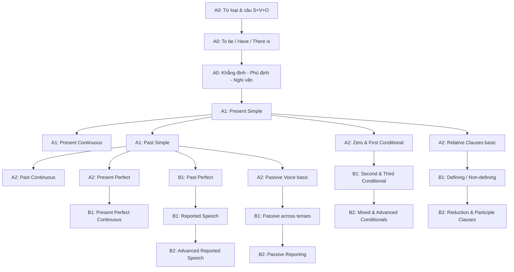

# 🗺️ Curriculum Map — Bản đồ toàn bộ chương trình A0 → B2

> Đây là **bản đồ gốc** của toàn bộ giáo trình *English Mastery: From Zero to B2*. Mọi Lesson ID, tên file và thứ tự học đều được quy định ở đây. Khi bạn không biết "mình đang ở đâu" hay "học gì tiếp theo", hãy quay lại trang này.

## Mục lục

1. [Cách đọc bản đồ](#1-cách-đọc-bản-đồ)
2. [Mục tiêu đầu ra theo CEFR](#2-mục-tiêu-đầu-ra-theo-cefr-can-do-statements)
3. [Sơ đồ kiến thức tiên quyết](#3-sơ-đồ-kiến-thức-tiên-quyết)
4. [A0 Foundation](#4-a0-foundation--nền-móng)
5. [A1 Beginner](#5-a1-beginner)
6. [A2 Elementary](#6-a2-elementary)
7. [B1 Intermediate](#7-b1-intermediate)
8. [B2 Upper-Intermediate](#8-b2-upper-intermediate)
9. [Ma trận bao phủ kỹ năng](#9-ma-trận-bao-phủ-kỹ-năng-skill-coverage-matrix)
10. [Đối chiếu với danh sách tối thiểu & phần bổ sung](#10-đối-chiếu-phạm-vi-tối-thiểu-và-phần-bổ-sung)

---

## 1. Cách đọc bản đồ

| Ký hiệu | Ý nghĩa |
|---|---|
| **A0-G001** | Lesson ID: `Cấp độ` - `G` (Grammar) + số thứ tự. ID là duy nhất trong toàn hệ thống. |
| **Prerequisites** | Những bài **bắt buộc** đã học trước. Nếu chưa học, bạn sẽ gặp thuật ngữ chưa được giải thích. |
| **Time** | Thời gian ước tính cho một lượt học đầy đủ (đọc + làm bài + chữa bài), chưa tính ôn tập. |
| **Answers** | Mỗi bài có file đáp án riêng trong [`12-ANSWERS-AND-EXPLANATIONS/`](../12-ANSWERS-AND-EXPLANATIONS/README.md). |

Quy ước tên file:

```text
<thư mục cấp độ>/grammar/<Lesson-ID>-<tên-chủ-đề>.md
12-ANSWERS-AND-EXPLANATIONS/<cấp độ>/<Lesson-ID>-ANSWERS.md
```

---

## 2. Mục tiêu đầu ra theo CEFR (Can-do statements)

CEFR (Common European Framework of Reference — Khung tham chiếu chung châu Âu) mô tả năng lực bằng những việc người học **làm được**, không phải bằng số bài đã học. Bảng dưới là mục tiêu của chương trình này (diễn giải ngắn gọn từ mô tả CEFR, không phải trích nguyên văn).

| Cấp độ | Milestone | Nghe | Nói | Đọc | Viết |
|---|---|---|---|---|---|
| **A0** | 🧱 Foundation Builder | Nhận ra chữ cái, số, từ quen thuộc khi nói chậm | Giới thiệu tên, tuổi, quê quán bằng câu rất ngắn | Đọc được câu 3–6 từ | Viết đúng câu S + V + O/C đơn giản |
| **A1** | 💬 Basic Communicator | Hiểu câu hỏi đơn giản về bản thân, gia đình khi nói chậm, rõ | Hỏi – đáp về thói quen, sở thích, nơi chốn | Hiểu biển báo, tin nhắn, đoạn văn 60–100 từ | Viết đoạn ngắn về bản thân, tin nhắn đơn giản |
| **A2** | 🗣️ Independent Speaker (giai đoạn đầu) | Nắm ý chính của hội thoại hằng ngày, thông báo ngắn | Kể lại trải nghiệm, mô tả kế hoạch, mua bán, hỏi đường | Đọc email, quảng cáo, câu chuyện ngắn 150–250 từ | Viết email cá nhân, kể chuyện 80–120 từ |
| **B1** | 🌟 Confident Communicator | Hiểu ý chính của bài nói rõ ràng về chủ đề quen thuộc, tin tức đơn giản | Diễn đạt quan điểm, giải thích lý do, kể chuyện có trình tự | Hiểu bài báo đơn giản, bài viết có lập luận cơ bản 300–500 từ | Viết thư/email, đoạn văn nghị luận 150–200 từ |
| **B2** | 🏆 B2 Ready | Theo dõi bài giảng, thảo luận dài, nhận ra quan điểm và thái độ người nói | Thảo luận, phản biện, so sánh ưu – nhược điểm, nói liên tục 2–3 phút | Đọc bài nghị luận, bài báo, suy luận ý ẩn 500–800 từ | Viết bài luận 250+ từ có lập luận chặt chẽ, email trang trọng |

> 💡 **Quan trọng:** Bạn chỉ chuyển cấp khi **đạt bài kiểm tra cuối cấp** (Exit Test) trong [`11-EXAMS-AND-ASSESSMENTS/`](../11-EXAMS-AND-ASSESSMENTS/README.md), không phải khi đọc xong các bài.

---

## 3. Sơ đồ kiến thức tiên quyết

Sơ đồ dưới cho thấy "xương sống" của ngữ pháp tiếng Anh: mọi thì (tense) và cấu trúc phức tạp đều dựa trên vài nền móng.



---

## 4. A0 Foundation — Nền móng

Thư mục: [`01-A0-FOUNDATION/`](../01-A0-FOUNDATION/README.md) · Bài thi cuối cấp: [A0 Exit Test](../11-EXAMS-AND-ASSESSMENTS/A0-EXIT-TEST.md)

| ID | Topic (English) | Tên tiếng Việt | Prerequisites | Time |
|---|---|---|---|---|
| [A0-G001](../01-A0-FOUNDATION/grammar/A0-G001-alphabet.md) | The English Alphabet | Bảng chữ cái và cách đọc tên chữ | — | 60' |
| [A0-G002](../01-A0-FOUNDATION/grammar/A0-G002-phonics-basics.md) | Basic Phonics | Chữ viết và âm thanh | A0-G001 | 75' |
| [A0-G003](../01-A0-FOUNDATION/grammar/A0-G003-english-sounds-ipa.md) | English Sounds & IPA | Âm tiếng Anh và bảng phiên âm IPA | A0-G002 | 90' |
| [A0-G004](../01-A0-FOUNDATION/grammar/A0-G004-parts-of-speech.md) | Parts of Speech | Từ loại cơ bản | — | 60' |
| [A0-G005](../01-A0-FOUNDATION/grammar/A0-G005-nouns-verbs-adjectives-adverbs.md) | Nouns, Verbs, Adjectives, Adverbs | Danh từ, động từ, tính từ, trạng từ | A0-G004 | 90' |
| [A0-G006](../01-A0-FOUNDATION/grammar/A0-G006-subject-pronouns.md) | Subject Pronouns | Đại từ nhân xưng làm chủ ngữ | A0-G004 | 60' |
| [A0-G007](../01-A0-FOUNDATION/grammar/A0-G007-subject-verb-object.md) | Subject, Verb, Object | Chủ ngữ, động từ, tân ngữ | A0-G005, A0-G006 | 75' |
| [A0-G008](../01-A0-FOUNDATION/grammar/A0-G008-sentence-patterns.md) | Sentence Patterns S+V, S+V+O, S+V+C | Các mẫu câu cơ bản | A0-G007 | 90' |
| [A0-G009](../01-A0-FOUNDATION/grammar/A0-G009-verb-to-be.md) | The Verb *To Be* | Động từ To Be | A0-G008 | 90' |
| [A0-G010](../01-A0-FOUNDATION/grammar/A0-G010-have-has.md) | Have / Has | Động từ Have / Has | A0-G009 | 75' |
| [A0-G011](../01-A0-FOUNDATION/grammar/A0-G011-this-that-these-those.md) | This, That, These, Those | Từ chỉ định | A0-G009 | 60' |
| [A0-G012](../01-A0-FOUNDATION/grammar/A0-G012-articles-basic.md) | Articles A, An, The (basic) | Mạo từ cơ bản | A0-G005 | 75' |
| [A0-G013](../01-A0-FOUNDATION/grammar/A0-G013-singular-plural-nouns.md) | Singular & Plural Nouns | Danh từ số ít, số nhiều | A0-G012 | 75' |
| [A0-G014](../01-A0-FOUNDATION/grammar/A0-G014-countable-uncountable.md) | Countable & Uncountable Nouns | Danh từ đếm được và không đếm được | A0-G013 | 75' |
| [A0-G015](../01-A0-FOUNDATION/grammar/A0-G015-there-is-there-are.md) | There is / There are | Cấu trúc "có" (tồn tại) | A0-G009, A0-G014 | 75' |
| [A0-G016](../01-A0-FOUNDATION/grammar/A0-G016-sentence-types.md) | Affirmative, Negative, Interrogative | Câu khẳng định, phủ định, nghi vấn | A0-G009, A0-G010, A0-G015 | 90' |
| [A0-G017](../01-A0-FOUNDATION/grammar/A0-G017-question-words.md) | Question Words | Từ để hỏi cơ bản | A0-G016 | 75' |
| [A0-G018](../01-A0-FOUNDATION/grammar/A0-G018-numbers-dates-time-age.md) | Numbers, Dates, Time, Age | Số, ngày tháng, giờ, tuổi | A0-G009, A0-G017 | 90' |
| [A0-G019](../01-A0-FOUNDATION/grammar/A0-G019-likes-and-hobbies.md) | Talking about Likes & Hobbies | Nói về sở thích | A0-G010, A0-G016 | 75' |

Kỹ năng A0: [A0 Skills Practice](../01-A0-FOUNDATION/A0-SKILLS-PRACTICE.md)

---

## 5. A1 Beginner

Thư mục: [`02-A1-BEGINNER/`](../02-A1-BEGINNER/README.md) · Bài thi cuối cấp: [A1 Exit Test](../11-EXAMS-AND-ASSESSMENTS/A1-EXIT-TEST.md)

| ID | Topic (English) | Tên tiếng Việt | Prerequisites | Time |
|---|---|---|---|---|
| [A1-G001](../02-A1-BEGINNER/grammar/A1-G001-present-simple-affirmative.md) | Present Simple: Affirmative | Hiện tại đơn: câu khẳng định | A0-G016 | 90' |
| [A1-G002](../02-A1-BEGINNER/grammar/A1-G002-present-simple-negatives-questions.md) | Present Simple: Negatives & Questions | Hiện tại đơn: phủ định & nghi vấn | A1-G001 | 90' |
| [A1-G003](../02-A1-BEGINNER/grammar/A1-G003-adverbs-of-frequency.md) | Adverbs of Frequency | Trạng từ chỉ tần suất | A1-G002 | 60' |
| [A1-G004](../02-A1-BEGINNER/grammar/A1-G004-present-continuous.md) | Present Continuous | Hiện tại tiếp diễn | A1-G002 | 90' |
| [A1-G005](../02-A1-BEGINNER/grammar/A1-G005-present-simple-vs-continuous.md) | Present Simple vs Present Continuous | So sánh hai thì hiện tại | A1-G004 | 90' |
| [A1-G006](../02-A1-BEGINNER/grammar/A1-G006-possessives.md) | Possessive Adjectives, Pronouns & 's | Tính từ sở hữu, đại từ sở hữu, sở hữu cách | A0-G006 | 75' |
| [A1-G007](../02-A1-BEGINNER/grammar/A1-G007-object-pronouns.md) | Object Pronouns | Đại từ tân ngữ | A1-G006 | 60' |
| [A1-G008](../02-A1-BEGINNER/grammar/A1-G008-have-got.md) | Have Got | Cấu trúc Have got | A1-G002 | 60' |
| [A1-G009](../02-A1-BEGINNER/grammar/A1-G009-prepositions-of-place.md) | Prepositions of Place | Giới từ chỉ nơi chốn | A0-G015 | 75' |
| [A1-G010](../02-A1-BEGINNER/grammar/A1-G010-prepositions-of-time.md) | Prepositions of Time | Giới từ chỉ thời gian | A0-G018 | 75' |
| [A1-G011](../02-A1-BEGINNER/grammar/A1-G011-imperatives.md) | Imperatives | Câu mệnh lệnh | A1-G002 | 60' |
| [A1-G012](../02-A1-BEGINNER/grammar/A1-G012-can-cant.md) | Can / Can't | Khả năng với Can | A1-G002 | 75' |
| [A1-G013](../02-A1-BEGINNER/grammar/A1-G013-would-like.md) | Would Like | Lời mời, yêu cầu lịch sự | A1-G012 | 60' |
| [A1-G014](../02-A1-BEGINNER/grammar/A1-G014-some-any.md) | Some / Any | Some và Any | A0-G014 | 60' |
| [A1-G015](../02-A1-BEGINNER/grammar/A1-G015-much-many-a-lot-of.md) | Much / Many / A Lot Of | Lượng từ cơ bản | A1-G014 | 60' |
| [A1-G016](../02-A1-BEGINNER/grammar/A1-G016-past-simple-be.md) | Past Simple of *Be* (was/were) | Quá khứ của To Be | A0-G009 | 75' |
| [A1-G017](../02-A1-BEGINNER/grammar/A1-G017-past-simple-affirmative.md) | Past Simple: Regular & Irregular Verbs | Quá khứ đơn: câu khẳng định | A1-G016 | 90' |
| [A1-G018](../02-A1-BEGINNER/grammar/A1-G018-past-simple-negatives-questions.md) | Past Simple: Negatives & Questions | Quá khứ đơn: phủ định & nghi vấn | A1-G017 | 90' |
| [A1-G019](../02-A1-BEGINNER/grammar/A1-G019-future-will.md) | Future with *Will* | Tương lai với Will | A1-G002 | 75' |
| [A1-G020](../02-A1-BEGINNER/grammar/A1-G020-be-going-to.md) | Be Going To | Tương lai với Be going to | A1-G019 | 90' |
| [A1-G021](../02-A1-BEGINNER/grammar/A1-G021-basic-conjunctions.md) | Basic Conjunctions | Liên từ cơ bản and, but, or, so, because | A0-G008 | 60' |
| [A1-G022](../02-A1-BEGINNER/grammar/A1-G022-comparatives.md) | Comparative Adjectives | So sánh hơn | A0-G005 | 75' |
| [A1-G023](../02-A1-BEGINNER/grammar/A1-G023-superlatives.md) | Superlative Adjectives | So sánh nhất | A1-G022 | 75' |

Giao tiếp & kỹ năng A1: [A1 Communication](../02-A1-BEGINNER/A1-COMMUNICATION.md) · [A1 Skills Practice](../02-A1-BEGINNER/A1-SKILLS-PRACTICE.md)

---

## 6. A2 Elementary

**Thứ tự thực học điều chỉnh (2026-10-16):** G001–G010 → **G015** → G011–G014 → G016–G030. G011 đã yêu cầu G015 từ bản đồ gốc; học G015 sớm để không phải đoán dạng V-ing. Giữ nguyên Lesson ID và tên file. Tình trạng có/thiếu và kiểm định từng bài được ghi trong [CONTENT-AUDIT](../CONTENT-AUDIT.md), không suy ra hoàn thành từ một liên kết trong bảng.

Thư mục: [`03-A2-ELEMENTARY/`](../03-A2-ELEMENTARY/README.md) · Bài thi cuối cấp: [A2 Exit Test](../11-EXAMS-AND-ASSESSMENTS/A2-EXIT-TEST.md)

| ID | Topic (English) | Tên tiếng Việt | Prerequisites | Time |
|---|---|---|---|---|
| [A2-G001](../03-A2-ELEMENTARY/grammar/A2-G001-past-continuous.md) | Past Continuous | Quá khứ tiếp diễn | A1-G018, A1-G004 | 90' |
| [A2-G002](../03-A2-ELEMENTARY/grammar/A2-G002-past-simple-vs-past-continuous.md) | Past Simple vs Past Continuous (when/while) | Quá khứ đơn và quá khứ tiếp diễn | A2-G001 | 90' |
| [A2-G003](../03-A2-ELEMENTARY/grammar/A2-G003-present-perfect-form.md) | Present Perfect: Introduction & Form | Hiện tại hoàn thành: khái niệm & công thức | A1-G018 | 90' |
| [A2-G004](../03-A2-ELEMENTARY/grammar/A2-G004-present-perfect-experience.md) | Present Perfect for Experience (ever, never, been/gone) | HTHT nói về trải nghiệm | A2-G003 | 75' |
| [A2-G005](../03-A2-ELEMENTARY/grammar/A2-G005-present-perfect-just-already-yet.md) | Present Perfect with Just, Already, Yet | HTHT với just, already, yet | A2-G003 | 75' |
| [A2-G006](../03-A2-ELEMENTARY/grammar/A2-G006-present-perfect-since-for.md) | Present Perfect with Since & For | HTHT với since và for | A2-G003 | 75' |
| [A2-G007](../03-A2-ELEMENTARY/grammar/A2-G007-present-perfect-vs-past-simple.md) | Present Perfect vs Past Simple | So sánh HTHT và quá khứ đơn | A2-G004–G006 | 90' |
| [A2-G008](../03-A2-ELEMENTARY/grammar/A2-G008-present-continuous-future.md) | Present Continuous for Future Arrangements | Hiện tại tiếp diễn chỉ kế hoạch đã sắp xếp | A1-G020 | 75' |
| [A2-G009](../03-A2-ELEMENTARY/grammar/A2-G009-might-may-possibility.md) | Might / May for Possibility | Diễn tả khả năng xảy ra | A1-G019 | 60' |
| [A2-G010](../03-A2-ELEMENTARY/grammar/A2-G010-used-to.md) | Used To | Thói quen trong quá khứ | A1-G018 | 75' |
| [A2-G011](../03-A2-ELEMENTARY/grammar/A2-G011-be-used-to-get-used-to.md) | Be Used To / Get Used To (introduction) | Quen với / dần quen với | A2-G010, A2-G015 | 75' |
| [A2-G012](../03-A2-ELEMENTARY/grammar/A2-G012-must-have-to.md) | Obligation: Must / Have To / Don't Have To | Nghĩa vụ và sự cần thiết | A1-G012 | 90' |
| [A2-G013](../03-A2-ELEMENTARY/grammar/A2-G013-permission-can-could-may.md) | Permission & Requests: Can / Could / May | Xin phép và yêu cầu | A1-G012 | 60' |
| [A2-G014](../03-A2-ELEMENTARY/grammar/A2-G014-should-ought-to.md) | Advice: Should / Ought To | Lời khuyên | A2-G012 | 60' |
| [A2-G015](../03-A2-ELEMENTARY/grammar/A2-G015-gerunds-infinitives-basic.md) | Gerunds & Infinitives (basic) | Danh động từ và động từ nguyên mẫu | A0-G019, A1-G002, A1-G004 | 90' |
| [A2-G016](../03-A2-ELEMENTARY/grammar/A2-G016-zero-conditional.md) | Zero Conditional | Câu điều kiện loại 0 | A1-G002 | 60' |
| [A2-G017](../03-A2-ELEMENTARY/grammar/A2-G017-first-conditional.md) | First Conditional | Câu điều kiện loại 1 | A2-G016, A1-G019 | 90' |
| [A2-G018](../03-A2-ELEMENTARY/grammar/A2-G018-relative-clauses-basic.md) | Relative Clauses (basic) | Mệnh đề quan hệ cơ bản | A1-G007 | 90' |
| [A2-G019](../03-A2-ELEMENTARY/grammar/A2-G019-passive-voice-basic.md) | Passive Voice (basic) | Câu bị động cơ bản | A1-G017, A0-G007, A2-G003 | 90' |
| [A2-G020](../03-A2-ELEMENTARY/grammar/A2-G020-question-tags.md) | Question Tags (basic) | Câu hỏi đuôi | A1-G018 | 75' |
| [A2-G021](../03-A2-ELEMENTARY/grammar/A2-G021-adjective-order.md) | Adjective Order | Trật tự tính từ | A0-G005, A0-G012 | 60' |
| [A2-G022](../03-A2-ELEMENTARY/grammar/A2-G022-adverbs-of-manner.md) | Adverbs of Manner | Trạng từ chỉ cách thức | A0-G005, A2-G021 | 60' |
| [A2-G023](../03-A2-ELEMENTARY/grammar/A2-G023-ed-ing-adjectives.md) | -ed and -ing Adjectives | Tính từ đuôi -ed và -ing | A2-G022, A0-G009 | 60' |
| [A2-G024](../03-A2-ELEMENTARY/grammar/A2-G024-quantifiers.md) | Quantifiers | Lượng từ (a few, a little, few, little, no, none...) | A1-G015 | 75' |
| [A2-G025](../03-A2-ELEMENTARY/grammar/A2-G025-too-enough.md) | Too & Enough | Quá và đủ | A2-G015, A2-G024, A2-G022 | 60' |
| [A2-G026](../03-A2-ELEMENTARY/grammar/A2-G026-articles-advanced.md) | Articles (developing) | Mạo từ nâng cao hơn | A0-G012, A2-G024 | 90' |
| [A2-G027](../03-A2-ELEMENTARY/grammar/A2-G027-comparisons.md) | Comparisons: as...as, the same as, different from | Các cấu trúc so sánh | A1-G022, A1-G023, A2-G022 | 75' |
| [A2-G028](../03-A2-ELEMENTARY/grammar/A2-G028-indirect-questions.md) | Indirect Questions (basic) | Câu hỏi gián tiếp | A0-G017, A1-G018 | 75' |
| [A2-G029](../03-A2-ELEMENTARY/grammar/A2-G029-subject-object-questions.md) | Subject & Object Questions | Câu hỏi chủ ngữ và tân ngữ | A0-G007, A0-G017, A1-G018 | 60' |
| [A2-G030](../03-A2-ELEMENTARY/grammar/A2-G030-reflexive-pronouns.md) | Reflexive Pronouns | Đại từ phản thân | A1-G007, A0-G007 | 60' |

Giao tiếp & kỹ năng A2: [A2 Communication](../03-A2-ELEMENTARY/A2-COMMUNICATION.md) · [A2 Skills Practice](../03-A2-ELEMENTARY/A2-SKILLS-PRACTICE.md)

---

## 7. B1 Intermediate

Thư mục: [`04-B1-INTERMEDIATE/`](../04-B1-INTERMEDIATE/README.md) · Bài thi cuối cấp: [B1 Exit Test](../11-EXAMS-AND-ASSESSMENTS/B1-EXIT-TEST.md)

| ID | Topic (English) | Tên tiếng Việt | Prerequisites | Time |
|---|---|---|---|---|
| [B1-G001](../04-B1-INTERMEDIATE/grammar/B1-G001-present-perfect-continuous.md) | Present Perfect Continuous | Hiện tại hoàn thành tiếp diễn | A2-G007 | 90' |
| [B1-G002](../04-B1-INTERMEDIATE/grammar/B1-G002-past-perfect.md) | Past Perfect | Quá khứ hoàn thành | A2-G002, A2-G003 | 90' |
| [B1-G003](../04-B1-INTERMEDIATE/grammar/B1-G003-past-perfect-continuous.md) | Past Perfect Continuous | Quá khứ hoàn thành tiếp diễn | B1-G001, B1-G002 | 75' |
| [B1-G004](../04-B1-INTERMEDIATE/grammar/B1-G004-narrative-tenses.md) | Narrative Tenses | Các thì dùng khi kể chuyện | B1-G003 | 90' |
| [B1-G005](../04-B1-INTERMEDIATE/grammar/B1-G005-future-continuous.md) | Future Continuous | Tương lai tiếp diễn | A2-G008 | 75' |
| [B1-G006](../04-B1-INTERMEDIATE/grammar/B1-G006-future-perfect.md) | Future Perfect | Tương lai hoàn thành | B1-G005 | 75' |
| [B1-G007](../04-B1-INTERMEDIATE/grammar/B1-G007-second-conditional.md) | Second Conditional | Câu điều kiện loại 2 | A2-G017 | 90' |
| [B1-G008](../04-B1-INTERMEDIATE/grammar/B1-G008-third-conditional.md) | Third Conditional | Câu điều kiện loại 3 | B1-G007, B1-G002 | 90' |
| [B1-G009](../04-B1-INTERMEDIATE/grammar/B1-G009-wish-if-only.md) | Wish / If Only | Câu ước | B1-G008 | 90' |
| [B1-G010](../04-B1-INTERMEDIATE/grammar/B1-G010-reported-statements.md) | Reported Speech: Statements | Câu tường thuật: câu kể | B1-G002 | 90' |
| [B1-G011](../04-B1-INTERMEDIATE/grammar/B1-G011-reported-questions-commands.md) | Reported Questions, Requests & Commands | Tường thuật câu hỏi và mệnh lệnh | B1-G010, A2-G028 | 90' |
| [B1-G012](../04-B1-INTERMEDIATE/grammar/B1-G012-passive-all-tenses.md) | Passive Voice across Tenses | Bị động ở các thì | A2-G019, B1-G001 | 90' |
| [B1-G013](../04-B1-INTERMEDIATE/grammar/B1-G013-defining-non-defining-relatives.md) | Defining & Non-defining Relative Clauses | Mệnh đề quan hệ xác định và không xác định | A2-G018 | 90' |
| [B1-G014](../04-B1-INTERMEDIATE/grammar/B1-G014-modals-deduction-present.md) | Modal Verbs of Deduction (present) | Động từ khuyết thiếu chỉ suy luận (hiện tại) | A2-G009, A2-G012 | 75' |
| [B1-G015](../04-B1-INTERMEDIATE/grammar/B1-G015-modal-perfects.md) | Must have / Might have / Could have / Should have | Động từ khuyết thiếu + have + V3 | B1-G014 | 90' |
| [B1-G016](../04-B1-INTERMEDIATE/grammar/B1-G016-gerund-vs-infinitive.md) | Gerund vs Infinitive (meaning change) | Danh động từ và nguyên mẫu đổi nghĩa | A2-G015 | 90' |
| [B1-G017](../04-B1-INTERMEDIATE/grammar/B1-G017-causative-have-get.md) | Causative Have / Get | Thể nhờ bảo | B1-G012 | 75' |
| [B1-G018](../04-B1-INTERMEDIATE/grammar/B1-G018-linking-words.md) | Linking Words | Từ nối | A1-G021 | 90' |
| [B1-G019](../04-B1-INTERMEDIATE/grammar/B1-G019-complex-sentences.md) | Conjunctions & Complex Sentences | Liên từ và câu phức | B1-G018 | 90' |
| [B1-G020](../04-B1-INTERMEDIATE/grammar/B1-G020-phrasal-verbs.md) | Phrasal Verbs (grammar) | Cụm động từ | A1-G007 | 90' |
| [B1-G021](../04-B1-INTERMEDIATE/grammar/B1-G021-verb-patterns.md) | Verb Patterns | Các mẫu động từ | B1-G016 | 90' |
| [B1-G022](../04-B1-INTERMEDIATE/grammar/B1-G022-comparison-structures.md) | Comparison Structures (advanced) | Cấu trúc so sánh mở rộng | A2-G027 | 75' |
| [B1-G023](../04-B1-INTERMEDIATE/grammar/B1-G023-adverbial-clauses.md) | Adverbial Clauses | Mệnh đề trạng ngữ | B1-G019 | 90' |
| [B1-G024](../04-B1-INTERMEDIATE/grammar/B1-G024-so-such.md) | So / Such ... That | Quá... đến nỗi | A2-G025 | 60' |
| [B1-G025](../04-B1-INTERMEDIATE/grammar/B1-G025-both-either-neither-each-every.md) | Both, Either, Neither, Each, Every | Các từ chỉ định lượng hai/mỗi | A2-G024 | 75' |
| [B1-G026](../04-B1-INTERMEDIATE/grammar/B1-G026-expressing-opinions.md) | Expressing Opinions & Arguments | Diễn đạt quan điểm và lập luận | B1-G018 | 90' |

Kỹ năng B1: [B1 Skills Practice](../04-B1-INTERMEDIATE/B1-SKILLS-PRACTICE.md)

---

## 8. B2 Upper-Intermediate

Thư mục: [`05-B2-UPPER-INTERMEDIATE/`](../05-B2-UPPER-INTERMEDIATE/README.md) · Đề mô phỏng: [B2 Mock Tests](../11-EXAMS-AND-ASSESSMENTS/B2-MOCK-TEST-1.md)

| ID | Topic (English) | Tên tiếng Việt | Prerequisites | Time |
|---|---|---|---|---|
| [B2-G001](../05-B2-UPPER-INTERMEDIATE/grammar/B2-G001-mixed-conditionals.md) | Mixed Conditionals | Câu điều kiện hỗn hợp | B1-G008 | 90' |
| [B2-G002](../05-B2-UPPER-INTERMEDIATE/grammar/B2-G002-advanced-conditionals.md) | Advanced Conditional Structures | Điều kiện nâng cao (đảo ngữ, but for, otherwise) | B2-G001 | 90' |
| [B2-G003](../05-B2-UPPER-INTERMEDIATE/grammar/B2-G003-unless-provided-in-case.md) | Unless, Provided That, As Long As, In Case | Các liên từ điều kiện | A2-G017 | 75' |
| [B2-G004](../05-B2-UPPER-INTERMEDIATE/grammar/B2-G004-advanced-passive.md) | Advanced Passive Voice | Bị động nâng cao | B1-G012 | 90' |
| [B2-G005](../05-B2-UPPER-INTERMEDIATE/grammar/B2-G005-passive-reporting.md) | Passive Reporting Structures | Bị động tường thuật | B2-G004, B2-G013 | 90' |
| [B2-G006](../05-B2-UPPER-INTERMEDIATE/grammar/B2-G006-advanced-reported-speech.md) | Advanced Reported Speech (reporting verbs) | Tường thuật nâng cao với động từ tường thuật | B1-G011 | 90' |
| [B2-G007](../05-B2-UPPER-INTERMEDIATE/grammar/B2-G007-relative-clause-reduction.md) | Reduced Relative Clauses | Rút gọn mệnh đề quan hệ | B1-G013 | 90' |
| [B2-G008](../05-B2-UPPER-INTERMEDIATE/grammar/B2-G008-participle-clauses.md) | Participle Clauses | Mệnh đề phân từ | B2-G007 | 90' |
| [B2-G009](../05-B2-UPPER-INTERMEDIATE/grammar/B2-G009-inversion.md) | Inversion | Đảo ngữ | B1-G019 | 90' |
| [B2-G010](../05-B2-UPPER-INTERMEDIATE/grammar/B2-G010-cleft-sentences-emphasis.md) | Emphasis & Cleft Sentences | Câu chẻ và nhấn mạnh | B1-G013 | 75' |
| [B2-G011](../05-B2-UPPER-INTERMEDIATE/grammar/B2-G011-advanced-modals.md) | Advanced Modal Verbs | Động từ khuyết thiếu nâng cao | B1-G015 | 90' |
| [B2-G012](../05-B2-UPPER-INTERMEDIATE/grammar/B2-G012-future-perfect-continuous.md) | Future Perfect Continuous & Future in the Past | Tương lai hoàn thành tiếp diễn & tương lai trong quá khứ | B1-G006 | 75' |
| [B2-G013](../05-B2-UPPER-INTERMEDIATE/grammar/B2-G013-perfect-infinitives-gerunds.md) | Perfect Infinitives & Perfect Gerunds | Nguyên mẫu hoàn thành, danh động từ hoàn thành | B1-G016 | 75' |
| [B2-G014](../05-B2-UPPER-INTERMEDIATE/grammar/B2-G014-advanced-gerund-infinitive.md) | Advanced Gerund & Infinitive Patterns | Mẫu danh động từ/nguyên mẫu nâng cao | B2-G013 | 90' |
| [B2-G015](../05-B2-UPPER-INTERMEDIATE/grammar/B2-G015-subjunctive.md) | Subjunctive & Formal Recommendations | Thức giả định | B1-G021 | 75' |
| [B2-G016](../05-B2-UPPER-INTERMEDIATE/grammar/B2-G016-unreal-past-would-rather.md) | Unreal Past: Would Rather, It's Time, As If | Quá khứ giả định | B1-G009 | 75' |
| [B2-G017](../05-B2-UPPER-INTERMEDIATE/grammar/B2-G017-advanced-linking-devices.md) | Advanced Linking Devices | Phương tiện liên kết nâng cao | B1-G018 | 75' |
| [B2-G018](../05-B2-UPPER-INTERMEDIATE/grammar/B2-G018-contrast-concession.md) | Contrast & Concession | Tương phản và nhượng bộ | B2-G017 | 90' |
| [B2-G019](../05-B2-UPPER-INTERMEDIATE/grammar/B2-G019-purpose-result-reason.md) | Purpose, Result & Reason | Mục đích, kết quả, lý do | B2-G017 | 90' |
| [B2-G020](../05-B2-UPPER-INTERMEDIATE/grammar/B2-G020-complex-noun-phrases.md) | Complex Noun Phrases | Cụm danh từ phức | B2-G007 | 75' |
| [B2-G021](../05-B2-UPPER-INTERMEDIATE/grammar/B2-G021-nominalisation.md) | Nominalisation | Danh từ hóa | B2-G020 | 75' |
| [B2-G022](../05-B2-UPPER-INTERMEDIATE/grammar/B2-G022-subject-verb-agreement.md) | Advanced Subject–Verb Agreement | Hòa hợp chủ ngữ – động từ nâng cao | B2-G020 | 75' |
| [B2-G023](../05-B2-UPPER-INTERMEDIATE/grammar/B2-G023-ellipsis-substitution.md) | Ellipsis & Substitution | Tỉnh lược và thay thế | A2-G020 | 75' |
| [B2-G024](../05-B2-UPPER-INTERMEDIATE/grammar/B2-G024-parallel-structures.md) | Parallel Structures | Cấu trúc song song | B1-G016 | 60' |
| [B2-G025](../05-B2-UPPER-INTERMEDIATE/grammar/B2-G025-hedging-academic-language.md) | Hedging & Academic Language | Rào đón và ngôn ngữ học thuật | B2-G011 | 75' |
| [B2-G026](../05-B2-UPPER-INTERMEDIATE/grammar/B2-G026-collocations.md) | Common Collocations | Kết hợp từ thông dụng | — | 75' |
| [B2-G027](../05-B2-UPPER-INTERMEDIATE/grammar/B2-G027-discourse-markers.md) | Discourse Markers | Dấu hiệu diễn ngôn | B2-G017 | 75' |
| [B2-G028](../05-B2-UPPER-INTERMEDIATE/grammar/B2-G028-formal-informal.md) | Formal vs Informal English | Văn phong trang trọng và thân mật | B2-G027 | 75' |
| [B2-G029](../05-B2-UPPER-INTERMEDIATE/grammar/B2-G029-sentence-transformation.md) | Advanced Sentence Transformation | Biến đổi câu nâng cao | toàn bộ B2-G001–G028 | 120' |
| [B2-G030](../05-B2-UPPER-INTERMEDIATE/grammar/B2-G030-argumentation.md) | Argumentation & Critical Thinking | Lập luận và tư duy phản biện | B2-G018, B2-G025 | 90' |

Kỹ năng B2: [B2 Skills Practice](../05-B2-UPPER-INTERMEDIATE/B2-SKILLS-PRACTICE.md)

---

## 9. Ma trận bao phủ kỹ năng (Skill Coverage Matrix)

| Mảng | A0 | A1 | A2 | B1 | B2 | Vị trí chính |
|---|---|---|---|---|---|---|
| Grammar | 19 bài | 23 bài | 30 bài | 26 bài | 30 bài | `01`–`05/grammar/` |
| Vocabulary | Daily Life, Family | + Food, Shopping, Travel | + Work, Health, Tech | + Environment, Society, Media | + Science, Business, Culture, Collocations | [`07-VOCABULARY/`](../07-VOCABULARY/README.md) |
| Pronunciation | Alphabet, phonics, IPA | Vowels/consonants, minimal pairs | Word stress, linking | Sentence stress, weak forms | Intonation, connected speech | [`08-PRONUNCIATION/`](../08-PRONUNCIATION/README.md) |
| Listening | Từ, số | Câu, hội thoại ngắn | Ý chính, chi tiết | Paraphrase, note completion | Bài nói dài, dạng VSTEP | [`09-FOUR-SKILLS/Listening/`](../09-FOUR-SKILLS/Listening/README.md) |
| Speaking | Giới thiệu bản thân | Hỏi – đáp hằng ngày | Mô tả, kể chuyện | Quan điểm, giải thích | Thảo luận, VSTEP Part 1–3 | [`09-FOUR-SKILLS/Speaking/`](../09-FOUR-SKILLS/Speaking/README.md) |
| Reading | Câu ngắn | Đoạn 60–100 từ | Bài 150–250 từ | Bài 300–500 từ | Bài 500–800 từ, suy luận | [`09-FOUR-SKILLS/Reading/`](../09-FOUR-SKILLS/Reading/README.md) |
| Writing | Từ → câu | Câu → đoạn ngắn | Đoạn, email cá nhân | Email, đoạn nghị luận | Essay 250+ từ, VSTEP Task 1–2 | [`09-FOUR-SKILLS/Writing/`](../09-FOUR-SKILLS/Writing/README.md) |
| Review | Daily drills | Weekly review | Mixed exercises | Error correction, transformation | Monthly review, mock tests | [`10-PRACTICE-LAB/`](../10-PRACTICE-LAB/README.md) |

---

## 10. Đối chiếu phạm vi tối thiểu và phần bổ sung

Tất cả chủ điểm trong danh sách tối thiểu của dự án đều có bài riêng hoặc được dạy trong một bài cụ thể:

| Yêu cầu tối thiểu | Được dạy tại |
|---|---|
| Alphabet, phonics, sounds & IPA | A0-G001, A0-G002, A0-G003 |
| Từ loại; danh/động/tính/trạng từ | A0-G004, A0-G005 |
| Chủ ngữ, động từ, tân ngữ; S+V, S+V+O, S+V+C | A0-G007, A0-G008 |
| Câu khẳng định, phủ định, nghi vấn | A0-G016 |
| Ngày tháng, thời gian, tuổi tác, sở thích | A0-G018, A0-G019 |
| Present Perfect vs Past Simple | A2-G007 |
| Modal verbs: obligation, permission, advice | A2-G012, A2-G013, A2-G014 |
| Must have / Might have / Could have / Should have | B1-G015 |
| Unless, Provided That, As Long As, In Case | B2-G003 |
| Contrast, Concession, Purpose, Result & Reason | B2-G018, B2-G019 |
| Common Collocations | B2-G026 (ngữ pháp kết hợp từ) + [VOC-17](../07-VOCABULARY/VOC-17-common-collocations.md) (danh sách theo chủ đề) |
| Các tình huống giao tiếp A1/A2 | [A1-COMMUNICATION](../02-A1-BEGINNER/A1-COMMUNICATION.md), [A2-COMMUNICATION](../03-A2-ELEMENTARY/A2-COMMUNICATION.md) |
| Kỹ năng B1 | [B1-SKILLS-PRACTICE](../04-B1-INTERMEDIATE/B1-SKILLS-PRACTICE.md) |

**Phần bổ sung sau khi đối chiếu CEFR** (không có trong danh sách tối thiểu nhưng cần cho A0–B2):

| Bổ sung | Lý do |
|---|---|
| A2-G009 Might/May (possibility) | Cấu trúc A2 cốt lõi, là nền cho modal of deduction ở B1 |
| A2-G022 Adverbs of Manner, A2-G023 -ed/-ing adjectives | Lỗi "I am boring" rất phổ biến ở người Việt; CEFR A2 |
| A2-G025 Too/Enough, A2-G029 Subject/Object Questions, A2-G030 Reflexive Pronouns | Nội dung chuẩn A2 trong các giáo trình theo CEFR |
| B1-G004 Narrative Tenses | Cần để kể chuyện mạch lạc — kỹ năng nói/viết B1 |
| B1-G024 So/Such...that, B1-G025 Both/Either/Neither/Each/Every | Cấu trúc B1 xuất hiện thường xuyên trong đề VSTEP |
| B2-G012 Future in the Past (was going to, would) | Đi kèm reported speech & narrative ở B2 |
| B2-G016 Unreal Past (would rather, it's time, as if) | Cấu trúc B2 hay gặp trong biến đổi câu |
