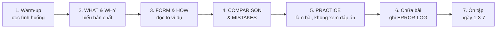

# 📘 How to Learn — Học bộ giáo trình này như thế nào cho hiệu quả?

> Đọc trang này **một lần thật kỹ** trước khi bắt đầu, và đọc lại mỗi khi bạn cảm thấy "học mãi không vào".

## Mục lục

1. [Vì sao người Việt hay "học mãi vẫn mất gốc"?](#1-vì-sao-người-việt-hay-học-mãi-vẫn-mất-gốc)
2. [Chu trình học một bài ngữ pháp (7 bước)](#2-chu-trình-học-một-bài-ngữ-pháp-7-bước)
3. [Cách làm bài tập và dùng đáp án](#3-cách-làm-bài-tập-và-dùng-đáp-án)
4. [Cách học từ vựng](#4-cách-học-từ-vựng)
5. [Cách luyện bốn kỹ năng](#5-cách-luyện-bốn-kỹ-năng)
6. [Tự tạo audio từ transcript](#6-tự-tạo-audio-từ-transcript)
7. [Một buổi học mẫu 60 phút](#7-một-buổi-học-mẫu-60-phút)
8. [Công cụ đọc tài liệu](#8-công-cụ-đọc-tài-liệu)

---

## 1. Vì sao người Việt hay "học mãi vẫn mất gốc"?

| Thói quen cũ | Hậu quả | Cách bộ tài liệu này thay đổi |
|---|---|---|
| Học thuộc công thức *S + V(s/es)* mà không hiểu vì sao | Gặp câu hơi khác là không biết dùng | Mỗi bài có phần **WHY** giải thích bản chất |
| Chỉ làm trắc nghiệm | Nhận ra đáp án đúng nhưng không tự viết/nói được | Bài tập 5 cấp, kết thúc bằng **Production** và **Real Communication** |
| Học từng chủ điểm riêng lẻ | Biết thì hiện tại đơn khi làm bài "hiện tại đơn", nhưng lẫn lộn khi gặp bài tổng hợp | **Mixed exercises** và bài ôn không ghi tên cấu trúc |
| Dịch từng từ từ tiếng Việt | *I very like it*, *She is go to school* | Phần **COMMON MISTAKES** chỉ rõ lỗi do ảnh hưởng tiếng Việt |
| Không ôn tập | Quên 70–80% sau vài tuần | Lịch ôn **1–3–7–14–30 ngày** |
| Sợ nói sai nên không nói | Nghe hiểu nhưng không phản xạ | Shadowing và Speaking challenges ngay từ A0 |

> 🧠 **Thay đổi tư duy quan trọng nhất:** Ngữ pháp không phải là "luật để thi", mà là **cách người bản ngữ tổ chức ý nghĩa**. Khi bạn hiểu ý nghĩa, bạn sẽ tự suy ra được công thức.

---

## 2. Chu trình học một bài ngữ pháp (7 bước)

**Bước 1 — Warm-up (5 phút):** Đọc tình huống và tự trả lời câu hỏi dẫn dắt *trước* khi đọc tiếp. Đoán sai cũng không sao — việc đoán giúp não chuẩn bị "chỗ trống" cho kiến thức mới.

**Bước 2 — WHAT & WHY (10 phút):** Đọc chậm. Sau mỗi phần, gập màn hình lại và tự giải thích bằng lời của bạn: *"Cấu trúc này dùng khi..., vì..."*. Nếu không giải thích được, đọc lại.

**Bước 3 — FORM & HOW (15 phút):** Đọc **to** mọi ví dụ tiếng Anh. Chép tay ít nhất 3 ví dụ bạn thích nhất vào sổ.

**Bước 4 — COMPARISON & MISTAKES (10 phút):** Đây là phần quan trọng nhất với người học lâu năm nhưng vẫn sai. Hãy đánh dấu những lỗi **bạn từng mắc**.

**Bước 5 — PRACTICE (20–30 phút):** Làm theo thứ tự Level 1 → 5. Viết đáp án ra giấy/file riêng. **Không mở file đáp án giữa chừng.**

**Bước 6 — Chữa bài (10–15 phút):** Mở file đáp án, chấm từng câu. Với câu sai, đọc kỹ giải thích và ghi vào [ERROR-LOG](../13-LEARNING-TRACKER/ERROR-LOG.md).

**Bước 7 — Ôn tập:** Làm phần *Knowledge Check* sau 1 ngày, 3 ngày, 7 ngày. Ghi lịch vào [SPACED-REPETITION](../13-LEARNING-TRACKER/SPACED-REPETITION.md).

> ✅ **Tiêu chí "đã học xong một bài":** Đúng ≥ 80% Level 1–3, hoàn thành Level 4–5 và tự chấm đạt các tiêu chí trong đáp án mẫu.

---

## 3. Cách làm bài tập và dùng đáp án

### 3.1. Năm cấp độ bài tập

| Level | Tên | Mục đích | Mẹo |
|---|---|---|---|
| 1 | Recognition | Nhận diện đúng/sai | Đừng chỉ chọn đáp án — nói lý do |
| 2 | Controlled Practice | Điền, chia động từ | Đọc cả câu trước khi điền |
| 3 | Error Correction | Tìm và sửa lỗi | Gạch chân lỗi, viết lại **cả câu** |
| 4 | Production | Dịch, viết câu của riêng bạn | Dịch **ý**, không dịch từng chữ |
| 5 | Real Communication | Viết đoạn ngắn, nói theo tình huống | Ghi âm phần nói, nghe lại |

### 3.2. Ký hiệu số câu

Câu hỏi được đánh số theo dạng **L2.4** = Level 2, câu 4. File đáp án dùng đúng ký hiệu này, nên bạn chỉ cần tìm đúng mã câu.

### 3.3. Với câu hỏi mở

Đáp án cho câu mở là **đáp án mẫu** kèm **tiêu chí tự chấm**. Câu của bạn có thể khác hoàn toàn nhưng vẫn đúng. Hãy tự kiểm tra theo tiêu chí:

- Có dùng đúng cấu trúc của bài không?
- Có đúng hòa hợp chủ ngữ – động từ không?
- Ý nghĩa có rõ ràng không?
- Một người nước ngoài đọc có hiểu không?

Nếu không chắc chắn, bạn có thể nhờ giáo viên hoặc dùng công cụ AI để **kiểm tra lỗi** — nhưng hãy tự sửa trước, rồi mới so sánh.

---

## 4. Cách học từ vựng

1. **Học từ trong cụm, không học từ đơn lẻ.** Thay vì *decision = quyết định*, hãy học *make a decision*, *a difficult decision*.
2. **Học 4 thông tin của một từ:** nghĩa – từ loại – phát âm (IPA, trọng âm) – cách kết hợp (collocation).
3. **Tự đặt câu về cuộc sống của bạn.** Câu có liên quan đến bản thân nhớ lâu hơn câu trong sách.
4. **Ôn bằng flashcard hai chiều:** Việt → Anh (khó hơn, hiệu quả hơn) và Anh → Việt.
5. **Mỗi ngày 8–15 từ mới** là đủ nếu bạn ôn đều. Học 50 từ/ngày mà không ôn thì sau một tuần gần như quên hết.

Chi tiết: [07-VOCABULARY/README.md](../07-VOCABULARY/README.md) và [VOCABULARY-TRACKER](../13-LEARNING-TRACKER/VOCABULARY-TRACKER.md).

---

## 5. Cách luyện bốn kỹ năng

| Kỹ năng | Hoạt động cốt lõi | Tần suất tối thiểu |
|---|---|---|
| **Listening** | Nghe không transcript → nghe có transcript → nghe lại không transcript | 3 lần/tuần |
| **Speaking** | Shadowing 5–10 phút + trả lời 1 câu hỏi bằng ghi âm | Hằng ngày |
| **Reading** | Đọc 1 bài theo trình độ, gạch chân từ mới, tóm tắt 2–3 câu | 3 lần/tuần |
| **Writing** | Viết 5 câu (A0–A1) → 1 đoạn (A2–B1) → 1 bài (B2), tự sửa theo checklist | 2–3 lần/tuần |

> 💬 **Về Speaking khi tự học:** Bạn không cần bạn nói chuyện để bắt đầu. Ghi âm câu trả lời của mình, nghe lại, so với câu mẫu, rồi ghi âm lần 2. Sự khác biệt giữa lần 1 và lần 2 chính là tiến bộ.

---

## 6. Tự tạo audio từ transcript

Bộ tài liệu **không chứa file âm thanh**. Mọi bài nghe đều có transcript. Bạn có thể tự tạo audio:

| Cách | Hướng dẫn |
|---|---|
| macOS | Bôi đen đoạn văn → chuột phải → *Speech* → *Start Speaking*; hoặc dùng lệnh Terminal `say -v Samantha "text"` (đổi giọng trong System Settings → Accessibility → Spoken Content). |
| Windows | Mở file trong Microsoft Edge → *Read aloud*; chọn giọng *English (United States)* hoặc *English (United Kingdom)*. |
| Điện thoại | Bật tính năng đọc màn hình/đọc văn bản (Select to Speak trên Android, Speak Selection trên iOS). |
| Công cụ trực tuyến | Các trang TTS miễn phí, hoặc Google Translate (dán câu tiếng Anh → bấm biểu tượng loa). |

**Lưu ý:** TTS đọc khá "chuẩn" và rõ — tốt cho người mới, nhưng thiếu tự nhiên. Từ A2 trở lên, hãy bổ sung nguồn nghe thật: podcast cho người học, tin tức tốc độ chậm, video có phụ đề. Danh sách gợi ý trong [Listening README](../09-FOUR-SKILLS/Listening/README.md).

---

## 7. Một buổi học mẫu 60 phút

| Phút | Hoạt động |
|---|---|
| 0–5 | Ôn nhanh: làm lại 5 câu Knowledge Check của bài học 3 ngày trước |
| 5–30 | Học bài ngữ pháp mới (Warm-up → HOW) |
| 30–45 | Làm bài tập Level 1–3 |
| 45–50 | Chữa bài, ghi ERROR-LOG |
| 50–60 | Shadowing 5 phút + học 8 từ vựng mới |

Ngày hôm sau: làm tiếp Level 4–5 của bài cũ trước khi học bài mới.

---

## 8. Công cụ đọc tài liệu

| Công cụ | Ưu điểm | Lưu ý |
|---|---|---|
| **VS Code** | Mở cả thư mục, tìm kiếm toàn bộ (Ctrl/Cmd + Shift + F) | Nhấn Ctrl/Cmd + Shift + V để xem preview; cài extension hỗ trợ Mermaid để xem sơ đồ |
| **Obsidian** | Đẹp, có graph view, tick checkbox trực tiếp | Mở thư mục `english-zero-to-b2` làm *vault* |
| **GitHub** | Đọc trên điện thoại, hiển thị Mermaid sẵn | Cần đẩy thư mục lên một repository |

Tiếp theo: [LEARNING-TECHNIQUES.md](LEARNING-TECHNIQUES.md) → [STUDY-SCHEDULE.md](STUDY-SCHEDULE.md).
