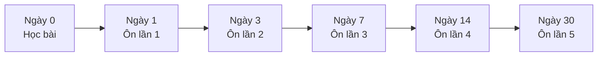

# 🧠 Learning Techniques — Kỹ thuật học có cơ sở khoa học

> Bốn kỹ thuật trọng tâm: **Active Recall**, **Spaced Repetition**, **Shadowing**, **Interleaving**. Đây không phải mẹo "thần kỳ" — chúng hiệu quả vì phù hợp với cách bộ nhớ hoạt động, nhưng vẫn đòi hỏi bạn thực hành đều đặn.

## Mục lục

1. [Active Recall — Chủ động gợi nhớ](#1-active-recall--chủ-động-gợi-nhớ)
2. [Spaced Repetition — Lặp lại ngắt quãng](#2-spaced-repetition--lặp-lại-ngắt-quãng)
3. [Shadowing — Nói đuổi](#3-shadowing--nói-đuổi)
4. [Interleaving — Học xen kẽ](#4-interleaving--học-xen-kẽ)
5. [Kỹ thuật bổ trợ](#5-kỹ-thuật-bổ-trợ)
6. [Kết hợp tất cả trong một tuần](#6-kết-hợp-tất-cả-trong-một-tuần)

---

## 1. Active Recall — Chủ động gợi nhớ

### Là gì?

Thay vì **đọc lại** bài (thụ động), bạn **tự kéo thông tin ra khỏi trí nhớ** (chủ động) — bằng cách tự hỏi, tự trả lời, tự giải thích, làm bài tập.

### Vì sao hiệu quả?

Mỗi lần bạn cố nhớ lại một điều, liên kết trong trí nhớ dẫn đến điều đó được củng cố. Đọc lại tạo cảm giác "quen quen" — dễ nhầm với "đã biết", nhưng khi cần dùng thì không nhớ ra. Các nghiên cứu tâm lý học giáo dục về *testing effect* (hiệu ứng kiểm tra) cho thấy tự kiểm tra thường giúp nhớ lâu hơn so với chỉ đọc lại cùng một khoảng thời gian.

### Cách áp dụng

| Tình huống | Cách làm thụ động ❌ | Cách làm chủ động ✅ |
|---|---|---|
| Ôn bài Present Perfect | Đọc lại bài giảng | Gập tài liệu, viết ra: công thức, 3 cách dùng, 3 ví dụ của bạn |
| Học từ vựng | Nhìn danh sách từ | Che cột tiếng Anh, nhìn tiếng Việt và nói từ tiếng Anh |
| Ôn lỗi sai | Đọc ERROR-LOG | Che cột "câu đúng", tự sửa lại câu sai |
| Sau khi đọc bài | Chuyển sang bài khác | Tóm tắt bài vừa đọc trong 3 câu, không nhìn lại |

> 💡 **Quy tắc 1 phút:** Sau mỗi phần bài học, dừng 1 phút, nhắm mắt và tự giải thích lại bằng lời. Nếu bị "tắc", đó chính là chỗ bạn cần đọc lại.

---

## 2. Spaced Repetition — Lặp lại ngắt quãng

### Là gì?

Ôn lại kiến thức ở những **khoảng cách thời gian tăng dần**, đúng vào lúc bạn sắp quên.

### Vì sao hiệu quả?

Trí nhớ suy giảm theo thời gian nếu không được ôn (đường cong quên lãng — *forgetting curve*). Mỗi lần ôn đúng lúc, tốc độ quên chậm lại. Ôn dồn một lúc (học nhồi) giúp nhớ ngắn hạn, nhưng ôn rải ra giúp nhớ dài hạn tốt hơn.



### Lịch gợi ý và cách điều chỉnh

| Lần ôn | Thời điểm | Làm gì (10–15 phút) |
|---|---|---|
| 1 | Ngày 1 | Knowledge Check của bài + 5 câu Level 2 làm lại |
| 2 | Ngày 3 | Viết 5 câu mới dùng cấu trúc, không nhìn bài |
| 3 | Ngày 7 | Làm lại các câu đã sai (từ ERROR-LOG) |
| 4 | Ngày 14 | Bài tập trộn trong [Mixed Grammar Exercises](../10-PRACTICE-LAB/LAB-02-mixed-grammar-exercises.md) |
| 5 | Ngày 30 | [Monthly Review](../10-PRACTICE-LAB/LAB-10-monthly-review.md) |

**Điều chỉnh theo kết quả:**

- Nếu ôn mà đúng ≥ 90% và trả lời nhanh → **giãn** khoảng cách lần sau (ví dụ 7 → 21 ngày).
- Nếu sai ≥ 30% → **rút ngắn**: quay lại ôn sau 1–2 ngày.
- Lịch 1–3–7–14–30 chỉ là **điểm xuất phát**, không phải luật cứng.

Công cụ: [SPACED-REPETITION.md](../13-LEARNING-TRACKER/SPACED-REPETITION.md). Bạn có thể dùng ứng dụng flashcard có thuật toán lặp lại ngắt quãng (ví dụ Anki) cho từ vựng.

---

## 3. Shadowing — Nói đuổi

### Là gì?

Nghe một câu tiếng Anh và **nói lặp lại gần như ngay lập tức**, bắt chước cả âm, trọng âm, nhịp điệu và ngữ điệu — như một cái bóng (*shadow*) đi theo người nói.

### Vì sao hiệu quả?

- Luyện cơ miệng cho những âm không có trong tiếng Việt (/θ/, /ð/, âm cuối /s/, /z/, /t/...).
- Tiếng Việt là ngôn ngữ có thanh điệu, mỗi âm tiết rõ ràng; tiếng Anh có trọng âm và nối âm. Shadowing giúp bạn "cảm" được nhịp điệu này.
- Tăng phản xạ: những mẫu câu được lặp lại nhiều lần sẽ bật ra tự nhiên khi nói.

### Quy trình 5 bước

| Bước | Hoạt động | Mục đích |
|---|---|---|
| 1 | Nghe toàn bộ đoạn 2 lần, không nhìn chữ | Làm quen âm thanh |
| 2 | Đọc transcript, tra từ mới, đánh dấu trọng âm và chỗ nối âm | Hiểu nội dung |
| 3 | Nghe từng câu, dừng lại, đọc theo (*pause and repeat*) | Chính xác từng câu |
| 4 | Nhìn transcript, nói cùng lúc với audio (*parallel reading*) | Bắt nhịp |
| 5 | Không nhìn transcript, nói đuổi theo audio (*true shadowing*) | Phản xạ |

> ⚠️ **Lưu ý:** Chọn đoạn nghe **dễ hơn** trình độ của bạn một chút, dài 30–60 giây. Đoạn quá khó khiến bạn chỉ "lẩm bẩm" theo mà không học được gì. Bài tập chi tiết: [PRON-10 Shadowing Practice](../08-PRONUNCIATION/PRON-10-shadowing-practice.md).

---

## 4. Interleaving — Học xen kẽ

### Là gì?

Thay vì luyện 30 câu toàn thì hiện tại đơn rồi 30 câu toàn hiện tại tiếp diễn (*blocked practice* — luyện theo khối), bạn luyện **trộn lẫn** các chủ điểm trong cùng một bài.

### Vì sao hiệu quả?

Khi làm bài theo khối, bạn biết trước "bài này về thì gì", nên chỉ việc áp công thức. Nhưng trong giao tiếp và trong đề thi, **không ai báo trước cấu trúc cần dùng**. Học xen kẽ buộc não phải thực hiện bước khó nhất: **chọn đúng cấu trúc**. Ban đầu cảm giác khó hơn và chậm hơn — đó là dấu hiệu bạn đang học thật.

### Cách áp dụng

```text
❌ Blocked:     AAAAA BBBBB CCCCC
✅ Interleaved: ABCBA CABCB ACBAC
```

- Mỗi tuần làm ít nhất một bài **trộn** trong [10-PRACTICE-LAB](../10-PRACTICE-LAB/README.md).
- Khi ôn, chọn ngẫu nhiên 3 bài đã học, mỗi bài lấy 3–4 câu, trộn lại.
- Khi làm bài trộn, trước khi trả lời hãy tự hỏi: **"Câu này đang nói về thời gian nào? Hành động xong hay chưa? Ai làm?"**

---

## 5. Kỹ thuật bổ trợ

| Kỹ thuật | Mô tả | Ví dụ áp dụng |
|---|---|---|
| **Elaboration** (Giải thích sâu) | Tự hỏi "tại sao?" và "khác gì?" | "Vì sao *I have lived here for 5 years* mà không phải *I live here for 5 years*?" |
| **Personalization** (Cá nhân hóa) | Đặt ví dụ về chính cuộc sống của bạn | Học *used to* → viết 5 câu về thói quen hồi nhỏ của bạn |
| **Chunking** (Học theo cụm) | Học cả cụm từ/câu thay vì từ đơn | *I'm looking forward to hearing from you.* — học nguyên câu |
| **Feynman Technique** | Giải thích kiến thức như đang dạy cho người khác | Giải thích câu điều kiện loại 2 cho một người bạn (hoặc ghi âm) |
| **Error-driven learning** | Học từ lỗi của chính mình | [ERROR-LOG](../13-LEARNING-TRACKER/ERROR-LOG.md) |
| **Dual coding** (Mã hóa kép) | Kết hợp lời và hình | Vẽ timeline cho mỗi thì |

---

## 6. Kết hợp tất cả trong một tuần

| Ngày | Active Recall | Spaced Repetition | Shadowing | Interleaving |
|---|---|---|---|---|
| Thứ 2 | Knowledge Check bài cũ | Ôn bài của 7 ngày trước | 5' | — |
| Thứ 3 | Tự viết công thức bài mới | Ôn bài hôm qua | 5' | — |
| Thứ 4 | Flashcard từ vựng | Ôn bài của 3 ngày trước | 5' | — |
| Thứ 5 | Tóm tắt bài đọc | Ôn ERROR-LOG | 5' | — |
| Thứ 6 | Tự giải thích (Feynman) | Ôn bài của 14 ngày trước | 5' | — |
| Thứ 7 | — | — | 10' | [Weekly Review](../10-PRACTICE-LAB/LAB-09-weekly-review.md) |
| Chủ nhật | Nghỉ hoặc học nhẹ (xem phim, nghe nhạc tiếng Anh) | | | |
