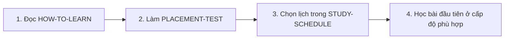
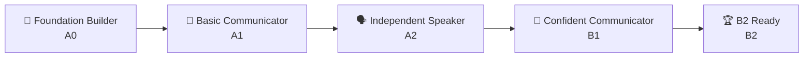

# 🏠 English Mastery: From Zero to B2 — Trang chủ

Chào bạn! Nếu bạn đang đọc trang này, có thể bạn đã từng học tiếng Anh nhiều năm ở trường nhưng vẫn ngại mở miệng, vẫn băn khoăn "*I am go* hay *I go*?", vẫn thấy các thì như một mê cung. Bạn không đơn độc — và bạn **không cần phải bắt đầu lại bằng cách học thuộc công thức**.

Bộ giáo trình này được viết để bạn **hiểu bản chất**: vì sao tiếng Anh nói như vậy, khi nào dùng cấu trúc nào, và làm sao tự phát hiện lỗi của chính mình.

---

## 1. Bắt đầu trong 4 bước

| Bước | Việc cần làm | File |
|---|---|---|
| 1 | Hiểu phương pháp học của bộ tài liệu (15 phút) | [HOW-TO-LEARN.md](HOW-TO-LEARN.md) |
| 2 | Làm bài kiểm tra đầu vào để biết nên bắt đầu ở đâu (45–60 phút) | [PLACEMENT-TEST.md](PLACEMENT-TEST.md) → [PLACEMENT-ANSWERS.md](PLACEMENT-ANSWERS.md) |
| 3 | Chọn lịch học theo thời gian rảnh của bạn | [STUDY-SCHEDULE.md](STUDY-SCHEDULE.md) |
| 4 | Mở bài học đầu tiên theo kết quả kiểm tra | Xem bảng ở mục 3 bên dưới |

---

## 2. Bản đồ tài liệu

| Bạn muốn... | Hãy mở |
|---|---|
| Xem toàn bộ chương trình, thứ tự học | [CURRICULUM-MAP.md](CURRICULUM-MAP.md) |
| Biết mình cần bao lâu để đạt từng cấp | [ROADMAP.md](ROADMAP.md) |
| Học cách ghi nhớ lâu, ôn tập hiệu quả | [LEARNING-TECHNIQUES.md](LEARNING-TECHNIQUES.md) |
| Tra nhanh một điểm ngữ pháp | [06-GRAMMAR-REFERENCE](../06-GRAMMAR-REFERENCE/README.md) |
| Học từ vựng theo chủ đề | [07-VOCABULARY](../07-VOCABULARY/README.md) |
| Sửa phát âm | [08-PRONUNCIATION](../08-PRONUNCIATION/README.md) |
| Luyện nghe, nói, đọc, viết | [09-FOUR-SKILLS](../09-FOUR-SKILLS/README.md) |
| Làm bài tập tổng hợp | [10-PRACTICE-LAB](../10-PRACTICE-LAB/README.md) |
| Làm bài thi chuyển cấp, đề mô phỏng VSTEP | [11-EXAMS-AND-ASSESSMENTS](../11-EXAMS-AND-ASSESSMENTS/README.md) |
| Ghi tiến độ, ghi lỗi sai | [13-LEARNING-TRACKER](../13-LEARNING-TRACKER/README.md) |

---

## 3. Bắt đầu từ đâu?

| Kết quả Placement Test | Điểm xuất phát |
|---|---|
| Chưa biết gì / dưới 15 điểm | [A0-G001 — Bảng chữ cái](../01-A0-FOUNDATION/grammar/A0-G001-alphabet.md) |
| 15–29 điểm | [A0-G004 — Từ loại](../01-A0-FOUNDATION/grammar/A0-G004-parts-of-speech.md) (lướt nhanh A0-G001–G003) |
| 30–44 điểm | [A1-G001 — Hiện tại đơn](../02-A1-BEGINNER/grammar/A1-G001-present-simple-affirmative.md) |
| 45–59 điểm | [A2-G001 — Quá khứ tiếp diễn](../03-A2-ELEMENTARY/grammar/A2-G001-past-continuous.md) |
| 60–74 điểm | [B1-G001 — Hiện tại hoàn thành tiếp diễn](../04-B1-INTERMEDIATE/grammar/B1-G001-present-perfect-continuous.md) |
| 75 điểm trở lên | [B2-G001 — Câu điều kiện hỗn hợp](../05-B2-UPPER-INTERMEDIATE/grammar/B2-G001-mixed-conditionals.md) |

> ⚠️ **Đừng "nhảy cóc" vì sĩ diện.** Nếu bạn bắt đầu ở A1 nhưng làm bài tập A1 đúng dưới 70%, hãy quay lại A0. Nền móng vững giúp bạn tiến nhanh hơn ở các cấp sau.

---

## 4. Hành trình 5 chặng (Learning Journey)

Điều kiện hoàn thành từng chặng được mô tả chi tiết trong [ROADMAP.md](ROADMAP.md#3-năm-milestone-và-điều-kiện-hoàn-thành).

---

## 5. Một bài học trông như thế nào?

Mỗi bài ngữ pháp đi theo tiến trình:

`Hiểu khái niệm → Nhìn ví dụ → Phân tích → So sánh → Luyện tập → Vận dụng → Ôn tập`

| Phần | Bạn sẽ làm gì |
|---|---|
| A. Lesson Information | Biết mục tiêu, thời gian, bài tiên quyết |
| B. Warm-up | Đọc một tình huống đời thường để thấy *vì sao* cần cấu trúc này |
| C–D. WHAT & WHY | Hiểu ý nghĩa và bản chất |
| E. FORM | Nắm công thức, mọi ký hiệu đều được giải thích |
| F. HOW | Xem ít nhất 8 ví dụ có phân tích |
| G. VISUAL | Timeline, bảng, sơ đồ |
| H. COMPARISON | Phân biệt với cấu trúc dễ nhầm |
| I. COMMON MISTAKES | Học từ lỗi người Việt hay mắc |
| J. MEMORY TRICKS | Mẹo nhớ có cơ sở |
| K. REAL-LIFE | Hội thoại/bài đọc dùng cấu trúc vừa học |
| L. PRACTICE | Ít nhất 25 câu bài tập, 5 mức độ |
| M. KNOWLEDGE CHECK | Tự kiểm tra, lịch ôn 1–3–7 ngày |
| N. ANSWER KEY | Đáp án ở **file riêng** — chỉ mở sau khi làm xong |

---

## 6. Ba nguyên tắc vàng

1. **Làm bài trước, xem đáp án sau.** Sai là dữ liệu quý — ghi vào [ERROR-LOG](../13-LEARNING-TRACKER/ERROR-LOG.md).
2. **Nói ra thành tiếng.** Mỗi ví dụ trong bài, hãy đọc to ít nhất một lần.
3. **Ôn theo lịch, không theo cảm hứng.** Dùng [SPACED-REPETITION](../13-LEARNING-TRACKER/SPACED-REPETITION.md).

Chúc bạn một hành trình bền bỉ. *Slow progress is still progress.* 🌱
