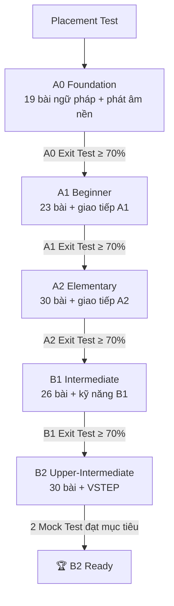
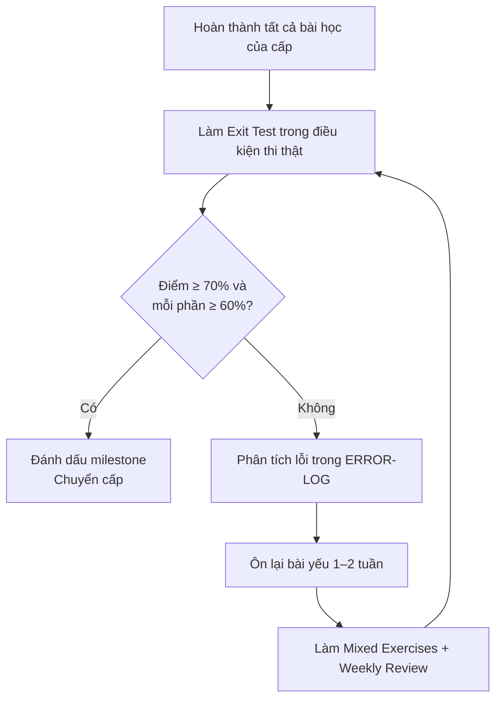

# 🛣️ Roadmap — Lộ trình từ A0 đến B2

> Trang này trả lời ba câu hỏi: **Học theo thứ tự nào? Mất bao lâu? Khi nào được chuyển cấp?**

## Mục lục

1. [Tổng quan lộ trình](#1-tổng-quan-lộ-trình)
2. [Thời gian ước tính](#2-thời-gian-ước-tính)
3. [Năm milestone và điều kiện hoàn thành](#3-năm-milestone-và-điều-kiện-hoàn-thành)
4. [Lộ trình chi tiết từng cấp](#4-lộ-trình-chi-tiết-từng-cấp)
5. [Quy tắc chuyển cấp](#5-quy-tắc-chuyển-cấp)
6. [Khi bị chậm tiến độ](#6-khi-bị-chậm-tiến-độ)

---

## 1. Tổng quan lộ trình

Song song với ngữ pháp, mỗi cấp có:

- **Từ vựng** theo chủ đề trong [07-VOCABULARY](../07-VOCABULARY/README.md).
- **Phát âm** trong [08-PRONUNCIATION](../08-PRONUNCIATION/README.md).
- **Bốn kỹ năng** trong [09-FOUR-SKILLS](../09-FOUR-SKILLS/README.md) và file Skills Practice ở mỗi cấp.
- **Ôn tập** trong [10-PRACTICE-LAB](../10-PRACTICE-LAB/README.md).

---

## 2. Thời gian ước tính

Bảng dưới là **ước tính tham khảo** cho người học đều đặn, làm đủ bài tập và ôn tập. Thời gian thực tế phụ thuộc vào nền tảng, mức độ tập trung, cơ hội dùng tiếng Anh và chất lượng ôn tập. **Không có bảo đảm** đạt B2 sau một số ngày cố định.

| Chặng | Tổng giờ học ước tính (gồm cả kỹ năng & ôn tập) | 30'/ngày | 60'/ngày | 120'/ngày | 240'/ngày |
|---|---|---|---|---|---|
| A0 → hết A0 | 60–90 giờ | 4–6 tháng | 2–3 tháng | 1–1,5 tháng | 3–4 tuần |
| A1 | 100–150 giờ | 7–10 tháng | 3,5–5 tháng | 2–2,5 tháng | 4–6 tuần |
| A2 | 150–200 giờ | 10–13 tháng | 5–7 tháng | 2,5–3,5 tháng | 6–8 tuần |
| B1 | 200–300 giờ | 13–20 tháng | 7–10 tháng | 3,5–5 tháng | 2–2,5 tháng |
| B2 | 250–350 giờ | 17–23 tháng | 8–12 tháng | 4–6 tháng | 2–3 tháng |
| **Tổng A0 → B2** | **≈ 760–1.090 giờ** | — | **≈ 2–3,5 năm** | **≈ 1–1,7 năm** | **≈ 6–10 tháng** |

> 💡 Số giờ trên nằm trong khoảng mà các tổ chức khảo thí thường đưa ra cho mỗi cấp CEFR khi có hướng dẫn (*guided learning hours*). Người tự học thường cần **nhiều hơn**, đặc biệt ở kỹ năng nói. Nếu bạn đã có nền A2 từ trường phổ thông, tổng thời gian sẽ ngắn hơn đáng kể.

Lịch học chi tiết cho từng mức thời gian: [STUDY-SCHEDULE.md](STUDY-SCHEDULE.md).

---

## 3. Năm milestone và điều kiện hoàn thành

### 🧱 Milestone 1 — Foundation Builder (A0)

- [ ] Đọc đúng 26 chữ cái, đánh vần được tên và email của mình.
- [ ] Nhận biết danh từ, động từ, tính từ, trạng từ trong câu đơn giản.
- [ ] Viết đúng câu dạng S + V, S + V + O, S + V + C.
- [ ] Dùng đúng *am/is/are*, *have/has*, *there is/there are*.
- [ ] Biến câu khẳng định thành phủ định và câu hỏi.
- [ ] Nói được 6–8 câu giới thiệu bản thân (tên, tuổi, quê, nghề, sở thích).
- [ ] Đạt **≥ 70%** [A0 Exit Test](../11-EXAMS-AND-ASSESSMENTS/A0-EXIT-TEST.md).

### 💬 Milestone 2 — Basic Communicator (A1)

- [ ] Dùng đúng hiện tại đơn, hiện tại tiếp diễn, quá khứ đơn, tương lai với *will* / *be going to*.
- [ ] Hỏi – đáp về thói quen, gia đình, công việc, kế hoạch cuối tuần.
- [ ] Viết đoạn 60–80 từ về một ngày của mình.
- [ ] Hoàn thành 3 thử thách trong [A1 Communication](../02-A1-BEGINNER/A1-COMMUNICATION.md).
- [ ] Đạt **≥ 70%** [A1 Exit Test](../11-EXAMS-AND-ASSESSMENTS/A1-EXIT-TEST.md).

### 🗣️ Milestone 3 — Independent Speaker (A2)

- [ ] Phân biệt hiện tại hoàn thành và quá khứ đơn trong ngữ cảnh.
- [ ] Đưa lời khuyên, nói về nghĩa vụ, xin phép lịch sự.
- [ ] Kể lại một kỳ nghỉ hoặc trải nghiệm 1–2 phút.
- [ ] Viết email cá nhân 100–120 từ.
- [ ] Đạt **≥ 70%** [A2 Exit Test](../11-EXAMS-AND-ASSESSMENTS/A2-EXIT-TEST.md).

### 🌟 Milestone 4 — Confident Communicator (B1)

- [ ] Kể chuyện với các thì quá khứ (narrative tenses) mạch lạc.
- [ ] Dùng câu điều kiện 1–2–3, câu ước, câu tường thuật, bị động.
- [ ] Trình bày quan điểm có lý do và ví dụ trong 2 phút.
- [ ] Viết đoạn nghị luận 150–200 từ có câu chủ đề và từ nối hợp lý.
- [ ] Đạt **≥ 70%** [B1 Exit Test](../11-EXAMS-AND-ASSESSMENTS/B1-EXIT-TEST.md).

### 🏆 Milestone 5 — B2 Ready

- [ ] Dùng linh hoạt đảo ngữ, câu chẻ, mệnh đề phân từ, danh từ hóa khi phù hợp.
- [ ] Viết bài luận 250+ từ có lập luận, phản biện, kết luận rõ ràng trong 40 phút.
- [ ] Thảo luận một vấn đề xã hội 3 phút, có phản biện.
- [ ] Đạt mục tiêu ở **ít nhất 2 đề mô phỏng** trong [11-EXAMS-AND-ASSESSMENTS](../11-EXAMS-AND-ASSESSMENTS/README.md).
- [ ] Hoàn thành [B2-READINESS-CHECKLIST](../13-LEARNING-TRACKER/B2-READINESS-CHECKLIST.md).

---

## 4. Lộ trình chi tiết từng cấp

Mỗi cấp chia thành các **khối (block)**. Sau mỗi khối có một thử thách nhỏ (mini challenge) và một buổi ôn tập.

### A0 — 4 khối

| Khối | Bài học | Song song | Mini challenge |
|---|---|---|---|
| A0-1 Âm thanh & chữ viết | G001–G003 | [PRON-01 IPA](../08-PRONUNCIATION/PRON-01-ipa-reference.md) | Đánh vần tên, địa chỉ email của bạn và 5 người thân |
| A0-2 Từ loại & câu | G004–G008 | [VOC-01 Daily Life](../07-VOCABULARY/VOC-01-daily-life.md) | Viết 10 câu S+V+O về đồ vật trong phòng |
| A0-3 Be, have, danh từ | G009–G015 | [VOC-02 Family](../07-VOCABULARY/VOC-02-family-relationships.md) | Mô tả căn phòng của bạn bằng 8 câu *there is/are* |
| A0-4 Hỏi và trả lời | G016–G019 | [A0 Skills Practice](../01-A0-FOUNDATION/A0-SKILLS-PRACTICE.md) | Ghi âm 1 phút giới thiệu bản thân |

### A1 — 5 khối

| Khối | Bài học | Mini challenge |
|---|---|---|
| A1-1 Hiện tại | G001–G005 | *Describe your daily routine* (8–10 câu) |
| A1-2 Sở hữu, đại từ, giới từ | G006–G010 | Mô tả nhà bạn và vị trí đồ vật |
| A1-3 Mệnh lệnh, khả năng, yêu cầu, lượng từ | G011–G015 | Gọi món trong quán cà phê (role-play) |
| A1-4 Quá khứ & tương lai | G016–G020 | *Talk about your last weekend and next weekend* |
| A1-5 Liên kết & so sánh | G021–G023 | So sánh hai thành phố bạn biết |

### A2 — 6 khối

| Khối | Bài học | Mini challenge |
|---|---|---|
| A2-1 Kể chuyện quá khứ | G001–G002 | Kể một sự cố bất ngờ |
| A2-2 Hiện tại hoàn thành | G003–G007 | *Talk about your last holiday* & trải nghiệm từng có |
| A2-3 Tương lai & thói quen cũ | G008–G010 → G015 → G011 | So sánh cuộc sống trước đây và bây giờ |
| A2-4 Modal verbs | G012–G014 | Viết nội quy và lời khuyên cho người mới vào công ty |
| A2-5 Cấu trúc câu mở rộng | Ôn G015, rồi G016–G020 | *Explain a problem at work* bằng câu điều kiện và bị động |
| A2-6 Mô tả & lượng từ | G021–G030 | Viết quảng cáo bán một món đồ cũ |

### B1 — 5 khối

| Khối | Bài học | Mini challenge |
|---|---|---|
| B1-1 Thì hoàn thành & kể chuyện | G001–G006 | Kể một câu chuyện có nút thắt (200 từ) |
| B1-2 Điều kiện & ước | G007–G009 | *What would you do if...?* — nói 2 phút |
| B1-3 Tường thuật & bị động | G010–G013 | Tường thuật một cuộc họp/cuộc gọi |
| B1-4 Modal & mẫu động từ | G014–G017, G020–G021 | Suy luận về một bí ẩn từ manh mối |
| B1-5 Liên kết & lập luận | G018–G019, G022–G026 | *Compare two job opportunities* |

### B2 — 5 khối

| Khối | Bài học | Mini challenge |
|---|---|---|
| B2-1 Điều kiện & giả định | G001–G003, G015–G016 | Viết thư khiếu nại có đề xuất trang trọng |
| B2-2 Bị động & tường thuật | G004–G006, G013–G014 | Viết bản tin ngắn bằng bị động tường thuật |
| B2-3 Cấu trúc câu nâng cao | G007–G012 | Viết lại một đoạn văn cho súc tích và ấn tượng hơn |
| B2-4 Văn phong học thuật | G017–G025, G027–G028 | *Give an opinion about technology* — essay 250 từ |
| B2-5 Tổng hợp & thi | G026, G029–G030 | 2 đề mô phỏng VSTEP-style |

---

## 5. Quy tắc chuyển cấp

- **Không chuyển cấp chỉ vì đã đọc hết bài.** Điều kiện là kết quả kiểm tra.
- Phần Writing/Speaking được tự đánh giá bằng **rubric mô tả** ([Skill Evaluation Rubrics](../11-EXAMS-AND-ASSESSMENTS/SKILL-EVALUATION-RUBRICS.md)); nếu có thể, nhờ giáo viên hoặc bạn học có trình độ cao hơn chấm giúp.
- Khi làm lại Exit Test, hãy để cách lần đầu ít nhất 10 ngày để tránh nhớ đáp án.

---

## 6. Khi bị chậm tiến độ

| Dấu hiệu | Nguyên nhân thường gặp | Cách xử lý |
|---|---|---|
| Đọc hiểu bài nhưng làm bài tập sai nhiều | Học thụ động, chưa tự sản xuất câu | Làm lại Level 4–5 của bài, viết thêm 10 câu của riêng bạn |
| Làm bài tập đúng nhưng nói không được | Thiếu luyện nói, sợ sai | 10 phút shadowing/ngày — [PRON-10](../08-PRONUNCIATION/PRON-10-shadowing-practice.md) |
| Quên bài cũ sau 2 tuần | Không ôn theo lịch | Áp dụng [SPACED-REPETITION](../13-LEARNING-TRACKER/SPACED-REPETITION.md) |
| Bỏ học vài ngày rồi bỏ hẳn | Mục tiêu quá lớn | Giảm xuống lịch 30 phút/ngày, giữ chuỗi ngày học |
| Đọc chậm, nghe không kịp | Vốn từ ít | Ưu tiên 07-VOCABULARY, mỗi ngày 10–15 từ có ngữ cảnh |
