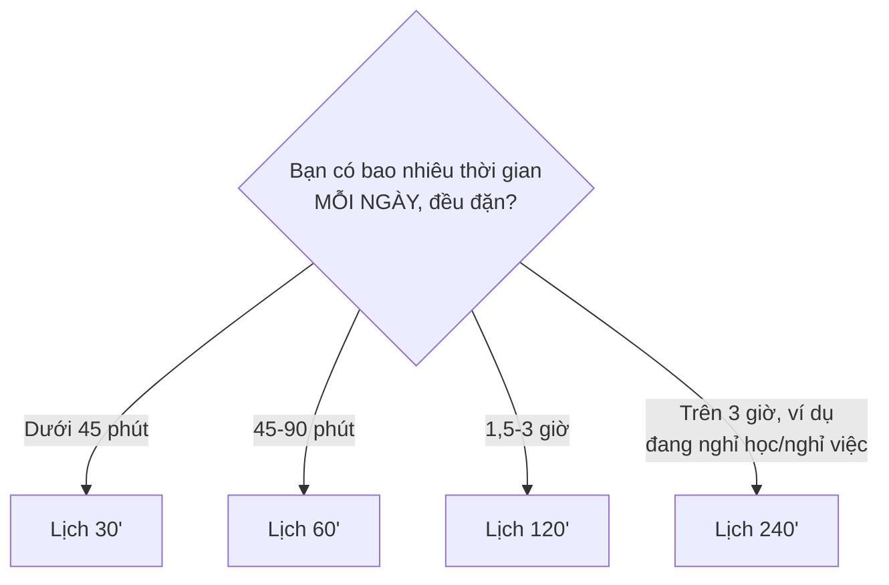

# 📅 Study Schedule — Các phương án lịch học

> Chọn lịch phù hợp với thời gian **thực tế** bạn có thể duy trì trong nhiều tháng — không phải thời gian bạn *mong muốn* có. Học 30 phút mỗi ngày đều đặn tốt hơn học 4 tiếng một ngày rồi bỏ cả tuần.

## Mục lục

1. [Chọn lịch nào?](#1-chọn-lịch-nào)
2. [Lịch 30 phút/ngày](#2-lịch-30-phútngày)
3. [Lịch 60 phút/ngày](#3-lịch-60-phútngày)
4. [Lịch 120 phút/ngày](#4-lịch-120-phútngày)
5. [Lịch 240 phút/ngày](#5-lịch-240-phútngày)
6. [Điều chỉnh tỉ lệ theo cấp độ](#6-điều-chỉnh-tỉ-lệ-theo-cấp-độ)
7. [Quy tắc khi lỡ buổi học](#7-quy-tắc-khi-lỡ-buổi-học)

---

## 1. Chọn lịch nào?

| Lịch | Phù hợp với | Tốc độ bài ngữ pháp mới | Thời gian ước tính A0 → B2 |
|---|---|---|---|
| 30'/ngày | Người đi làm bận rộn | 2 bài/tuần | 3,5–5 năm (ước tính) |
| 60'/ngày | Đa số người đi làm, sinh viên | 3 bài/tuần | 2–3,5 năm |
| 120'/ngày | Sinh viên có mục tiêu thi VSTEP | 4–5 bài/tuần | 1–1,7 năm |
| 240'/ngày | Học toàn thời gian | 6–8 bài/tuần | 6–10 tháng |

> ⚠️ Đây là **ước tính** dựa trên tổng giờ học trong [ROADMAP](ROADMAP.md#2-thời-gian-ước-tính). Không có bảo đảm đạt B2 sau một số ngày cố định. Bạn chỉ chuyển cấp khi **đạt Exit Test**.

---

## 2. Lịch 30 phút/ngày

**Phân bổ thời gian trong tuần (210 phút):**

| Mảng | Phút/tuần | Tỉ lệ |
|---|---|---|
| Grammar | 60 | 29% |
| Vocabulary | 40 | 19% |
| Pronunciation | 20 | 10% |
| Listening | 25 | 12% |
| Speaking | 20 | 10% |
| Reading | 15 | 7% |
| Writing | 10 | 5% |
| Review | 20 | 10% |

**Lịch mẫu một tuần:**

| Ngày | 0–10' | 10–20' | 20–30' |
|---|---|---|---|
| Thứ 2 | Ôn từ vựng (flashcard) | Bài ngữ pháp mới: Warm-up → FORM | Bài ngữ pháp: HOW, đọc to ví dụ |
| Thứ 3 | Ôn Knowledge Check bài cũ | Bài tập Level 1–2 | Chữa bài, ghi ERROR-LOG |
| Thứ 4 | Phát âm (1 file PRON, một phần) | Bài tập Level 3–4 | Từ vựng mới (8 từ) |
| Thứ 5 | Shadowing | Bài ngữ pháp mới (phần 1) | Bài ngữ pháp mới (phần 2) |
| Thứ 6 | Ôn từ vựng | Bài tập Level 1–3 | Chữa bài |
| Thứ 7 | Nghe 1 bài (Listening) | Đọc 1 bài ngắn (Reading) | Speaking: ghi âm trả lời 2 câu hỏi |
| Chủ nhật | Ôn tuần (Weekly Review rút gọn) | Writing: 5 câu/1 đoạn | Cập nhật PROGRESS |

---

## 3. Lịch 60 phút/ngày

**Phân bổ (420 phút/tuần):**

| Mảng | Phút/tuần | Tỉ lệ |
|---|---|---|
| Grammar | 110 | 26% |
| Vocabulary | 70 | 17% |
| Pronunciation | 35 | 8% |
| Listening | 50 | 12% |
| Speaking | 45 | 11% |
| Reading | 40 | 10% |
| Writing | 35 | 8% |
| Review | 35 | 8% |

**Lịch mẫu:**

| Ngày | Khối 1 (20') | Khối 2 (20') | Khối 3 (20') |
|---|---|---|---|
| Thứ 2 | Ngữ pháp mới (A → F) | Ngữ pháp (G → K) + bài tập L1–L2 | Từ vựng mới 10 từ + shadowing 5' |
| Thứ 3 | Ôn bài hôm qua; bài tập L3–L5 | Chữa bài, ERROR-LOG | Listening 1 bài |
| Thứ 4 | Ngữ pháp mới (A → F) | Bài tập L1–L3 | Phát âm |
| Thứ 5 | Bài tập L4–L5 + chữa | Reading 1 bài | Từ vựng mới 10 từ |
| Thứ 6 | Ngữ pháp mới | Bài tập L1–L3 | Speaking: 3 câu hỏi, ghi âm |
| Thứ 7 | Bài tập L4–L5 + chữa | Writing 1 đoạn | Listening + shadowing |
| Chủ nhật | Weekly Review | Ôn ERROR-LOG | Cập nhật tracker, nghỉ ngơi |

---

## 4. Lịch 120 phút/ngày

**Phân bổ (840 phút/tuần):**

| Mảng | Phút/tuần | Tỉ lệ |
|---|---|---|
| Grammar | 200 | 24% |
| Vocabulary | 130 | 15% |
| Pronunciation | 60 | 7% |
| Listening | 120 | 14% |
| Speaking | 100 | 12% |
| Reading | 100 | 12% |
| Writing | 70 | 8% |
| Review | 60 | 7% |

**Cấu trúc một ngày (thứ 2 – thứ 6):**

| Thời gian | Hoạt động |
|---|---|
| 0–10' | Ôn spaced repetition (từ vựng + Knowledge Check) |
| 10–50' | Ngữ pháp: một bài mới **hoặc** làm hết bài tập bài hôm qua |
| 50–65' | Từ vựng theo chủ đề |
| 65–90' | Kỹ năng luân phiên: T2 Listening, T3 Reading, T4 Listening, T5 Reading, T6 Writing |
| 90–110' | Speaking: shadowing 10' + trả lời câu hỏi theo cấp độ 10' |
| 110–120' | Phát âm hoặc ghi ERROR-LOG |

**Thứ 7:** Writing (40') + Practice Lab (40') + Speaking challenge (40').
**Chủ nhật:** Weekly Review (60') + tự do (xem phim/đọc sách tiếng Anh).

---

## 5. Lịch 240 phút/ngày

Chia thành **hai buổi** để tránh quá tải (ví dụ sáng 2 tiếng, chiều 2 tiếng). Nghỉ 5–10 phút sau mỗi 45–50 phút.

**Phân bổ (1.680 phút/tuần, 7 ngày; hoặc 6 ngày + 1 ngày ôn nhẹ):**

| Mảng | Phút/tuần | Tỉ lệ |
|---|---|---|
| Grammar | 360 | 21% |
| Vocabulary | 240 | 14% |
| Pronunciation | 120 | 7% |
| Listening | 270 | 16% |
| Speaking | 240 | 14% |
| Reading | 210 | 13% |
| Writing | 150 | 9% |
| Review | 90 | 6% |

**Một ngày mẫu:**

| Buổi | Thời gian | Hoạt động |
|---|---|---|
| Sáng | 0–15' | Spaced repetition |
| | 15–75' | Ngữ pháp: một bài mới đầy đủ (lý thuyết + Level 1–3) |
| | 75–105' | Từ vựng: 15 từ mới + đặt câu |
| | 105–120' | Phát âm |
| Chiều | 0–40' | Listening (1 bài + shadowing) |
| | 40–70' | Reading (1 bài + phân tích paraphrase) |
| | 70–100' | Speaking (role-play, ghi âm, tự đánh giá rubric) |
| | 100–120' | Writing hoặc bài tập Level 4–5 của bài ngữ pháp |

> ⚠️ Với lịch 240', nguy cơ lớn nhất là **kiệt sức**. Nếu bạn thấy giảm tập trung kéo dài, hãy chuyển sang lịch 120' trong 1–2 tuần.

---

## 6. Điều chỉnh tỉ lệ theo cấp độ

Tỉ lệ ở trên là trung bình. Khi lên cấp, hãy dịch chuyển trọng tâm:

| Cấp | Grammar | Vocabulary | Pronunciation | 4 kỹ năng | Review |
|---|---|---|---|---|---|
| A0 | 35% | 20% | 20% | 15% | 10% |
| A1 | 30% | 20% | 10% | 30% | 10% |
| A2 | 25% | 20% | 8% | 37% | 10% |
| B1 | 20% | 20% | 5% | 45% | 10% |
| B2 | 15% | 20% | 5% | 50% | 10% |

Lý do: ở A0 bạn cần xây nền âm và câu; càng lên cao, ngữ pháp đã đủ dùng và điều phân biệt B1 với B2 là **khả năng sử dụng** — nghe hiểu bài dài, viết bài luận, nói có lập luận.

---

## 7. Quy tắc khi lỡ buổi học

1. **Không học bù gấp đôi.** Lỡ một ngày → hôm sau học bình thường.
2. **Giữ "phiên bản tối thiểu" 10 phút** cho những ngày bận: ôn 10 flashcard + đọc to 5 câu. Chuỗi ngày học không bị đứt.
3. **Lỡ cả tuần** → tuần sau dành 2 buổi đầu cho ôn tập, sau đó mới học bài mới.
4. Ghi lại lý do lỡ học trong [WEEKLY-REVIEW](../13-LEARNING-TRACKER/WEEKLY-REVIEW.md) để điều chỉnh lịch cho thực tế hơn.
