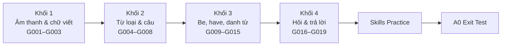

# 🧱 A0 Foundation — Nền móng cho người mất gốc

> **Milestone 1: Foundation Builder.** Mục tiêu của A0 không phải là "biết nhiều", mà là **chắc chắn**: đọc đúng chữ cái và âm, hiểu một câu tiếng Anh được xây như thế nào, dùng đúng *be*, *have*, *there is* và đặt được câu hỏi. Mọi cấp độ sau đều đứng trên nền móng này.

## 1. Bạn sẽ làm được gì sau A0?

- Đánh vần tên, email; đọc số điện thoại, ngày sinh, giờ, giá tiền.
- Nhận biết danh từ, động từ, tính từ, trạng từ và vị trí của chúng.
- Viết đúng câu S + V, S + V + O, S + V + C.
- Giới thiệu bản thân, gia đình, căn phòng, khu phố bằng 8–10 câu đơn giản.
- Đặt và trả lời câu hỏi Yes/No và câu hỏi Wh- cơ bản.

## 2. Lộ trình 4 khối

## 3. Danh sách bài học và checklist tiến độ

Đánh dấu từng cột khi hoàn thành. Một bài chỉ được coi là xong khi cả 6 ô đều được đánh dấu.

| Bài | Chủ đề | Đã đọc & hiểu | Làm bài tập | Đã sửa lỗi | Ôn ngày 1 | Ôn ngày 3 | Ôn ngày 7 |
|---|---|---|---|---|---|---|---|
| [A0-G001](grammar/A0-G001-alphabet.md) | Alphabet | [ ] | [ ] | [ ] | [ ] | [ ] | [ ] |
| [A0-G002](grammar/A0-G002-phonics-basics.md) | Phonics | [ ] | [ ] | [ ] | [ ] | [ ] | [ ] |
| [A0-G003](grammar/A0-G003-english-sounds-ipa.md) | Sounds & IPA | [ ] | [ ] | [ ] | [ ] | [ ] | [ ] |
| [A0-G004](grammar/A0-G004-parts-of-speech.md) | Parts of Speech | [ ] | [ ] | [ ] | [ ] | [ ] | [ ] |
| [A0-G005](grammar/A0-G005-nouns-verbs-adjectives-adverbs.md) | N, V, Adj, Adv | [ ] | [ ] | [ ] | [ ] | [ ] | [ ] |
| [A0-G006](grammar/A0-G006-subject-pronouns.md) | Subject Pronouns | [ ] | [ ] | [ ] | [ ] | [ ] | [ ] |
| [A0-G007](grammar/A0-G007-subject-verb-object.md) | S, V, O | [ ] | [ ] | [ ] | [ ] | [ ] | [ ] |
| [A0-G008](grammar/A0-G008-sentence-patterns.md) | Sentence Patterns | [ ] | [ ] | [ ] | [ ] | [ ] | [ ] |
| [A0-G009](grammar/A0-G009-verb-to-be.md) | To Be | [ ] | [ ] | [ ] | [ ] | [ ] | [ ] |
| [A0-G010](grammar/A0-G010-have-has.md) | Have / Has | [ ] | [ ] | [ ] | [ ] | [ ] | [ ] |
| [A0-G011](grammar/A0-G011-this-that-these-those.md) | This / That / These / Those | [ ] | [ ] | [ ] | [ ] | [ ] | [ ] |
| [A0-G012](grammar/A0-G012-articles-basic.md) | A / An / The | [ ] | [ ] | [ ] | [ ] | [ ] | [ ] |
| [A0-G013](grammar/A0-G013-singular-plural-nouns.md) | Singular & Plural | [ ] | [ ] | [ ] | [ ] | [ ] | [ ] |
| [A0-G014](grammar/A0-G014-countable-uncountable.md) | Countable & Uncountable | [ ] | [ ] | [ ] | [ ] | [ ] | [ ] |
| [A0-G015](grammar/A0-G015-there-is-there-are.md) | There is / There are | [ ] | [ ] | [ ] | [ ] | [ ] | [ ] |
| [A0-G016](grammar/A0-G016-sentence-types.md) | Sentence Types | [ ] | [ ] | [ ] | [ ] | [ ] | [ ] |
| [A0-G017](grammar/A0-G017-question-words.md) | Question Words | [ ] | [ ] | [ ] | [ ] | [ ] | [ ] |
| [A0-G018](grammar/A0-G018-numbers-dates-time-age.md) | Numbers, Dates, Time | [ ] | [ ] | [ ] | [ ] | [ ] | [ ] |
| [A0-G019](grammar/A0-G019-likes-and-hobbies.md) | Likes & Hobbies | [ ] | [ ] | [ ] | [ ] | [ ] | [ ] |

Kỹ năng: [A0 Skills Practice](A0-SKILLS-PRACTICE.md) — [ ] Listening · [ ] Reading · [ ] Speaking · [ ] Writing

## 4. Học song song

| Khối | Phát âm | Từ vựng |
|---|---|---|
| 1 | [PRON-01 IPA Reference](../08-PRONUNCIATION/PRON-01-ipa-reference.md), [PRON-02 Vowels & Consonants](../08-PRONUNCIATION/PRON-02-vowels-consonants.md) | Chữ cái, số đếm |
| 2 | [PRON-03 Minimal Pairs](../08-PRONUNCIATION/PRON-03-minimal-pairs.md) | [VOC-01 Daily Life](../07-VOCABULARY/VOC-01-daily-life.md) |
| 3 | [PRON-11 Lỗi phát âm người Việt](../08-PRONUNCIATION/PRON-11-vietnamese-learner-mistakes.md) | [VOC-02 Family & Relationships](../07-VOCABULARY/VOC-02-family-relationships.md) |
| 4 | [PRON-04 Word Stress](../08-PRONUNCIATION/PRON-04-word-stress.md) (phần số *-teen/-ty*) | [VOC-06 Food & Health](../07-VOCABULARY/VOC-06-food-health.md) (phần A1) |

## 5. Mini Challenges

Hoàn thành mỗi thử thách sau khi học xong khối tương ứng. Ghi âm hoặc viết ra, lưu lại để so sánh khi lên A1.

- [ ] **Challenge 1 — The Spelling Bee** (sau khối 1): Đánh vần to họ tên, email và địa chỉ của bạn và 5 người thân, không nhìn bảng chữ cái. Nhờ ai đó (hoặc tự ghi âm) để kiểm tra.
- [ ] **Challenge 2 — 10 Sentences in My Room** (sau khối 2): Viết 10 câu S+V+O hoặc S+V+C về đồ vật trong phòng. Đánh dấu S, V, O/C cho từng câu.
- [ ] **Challenge 3 — Room Tour** (sau khối 3): Ghi âm 1 phút giới thiệu căn phòng/căn nhà bằng *there is/are, this/these, have/has*, mạo từ đúng.
- [ ] **Challenge 4 — Meet Me!** (sau khối 4): Ghi âm 1 phút giới thiệu bản thân: tên, tuổi, ngày sinh, quê, nghề, gia đình, 3 sở thích. Sau đó viết lại thành đoạn văn 8–10 câu.

## 6. Điều kiện hoàn thành A0

- [ ] Hoàn thành 19 bài ngữ pháp (checklist mục 3).
- [ ] Hoàn thành [A0 Skills Practice](A0-SKILLS-PRACTICE.md).
- [ ] Hoàn thành 4 Mini Challenges.
- [ ] Đạt mốc tự học **39/55** tổng A–D, **≥ 60%** mỗi phần A–D, đồng thời Writing và Speaking đạt rubric riêng trong [A0 Exit Test](../11-EXAMS-AND-ASSESSMENTS/A0-EXIT-TEST.md).

➡️ Sau khi đạt: chuyển sang [02-A1-BEGINNER](../02-A1-BEGINNER/README.md).

## 7. Tình trạng nội dung và cách tự kiểm thử thách

19 bài ngữ pháp cùng đáp án đã được đọc đối chiếu, sửa quy tắc và kiểm nhãn bài tập; không có audio đóng gói. A0 là nhãn nền móng của chương trình, không phải một mức chứng chỉ riêng trong CEFR. Hoàn thành checklist là bằng chứng đã luyện, không bảo đảm tự động thành thạo.

Challenge 1 dùng bảng tên chữ G001 và mẫu L4/L5 trong đáp án G001; chấm đủ chữ, thứ tự đúng, người nghe chép lại được. Challenge 2 dùng mẫu và đáp án G007/G008, kiểm toàn cụm S/O/C. Challenge 3 dùng Speaking 3 của A0 Skills; Challenge 4 dùng Speaking 2 cùng Writing 3; các file đáp án kỹ năng có mẫu và rubric. Không cần tạo lại bài tập không có lời giải. Với các mẫu nói một phút, tự bấm giờ và mở rộng bằng thông tin thật hoặc giả định, không đo thời lượng từ bản viết.
