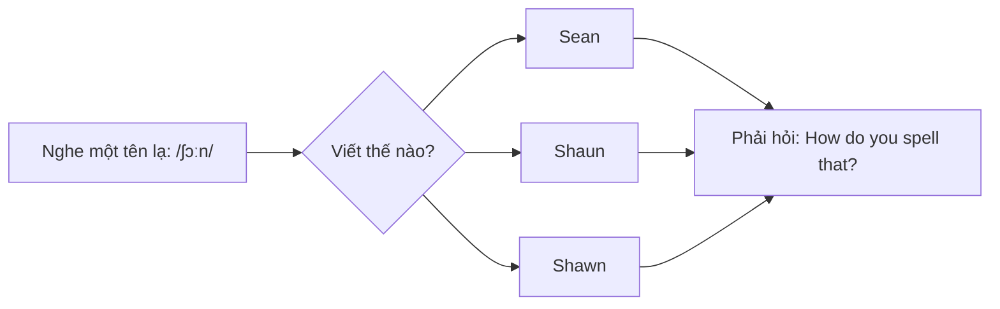

# A0-G001 · The English Alphabet — Bảng chữ cái và cách đọc tên chữ

## Mục lục

- [A. Lesson Information](#a-lesson-information)
- [B. Warm-up](#b-warm-up-tình-huống-thực-tế)
- [C. WHAT](#c-what-bảng-chữ-cái-tiếng-anh-là-gì)
- [D. WHY](#d-why-vì-sao-phải-học-tên-chữ-cái)
- [E. FORM](#e-form-26-chữ-cái-và-cách-đọc)
- [F. HOW](#f-how-đánh-vần-trong-đời-sống)
- [G. VISUAL](#g-visual-explanation)
- [H. COMPARISON](#h-comparison-chữ-cái-tiếng-việt-và-tiếng-anh)
- [I. COMMON MISTAKES](#i-common-mistakes)
- [J. MEMORY TRICKS](#j-memory-tricks)
- [K. REAL-LIFE APPLICATION](#k-real-life-application)
- [L. PRACTICE EXERCISES](#l-practice-exercises)
- [M. KNOWLEDGE CHECK](#m-knowledge-check)
- [N. ANSWER KEY](#n-answer-key)

---

## A. Lesson Information

| Mục | Nội dung |
|---|---|
| **Lesson ID** | A0-G001 |
| **Topic** | The English Alphabet |
| **Tên tiếng Việt** | Bảng chữ cái và cách đọc tên chữ cái |
| **CEFR Level** | Pre-A1 / A0 |
| **Prerequisites** | Không có — đây là bài đầu tiên |
| **Estimated Time** | 60 phút |

**Learning Objectives — Sau bài này, bạn có thể:**

1. Đọc đúng **tên** của 26 chữ cái tiếng Anh.
2. Phân biệt các cặp chữ hay nhầm: **E – I**, **G – J**, **A – E – I**, **B – P – V**.
3. Đánh vần (*spell*) tên, họ và địa chỉ email của mình.
4. Hiểu và dùng các câu hỏi *"How do you spell...?"*, *"Can you spell that, please?"*.
5. Biết 5 chữ cái nguyên âm (vowels) và 21 chữ cái phụ âm (consonants).

---

## B. Warm-up: Tình huống thực tế

Bạn gọi điện đặt phòng khách sạn ở Singapore. Nhân viên lễ tân hỏi:

> **Receptionist:** Can I have your name, please?
> **You:** Nguyen Thi Hoa.
> **Receptionist:** Sorry, how do you spell your family name?

Bạn đọc "en – gờ – u – y – ê – en" theo kiểu tiếng Việt. Nhân viên lễ tân bối rối và ghi sai tên bạn thành *"Ngwen"*.

🤔 **Hãy suy nghĩ:** Vì sao người nước ngoài không hiểu khi bạn đánh vần theo cách đọc chữ cái tiếng Việt? Tiếng Anh gọi chữ **G** và chữ **Y** là gì?

Đến cuối bài, bạn sẽ đánh vần được: **N – G – U – Y – E – N** /en – dʒiː – juː – waɪ – iː – en/.

---

## C. WHAT: Bảng chữ cái tiếng Anh là gì?

**Bảng chữ cái (alphabet)** tiếng Anh có **26 chữ cái (letters)**. Mỗi chữ cái có:

- **Chữ in hoa (capital letter / uppercase):** A, B, C...
- **Chữ thường (small letter / lowercase):** a, b, c...
- **Tên chữ cái (letter name):** cách gọi chữ đó khi đánh vần, ví dụ chữ **H** có tên là /eɪtʃ/.

> ⚠️ **Điểm then chốt của bài:** **Tên chữ cái** khác với **âm mà chữ cái đó tạo ra trong từ**. Ví dụ, chữ **C** có tên là /siː/, nhưng trong từ *cat* nó phát âm là /k/. Bài này dạy **tên chữ cái** (dùng khi đánh vần). Âm của chữ trong từ sẽ được học ở [A0-G002](A0-G002-phonics-basics.md).

**Khi nào dùng tên chữ cái?**

- Đánh vần tên người, tên đường, email, mật khẩu Wi-Fi.
- Đọc chữ viết tắt: *USA* /juː es eɪ/, *BBC* /biː biː siː/, *ATM* /eɪ tiː em/.
- Đọc biển số xe, mã đặt chỗ: *Booking code: K7T2P*.

**Khi nào KHÔNG dùng?** Khi đọc một từ bình thường. Bạn không đọc *cat* là "siː-eɪ-tiː" — bạn đọc /kæt/.

---

## D. WHY: Vì sao phải học tên chữ cái?

Quan hệ chữ–âm trong tiếng Việt khá đều đặn nhưng vẫn có khác biệt vùng miền. Trong tiếng Anh: **một âm có thể viết bằng nhiều cách**, và **một chữ có thể đọc nhiều cách**. Ví dụ âm /iː/ có thể viết là *ee* (see), *ea* (sea), *ie* (piece), *e* (me).

Vì vậy, khi nghe một cái tên lạ như /ʃɔːn/, người bản ngữ cũng không biết viết là *Sean* hay *Shaun* hay *Shawn* — họ phải hỏi *"How do you spell that?"*. Đánh vần là kỹ năng **giao tiếp thực tế hằng ngày** trong tiếng Anh, không phải bài học cho trẻ con.

---

## E. FORM: 26 chữ cái và cách đọc

### E1. Bảng đầy đủ

| Chữ | IPA (tên chữ) | Gợi ý đọc cho người Việt* | Chữ | IPA (tên chữ) | Gợi ý đọc* |
|---|---|---|---|---|---|
| A a | /eɪ/ | "ây" | N n | /en/ | "en" |
| B b | /biː/ | "bi" (kéo dài) | O o | /əʊ/ (UK), /oʊ/ (US) | "âu" / "ôu" |
| C c | /siː/ | "si" | P p | /piː/ | "pi" (bật hơi) |
| D d | /diː/ | "đi" | Q q | /kjuː/ | "khiu" |
| E e | /iː/ | "i" (kéo dài) | R r | /ɑː/ (UK), /ɑːr/ (US) | "a" / "a-r" |
| F f | /ef/ | /e/ rồi giữ /f/: răng trên chạm môi dưới | S s | /es/ | /e/ rồi /s/, không thêm /t/ |
| G g | /dʒiː/ | "chi" (rung) | T t | /tiː/ | "thi" |
| H h | /eɪtʃ/ | "ây-ch" | U u | /juː/ | "iu" |
| I i | /aɪ/ | "ai" | V v | /viː/ | "vi" |
| J j | /dʒeɪ/ | "chây" (rung) | W w | /ˈdʌbəl juː/ | "đắp-bồ-iu" |
| K k | /keɪ/ | "khây" | X x | /eks/ | "éks" |
| L l | /el/ | /e/ rồi /l/, đầu lưỡi chạm lợi trên | Y y | /waɪ/ | /w/ nối với /aɪ/, không thêm /k/ |
| M m | /em/ | "em" (khép môi) | Z z | /zed/ (UK), /ziː/ (US) | "zét" / "zi" |

\* *Cột "gợi ý đọc" chỉ giúp bạn hình dung ban đầu. Âm tiếng Anh **không hoàn toàn giống** âm tiếng Việt — hãy luôn đối chiếu với IPA và nghe mẫu. IPA sẽ được học kỹ ở [A0-G003](A0-G003-english-sounds-ipa.md).*

**Giải thích ký hiệu:**

- **IPA** (International Phonetic Alphabet — Bảng ký hiệu ngữ âm quốc tế): hệ thống ký hiệu ghi lại âm thanh. Chữ trong `/.../` là IPA.
- **ː**: ký hiệu độ dài trong hệ phiên âm này. /iː/ và /ɪ/ còn khác vị trí lưỡi/chất lượng âm; không chỉ kéo dài /ɪ/ để tạo /iː/.
- **UK / US:** cách đọc Anh – Anh và Anh – Mỹ. Cả hai đều đúng.

### E2. Nguyên âm và phụ âm (Vowels & Consonants)

| Loại | Chữ cái | Số lượng |
|---|---|---|
| **Vowel letters** (chữ cái nguyên âm) | A, E, I, O, U | 5 |
| **Consonant letters** (chữ cái phụ âm) | 21 chữ còn lại | 21 |

> 💡 Chữ **Y** đặc biệt: đôi khi hoạt động như phụ âm (*yes* /jes/), đôi khi như nguyên âm (*my* /maɪ/, *happy* /ˈhæpi/). Bạn sẽ cần biết khái niệm nguyên âm/phụ âm khi học *a/an* ở [A0-G012](A0-G012-articles-basic.md).

### E3. Từ vựng khi đánh vần

| Cách nói | Ý nghĩa | Ví dụ |
|---|---|---|
| **capital** / **upper case** | chữ in hoa | *capital H* |
| **small** / **lower case** | chữ thường | *small h* |
| **double** + chữ | hai chữ giống nhau liền nhau | *double L* = ll |
| **at** | @ | *hoa at gmail dot com* |
| **dot** | . (trong email, website) | *gmail dot com* |
| **hyphen** / **dash** | - | *Nguyen-Thi* |
| **underscore** | _ | *hoa_nguyen* |
| **space** | khoảng trắng | |

---

## F. HOW: Đánh vần trong đời sống

### Cách dùng 1 — Hỏi cách đánh vần

Học các câu dưới đây như **cụm giao tiếp cố định**; chưa cần biết quy tắc câu hỏi, động từ hoặc so sánh nhất trong các câu minh họa. Mục tiêu là nghe/đọc tên chữ.

**Mẫu câu:** *How do you spell + [từ/tên]?* · *Can you spell that, please?* · *Could you spell it for me?*

| # | English | Tiếng Việt | Phân tích |
|---|---|---|---|
| 1 | **How do you spell** your name? | Tên bạn đánh vần thế nào? | *spell* = đánh vần; *How* = như thế nào |
| 2 | **Can you spell that, please?** | Bạn đánh vần giúp tôi được không? | *that* thay cho từ vừa nghe; *please* làm câu lịch sự |
| 3 | **Is that** with a **G** or a **J**? | Là chữ G hay chữ J vậy? | Dùng khi nghe chưa rõ một chữ |

### Cách dùng 2 — Đánh vần thông tin của mình

| # | English | Tiếng Việt | Phân tích |
|---|---|---|---|
| 4 | It's **N-G-U-Y-E-N**. | Đánh vần là N-G-U-Y-E-N. | Đọc từng tên chữ: /en dʒiː juː waɪ iː en/ |
| 5 | **T-R-A-N**, Tran. | T-R-A-N, Tran. | Đánh vần xong đọc lại cả từ để xác nhận |
| 6 | My email is **lan dot pham at gmail dot com**. | Email của tôi là lan.pham@gmail.com. | *dot* = dấu chấm, *at* = @ |
| 7 | That's **double L**: P-H-U-O-N-G-dash-L-L. | Có hai chữ L. | *double* + tên chữ |

### Cách dùng 3 — Đọc chữ viết tắt (abbreviations)

| # | English | Tiếng Việt | Phân tích |
|---|---|---|---|
| 8 | I work for a big **IT** company. | Tôi làm cho một công ty CNTT lớn. | *IT* /aɪ tiː/ — đọc từng tên chữ |
| 9 | Where is the nearest **ATM**? | Cây ATM gần nhất ở đâu? | /eɪ tiː em/ |
| 10 | She lives in the **UK**. | Cô ấy sống ở Vương quốc Anh. | /juː keɪ/ |

> 💡 Một số chữ viết tắt được đọc như một từ (gọi là *acronym*): *NASA* /ˈnæsə/, *UNESCO* /juːˈneskəʊ/. Bạn sẽ học dần qua từ vựng.

---

## G. VISUAL EXPLANATION

### G1. Nhóm chữ cái theo âm của tên chữ

Cách học nhanh nhất là gom các chữ có **cùng âm nguyên âm** trong tên:

| Nhóm âm | Chữ cái | Mẹo |
|---|---|---|
| /eɪ/ "ây" | **A H J K** | "A Hà Jì Kẹo" — 4 chữ |
| /iː/ "i" | **B C D E G P T V** (+ Z kiểu Mỹ) | Nhóm đông nhất |
| /e/ "e" | **F L M N S X** (+ Z kiểu Anh) | Bắt đầu bằng /e/ |
| /aɪ/ "ai" | **I Y** | I = /aɪ/, Y = /waɪ/ |
| /əʊ/ "âu" | **O** | Một mình |
| /uː/ "iu" | **Q U W** | Đều kết thúc bằng /juː/ |
| /ɑː/ "a" | **R** | Một mình |

### G2. Phân tích cách đánh vần một email

`hoa.tran_92@gmail.com`

| Phần | Đọc là |
|---|---|
| hoa | H – O – A |
| . | dot |
| tran | T – R – A – N |
| _ | underscore |
| 92 | nine two |
| @ | at |
| gmail | G – mail (hoặc G – M – A – I – L) |
| .com | dot com |

---

## H. COMPARISON: Chữ cái tiếng Việt và tiếng Anh

| Điểm | Tiếng Việt | Tiếng Anh |
|---|---|---|
| Số chữ cái | 29 | 26 |
| Chữ có ở tiếng Anh nhưng không có trong bảng chữ cái tiếng Việt | — | **F, J, W, Z** |
| Chữ có ở tiếng Việt nhưng không có trong tiếng Anh | Ă, Â, Đ, Ê, Ô, Ơ, Ư | — |
| Dấu thanh | Có (sắc, huyền, hỏi, ngã, nặng) | Không có |
| Đọc tên chữ | Gần với âm của chữ (a, bê, xê...) | Thường **khác** âm trong từ (C = /siː/ nhưng *cat* = /kæt/) |

**Các cặp dễ nhầm nhất với người Việt:**

| Cặp | Người Việt hay đọc | Đúng là |
|---|---|---|
| **E** và **I** | E = "e", I = "i" | E = /iː/ ("i"), I = /aɪ/ ("ai") |
| **A** và **E** | A = "a" | A = /eɪ/ ("ây") |
| **G** và **J** | G = "giê", J = "gi" | G = /dʒiː/, J = /dʒeɪ/ |
| **R** | "e-rờ" | /ɑː/ hoặc /ɑːr/ |
| **Y** | "i dài" | /waɪ/ |
| **W** | "vê kép" | /ˈdʌbəl juː/ |

> 📌 **Quy tắc ra quyết định:** Khi đánh vần **bằng tiếng Anh**, hãy "quên" hoàn toàn cách gọi chữ cái tiếng Việt. Coi mỗi chữ cái là một từ mới cần học.

---

## I. COMMON MISTAKES

| # | ❌ Sai | ✅ Đúng | Nguyên nhân | Cách tránh |
|---|---|---|---|---|
| 1 | Đọc **E** là "e" | **E** = /iː/ | Thói quen tiếng Việt | Nhớ: E nằm trong nhóm /iː/ cùng B, C, D |
| 2 | Đọc **I** là "i" | **I** = /aɪ/ | Thói quen tiếng Việt | I giống từ *I* (tôi) /aɪ/ |
| 3 | Đọc **A** là "a" | **A** = /eɪ/ | Thói quen tiếng Việt | A nằm trong nhóm "A H J K" |
| 4 | Đọc **H** là "hát" | **H** = /eɪtʃ/ | Thói quen tiếng Việt | H cũng thuộc nhóm /eɪ/ |
| 5 | Lẫn **G** và **J** | G = /dʒiː/, J = /dʒeɪ/ | Hai chữ đều bắt đầu bằng /dʒ/ | G đi với nhóm /iː/, J đi với nhóm /eɪ/ |
| 6 | Bỏ một chữ S khi đánh vần Jessica | J–E–S–S–I–C–A hoặc J–E–double S–I–C–A | Không đếm chữ lặp | Nói S hai lần hay double S đều đúng |
| 7 | Đọc dấu "." trong email là "chấm" hoặc "point" | **dot** | Dịch từ tiếng Việt | Trong email/website luôn là *dot* |

---

## J. MEMORY TRICKS

1. **Thuộc bài hát ABC.** Bài hát bảng chữ cái tiếng Anh (*The Alphabet Song*) giúp nhớ thứ tự và cách đọc. Hãy hát chậm, chú ý chỗ **"L-M-N-O-P"** thường bị hát lướt.
2. **Gom nhóm âm** (bảng G1): Học 7 nhóm dễ hơn học 26 chữ rời.
3. **Liên tưởng với từ quen:** *I* = "tôi" /aɪ/; *U* = *you* /juː/; *R* = *are* /ɑː/; *C* = *see* /siː/; *Y* = *why* /waɪ/; *B* = *be* /biː/; *O* = *oh* /əʊ/.
4. **Luyện với biển số xe:** Mỗi khi đi đường, đọc thầm biển số xe bằng tiếng Anh: *29A-123.45* → "two nine **A**, one two three, four five".

> ⚠️ Mẹo 3 chỉ giúp nhớ **cách phát âm tên chữ cái**, không có nghĩa các chữ đó luôn đọc như vậy trong mọi từ.

---

## K. REAL-LIFE APPLICATION

### Hội thoại: Đăng ký lớp học

> **Receptionist:** Good morning. Can I have your name, please?
> **Minh:** Yes. My name is Le Quang Minh.
> **Receptionist:** How do you spell your first name?
> **Minh:** M-I-N-H. Minh.
> **Receptionist:** And your family name?
> **Minh:** L-E. Le.
> **Receptionist:** Is that "L-E-E"?
> **Minh:** No, just L-E. Only one E.
> **Receptionist:** OK. And what's your email address?
> **Minh:** It's minh dot le, L-E, at gmail dot com.
> **Receptionist:** Great. Thank you, Mr Le.

**Giải thích tiếng Việt:** Minh đăng ký lớp học. Lễ tân hỏi tên, cách đánh vần tên riêng (*first name*) và họ (*family name*), rồi xác nhận lại vì nghe nhầm thành *Lee*. Minh sửa lại: *Only one E* — chỉ một chữ E.

**Grammar & language highlights:**

- *first name* = tên riêng (Minh); *family name / surname / last name* = họ (Le). Người phương Tây thường viết **tên trước, họ sau**: *Minh Le*.
- *Is that...?* — dùng để xác nhận lại thông tin.
- *Only one E* / *Double E* — cách nói số lượng chữ cái.

**Useful expressions:**

- *Sorry, could you repeat that?* — Xin lỗi, bạn nhắc lại được không?
- *Is that B for "boy" or P for "pen"?* — B trong "boy" hay P trong "pen"? (Cách xác nhận chữ dễ nhầm khi nghe điện thoại.)

---

## L. PRACTICE EXERCISES

> ✍️ Viết đáp án ra giấy hoặc file riêng. Đáp án: [A0-G001-ANSWERS](../../12-ANSWERS-AND-EXPLANATIONS/A0/A0-G001-ANSWERS.md).

### Level 1 — Recognition (Nhận diện)

Chọn chữ cái có **tên** chứa âm khác với các chữ còn lại.

**L1.1.** A. B  B. D  C. F  D. T
**L1.2.** A. A  B. H  C. K  D. E
**L1.3.** A. L  B. M  C. I  D. S
**L1.4.** A. Q  B. U  C. W  D. G
**L1.5.** Chữ cái nào là **vowel letter** (chữ cái nguyên âm)?  A. B  B. O  C. K  D. R
**L1.6.** Ký hiệu /dʒeɪ/ là tên của chữ nào?  A. G  B. J  C. Y  D. H

### Level 2 — Controlled Practice (Luyện có hướng dẫn)

Viết IPA tên chữ cái (có thể nhìn bảng E1 lần đầu, sau đó che bảng và làm lại).

**L2.1.** E → /___/
**L2.2.** I → /___/
**L2.3.** H → /___/
**L2.4.** Y → /___/
**L2.5.** R (UK) → /___/
**L2.6.** W → /___/

Viết từ được đánh vần:

**L2.7.** /tiː – iː – eɪ/ → ______
**L2.8.** /dʒiː – əʊ/ → ______
**L2.9.** /dʌbəl juː – eɪ – tiː – iː – ɑː/ → ______
**L2.10.** /eɪtʃ – əʊ – em – iː/ → ______

### Level 3 — Error Correction (Sửa lỗi)

Mỗi câu dưới đây có **một** lỗi về cách đánh vần hoặc cách đọc. Tìm và sửa.

**L3.1.** Lan đánh vần tên mình: "L – A – N, đọc là /el – ɑː – en/."
**L3.2.** "My email is hoa **point** nguyen at yahoo dot com."
**L3.3.** Đánh vần *Jessica*: "J – E – S – I – C – A."
**L3.4.** Đánh vần *Ha Noi*: "/eɪtʃ – iː – en – əʊ – aɪ/" (chỉ xét phần đọc chữ A).
**L3.5.** "The letter G is pronounced /dʒeɪ/."

### Level 4 — Production (Vận dụng)

**L4.1.** Đánh vần đầy đủ họ và tên của bạn bằng IPA hoặc bằng cách viết tên chữ cái (ví dụ: *en – dʒiː – juː...*).
**L4.2.** Viết cách đọc địa chỉ email của bạn (hoặc một email tưởng tượng) bằng tiếng Anh, có dùng *at*, *dot*.
**L4.3.** Đọc các chữ viết tắt sau: *VN*, *HCMC*, *USB*, *PDF*, *VIP*.
**L4.4.** Viết một câu hỏi để nhờ người khác đánh vần tên của họ (lịch sự).

### Level 5 — Real Communication (Giao tiếp thực tế)

**L5.1.** Bạn gọi điện đến nhà hàng đặt bàn. Viết đoạn hội thoại 6–8 dòng, trong đó bạn đánh vần tên và nhân viên xác nhận lại một chữ dễ nhầm (ví dụ G/J hoặc E/I).
**L5.2.** **Speaking:** Ghi âm bạn đánh vần tên của 5 người trong gia đình. Nghe lại và kiểm tra các chữ A, E, I, G, J, H, R, Y, W.
**L5.3.** **Listening (tự tạo audio):** Đây là luyện nghe có chuẩn bị vì chuỗi chữ hiện ngay trong đề, không phải bài kiểm tra nghe độc lập. Che chuỗi khi nghe; có thể nhờ người khác đổi thứ tự và giữ đáp án riêng.  Dùng TTS (xem [HOW-TO-LEARN mục 6](../../00-GETTING-STARTED/HOW-TO-LEARN.md#6-tự-tạo-audio-từ-transcript)) đọc chuỗi sau, chép lại những gì bạn nghe được rồi so sánh: *"K, G, J, E, I, A, H, R, Y, W, Q, U"*.

---

## M. KNOWLEDGE CHECK

### 5 câu hỏi tự kiểm tra

1. Chữ **E** và chữ **I** có tên đọc là gì?
2. Bốn chữ cái nào thuộc nhóm âm /eɪ/?
3. Bạn nói dấu **@** và dấu **.** trong email như thế nào?
4. Năm chữ cái nguyên âm là gì?
5. Bạn nói "hai chữ S liền nhau" bằng tiếng Anh như thế nào?

### Checklist

- [ ] Tôi đọc được 26 chữ cái theo thứ tự không cần nhìn.
- [ ] Tôi đọc được 26 chữ cái theo thứ tự **ngẫu nhiên**.
- [ ] Tôi đánh vần được họ tên và email của mình trôi chảy.
- [ ] Tôi phân biệt được E/I, G/J, A/E khi nghe.

### 3 lỗi quan trọng cần nhớ

1. **E** = /iː/, **I** = /aɪ/ — ngược với cảm giác của người Việt.
2. **A** = /eɪ/, **H** = /eɪtʃ/, không phải "a", "hát".
3. Trong email: **dot**, không phải *point* hay "chấm".

### Lịch ôn tập

| Ngày | Việc cần làm |
|---|---|
| Ngày 1 | Đọc to bảng chữ cái theo 7 nhóm âm; làm lại L1 |
| Ngày 3 | Đánh vần tên 5 người bạn + 5 chữ viết tắt |
| Ngày 7 | Làm lại L5.3 với chuỗi chữ khác; đánh vần 3 email |

### Liên kết

- ➡️ Bài tiếp theo: [A0-G002 — Basic Phonics](A0-G002-phonics-basics.md)
- 🔁 Ôn tập liên quan: [PRON-01 — IPA Reference](../../08-PRONUNCIATION/PRON-01-ipa-reference.md)
- 🗺️ [Curriculum Map](../../00-GETTING-STARTED/CURRICULUM-MAP.md)

---

## N. ANSWER KEY

👉 [A0-G001-ANSWERS.md](../../12-ANSWERS-AND-EXPLANATIONS/A0/A0-G001-ANSWERS.md)
