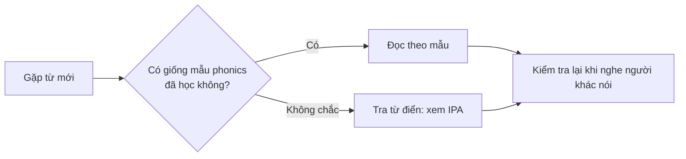
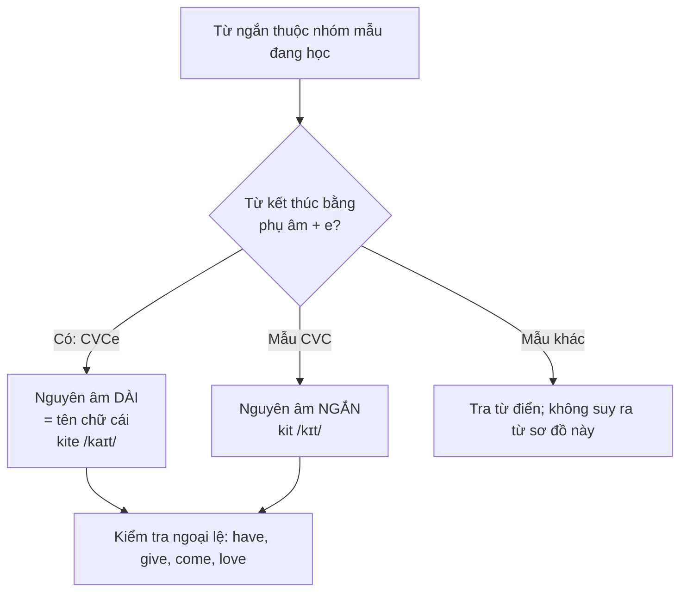

# A0-G002 · Basic Phonics — Chữ viết và âm thanh

## Mục lục

- [A. Lesson Information](#a-lesson-information)
- [B. Warm-up](#b-warm-up-tình-huống-thực-tế)
- [C. WHAT](#c-what-phonics-là-gì)
- [D. WHY](#d-why-vì-sao-tiếng-anh-không-đọc-sao-viết-vậy)
- [E. FORM](#e-form-các-quy-tắc-phonics-cốt-lõi)
- [F. HOW](#f-how-đọc-một-từ-mới-theo-5-bước)
- [G. VISUAL](#g-visual-explanation)
- [H. COMPARISON](#h-comparison)
- [I. COMMON MISTAKES](#i-common-mistakes)
- [J. MEMORY TRICKS](#j-memory-tricks)
- [K. REAL-LIFE APPLICATION](#k-real-life-application)
- [L. PRACTICE EXERCISES](#l-practice-exercises)
- [M. KNOWLEDGE CHECK](#m-knowledge-check)
- [N. ANSWER KEY](#n-answer-key)

---

## A. Lesson Information

| Mục | Nội dung |
|---|---|
| **Lesson ID** | A0-G002 |
| **Topic** | Basic Phonics — Letter–Sound Relationships |
| **Tên tiếng Việt** | Phonics cơ bản: mối quan hệ giữa chữ viết và âm thanh |
| **CEFR Level** | A0 |
| **Prerequisites** | [A0-G001 — Bảng chữ cái](A0-G001-alphabet.md) |
| **Estimated Time** | 75 phút |

**Learning Objectives:**

1. Phân biệt **tên chữ cái** (letter name) và **âm của chữ cái** (letter sound).
2. Đọc đúng 5 nguyên âm ngắn: *a* /æ/, *e* /e/, *i* /ɪ/, *o* /ɒ/, *u* /ʌ/.
3. Áp dụng quy tắc **"magic e"** (*cap → cape*, *kit → kite*).
4. Đọc đúng các tổ hợp phụ âm *sh, ch, th, ph, ck, ng, wh*.
5. Nhận biết chữ câm (silent letters) thường gặp và các trường hợp *c, g* đọc hai cách.

---

## B. Warm-up: Tình huống thực tế

Bạn nhìn thấy hai từ: **hat** và **hate**. Chúng chỉ khác nhau một chữ *e* ở cuối — và chữ *e* đó **không được đọc**. Thế nhưng:

- *hat* đọc là /hæt/ (cái mũ)
- *hate* đọc là /heɪt/ (ghét)

🤔 **Hãy suy nghĩ:** Nếu chữ *e* cuối không được đọc, tại sao nó lại làm chữ *a* thay đổi cách đọc? Và có cách nào để đoán được cách đọc của một từ mới mà không cần tra từ điển không?

Phonics cung cấp các mẫu để thử cách đọc. Bạn vẫn cần nghe mẫu hoặc tra từ điển khi gặp từ mới; bài này không đưa ra tỷ lệ đoán đúng.

---

## C. WHAT: Phonics là gì?

**Phonics** (ngữ âm – chữ viết) là cách học **mối liên hệ giữa chữ viết và âm thanh**: chữ hoặc nhóm chữ nào thường tạo ra âm nào.

| Khái niệm | Ví dụ |
|---|---|
| **Letter name** (tên chữ) — học ở bài trước | C = /siː/ |
| **Letter sound** (âm của chữ trong từ) — học ở bài này | C trong *cat* = /k/ |
| **Digraph** (tổ hợp hai chữ tạo một âm) | *sh* trong *ship* = /ʃ/ |
| **Silent letter** (chữ câm, viết nhưng không đọc) | *k* trong *knife* |

**Phonics giúp bạn:**

- Đọc được từ mới với xác suất đúng cao (không phải 100%).
- Đoán được cách viết khi nghe một từ.
- Hiểu vì sao từ điển ghi phiên âm khác với mặt chữ.

**Phonics KHÔNG phải:** một bộ luật tuyệt đối. Tiếng Anh có nhiều ngoại lệ. Hãy coi phonics là **bản đồ đường chính**, còn từ điển là **GPS** khi gặp đường lạ.

---

## D. WHY: Vì sao tiếng Anh không "đọc sao viết vậy"?

Tiếng Anh vay mượn từ rất nhiều ngôn ngữ (Latin, Pháp, Hy Lạp, Đức cổ, Bắc Âu...). Cách phát âm thay đổi qua hàng trăm năm, nhưng cách viết thì ít thay đổi hơn. Kết quả là:

- **Một âm — nhiều cách viết:** âm /iː/: *see, sea, piece, me, key*.
- **Một cách viết — nhiều âm:** *ough*: *though* /ðəʊ/, *through* /θruː/, *tough* /tʌf/.

Nhiều từ thông dụng tuân theo các **mẫu (pattern)** lặp lại. Học những mẫu này giúp bạn đọc tự tin hơn nhiều so với đoán mò.

---

## E. FORM: Các quy tắc phonics cốt lõi

### E1. Âm của 5 nguyên âm ngắn (short vowels)

Phiên âm mặc định theo mẫu Anh–Anh; cách đọc Anh–Mỹ cũng hợp lệ. **Long/short vowel trong phonics là nhãn nhóm cách đọc**, không có nghĩa chỉ kéo dài/rút ngắn cùng một âm. A trong cap /æ/ và cape /eɪ/ khác cả chất lượng âm. C và V dưới đây chỉ đơn vị phụ âm/nguyên âm: trong shop, hai chữ sh cùng biểu thị một phụ âm /ʃ/. Khi bài yêu cầu cặp CVC–CVCe đơn giản, dùng dạng ba chữ rồi thêm e như mat–mate.

Khi một nguyên âm nằm **giữa hai phụ âm** trong từ ngắn (mẫu **CVC** = Consonant – Vowel – Consonant: phụ âm – nguyên âm – phụ âm), nó thường đọc **ngắn**:

| Chữ | Âm ngắn | Ví dụ | Gợi ý cho người Việt |
|---|---|---|---|
| a | /æ/ | cat, bag, map, hat | Giữa "a" và "e", miệng mở rộng sang hai bên |
| e | /e/ | bed, pen, red, ten | Gần "e" tiếng Việt |
| i | /ɪ/ | sit, big, pin, kid | "i" rất ngắn, hơi chùng |
| o | /ɒ/ (UK), /ɑː/ (US) | hot, dog, box, top | Gần "o" tròn môi (UK) / "a" (US) |
| u | /ʌ/ | cup, bus, sun, run | Gần "ă/â" tiếng Việt |

### E2. Quy tắc "magic e" (mẫu CVCe)

Khi thêm **e câm** vào cuối từ CVC, nguyên âm thường đọc **giống tên chữ cái của nó** (gọi là **long vowel** — nguyên âm dài):

| CVC (ngắn) | CVCe (dài) | Âm dài |
|---|---|---|
| cap /kæp/ | cape /keɪp/ | a → /eɪ/ (tên chữ A) |
| pet /pet/ | Pete /piːt/ | e → /iː/ (tên chữ E) |
| kit /kɪt/ | kite /kaɪt/ | i → /aɪ/ (tên chữ I) |
| hop /hɒp/ | hope /həʊp/ | o → /əʊ/ (tên chữ O) |
| cut /kʌt/ | cute /kjuːt/ | u → /juː/ (tên chữ U) |

> ⚠️ **Ngoại lệ thường gặp:** *have* /hæv/, *give* /ɡɪv/, *live* (động từ) /lɪv/, *come* /kʌm/, *some* /sʌm/, *love* /lʌv/, *done* /dʌn/. Những từ rất thông dụng thường là ngoại lệ — hãy học thuộc chúng.

### E3. Tổ hợp chữ phụ âm (consonant letter groups)

| Tổ hợp | Âm | Ví dụ |
|---|---|---|
| sh | /ʃ/ | ship, fish, shop |
| ch | /tʃ/ | chair, lunch, teacher |
| th | /θ/ (không rung) | think, three, mouth |
| th | /ð/ (rung) | this, mother, the |
| ph | /f/ | phone, photo |
| ck | /k/ | back, clock, duck |
| ng | /ŋ/ | sing, long, morning |
| wh | /w/ | what, white, when |
| qu | /kw/ | queen, quick |

**Digraph** như sh biểu thị một âm. Riêng **qu /kw/** trong queen là hai âm /k/ + /w/, không phải một âm đơn. Bảng ghi cách đọc trong các từ mẫu: ch còn đọc /k/ trong school; wh có thể là /ʍ/ ở một số giọng, và là /h/ trong who. Không suy ra mọi tổ hợp luôn có một cách đọc.

### E4. Nhóm nguyên âm đôi chữ (vowel teams)

| Tổ hợp | Âm thường gặp | Ví dụ | Ngoại lệ đáng chú ý |
|---|---|---|---|
| ee | /iː/ | see, tree, green | — |
| ea | /iː/ | sea, eat, teach | *bread, head* /e/; *great* /eɪ/ |
| ai, ay | /eɪ/ | rain, wait, day, play | *said* /e/ |
| oa | /əʊ/ | boat, road, coat | — |
| oo | /uː/ hoặc /ʊ/ | food, moon / book, good | *blood* /ʌ/ |
| ow | /aʊ/ hoặc /əʊ/ | how, now / snow, slow | — |
| ou | /aʊ/ | house, out, mouth | *you* /uː/, *young* /ʌ/ |

### E5. C và G "cứng" và "mềm"

| Chữ | Trước a, o, u hoặc phụ âm | Trước e, i, y |
|---|---|---|
| **c** | /k/ "cứng": *cat, cold, cup, class* | /s/ "mềm": *city, cent, bicycle* |
| **g** | /ɡ/ "cứng": *game, go, gun, green* | thường /dʒ/ "mềm": *gym, giant, page* |

> ⚠️ Đây là xu hướng cho từ quen thuộc, không phải luật tuyệt đối; chẳng hạn c trong cello là /tʃ/. Quy tắc của **g** có nhiều ngoại lệ: *get, give, girl, begin* vẫn đọc /ɡ/.

### E6. Chữ câm (silent letters) thường gặp

| Chữ câm | Ví dụ |
|---|---|
| k trước n | **k**now, **k**nife, **k**nee |
| w trước r | **w**rite, **w**rong |
| b sau m | clim**b**, com**b**, lam**b** |
| h | **h**our, **h**onest, w**h**at (ở nhiều giọng) |
| l | ta**l**k, wa**l**k, ha**l**f |
| gh | ni**gh**t, ri**gh**t, dau**gh**ter |

---

## F. HOW: Đọc một từ mới theo 5 bước

**Quy trình:**

1. Tìm **tổ hợp chữ** quen thuộc (*sh, ch, th, ee, ai...*).
2. Xác định **mẫu**: CVC (ngắn) hay CVCe (dài)?
3. Kiểm tra **c/g** đứng trước chữ gì.
4. Để ý **chữ câm**.
5. Ghép âm lại → đọc → **kiểm tra bằng từ điển** nếu từ quan trọng.

**Ví dụ phân tích (≥ 8 ví dụ):**

| # | Từ | Phân tích | Cách đọc | Nghĩa |
|---|---|---|---|---|
| 1 | **shop** | *sh* = /ʃ/ + CVC → *o* ngắn /ɒ/ | /ʃɒp/ | cửa hàng |
| 2 | **shape** | *sh* = /ʃ/ + CVCe → *a* dài /eɪ/ | /ʃeɪp/ | hình dạng |
| 3 | **chin** | *ch* = /tʃ/ + CVC → *i* ngắn /ɪ/ | /tʃɪn/ | cằm |
| 4 | **time** | CVCe → *i* = /aɪ/ | /taɪm/ | thời gian |
| 5 | **rice** | CVCe → *i* = /aɪ/; *c* trước *e* = /s/ | /raɪs/ | gạo, cơm |
| 6 | **think** | *th* không rung /θ/ + *ink* | /θɪŋk/ | nghĩ |
| 7 | **knock** | *k* câm + *ck* = /k/ | /nɒk/ | gõ cửa |
| 8 | **cream** | *c* trước *r* = /k/ + *ea* = /iː/ | /kriːm/ | kem |
| 9 | **road** | *oa* = /əʊ/ | /rəʊd/ | con đường |
| 10 | **cycle** | *c* trước *y* = /s/; *y* = /aɪ/ | /ˈsaɪkəl/ | đạp xe, chu kỳ |

> 💡 Ví dụ 5 và 10 cho thấy **nhiều quy tắc kết hợp** trong một từ. Đây là lý do bạn nên đi theo đủ 5 bước.

---

## G. VISUAL EXPLANATION

### G1. Sơ đồ quyết định: nguyên âm ngắn hay dài?

### G2. Breakdown một từ

`ch | ee | se` → **cheese** /tʃiːz/

- **ch** → /tʃ/
- **ee** → /iː/
- **se** → /z/ trong cheese; e cuối câm. Không dùng vị trí s để đoán chắc: case có /s/, cheese có /z/.

---

## H. COMPARISON

### Nguyên âm ngắn và nguyên âm dài cùng một chữ

| Chữ | Ngắn (CVC) | Dài (CVCe / tên chữ) |
|---|---|---|
| a | m**a**d /mæd/ — giận | m**a**de /meɪd/ — đã làm |
| e | p**e**t /pet/ — thú cưng | P**e**te /piːt/ — tên người |
| i | f**i**n /fɪn/ — vây cá | f**i**ne /faɪn/ — ổn |
| o | n**o**t /nɒt/ — không | n**o**te /nəʊt/ — ghi chú |
| u | t**u**b /tʌb/ — bồn | t**u**be /tjuːb/ — ống |

### th rung và th không rung

| /θ/ không rung (thổi hơi) | /ð/ rung (dây thanh rung) |
|---|---|
| **th**ink, **th**ree, **th**ank, mon**th**, ba**th** | **th**is, **th**at, **th**e, mo**th**er, wi**th** |

> 📌 **With có cả /wɪð/ và /wɪθ/** tùy giọng/ngữ cảnh; cả hai được chấp nhận.

> 📌 **Quy tắc ra quyết định (gần đúng):** Các từ chức năng hay dùng (*the, this, that, these, those, they, them, there, then, than*) dùng /ð/. Phần lớn danh từ, động từ, tính từ "nội dung" bắt đầu bằng *th* dùng /θ/ (*think, thing, thick, theatre*). Có ngoại lệ — hãy kiểm tra bằng từ điển.

---

## I. COMMON MISTAKES

| # | ❌ Sai | ✅ Đúng | Nguyên nhân | Cách tránh |
|---|---|---|---|---|
| 1 | Đọc *cat* như "két" hoặc "cát" | /kæt/ — miệng mở rộng | Tiếng Việt không có /æ/ | Luyện cặp *bed – bad*, *pen – pan* |
| 2 | Đọc *knife* là "k-nai-f" | /naɪf/ | Không biết chữ câm | Nhớ: *kn-* đầu từ → *k* câm |
| 3 | Đọc *think* là "thinh" hoặc "tinh" | /θɪŋk/ — đầu lưỡi giữa hai hàm răng, thổi hơi | Tiếng Việt không có /θ/ | Đặt đầu lưỡi giữa răng khi tập |
| 4 | Đọc *city* là "ki-ti" | /ˈsɪti/ | Không biết c mềm | *c* trước *e, i, y* → /s/ |
| 5 | Đọc *have* là /heɪv/ theo magic e | /hæv/ | Áp quy tắc vào ngoại lệ | Học thuộc nhóm ngoại lệ: *have, give, live, come, some, love* |
| 6 | Bỏ âm cuối: *rice* thành "rai" | /raɪs/ — có /s/ cuối | Tiếng Việt không bật phụ âm cuối như tiếng Anh | Luôn đọc rõ âm cuối, sẽ học kỹ ở [PRON-11](../../08-PRONUNCIATION/PRON-11-vietnamese-learner-mistakes.md) |
| 7 | Đọc *photo* là "pô-tô" | /ˈfəʊtəʊ/ | Ảnh hưởng từ mượn tiếng Việt | *ph* = /f/ |

---

## J. MEMORY TRICKS

1. **"Magic e nói tên bạn của nó":** E câm cuối từ "chạm phép thuật" vào nguyên âm đứng trước, khiến nguyên âm đó **đọc lên tên của chính nó** (A /eɪ/, I /aɪ/, O /əʊ/, U /juː/). Đây là mẹo, có ngoại lệ (mục E2).
2. **"When two vowels go walking, the first one does the talking"** — Khi hai nguyên âm đi cùng nhau, chữ đầu thường "nói" tên của nó: *rain* (a → /eɪ/), *boat* (o → /əʊ/), *team* (e → /iː/). ⚠️ Mẹo này **chỉ đúng khoảng một phần các trường hợp** (sai với *bread, said, food*) — dùng để đoán, không dùng để khẳng định.
3. **C và G "mềm" trước E, I, Y:** Dùng như xu hướng, luôn nhớ get, give, girl là ngoại lệ; không xem câu mẹo là luật.
4. **Sổ ngoại lệ:** Mỗi khi gặp từ "không theo luật", ghi vào một trang riêng. Sau 1 tháng, bạn sẽ thấy các ngoại lệ cũng lặp lại theo nhóm.

---

## K. REAL-LIFE APPLICATION

### Đọc biển hiệu trên phố

Bạn đi dạo và đọc các biển hiệu. Hãy đọc to từng biển, áp dụng phonics:

> 🏪 **FISH SHOP** — /fɪʃ ʃɒp/ — Cửa hàng cá
> ☕ **CHEAP COFFEE** — /tʃiːp ˈkɒfi/ — Cà phê giá rẻ
> 🚌 **BUS STOP** — /bʌs stɒp/ — Điểm dừng xe buýt
> 🍦 **ICE CREAM** — /aɪs kriːm/ — Kem
> 🏠 **HOME SWEET HOME** — /həʊm swiːt həʊm/ — Tổ ấm thân yêu
> ⚠️ **WET PAINT** — /wet peɪnt/ — Sơn ướt

**Giải thích:** *fish* (CVC + *sh*), *shop* (*sh* + CVC), *cheap* (*ch* + *ea*), *bus* (CVC /ʌ/), *ice* (*i* dài + *c* mềm), *cream* (*ea*), *home* (magic e — đây là trường hợp đúng luật, khác với *come*), *sweet* (*ee*), *wet* (CVC), *paint* (*ai*).

**Useful expressions:**

- *How do you pronounce this word?* — Từ này phát âm thế nào?
- *Is the "k" silent?* — Chữ *k* có câm không?

---

## L. PRACTICE EXERCISES

> ✍️ Đáp án: [A0-G002-ANSWERS](../../12-ANSWERS-AND-EXPLANATIONS/A0/A0-G002-ANSWERS.md)

### Level 1 — Recognition

Chọn từ có **âm được gạch chân/in đậm khác** với các từ còn lại.

**L1.1.** A. c**a**t  B. h**a**t  C. m**a**ke  D. m**a**p
**L1.2.** A. k**i**te  B. s**i**t  C. t**i**me  D. f**i**ne
**L1.3.** A. **c**ity  B. **c**ake  C. **c**ent  D. ri**c**e
**L1.4.** A. **th**ink  B. **th**ree  C. **th**is  D. ba**th**
**L1.5.** Từ nào có **chữ câm**?  A. desk  B. write  C. bag  D. stop
**L1.6.** Từ nào theo mẫu **CVCe**?  A. hot  B. note  C. dog  D. sun

### Level 2 — Controlled Practice

Thêm *e* câm để tạo từ mới, rồi viết âm của nguyên âm trong từ mới.

**L2.1.** tap → ______ (a = /___/)
**L2.2.** pin → ______ (i = /___/)
**L2.3.** rob → ______ (o = /___/)
**L2.4.** cub → ______ (u = /___/)

Điền tổ hợp chữ (*sh, ch, th, ph, ck*) để tạo từ đúng:

**L2.5.** ___ip (tàu thủy)
**L2.6.** lun___ (bữa trưa)
**L2.7.** ___one (điện thoại)
**L2.8.** ba___ (lưng)
**L2.9.** ___ank you (cảm ơn)
**L2.10.** tea___er (giáo viên)

### Level 3 — Error Correction

Mỗi cách đọc sau có **một lỗi**. Chỉ ra và sửa.

**L3.1.** *knee* → /kniː/
**L3.2.** *cute* → /kʌt/
**L3.3.** *city* → /ˈkɪti/
**L3.4.** *phone* → /pəʊn/
**L3.5.** *come* → /kəʊm/

### Level 4 — Production

**L4.1.** Viết 3 cặp từ CVC – CVCe chưa xuất hiện trong các bảng và bài tập ở trên và ghi nghĩa nếu bạn biết.
**L4.2.** Viết 4 từ có chữ *c* đọc /k/ và 2 từ có chữ *c* đọc /s/.
**L4.3.** Phân tích theo 5 bước (như mục F) cho các từ: *cheese, white, night, page*.
**L4.4.** Viết 3 từ có *ea* đọc /iː/ và 1 từ có *ea* đọc /e/.

### Level 5 — Real Communication

**L5.1.** **Reading aloud:** Nghĩa đoạn: Tôi thích cá và cơm. Mẹ làm bữa trưa ngon. Chúng tôi ăn ở bàn trắng trong bếp. Sau đó tôi đi xe buýt đến trường. Tôi nghĩ hôm nay là ngày đẹp trời. Ở đây chỉ luyện đọc thành tiếng; ngữ pháp sẽ học sau.  Đọc to đoạn sau 3 lần, ghi âm lần 3. Gạch chân các từ bạn không chắc chắn và kiểm tra bằng từ điển:
> *I like fish and rice. My mother makes a nice lunch. We eat at the white table in the kitchen. Then I take the bus to school. I think it is a fine day.*

**L5.2.** **Spelling from sound:** Đây là luyện có chuẩn bị vì danh sách từ đã hiện trong đề. Che danh sách khi nghe; để kiểm tra độc lập, nhờ người khác chọn danh sách tương tự và giữ đáp án.  Dùng TTS đọc các từ: *ship, cheap, phone, knife, smile, boat*. Nghe (không nhìn) và viết chính tả. So sánh và ghi lại những chữ bạn viết sai.

---

## M. KNOWLEDGE CHECK

### 5 câu hỏi tự kiểm tra

1. Tên chữ cái và âm của chữ cái khác nhau thế nào? Cho ví dụ với chữ C.
2. Quy tắc "magic e" là gì? Kể 3 ngoại lệ.
3. Chữ *c* đọc là /s/ khi nào?
4. Chữ nào câm trong *write, know, lamb*?
5. *ph* đọc là gì?

### Checklist

- [ ] Tôi đọc đúng 5 nguyên âm ngắn trong từ CVC.
- [ ] Tôi áp dụng được magic e và nhớ các ngoại lệ phổ biến.
- [ ] Tôi đọc đúng *sh, ch, th, ph, ck, ng*.
- [ ] Tôi nhận ra chữ câm trong các từ thông dụng.

### 3 lỗi quan trọng cần nhớ

1. *have, give, come, love, some* **không** theo magic e.
2. *c* trước *e/i/y* thường đọc **/s/** (*city, rice*).
3. Đừng bỏ âm cuối (*rice* /raɪs/, *bus* /bʌs/).

### Lịch ôn tập

| Ngày | Việc cần làm |
|---|---|
| Ngày 1 | Đọc to bảng E2 và E3; làm lại L1 |
| Ngày 3 | Đọc lại đoạn L5.1 không nhìn ghi chú |
| Ngày 7 | Tìm 10 từ mới trong một bài đọc bất kỳ, đoán cách đọc rồi kiểm tra từ điển |

### Liên kết

- ➡️ Bài tiếp theo: [A0-G003 — English Sounds & IPA](A0-G003-english-sounds-ipa.md)
- ⬅️ Bài trước: [A0-G001 — Alphabet](A0-G001-alphabet.md)
- 🔁 Ôn tập liên quan: [PRON-02 — Vowels & Consonants](../../08-PRONUNCIATION/PRON-02-vowels-consonants.md)

---

## N. ANSWER KEY

👉 [A0-G002-ANSWERS.md](../../12-ANSWERS-AND-EXPLANATIONS/A0/A0-G002-ANSWERS.md)
