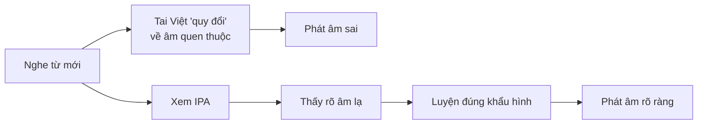
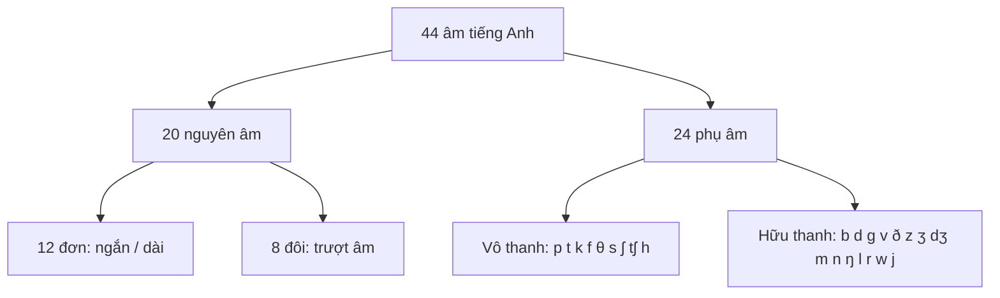

# A0-G003 · English Sounds & IPA — Âm tiếng Anh và bảng phiên âm quốc tế

## Mục lục

- [A. Lesson Information](#a-lesson-information)
- [B. Warm-up](#b-warm-up-tình-huống-thực-tế)
- [C. WHAT](#c-what-ipa-là-gì)
- [D. WHY](#d-why-vì-sao-người-việt-cần-ipa)
- [E. FORM](#e-form-hệ-thống-âm-tiếng-anh)
- [F. HOW](#f-how-đọc-phiên-âm-trong-từ-điển)
- [G. VISUAL](#g-visual-explanation)
- [H. COMPARISON](#h-comparison-âm-tiếng-việt-và-âm-tiếng-anh)
- [I. COMMON MISTAKES](#i-common-mistakes)
- [J. MEMORY TRICKS](#j-memory-tricks)
- [K. REAL-LIFE APPLICATION](#k-real-life-application)
- [L. PRACTICE EXERCISES](#l-practice-exercises)
- [M. KNOWLEDGE CHECK](#m-knowledge-check)
- [N. ANSWER KEY](#n-answer-key)

---

## A. Lesson Information

| Mục | Nội dung |
|---|---|
| **Lesson ID** | A0-G003 |
| **Topic** | English Sounds & the International Phonetic Alphabet (IPA) |
| **Tên tiếng Việt** | Âm tiếng Anh và bảng ký hiệu ngữ âm quốc tế |
| **CEFR Level** | A0 |
| **Prerequisites** | [A0-G002 — Basic Phonics](A0-G002-phonics-basics.md) |
| **Estimated Time** | 90 phút |

**Learning Objectives:**

1. Hiểu IPA là gì và vì sao nó đáng tin hơn mặt chữ khi học phát âm.
2. Phân biệt **chất lượng và độ dài nguyên âm**, **nguyên âm đơn – đôi**.
3. Phân biệt **phụ âm hữu thanh** (voiced) và **vô thanh** (voiceless).
4. Đọc được phiên âm IPA của một từ trong từ điển, kể cả dấu trọng âm.
5. Nhận biết các âm/vị trí âm thường cần luyện thêm: /θ/, /ð/, /ʃ/, /ʒ/, /æ/, âm cuối.

---

## B. Warm-up: Tình huống thực tế

Hai người bạn của bạn tranh luận:

> **An:** *"Sheep" và "ship" đọc giống nhau mà!*
> **Bình:** *Không, một từ là con cừu, một từ là con tàu. Đọc khác nhau chứ.*

Từ điển ghi:

- **sheep** /ʃiːp/
- **ship** /ʃɪp/

🤔 **Hãy suy nghĩ:** Hai phiên âm khác nhau ở đâu? Ký hiệu **ː** có ý nghĩa gì? Nếu bạn nói *"I see a ship"* nhưng phát âm thành *sheep*, người nghe sẽ hiểu sai thế nào?

---

## C. WHAT: IPA là gì?

**IPA (International Phonetic Alphabet)** — Bảng ký hiệu ngữ âm quốc tế — là hệ thống ký hiệu giúp mô tả âm nói. Phiên âm giữa hai dấu / / trong từ điển ghi các âm vị theo quy ước của giọng được chọn; không mô tả hết mọi biến thể phát âm trong lời nói. Điều này khác với chữ viết tiếng Anh, nơi một chữ có thể đọc nhiều cách.

| Chữ viết | Có thể đọc là | IPA ghi rõ |
|---|---|---|
| **a** | /æ/ (cat), /eɪ/ (cake), /ɑː/ (car), /ɔː/ (ball), /ə/ (about) | Mỗi âm một ký hiệu riêng |

Một mô hình âm vị Anh – Anh truyền thống dùng trong tài liệu học có **44 âm**; số lượng/phân loại thay đổi theo giọng và cách phân tích:

| Nhóm | Số lượng | Ví dụ |
|---|---|---|
| **Monophthongs** (nguyên âm đơn) | 12 | /iː/, /ɪ/, /e/, /æ/... |
| **Diphthongs** (nguyên âm đôi) | 8 | /eɪ/, /aɪ/, /əʊ/... |
| **Consonants** (phụ âm) | 24 | /p/, /b/, /θ/, /ð/... |

> 💡 Nhiều giọng Anh – Mỹ phát âm /r/ sau nguyên âm, trong khi giọng Anh – Anh dùng làm mẫu ở đây thường không đọc /r/ khi không có nguyên âm theo sau. Khi luyện, chọn một giọng mẫu để đối chiếu; mục tiêu là người nghe hiểu rõ. Bài này không dùng khác biệt giọng để kết luận đúng/sai nếu đó là biến thể có trong từ điển.

**Ký hiệu đi kèm:**

| Ký hiệu | Ý nghĩa | Ví dụ |
|---|---|---|
| `/ /` | Phiên âm âm vị (cách viết trong từ điển) | /kæt/ |
| **ː** | Ký hiệu độ dài trong hệ phiên âm đang dùng | /iː/ có dấu dài; /ɪ/ là nguyên âm khác về cả chất lượng, không chỉ thời lượng |
| **ˈ** (dấu phẩy trên) | Trọng âm chính đặt **trước** âm tiết được nhấn | /ˈteɪbəl/ → nhấn TA |
| **ˌ** (dấu phẩy dưới) | Trọng âm phụ | /ˌɪnfəˈmeɪʃən/ |

---

## D. WHY: Vì sao người Việt cần IPA?

1. **Chữ viết không luôn cho biết trực tiếp cách đọc** (bài A0-G002). IPA giúp nhận diện âm, nhưng cần kết hợp âm thanh mẫu; không suy ra toàn bộ khẩu hình hoặc giọng chỉ từ ký hiệu.
2. **Tiếng Việt thiếu một số âm của tiếng Anh**, nên tai người Việt có xu hướng "quy" âm lạ về âm Việt gần nhất (/θ/ → "th" Việt hoặc "t", /ʃ/ → "s"). IPA giúp bạn **nhìn thấy** sự khác biệt mà tai chưa nghe ra.
3. **Âm cuối:** Tiếng Việt có âm cuối nhưng thường không bật hơi rõ (*học, mát*); nhiều âm cuối tiếng Anh như /s/, /z/, /ʃ/, /tʃ/, /v/, /l/ không xuất hiện ở cuối âm tiết tiếng Việt. IPA cho bạn thấy rõ từ kết thúc bằng âm gì.

---

## E. FORM: Hệ thống âm tiếng Anh

### E1. 12 nguyên âm đơn (monophthongs)

| Ngắn | Ví dụ | Dài | Ví dụ |
|---|---|---|---|
| /ɪ/ | ship, sit, big | /iː/ | sheep, seat, see |
| /e/ | bed, pen, said | /ɜː/ | bird, work, learn |
| /æ/ | cat, bad, apple | /ɑː/ | car, father, half |
| /ʌ/ | cup, love, money | /ɔː/ | door, ball, walk |
| /ɒ/ | hot, dog, what | /uː/ | food, blue, two |
| /ʊ/ | book, good, put | | |
| /ə/ (schwa) | **a**bout, teach**er**, sof**a** | | |

> 💡 **/ə/ — schwa** là âm phổ biến nhất trong tiếng Anh. Nó là âm "ơ" rất nhẹ, xuất hiện ở các âm tiết **không được nhấn**: *banana* /bəˈnɑːnə/.

### E2. 8 nguyên âm đôi (diphthongs)

Nguyên âm đôi là sự **trượt** từ âm này sang âm khác trong một âm tiết.

| IPA | Ví dụ | IPA | Ví dụ |
|---|---|---|---|
| /eɪ/ | day, name, rain | /aʊ/ | now, house, out |
| /aɪ/ | my, time, buy | /ɪə/ | here, near, ear |
| /ɔɪ/ | boy, coin, toy | /eə/ | where, hair, care |
| /əʊ/ | go, home, road | /ʊə/ | tour, pure (ít gặp, nhiều người đọc /ɔː/) |

### E3. 24 phụ âm (consonants)

Nhiều phụ âm tạo thành **cặp vô thanh – hữu thanh**, có vị trí/cách cấu âm gần nhau. Sự rung dây thanh là một đặc điểm quan trọng; trong lời nói, độ bật hơi và thời lượng cũng có thể khác.

| Vô thanh (voiceless) | Ví dụ | Hữu thanh (voiced) | Ví dụ |
|---|---|---|---|
| /p/ | pen, cup | /b/ | bag, job |
| /t/ | tea, cat | /d/ | dog, bed |
| /k/ | key, back | /ɡ/ | go, bag |
| /f/ | fish, life | /v/ | very, five |
| /θ/ | think, mouth | /ð/ | this, mother |
| /s/ | sun, bus | /z/ | zoo, is |
| /ʃ/ | she, fish | /ʒ/ | television, usually |
| /tʃ/ | chair, watch | /dʒ/ | job, age |

Các phụ âm còn lại trong bảng học này: /m/ (man), /n/ (no), /ŋ/ (sing), /l/ (leg), /r/ (red), /w/ (we), /j/ (yes) thường được xếp vào nhóm hữu thanh; **/h/ (hat) là vô thanh**. Không gọi cả nhóm là “đều hữu thanh”.

> **Cách kiểm tra hữu thanh/vô thanh:** Đặt ngón tay lên cổ họng, phát âm kéo dài /sssss/ rồi /zzzzz/. Bạn sẽ cảm thấy **rung** ở /z/ — đó là âm hữu thanh.

---

## F. HOW: Đọc phiên âm trong từ điển

### Quy trình 4 bước

1. **Nhận diện âm tiết** theo nguyên âm và cách đọc mẫu; nguyên âm đôi nằm trong một âm tiết. Một số cách phiên âm còn có phụ âm tạo âm tiết, nên đây là cách hỗ trợ ban đầu, không phải quy tắc đếm tuyệt đối.
2. **Tìm dấu trọng âm ˈ** — âm tiết ngay sau dấu này được đọc to, dài, cao hơn.
3. **Đọc từng ký hiệu**, chú ý ː (dài) và âm cuối.
4. **Ghép lại** và nói cả từ 3 lần.

### Ví dụ phân tích

| # | Từ | IPA | Phân tích | Nghĩa |
|---|---|---|---|---|
| 1 | teacher | /ˈtiːtʃə/ | 2 âm tiết: **TEE**-chə; nhấn âm 1; /ə/ cuối nhẹ | giáo viên |
| 2 | banana | /bəˈnɑːnə/ | 3 âm tiết: bə-**NAA**-nə; hai schwa nhẹ | quả chuối |
| 3 | computer | /kəmˈpjuːtə/ | kəm-**PYOO**-tə; nhấn âm 2 | máy tính |
| 4 | thank | /θæŋk/ | /θ/ thổi hơi + /æ/ + /ŋk/ | cảm ơn |
| 5 | usually | /ˈjuːʒuəli/ | có âm /ʒ/ hiếm gặp | thường thường |
| 6 | world | /wɜːld/ | /ɜː/ dài + cụm âm cuối /ld/ | thế giới |
| 7 | five | /faɪv/ | âm cuối /v/ hữu thanh, môi dưới chạm răng trên | số năm |
| 8 | watched | /wɒtʃt/ | đuôi *-ed* đọc /t/ — 1 âm tiết | đã xem |
| 9 | hotel | /həʊˈtel/ | nhấn âm 2, khác với "hô-ten" tiếng Việt | khách sạn |
| 10 | vegetable | /ˈvedʒtəbəl/ | dễ bị đọc thành 4 nhịp khi nhìn chữ, nhưng phiên âm này có 3 âm tiết | rau củ |

> Ví dụ 10 cho thấy số nhóm chữ không bằng số âm tiết. Nghe mẫu rồi đọc theo phiên âm, không chèn thêm nguyên âm chỉ vì nhìn thấy nhiều chữ.

---

## G. VISUAL EXPLANATION

### G1. Bản đồ nguyên âm theo vị trí lưỡi (đơn giản hóa)

| | Lưỡi phía trước | Lưỡi ở giữa | Lưỡi phía sau |
|---|---|---|---|
| **Miệng khép (lưỡi cao)** | /iː/ /ɪ/ | | /uː/ /ʊ/ |
| **Miệng nửa mở** | /e/ | /ə/ /ɜː/ | /ɔː/ |
| **Miệng mở rộng (lưỡi thấp)** | /æ/ | /ʌ/ | /ɑː/ /ɒ/ |

### G2. Cây phân loại âm

---

## H. COMPARISON: Âm tiếng Việt và âm tiếng Anh

| Âm tiếng Anh | Có trong tiếng Việt? | Người Việt hay thay bằng | Cách phát âm đúng |
|---|---|---|---|
| /θ/ *think* | ❌ | "th" Việt (/tʰ/) hoặc /t/ | Đầu lưỡi đặt nhẹ giữa hai hàm răng, thổi hơi |
| /ð/ *this* | ❌ | /d/ hoặc /z/ | Như /θ/ nhưng dây thanh rung |
| /ʃ/ *she* | Không quy về một chữ Việt: cách đọc s/x thay đổi theo vùng | /s/ | Lưỡi ở sau lợi, môi có thể hơi tròn; nghe mẫu /ʃ/, không chỉ đọc chữ s Việt |
| /ʒ/ *usually* | ❌ | /z/ hoặc "gi" | Như /ʃ/ nhưng rung |
| /æ/ *cat* | ❌ | "e" hoặc "a" | Mở miệng rộng, kéo môi sang hai bên |
| /z/ *zoo, is* | Gần "d/gi" miền Bắc | /s/ hoặc bỏ | Như /s/ nhưng rung, giữ âm |
| Âm cuối /s/, /z/, /v/, /l/, /tʃ/, /dʒ/ | ❌ ở cuối âm tiết | Bỏ âm | Phải phát ra rõ âm cuối |
| Cụm phụ âm /str/, /spl/, /ksts/ | ❌ | Chèn nguyên âm: "sơ-tơ-rít" | Đọc liền, không chèn âm "ơ" |

---

## I. COMMON MISTAKES

| # | ❌ Sai | ✅ Đúng | Nguyên nhân | Cách tránh |
|---|---|---|---|---|
| 1 | *ship* và *sheep* đọc như nhau | /ʃɪp/ — /ʃiːp/: khác chất lượng nguyên âm và thường khác thời lượng | Chỉ kéo dài một âm quen thuộc mà chưa đổi vị trí lưỡi | Nghe mẫu cả cặp; /ɪ/ thường có lưỡi thấp hơn và lùi hơn /iː/; không chỉ kéo dài *ship* |
| 2 | *think* → "tinh" | /θɪŋk/ | Thiếu âm /θ/ | Đầu lưỡi giữa răng, gương soi |
| 3 | *rice* → "rai" | /raɪs/ | Bỏ âm cuối | Kéo dài âm /s/ khi tập |
| 4 | *street* → "sơ-tờ-rít" | /striːt/ | Chèn nguyên âm vào cụm phụ âm | Tập chậm: s...t...r → nhanh dần |
| 5 | *zoo* → /suː/ | /zuː/ | Không phân biệt hữu thanh/vô thanh | Đặt tay lên cổ, cảm nhận rung |
| 6 | Bỏ qua dấu ˈ: *hotel* → "HÔ-ten" | /həʊˈtel/ | Không đọc dấu trọng âm | Âm tiết sau ˈ luôn mạnh hơn |
| 7 | *she* → /siː/ (= *see*) | /ʃiː/ | /ʃ/ bị thay bằng /s/ | Tròn môi, hướng hơi ra trước |

---

## J. MEMORY TRICKS

1. **Gắn mỗi ký hiệu với một từ "chìa khóa":** /æ/ = c**a**t, /ʌ/ = c**u**p, /ɜː/ = b**ir**d, /ə/ = **a**bout. Khi gặp ký hiệu lạ, nghĩ đến từ chìa khóa.
2. **Dấu ː nhắc chú ý độ dài** trong hệ phiên âm của bài. Không có dấu ː không có nghĩa mọi âm đều ngắn: nguyên âm đôi và cách ghi trong từ điển khác cần được đọc theo quy ước. Độ dài thực tế còn phụ thuộc ngữ cảnh; đừng chỉ kéo dài /ɪ/ để tạo /iː/.
3. **Tay trên cổ họng:** cách hỗ trợ cảm nhận rung khi kéo dài cặp /s/–/z/. Không dùng cảm giác này làm phép đo tuyệt đối cho mọi âm trong lời nói nhanh.
4. **Gương soi:** khi tập /θ/, /ð/, đặt đầu lưỡi nhẹ giữa răng hoặc sát răng trên, không cần thè lưỡi nhiều; /f/, /v/ phải thấy **răng trên chạm môi dưới**.

---

## K. REAL-LIFE APPLICATION

### Tra từ điển để tự học

**Tình huống:** Bạn đọc thấy từ *comfortable* và không biết đọc. Bạn tra từ điển và thấy:

> **comfortable** (adj) /ˈkʌmftəbəl/ trong cách ghi Anh – Anh của bài; từ điển có thể ghi thêm biến thể. *Adj* = adjective — tính từ.

**Phân tích:**

- Dấu ˈ trước *kʌm* → nhấn âm tiết đầu: **KUM**-ftə-bəl.
- Không đếm âm tiết bằng số nhóm chữ. Phiên âm Anh – Anh minh họa có 3 âm tiết; chữ *or* không tạo thêm một âm tiết riêng trong cách đọc này.
- /ʌ/ trong âm tiết đầu — không phải "côm".

**Useful expressions khi hỏi về phát âm:**

- *How do you pronounce this word?* — Từ này phát âm thế nào?
- *Where is the stress?* — Trọng âm rơi vào đâu?
- *Is it a long or a short "i"?* — Âm "i" dài hay ngắn?

---

## L. PRACTICE EXERCISES

> ✍️ Đáp án: [A0-G003-ANSWERS](../../12-ANSWERS-AND-EXPLANATIONS/A0/A0-G003-ANSWERS.md)

### Level 1 — Recognition

Chọn phiên âm đúng.

**L1.1.** *ship*  A. /ʃiːp/  B. /ʃɪp/  C. /sɪp/
**L1.2.** *cat*  A. /ket/  B. /kɑːt/  C. /kæt/
**L1.3.** *this*  A. /ðɪs/  B. /θɪs/  C. /dɪs/
**L1.4.** *food*  A. /fʊd/  B. /fuːd/  C. /fəʊd/
**L1.5.** Âm nào là **hữu thanh** (voiced)?  A. /s/  B. /t/  C. /v/  D. /k/
**L1.6.** Trong /ˈteɪbəl/, âm tiết nào được nhấn?  A. teɪ  B. bəl  C. cả hai như nhau

### Level 2 — Controlled Practice

Ghép từ với phiên âm (L2.1–L2.6): *bird, boy, cup, house, she, five*

**L2.1.** /bɔɪ/  **L2.2.** /ʃiː/  **L2.3.** /faɪv/  **L2.4.** /kʌp/  **L2.5.** /bɜːd/  **L2.6.** /haʊs/

Viết cặp **hữu thanh** tương ứng:

**L2.7.** /p/ → /___/  **L2.8.** /f/ → /___/  **L2.9.** /θ/ → /___/  **L2.10.** /s/ → /___/

### Level 3 — Error Correction

Mỗi phiên âm sau có **một ký hiệu sai**. Tìm và sửa.

**L3.1.** *sheep* /ʃɪp/
**L3.2.** *mother* /ˈmʌθə/
**L3.3.** *zoo* /suː/
**L3.4.** *bed* /bæd/
**L3.5.** *hotel* /ˈhəʊtel/

### Level 4 — Production

**L4.1.** Đọc phiên âm và viết từ: /ˈwɔːtə/, /ˈmʌni/, /ˈjeləʊ/, /ˈθɜːti/, /ðeə/.
**L4.2.** Tra từ điển và viết IPA của 5 từ chỉ đồ vật trong phòng bạn. Đánh dấu âm tiết được nhấn.
**L4.3.** Viết 3 cặp từ chỉ khác nhau ở **một nguyên âm**, dùng cặp /ɪ/–/iː/ hoặc /ʊ/–/uː/ (như *ship – sheep*). Tra/nghe mẫu, chỉ ra hai ký hiệu khác nhau; không mô tả chúng chỉ bằng độ dài.
**L4.4.** Phân loại các âm sau thành hữu thanh và vô thanh: /b/, /k/, /ʒ/, /tʃ/, /m/, /ʃ/, /dʒ/, /h/.

### Level 5 — Real Communication

**L5.1.** **Speaking:** Đọc to các câu sau, ghi âm, tự đánh giá âm được in đậm:
> *I **th**ink **th**is **sh**ip is big. **Sh**e sees **th**ree **sh**eep. My mo**th**er **th**anks the tea**ch**er.*

**L5.2.** **Self-study task:** Chọn 5 từ tiếng Anh bạn dùng hằng ngày (ví dụ *Facebook, coffee, hotel, video, menu*). Tra IPA và so sánh với cách người Việt hay đọc. Viết ra điểm khác biệt.

---

## M. KNOWLEDGE CHECK

### 5 câu hỏi tự kiểm tra

1. Ký hiệu **ː** và **ˈ** trong IPA có ý nghĩa gì?
2. Schwa /ə/ là gì? Nó xuất hiện ở đâu?
3. Hữu thanh và vô thanh khác nhau thế nào? Kiểm tra bằng cách nào?
4. Kể ba âm/cụm âm bạn cần luyện thêm và nêu từ ví dụ.
5. Vì sao phải đọc rõ âm cuối?

### Checklist

- [ ] Tôi đọc được 12 nguyên âm đơn với từ chìa khóa.
- [ ] Tôi phân biệt /ɪ/–/iː/, /e/–/æ/ khi nói chậm.
- [ ] Tôi phát âm được /θ/ và /ð/ (có nhìn gương).
- [ ] Tôi đọc được phiên âm trong từ điển, kể cả trọng âm.

### 3 lỗi quan trọng cần nhớ

1. Chất lượng nguyên âm và độ dài đều đáng chú ý: *ship* /ʃɪp/ ≠ *sheep* /ʃiːp/; không chỉ kéo dài cùng một âm.
2. Không bỏ âm cuối, không chèn "ơ" vào cụm phụ âm.
3. Âm tiết đứng **sau** dấu ˈ là âm tiết được nhấn.

### Lịch ôn tập

| Ngày | Việc cần làm |
|---|---|
| Ngày 1 | Đọc bảng E1, E3 với từ ví dụ; làm lại L1 |
| Ngày 3 | Tra IPA 10 từ mới; đọc to |
| Ngày 7 | Ghi âm lại L5.1, so với bản ghi lần đầu |

### Liên kết

- ➡️ Bài tiếp theo: [A0-G004 — Parts of Speech](A0-G004-parts-of-speech.md)
- 🔁 Tra cứu đầy đủ: [PRON-01 — IPA Reference](../../08-PRONUNCIATION/PRON-01-ipa-reference.md)
- 🔁 Lỗi phát âm người Việt: [PRON-11](../../08-PRONUNCIATION/PRON-11-vietnamese-learner-mistakes.md)

---

## N. ANSWER KEY

👉 [A0-G003-ANSWERS.md](../../12-ANSWERS-AND-EXPLANATIONS/A0/A0-G003-ANSWERS.md)

Tham khảo ký hiệu, vị trí nguyên âm và dấu độ dài: [International Phonetic Association — Interactive IPA Chart](https://www.internationalphoneticassociation.org/IPAcharts/IPA_charts_EI/IPA_charts_EI.html). Bảng trong bài là bản hướng dẫn giản lược cho một hệ phiên âm tiếng Anh, không phải toàn bộ IPA.
