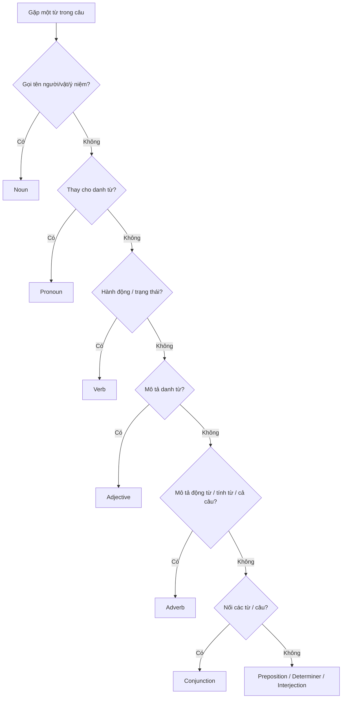

# A0-G004 · Parts of Speech — Từ loại cơ bản

## Mục lục

- [A. Lesson Information](#a-lesson-information)
- [B. Warm-up](#b-warm-up-tình-huống-thực-tế)
- [C. WHAT](#c-what-từ-loại-là-gì)
- [D. WHY](#d-why-vì-sao-phải-biết-từ-loại)
- [E. FORM](#e-form-9-từ-loại-trong-tiếng-anh)
- [F. HOW](#f-how-nhận-diện-từ-loại-trong-câu)
- [G. VISUAL](#g-visual-explanation)
- [H. COMPARISON](#h-comparison)
- [I. COMMON MISTAKES](#i-common-mistakes)
- [J. MEMORY TRICKS](#j-memory-tricks)
- [K. REAL-LIFE APPLICATION](#k-real-life-application)
- [L. PRACTICE EXERCISES](#l-practice-exercises)
- [M. KNOWLEDGE CHECK](#m-knowledge-check)
- [N. ANSWER KEY](#n-answer-key)

---

## A. Lesson Information

| Mục | Nội dung |
|---|---|
| **Lesson ID** | A0-G004 |
| **Topic** | Parts of Speech |
| **Tên tiếng Việt** | Từ loại cơ bản |
| **CEFR Level** | A0 |
| **Prerequisites** | Không bắt buộc (nên học sau A0-G001–G003 để đọc đúng ví dụ) |
| **Estimated Time** | 60 phút |

**Learning Objectives:**

1. Biết tên tiếng Anh – tiếng Việt của 9 từ loại.
2. Hiểu mỗi từ loại "làm công việc gì" trong câu.
3. Nhận diện từ loại dựa vào **vị trí** và **chức năng**, không chỉ dựa vào nghĩa.
4. Phân biệt **từ nội dung** (content words) và **từ chức năng** (function words).
5. Biết rằng một từ có thể thuộc nhiều từ loại tùy vị trí trong câu.

---

## B. Warm-up: Tình huống thực tế

Hãy nhìn hai câu sau:

> 1. I **work** in a bank. (Tôi **làm việc** ở ngân hàng.)
> 2. My **work** is interesting. (**Công việc** của tôi thú vị.)

Cùng một từ **work**, nhưng ở câu 1 nó là hành động (*làm việc*), ở câu 2 nó là sự vật (*công việc*).

🤔 **Hãy suy nghĩ:** Làm sao để biết *work* đang đóng vai trò gì? Bạn đã dựa vào điều gì để đoán nghĩa của nó trong mỗi câu?

Câu trả lời nằm ở **vị trí, nghĩa và cách kết hợp của từ trong câu** — đó là chìa khóa của bài này.

---

## C. WHAT: Từ loại là gì?

**Từ loại (part of speech / word class)** là nhóm từ có cách kết hợp và đặc điểm ngữ pháp tương tự. Đừng nhầm từ loại với vai trò: một danh từ có thể làm chủ ngữ hoặc tân ngữ. Bạn có thể hình dung một câu tiếng Anh như một **đội bóng**: mỗi cầu thủ có một vị trí và nhiệm vụ riêng — thủ môn, hậu vệ, tiền đạo. Từ loại chính là "vị trí" của từ trong đội hình câu.

Biết từ loại giúp bạn:

- **Đặt từ đúng chỗ** trong câu (tiếng Anh rất coi trọng trật tự từ).
- **Hiểu từ điển:** từ điển ghi *(n)*, *(v)*, *(adj)*... sau mỗi từ.
- **Hiểu các bài ngữ pháp sau:** hầu hết quy tắc đều nói "sau động từ...", "trước danh từ...".

> ⚠️ Ở bài này, bạn chỉ cần **nhận diện** từ loại. Cách dùng chi tiết của từng loại sẽ học dần trong các bài sau.

---

## D. WHY: Vì sao phải biết từ loại?

Tiếng Việt là ngôn ngữ **không biến đổi hình thái từ**: "đẹp" vẫn là "đẹp" dù nó đứng ở đâu. Tiếng Anh thì **thường thay đổi hình thức** theo từ loại:

| Ý nghĩa gốc | Danh từ (n) | Động từ (v) | Tính từ (adj) | Trạng từ (adv) |
|---|---|---|---|---|
| đẹp | beauty (vẻ đẹp) | beautify (làm đẹp) | beautiful (đẹp) | beautifully (một cách đẹp đẽ) |
| vui | happiness (niềm vui) | — | happy (vui) | happily (một cách vui vẻ) |
| quyết định | decision (quyết định) | decide (quyết định) | decisive (quả quyết) | decisively |

Nếu bạn nói *"She sings beautiful"* thay vì *"She sings beautifully"*, người nghe vẫn hiểu, nhưng câu sai ngữ pháp vì đã dùng **tính từ** ở chỗ cần **trạng từ**. Biết từ loại giúp bạn chọn đúng "hình thức" của từ.

---

## E. FORM: 9 từ loại trong tiếng Anh

| # | Từ loại (English) | Tiếng Việt | Viết tắt trong từ điển | Công việc trong câu | Ví dụ |
|---|---|---|---|---|---|
| 1 | **Noun** | Danh từ | n | Gọi tên người, vật, nơi chốn, ý niệm | teacher, phone, Hanoi, love |
| 2 | **Pronoun** | Đại từ | pron | Thay thế cho danh từ để không lặp lại | I, you, she, it, they |
| 3 | **Verb** | Động từ | v | Diễn tả hành động hoặc trạng thái | eat, run, be, have, like |
| 4 | **Adjective** | Tính từ | adj | Mô tả danh từ (thế nào?) | big, red, happy, Vietnamese |
| 5 | **Adverb** | Trạng từ | adv | Mô tả động từ, tính từ (như thế nào? khi nào? mức độ?) | quickly, very, often, here |
| 6 | **Preposition** | Giới từ | prep | Chỉ quan hệ vị trí, thời gian... giữa các từ | in, on, at, under, from |
| 7 | **Conjunction** | Liên từ | conj | Nối từ, cụm từ, câu | and, but, or, because |
| 8 | **Determiner** (gồm **Article**) | Từ hạn định (gồm mạo từ) | det | Đứng trước danh từ, xác định danh từ đó | a, an, the, this, my, some |
| 9 | **Interjection** | Thán từ | interj / excl | Thể hiện cảm xúc | Oh!, Wow!, Oops! |

> 💡 Một số sách liệt kê **8 từ loại** và gộp *determiner* vào *adjective*. Bài này dùng cách chia 9 nhóm để tách rõ a/an/the. Các hệ thống ngữ pháp có thể phân loại khác; không cần tranh luận số nhóm để làm bài.

### Từ nội dung và từ chức năng

| Content words (Từ nội dung) | Function words (Từ chức năng) |
|---|---|
| Mang **ý nghĩa chính** của câu | Làm **khung ngữ pháp**, nối các từ nội dung |
| Danh từ, động từ chính, nhiều tính từ/trạng từ | Đại từ, giới từ, liên từ, từ hạn định, trợ động từ |
| Số lượng rất lớn, liên tục có từ mới | Nhóm thường nhỏ hơn, thêm thành viên chậm hơn |
| Thường được **nhấn** khi nói | Thường được **đọc nhẹ, lướt** |

Ví dụ: *The **cat** is **sleeping** on the **sofa**.* — Nếu chỉ nghe được *cat... sleeping... sofa*, bạn vẫn hiểu ý chính. Từ chức năng vẫn có thể được nhấn khi đối chiếu, như **I**, not you. Không phải cứ thuộc một từ loại là luôn mạnh hay nhẹ. Đây là điểm cần chú ý về trọng âm (bạn sẽ học ở [PRON-05 Sentence Stress](../../08-PRONUNCIATION/PRON-05-sentence-stress.md)).

---

## F. HOW: Nhận diện từ loại trong câu

### Ba câu hỏi để nhận diện

1. **Từ này đứng ở đâu?** Sau the/a là một cụm danh từ, nhưng từ ngay sau có thể là tính từ: the **red** car. Sau chủ ngữ có thể có trạng từ trước động từ: She **often** reads.
2. **Nó làm gì?** (gọi tên? hành động? mô tả?)
3. **Nó có đuôi gì?** (*-tion* → danh từ; *-ful* → tính từ; *-ly* → thường là trạng từ)

### Ví dụ phân tích

| # | Câu và nghĩa | Phân tích từ loại trong ngữ cảnh |
|---|---|---|
| 1 | **She reads books.** — Cô ấy đọc sách. | She (đại từ) chỉ người đọc; reads (động từ) nêu hành động; books (danh từ) gọi tên thứ được đọc. |
| 2 | **The red car is mine.** — Xe đỏ là của tôi. | The (từ hạn định) xác định xe; red (tính từ) mô tả car; car (danh từ) gọi tên vật; is là động từ; mine là đại từ thay my car. |
| 3 | **He runs very fast.** — Anh ấy chạy rất nhanh. | Runs nêu hành động; fast (trạng từ) mô tả chạy thế nào; very (trạng từ) tăng mức độ của fast. |
| 4 | **I live in Da Nang and work in Hue.** — Tôi sống ở Đà Nẵng và làm ở Huế. | In là giới từ nối với địa điểm; and là liên từ nối hai hoạt động live và work của cùng người nói. |
| 5 | **Wow! This is beautiful.** — Chà! Cái này đẹp quá. | Wow là thán từ; This đứng một mình chỉ vật nên là đại từ; beautiful là tính từ mô tả vật ấy sau is. |
| 6 | **I work in a bank.** — Tôi làm ở ngân hàng. | Work là động từ chỉ hoạt động; I chỉ người thực hiện. Không có danh từ chính khác sau work trong cụm này. |
| 7 | **My work is interesting.** — Công việc tôi thú vị. | Work là danh từ chính của cụm my work; cả cụm là điều được nhận xét bằng is interesting. |
| 8 | **It's a fast car.** — Đó là xe chạy nhanh. | Fast là tính từ bổ nghĩa cho car, nằm trong cụm a fast car; không mô tả một động từ chạy trong câu này. |
| 9 | **He drives fast.** — Anh ấy lái nhanh. | Fast là trạng từ mô tả cách drives, không trực tiếp đứng trong cụm danh từ; không thêm -ly. |
| 10 | **Information is important.** — Thông tin quan trọng. | Information là danh từ làm chủ ngữ; is nối với important, tính từ đánh giá thông tin. Đuôi -tion gợi ý nhưng vai trò trong câu mới giúp kiểm tra. |

> 💡 Ví dụ 6–9 cho thấy: **cùng một từ có thể thuộc nhiều từ loại**. Cần kết hợp vị trí, nghĩa và từ đi kèm; không đoán chỉ bằng một vị trí.

---

## G. VISUAL EXPLANATION

### G1. Sơ đồ câu theo "đội hình"

`The | young | teacher | speaks | English | very | well.`

| Từ | Từ loại | Vai trò |
|---|---|---|
| The | Determiner | Báo hiệu danh từ sắp xuất hiện |
| young | Adjective | Mô tả *teacher* |
| **teacher** | **Noun** | Người thực hiện hành động |
| **speaks** | **Verb** | Hành động |
| English | Noun | Thứ được nói |
| very | Adverb | Bổ nghĩa cho *well* |
| well | Adverb | Mô tả cách *speaks* |

### G2. Cây quyết định nhận diện

---

## H. COMPARISON

### Tính từ (adjective) và trạng từ (adverb) — cặp hay nhầm nhất

| | Adjective | Adverb |
|---|---|---|
| Mô tả | **Danh từ** (người, vật) | **Động từ**, tính từ, trạng từ khác |
| Trả lời câu hỏi | *What kind?* — Loại nào? | *How? When? Where? How much?* |
| Vị trí thường gặp | Trước danh từ; sau *be* | Sau động từ (+ tân ngữ); trước tính từ |
| Ví dụ | She is a **careful** driver. | She drives **carefully**. |

**Quy tắc ra quyết định:** Hỏi "từ này đang mô tả **cái gì**?" → mô tả người/vật → tính từ; mô tả hành động → trạng từ.

### Giới từ (preposition) và liên từ (conjunction)

| Preposition | Conjunction |
|---|---|
| Theo sau là **danh từ / cụm danh từ** | Theo sau là **một mệnh đề** (có chủ ngữ + động từ) hoặc từ cùng loại |
| I stayed home **because of** the rain. | I stayed home **because** it rained. |

> ⚠️ Phần so sánh này sẽ được dạy kỹ ở [A1-G021](../../02-A1-BEGINNER/grammar/A1-G021-basic-conjunctions.md) và [B1-G018](../../04-B1-INTERMEDIATE/grammar/B1-G018-linking-words.md). Ở đây bạn chỉ cần nhận ra sự khác biệt.

---

## I. COMMON MISTAKES

| # | ❌ Sai | ✅ Đúng | Nguyên nhân | Cách tránh |
|---|---|---|---|---|
| 1 | She sings **beautiful**. | She sings **beautifully**. | Dùng tính từ để mô tả động từ | Mô tả hành động → trạng từ |
| 2 | I am very **happiness**. | I am very **happy**. | Dùng danh từ thay tính từ | Sau *be* để mô tả cảm xúc → tính từ |
| 3 | He is a **success** person. | He is a **successful** person. | Cụm tự nhiên là successful person | Danh từ cũng có thể bổ nghĩa danh từ như school bus; không phải cứ đứng trước danh từ là tính từ |
| 4 | I **very** like it. | I like it **very much**. | Dịch "rất thích" từng chữ | *very* chỉ bổ nghĩa cho tính từ/trạng từ, không đứng trước động từ *like* |
| 5 | My **decide** is final. | My **decision** is final. | Dùng động từ ở vị trí danh từ | Trong cụm my decision, decision là danh từ chính |
| 6 | Nghĩ mỗi từ chỉ có **một** từ loại | *work, fast, light, plan* có thể là nhiều từ loại | Học từ vựng theo danh sách rời | Học từ trong câu |

---

## J. MEMORY TRICKS

1. **"Đội hình câu"**: Danh từ = cầu thủ; động từ = hành động của cầu thủ; tính từ = áo số/đặc điểm cầu thủ; trạng từ = cách cầu thủ chơi (nhanh, khéo).
2. **Đuôi từ gợi ý từ loại** (mẹo hỗ trợ, có ngoại lệ):

| Đuôi | Thường là | Ví dụ | Ngoại lệ |
|---|---|---|---|
| -tion, -ment, -ness, -ity | Noun | information, movement, kindness, ability | — |
| -ful, -less, -ous, -ive, -al | Adjective | useful, careless, famous, active, natural | *arrival, proposal* là danh từ |
| -ly | Adverb | quickly, slowly | *friendly, lovely, lonely* là **tính từ** |
| -ize/-ise, -ify | Verb | organize, simplify | — |

3. **Thử cả cụm:** the decision → decision là tên của quyết định; the final decision → final mô tả decision. Very có thể đi trước cả tính từ (very happy) lẫn trạng từ (very slowly), nên một khung không đủ kết luận.

---

## K. REAL-LIFE APPLICATION

### Đọc hiểu một tấm bưu thiếp

> *Dear Mai,*
> *Greetings from Nha Trang! The beach is beautiful and the water is very clear. We swim every morning and eat fresh seafood. The people here are friendly. I really love this city!*
> *See you soon,*
> *Lan*

**Nghĩa:** Lan chào Mai từ Nha Trang. Biển đẹp, nước trong; họ bơi mỗi sáng, ăn hải sản tươi, gặp người thân thiện. Lan rất yêu thành phố này.

**Phân tích từ loại (một số từ tiêu biểu):**

| Từ | Từ loại | Ghi chú |
|---|---|---|
| beach, water, seafood, people, city | Noun | Có *the* hoặc đứng sau tính từ |
| is, are, swim, eat, love | Verb | |
| beautiful, clear, fresh, friendly | Adjective | *friendly* có đuôi *-ly* nhưng là tính từ! |
| very, really, here, soon | Adverb | *very* bổ nghĩa *clear*; *really* bổ nghĩa *love* |
| from | Preposition | |
| and | Conjunction | |
| the, this | Determiner | |
| We, I | Pronoun | |

**Useful expressions:** *Greetings from...!* (Lời chào từ...!) · *See you soon* (Hẹn sớm gặp lại).

---

## L. PRACTICE EXERCISES

> ✍️ Đáp án: [A0-G004-ANSWERS](../../12-ANSWERS-AND-EXPLANATIONS/A0/A0-G004-ANSWERS.md)

**Hỗ trợ trước khi làm:** Các câu là mẫu hoàn chỉnh để nhận diện từ loại; chưa kiểm tra chia thì. Với phần tự viết, dùng khung: *I am in...* (tôi ở...); *The room is...* (phòng...); *The people are...* (mọi người...); *I walk slowly* (tôi đi chậm). Trong câu *She looks happy*, look = trông có vẻ, nối she với tính từ happy. Với người khác, có thể sao chép dạng động từ trong ví dụ rồi thay thông tin.

### Level 1 — Recognition

Từ in đậm thuộc từ loại nào? (Noun / Pronoun / Verb / Adjective / Adverb / Preposition / Conjunction / Determiner / Interjection)

**L1.1.** My sister **cooks** dinner every day.
**L1.2.** This is a **cheap** phone.
**L1.3.** They walked **slowly** to the station.
**L1.4.** The keys are **under** the table.
**L1.5.** I like tea **but** my husband likes coffee.
**L1.6.** **Oh!** I forgot my bag.
**L1.7.** **We** are students.
**L1.8.** **Happiness** is important.

### Level 2 — Controlled Practice

Chọn từ đúng.

**L2.1.** He is a (careful / carefully) driver.
**L2.2.** He drives (careful / carefully).
**L2.3.** I need some (inform / information).
**L2.4.** She looks (happy / happily) today.
**L2.5.** It's a (danger / dangerous) road.
**L2.6.** The children played (quiet / quietly).
**L2.7.** Thank you for your (kind / kindness).

### Level 3 — Error Correction

Mỗi câu có **một** lỗi từ loại. Tìm và sửa.

**L3.1.** She speaks English very good.
**L3.2.** I very like Vietnamese food.
**L3.3.** He is a success businessman.
**L3.4.** My brother is very kindness.
**L3.5.** We need to make a decide today.

### Level 4 — Production

**L4.1.** Viết 3 câu dùng từ *light*: một câu là danh từ, một câu là tính từ, một câu là động từ (có thể tra từ điển).
**L4.2.** Viết hai câu với *fast*: một câu tính từ, một câu trạng từ.
**L4.3.** Dịch sang tiếng Anh: *"Cô ấy là một ca sĩ giỏi. Cô ấy hát rất hay."* (gợi ý: *singer, good, sing, well*)

### Level 5 — Real Communication

**L5.1.** Viết một tấm bưu thiếp 5–6 câu gửi bạn bè từ một nơi bạn từng đến. Sau đó gạch chân 3 danh từ, 3 động từ, 3 tính từ và 1 trạng từ.
**L5.2.** **Speaking:** Mô tả căn phòng của bạn trong 30 giây. Khi nghe lại bản ghi âm, đếm xem bạn đã dùng bao nhiêu tính từ.

---

## M. KNOWLEDGE CHECK

### 5 câu hỏi tự kiểm tra

1. Kể tên 9 từ loại bằng tiếng Anh và tiếng Việt.
2. Tính từ và trạng từ khác nhau thế nào?
3. Vì sao *friendly* không phải là trạng từ dù có đuôi *-ly*?
4. Từ nội dung và từ chức năng khác nhau ra sao?
5. Làm sao biết *work* là danh từ hay động từ trong một câu?

### Checklist

- [ ] Tôi nhớ tên 9 từ loại và viết tắt trong từ điển.
- [ ] Tôi nhận diện được từ loại dựa vào vị trí.
- [ ] Tôi phân biệt tính từ và trạng từ trong câu đơn giản.

### 3 lỗi quan trọng cần nhớ

1. Mô tả hành động → **trạng từ** (*sing beautifully*), không phải tính từ.
2. *I very like* là sai → *I really like* / *I like... very much*.
3. Đuôi *-ly* **không phải lúc nào** cũng là trạng từ.

### Lịch ôn tập

| Ngày | Việc cần làm |
|---|---|
| Ngày 1 | Làm lại L2, L3 |
| Ngày 3 | Lấy một đoạn văn tiếng Anh bất kỳ (5 câu), xác định từ loại của mọi từ |
| Ngày 7 | Tra từ điển 5 từ mới, ghi chú từ loại và các dạng khác của từ |

### Liên kết

- ➡️ Bài tiếp theo: [A0-G005 — Nouns, Verbs, Adjectives, Adverbs](A0-G005-nouns-verbs-adjectives-adverbs.md)
- 🔁 Tra cứu: [VOC-18 — Word Families](../../07-VOCABULARY/VOC-18-word-families.md)

---

## N. ANSWER KEY

👉 [A0-G004-ANSWERS.md](../../12-ANSWERS-AND-EXPLANATIONS/A0/A0-G004-ANSWERS.md)
