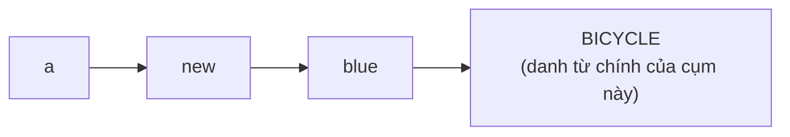

# A0-G005 · Nouns, Verbs, Adjectives, Adverbs — Danh từ, động từ, tính từ, trạng từ

## Mục lục

- [A. Lesson Information](#a-lesson-information)
- [B. Warm-up](#b-warm-up-tình-huống-thực-tế)
- [C. WHAT](#c-what-bốn-từ-loại-nội-dung)
- [D. WHY](#d-why-trật-tự-từ-quyết-định-nghĩa)
- [E. FORM](#e-form-vị-trí-của-bốn-từ-loại)
- [F. HOW](#f-how-cách-dùng-và-ví-dụ)
- [G. VISUAL](#g-visual-explanation)
- [H. COMPARISON](#h-comparison-trật-tự-tiếng-việt-và-tiếng-anh)
- [I. COMMON MISTAKES](#i-common-mistakes)
- [J. MEMORY TRICKS](#j-memory-tricks)
- [K. REAL-LIFE APPLICATION](#k-real-life-application)
- [L. PRACTICE EXERCISES](#l-practice-exercises)
- [M. KNOWLEDGE CHECK](#m-knowledge-check)
- [N. ANSWER KEY](#n-answer-key)

---

## A. Lesson Information

| Mục | Nội dung |
|---|---|
| **Lesson ID** | A0-G005 |
| **Topic** | Nouns, Verbs, Adjectives and Adverbs |
| **Tên tiếng Việt** | Danh từ, động từ, tính từ, trạng từ |
| **CEFR Level** | A0 |
| **Prerequisites** | [A0-G004 — Parts of Speech](A0-G004-parts-of-speech.md) |
| **Estimated Time** | 90 phút |

**Learning Objectives:**

1. Phân loại danh từ: người/vật/nơi chốn/ý niệm; danh từ riêng – danh từ chung.
2. Phân biệt động từ hành động (action verbs) và động từ trạng thái (state verbs) ở mức cơ bản.
3. Đặt **tính từ trước danh từ** (*a red car*) và **sau động từ be** (*the car is red*).
4. Biết trạng từ bổ nghĩa cho động từ, tính từ và vị trí thông dụng của chúng.
5. Biến đổi từ trong một **họ từ** (word family): *care → careful → carefully*.

---

## B. Warm-up: Tình huống thực tế

Bạn muốn nói: **"Tôi có một chiếc xe đạp màu xanh mới."**

Ba người học viết:

> 1. I have a bicycle blue new.
> 2. I have a new blue bicycle.
> 3. I have a blue new bicycle.

🤔 **Hãy suy nghĩ:** Câu nào đúng? Vì sao trong tiếng Việt tính từ đứng **sau** danh từ ("xe đạp **mới**"), nhưng tiếng Anh lại khác?

---

## C. WHAT: Bốn từ loại nội dung

Bốn từ loại này mang **phần lớn ý nghĩa** của câu (đã giới thiệu ở A0-G004). Bài này đi sâu vào **loại nhỏ** và **vị trí** của chúng.

### C1. Noun — Danh từ

Danh từ gọi tên:

| Loại | Ví dụ |
|---|---|
| Người | teacher, mother, Lan |
| Vật | phone, book, rice |
| Nơi chốn | school, Vietnam, kitchen |
| Ý niệm, cảm xúc (không chạm được) | love, time, idea, freedom |

- **Proper noun** (danh từ riêng): tên riêng, **luôn viết hoa** — *Hanoi, Mr Nam, Monday, January, English*.
- **Common noun** (danh từ chung): tên gọi chung — *city, man, day, language*.

> ⚠️ Khác với tiếng Việt: tiếng Anh viết hoa **thứ, tháng, ngôn ngữ, quốc tịch**: *Monday, May, English, Vietnamese*.

### C2. Verb — Động từ

| Loại | Ý nghĩa | Ví dụ |
|---|---|---|
| **Action verb** (động từ hành động) | Việc mà ta làm | eat, run, write, cook, play |
| **State verb** (động từ trạng thái) | Trạng thái, cảm xúc, sở hữu, suy nghĩ | be, have, like, know, want, need |

> 💡 Các câu trần thuật đầy đủ đang học cần động từ. Trong hội thoại có câu trả lời ngắn như Yes hoặc Great! không có động từ; chúng không phải mẫu câu trần thuật của bài. Đây là điểm khác lớn với tiếng Việt ("Tôi vui" — không cần động từ). Tiếng Anh phải nói *I **am** happy*. Bạn sẽ học kỹ ở [A0-G009](A0-G009-verb-to-be.md).

### C3. Adjective — Tính từ

Mô tả **đặc điểm** của danh từ: màu sắc, kích thước, cảm xúc, tính cách, quốc tịch...

*big, small, red, happy, tired, kind, Vietnamese, old, new, delicious*

Tính từ trong tiếng Anh **không thay đổi** theo số ít/số nhiều: *a **big** house* → *two **big** houses* (không phải *bigs*).

### C4. Adverb — Trạng từ

Trạng từ trả lời các câu hỏi:

| Câu hỏi | Loại | Ví dụ |
|---|---|---|
| How? (như thế nào?) | Cách thức | quickly, slowly, well, carefully |
| How much? (mức độ?) | Mức độ | very, really, quite, too |
| When? (khi nào?) | Thời gian | now, today, yesterday, soon |
| Where? (ở đâu?) | Nơi chốn | here, there, outside |
| How often? (bao lâu một lần?) | Tần suất | always, often, never (học kỹ ở [A1-G003](../../02-A1-BEGINNER/grammar/A1-G003-adverbs-of-frequency.md)) |

---

## D. WHY: Trật tự từ quyết định nghĩa

Tiếng Việt và tiếng Anh đều dựa nhiều vào trật tự từ. Nhưng trong **cụm danh từ**, trật tự hai ngôn ngữ **ngược nhau**:

| Tiếng Việt | Tiếng Anh |
|---|---|
| xe **đỏ** (danh từ → tính từ) | **red** car (tính từ → danh từ) |
| cô gái **xinh đẹp** | **beautiful** girl |
| quán cà phê **nhỏ** | **small** café |

Trong các cụm ngắn như a new blue bicycle, tính từ đứng trước danh từ chính. **Danh từ chính không luôn ở cuối cụm**: the book on the table còn có on the table sau book (quyển sách trên bàn). Bài này luyện mẫu tính từ + danh từ; các phần bổ nghĩa phía sau học thêm trong [Complex Noun Phrases](../../05-B2-UPPER-INTERMEDIATE/grammar/B2-G020-complex-noun-phrases.md).



---

## E. FORM: Vị trí của bốn từ loại

| Từ loại | Vị trí thường gặp | Mẫu | Ví dụ |
|---|---|---|---|
| **Noun** | Chủ ngữ (đầu câu) | **N** + V | **Dogs** bark. |
| | Tân ngữ (sau động từ) | V + **N** | I like **music**. |
| | Sau mạo từ, tính từ | a/the + (adj) + **N** | a small **house** |
| **Verb** | Sau chủ ngữ | S + **V** | She **sings**. |
| **Adjective** | Trước danh từ | adj + N | a **red** car |
| | Sau *be* và động từ liên kết (*look, feel, seem*) | be + **adj** | The car is **red**. |
| **Adverb** | Sau động từ (hoặc sau tân ngữ) | V (+ O) + **adv** | She speaks English **well**. |
| | Trước tính từ / trạng từ | **adv** + adj | **very** hot |
| | Đầu hoặc cuối câu (thời gian) | | **Today**, I'm busy. / I'm busy **today**. |

**Giải thích ký hiệu:**

- **S** (Subject — Chủ ngữ): người/vật thực hiện hành động hoặc được nói đến.
- **V** (Verb — Động từ).
- **O** (Object — Tân ngữ): người/vật chịu tác động của hành động.
- **N** (Noun), **adj** (adjective), **adv** (adverb).

> Bạn sẽ học kỹ S, V, O ở [A0-G007](A0-G007-subject-verb-object.md).

### Họ từ (word family) và cách tạo trạng từ cách thức

Phần lớn trạng từ cách thức được tạo bằng **tính từ + -ly**:

| Tính từ | Trạng từ | Quy tắc |
|---|---|---|
| quick | quickly | + ly |
| careful | carefully | + ly |
| happy | happily | -y → -ily |
| gentle | gently | -le → -ly |
| **good** | **well** | ⚠️ bất quy tắc |
| **fast** | **fast** | ⚠️ giữ nguyên |
| **hard** | **hard** | ⚠️ giữ nguyên (*hardly* có nghĩa khác: hầu như không) |

---

## F. HOW: Cách dùng và ví dụ

| # | English | Tiếng Việt | Phân tích |
|---|---|---|---|
| 1 | **Lan** **cooks** **delicious** **food**. | Lan nấu đồ ăn ngon. | Lan = proper noun (chủ ngữ) · cooks = action verb · delicious = adj (trước *food*) · food = noun (tân ngữ) |
| 2 | The **soup** is **hot**. | Món súp nóng. | hot = adj **sau be** |
| 3 | It's a **hot** **soup**. | Đó là một món súp nóng. | hot = adj **trước noun** — cùng ý với câu 2 nhưng khác vị trí |
| 4 | My father **drives** **carefully**. | Bố tôi lái xe cẩn thận. | carefully = adv mô tả *drives* |
| 5 | He is a **careful** **driver**. | Ông ấy là người lái xe cẩn thận. | careful = adj mô tả *driver* — so sánh với câu 4 |
| 6 | This coffee is **very** **strong**. | Cà phê này rất đậm. | very = adv bổ nghĩa cho adj *strong* |
| 7 | I **know** the **answer**. | Tôi biết câu trả lời. | know = state verb |
| 8 | We **live** in **Can Tho**. | Chúng tôi sống ở Cần Thơ. | Can Tho = proper noun, viết hoa |
| 9 | She sings **well**. | Cô ấy hát hay. | well = adverb của *good* |
| 10 | I have **three** **old** **books**. | Tôi có ba cuốn sách cũ. | *old* không thêm *s* dù *books* số nhiều |
| 11 | **Love** is **important**. | Tình yêu thì quan trọng. | Love = noun trừu tượng (ý niệm) |
| 12 | They work **hard**. | Họ làm việc chăm chỉ. | hard = adverb (không phải *hardly*) |

---

## G. VISUAL EXPLANATION

### Sentence breakdown

`My | young | brother | plays | football | very | well | every | weekend.`

```text
My young brother   plays   football   very well       every weekend
└─ cụm danh từ ─┘   └ V ┘   └─ N ─┘    └ adv + adv ┘  └ cụm thời gian ┘
   (chủ ngữ)                (tân ngữ)   (thế nào?)       (khi nào?)
```

| Từ | Từ loại | Câu hỏi nó trả lời |
|---|---|---|
| young | adjective | Người anh/em **thế nào**? |
| brother | noun | **Ai**? |
| plays | verb | **Làm gì**? |
| football | noun | Chơi **cái gì**? |
| very | adverb | Giỏi **đến mức nào**? |
| well | adverb | Chơi **thế nào**? |
| every weekend | cụm trạng ngữ thời gian | **Khi nào**? |

---

## H. COMPARISON: Trật tự tiếng Việt và tiếng Anh

| Cấu trúc | Tiếng Việt | Tiếng Anh | Ghi chú |
|---|---|---|---|
| Tính từ + danh từ | nhà **to** | **big** house | Đảo ngược |
| Nhiều tính từ | chiếc túi **da** **đen** **mới** | a **new** **black** **leather** bag | Có trật tự trung tính thường dùng, tùy nhấn mạnh — học ở [A2-G021](../../03-A2-ELEMENTARY/grammar/A2-G021-adjective-order.md) |
| Câu mô tả | Trời **nóng**. | It **is** hot. | Tiếng Anh cần động từ *is* |
| Mức độ | **rất** đẹp | **very** beautiful | Giống nhau |
| Mức độ + động từ | **rất** thích | **really** like / like ... **very much** | Không dùng *very like* |
| Cách thức | hát **hay** | sing **well** | Tiếng Việt dùng cùng từ "hay"; tiếng Anh đổi *good → well* |

**Quy tắc ra quyết định:**
1. Từ mô tả **người/vật** → tính từ → đứng **trước danh từ** hoặc **sau be**.
2. Từ mô tả **hành động** → trạng từ → thường **sau động từ (và tân ngữ)**.

---

## I. COMMON MISTAKES

| # | ❌ Sai | ✅ Đúng | Nguyên nhân | Cách tránh |
|---|---|---|---|---|
| 1 | I have a car **red**. | I have a **red** car. | Theo trật tự tiếng Việt | Trong a red car, tính từ red đứng trước car |
| 2 | They are **goods** students. | They are **good** students. | Thêm *s* vào tính từ | Tính từ không có số nhiều |
| 3 | She cooks **good**. | She cooks **well**. | Dùng tính từ mô tả hành động | Hành động → trạng từ |
| 4 | I **very** like coffee. | I **really** like coffee. | Dịch "rất" | *very* + adj/adv; *really* + verb |
| 5 | I'm from **vietnam**. I speak **vietnamese**. | **Vietnam** / **Vietnamese** | Tiếng Việt không viết hoa quốc tịch | Danh từ riêng, ngôn ngữ, quốc tịch: viết hoa |
| 6 | He works **hardly**. | He works **hard**. | Nghĩ mọi trạng từ đều có *-ly* | *hardly* = hầu như không |
| 7 | The weather **hot** today. | The weather **is** hot today. | Tiếng Việt không cần động từ | Câu tiếng Anh phải có động từ |

---

## J. MEMORY TRICKS

1. **"Mô tả trước, gọi tên sau"** giúp nhớ cụm ngắn a red car; không áp dụng thành luật mọi cụm danh từ vì còn có phần bổ nghĩa sau danh từ.
2. **"Tính từ không bao giờ số nhiều":** Nếu bạn định thêm *s* vào *good, big, new* — dừng lại.
3. **Câu hỏi kiểm tra:** Muốn biết dùng *good* hay *well*, hỏi: "mô tả **ai/cái gì**" (→ *good*) hay "mô tả **làm thế nào**" (→ *well*)?
4. ⚠️ Lưu ý: *I'm well* (tôi khỏe) là trường hợp đặc biệt — *well* ở đây là tính từ nghĩa "khỏe mạnh". Mẹo 3 không áp dụng cho nghĩa sức khỏe.

---

## K. REAL-LIFE APPLICATION

### Bài đọc: My best friend

> *My best friend is Hoa. She is tall and friendly. She has long black hair and a big smile. Hoa works in a small bookshop in Hue. She speaks English very well and reads books quickly. Every Sunday, we drink hot coffee in a quiet café near the river. I really love our Sundays.*

**Vietnamese explanation:** Người viết giới thiệu bạn thân tên Hoa — ngoại hình (cao, tóc đen dài, nụ cười tươi), công việc (hiệu sách nhỏ ở Huế), khả năng (nói tiếng Anh giỏi, đọc sách nhanh) và thói quen chủ nhật (uống cà phê nóng ở quán yên tĩnh gần sông).

**Grammar highlights:**

- Tính từ trước danh từ: *best friend, long black hair, big smile, small bookshop, hot coffee, quiet café*.
- Tính từ sau *be*: *She is tall and friendly.*
- Trạng từ: *very well, quickly, really*.
- Danh từ riêng viết hoa: *Hoa, Hue, English, Sunday*.

**Useful expressions:** *my best friend* (bạn thân nhất), *a big smile* (nụ cười tươi), *near the river* (gần sông).

---

## L. PRACTICE EXERCISES

> ✍️ Đáp án: [A0-G005-ANSWERS](../../12-ANSWERS-AND-EXPLANATIONS/A0/A0-G005-ANSWERS.md)

**Khung hỗ trợ:** I have a... (tôi có...); He/She is... (anh/cô ấy...); They are... (họ...); Our house is... (nhà chúng tôi...); He speaks... (anh ấy nói...). Dùng các dạng có s như speaks/has theo mẫu, chưa phải tự suy ra quy tắc chia thì. Trong L2.7/L2.10, dùng thứ tự tính chất/tuổi → nguồn gốc hoặc môn học → danh từ; mẫu a/an cho sẵn, sẽ học kỹ ở G012.

### Level 1 — Recognition

Chọn câu phù hợp tiếng Anh viết chuẩn thông dụng. Ở câu 6, cần diễn đạt **làm việc chăm chỉ**.

**L1.1.** A. She has a dress beautiful.  B. She has a beautiful dress.
**L1.2.** A. They are nice people.  B. They are nices people.
**L1.3.** A. He runs quicks.  B. He runs quickly.
**L1.4.** A. I live in hanoi.  B. I live in Hanoi.
**L1.5.** A. The room is clean.  B. The room clean.
**L1.6.** A. She works hardly.  B. She works hard.

### Level 2 — Controlled Practice

Viết dạng **trạng từ** của các tính từ:

**L2.1.** slow → ______  **L2.2.** easy → ______  **L2.3.** good → ______  **L2.4.** careful → ______  **L2.5.** fast → ______

Sắp xếp thành cụm/câu đúng:

**L2.6.** car / a / new
**L2.7.** coffee / Vietnamese / strong
**L2.8.** speaks / she / slowly
**L2.9.** very / the / is / film / interesting
**L2.10.** an / teacher / English / old

### Level 3 — Error Correction

**L3.1.** My mother is a teacher good.
**L3.2.** We have two bigs dogs.
**L3.3.** He plays the guitar very good.
**L3.4.** The children happy today.
**L3.5.** I go to school on monday.

### Level 4 — Production

Dịch sang tiếng Anh:

**L4.1.** Tôi có một chiếc điện thoại mới.
**L4.2.** Anh ấy nói tiếng Anh rất chậm.
**L4.3.** Căn nhà của chúng tôi nhỏ nhưng đẹp. (*our house, small, but, beautiful*)
**L4.4.** Họ là những học sinh chăm chỉ. (*hard-working, students*)

### Level 5 — Real Communication

**L5.1.** Viết đoạn văn 5–7 câu: *My best friend* (theo mẫu bài đọc K). Dùng ít nhất 4 tính từ trước danh từ, 2 tính từ sau *be*, 2 trạng từ.
**L5.2.** **Speaking:** Mô tả một món ăn bạn thích trong 30–45 giây (màu sắc, mùi vị, ai nấu, nấu thế nào). Ví dụ mở đầu: *My favourite food is...*

---

## M. KNOWLEDGE CHECK

### 5 câu hỏi tự kiểm tra

1. Danh từ riêng khác danh từ chung thế nào? Những loại từ nào phải viết hoa trong tiếng Anh mà tiếng Việt không viết hoa?
2. Tính từ có hai vị trí chính nào?
3. Trạng từ của *good*, *fast*, *hard* là gì?
4. Vì sao *The weather hot* là câu sai?
5. Sắp xếp: *house / white / a / big*.

### Checklist

- [ ] Tôi đặt tính từ trước danh từ một cách tự nhiên.
- [ ] Tôi không thêm *s* vào tính từ.
- [ ] Tôi tạo được trạng từ từ tính từ và nhớ 3 trường hợp bất quy tắc.
- [ ] Tôi viết hoa đúng thứ, tháng, quốc tịch, ngôn ngữ.

### 3 lỗi quan trọng cần nhớ

1. ~~a car red~~ → **a red car**.
2. ~~cooks good~~ → **cooks well**.
3. ~~The weather hot~~ → **The weather is hot** (cần động từ).

### Lịch ôn tập

| Ngày | Việc cần làm |
|---|---|
| Ngày 1 | Làm lại L2–L3 |
| Ngày 3 | Viết 10 cụm "adj + noun" về đồ vật quanh bạn |
| Ngày 7 | Viết lại đoạn L5.1 không nhìn bài cũ, so sánh |

### Liên kết

- ➡️ Bài tiếp theo: [A0-G006 — Subject Pronouns](A0-G006-subject-pronouns.md)
- 🔁 Ôn tập: [A0-G004 — Parts of Speech](A0-G004-parts-of-speech.md) · [VOC-18 — Word Families](../../07-VOCABULARY/VOC-18-word-families.md)

---

## N. ANSWER KEY

👉 [A0-G005-ANSWERS.md](../../12-ANSWERS-AND-EXPLANATIONS/A0/A0-G005-ANSWERS.md)
