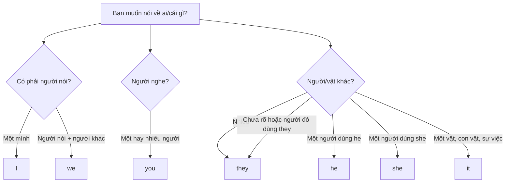

# A0-G006 · Subject Pronouns — Đại từ nhân xưng làm chủ ngữ

## Mục lục

- [A. Lesson Information](#a-lesson-information)
- [B. Warm-up](#b-warm-up-tình-huống-thực-tế)
- [C. WHAT](#c-what-đại-từ-nhân-xưng-là-gì)
- [D. WHY](#d-why-vì-sao-tiếng-anh-chỉ-cần-7-đại-từ)
- [E. FORM](#e-form-bảng-đại-từ-chủ-ngữ)
- [F. HOW](#f-how-cách-dùng)
- [G. VISUAL](#g-visual-explanation)
- [H. COMPARISON](#h-comparison-xưng-hô-tiếng-việt-và-tiếng-anh)
- [I. COMMON MISTAKES](#i-common-mistakes)
- [J. MEMORY TRICKS](#j-memory-tricks)
- [K. REAL-LIFE APPLICATION](#k-real-life-application)
- [L. PRACTICE EXERCISES](#l-practice-exercises)
- [M. KNOWLEDGE CHECK](#m-knowledge-check)
- [N. ANSWER KEY](#n-answer-key)

---

## A. Lesson Information

| Mục | Nội dung |
|---|---|
| **Lesson ID** | A0-G006 |
| **Topic** | Subject Pronouns |
| **Tên tiếng Việt** | Đại từ nhân xưng làm chủ ngữ |
| **CEFR Level** | A0 |
| **Prerequisites** | [A0-G004 — Parts of Speech](A0-G004-parts-of-speech.md) |
| **Estimated Time** | 60 phút |

**Learning Objectives:**

1. Thuộc 7 đại từ chủ ngữ: *I, you, he, she, it, we, they*.
2. Hiểu khái niệm **ngôi** (person) và **số** (number).
3. Thay danh từ bằng đại từ phù hợp để tránh lặp từ.
4. Chuyển đổi cách xưng hô tiếng Việt (anh, chị, em, ông, bà, cô...) sang tiếng Anh.
5. Tránh lỗi lặp chủ ngữ (*My mother she...*) và lỗi viết thường *i*.

---

## B. Warm-up: Tình huống thực tế

Đọc đoạn văn sau (Minh trong tình huống này dùng đại từ he):

> *Minh is my friend. Minh lives in Da Nang. Minh works in a hotel. Minh likes music.*

Đoạn văn đúng ngữ pháp nhưng nghe rất "máy móc" vì lặp *Minh* bốn lần. Người bản ngữ sẽ viết:

> *Minh is my friend. **He** lives in Da Nang. **He** works in a hotel. **He** likes music.*

🤔 **Hãy suy nghĩ:** Trong tiếng Việt, bạn gọi Minh là "anh ấy", "cậu ấy", "bạn ấy" hay "em ấy" tùy quan hệ và tuổi tác. Vì sao tiếng Anh chỉ dùng một từ *he*?

> 💡 Bài này có ví dụ chứa động từ như *lives, works, is, are*. Bạn **chưa cần hiểu** vì sao động từ có dạng đó — sẽ học ở [A0-G009](A0-G009-verb-to-be.md) và [A1-G001](../../02-A1-BEGINNER/grammar/A1-G001-present-simple-affirmative.md). Hãy tập trung vào **đại từ**.

---

## C. WHAT: Đại từ nhân xưng là gì?

**Personal pronoun** (đại từ nhân xưng) là từ dùng để **thay thế cho người hoặc vật** đã được nhắc đến hoặc đã rõ trong ngữ cảnh.

**Subject pronoun** (đại từ chủ ngữ) là đại từ đứng ở vị trí **chủ ngữ** — thường ở đầu câu, trước động từ, chỉ người/vật **thực hiện hành động** hoặc **được nói đến**.

**Hai khái niệm cần biết:**

| Khái niệm | Ý nghĩa |
|---|---|
| **Person** (ngôi) | Ngôi 1 = người nói (*I, we*); Ngôi 2 = người nghe (*you*); Ngôi 3 = người/vật được nói đến (*he, she, it, they*) |
| **Number** (số) | Singular (số ít) = một; Plural (số nhiều) = từ hai trở lên |

**Khi nào dùng?** Khi người nghe **đã biết** bạn đang nói về ai/cái gì.
**Khi nào không dùng?** Khi chưa rõ đối tượng — lúc đó phải dùng danh từ trước (*Minh...*), sau mới thay bằng *he*.

---

## D. WHY: Vì sao tiếng Anh chỉ cần 7 đại từ?

Tiếng Việt dùng **từ chỉ quan hệ gia đình và xã hội** để xưng hô (anh – em, cô – cháu, ông – tôi...), thể hiện tuổi tác, vai vế, mức độ thân thiết. Các đại từ chủ ngữ cơ bản trong tiếng Anh không mã hóa vai vế như anh/em; ta chọn theo người nói/người nghe, số và đại từ của người được nhắc tới.

Sự lịch sự trong tiếng Anh được thể hiện bằng **cách nói** (*please, could you...*), và cách gọi phù hợp ngữ cảnh. Việc dùng đúng đại từ người đó dùng cũng thể hiện sự tôn trọng. Vì vậy, nói *you* với giám đốc, với ông bà hay với bạn bè đều hoàn toàn bình thường.

---

## E. FORM: Bảng đại từ chủ ngữ

| Ngôi | Số ít (singular) | Nghĩa | Số nhiều (plural) | Nghĩa |
|---|---|---|---|---|
| 1 | **I** /aɪ/ | tôi, mình, em, con, cháu... (người nói) | **we** /wiː/ | chúng tôi, chúng ta, chúng mình |
| 2 | **you** /juː/ | bạn, anh, chị, em, ông, bà... (người nghe) | **you** /juː/ | các bạn, các anh chị... |
| 3 | **he** /hiː/ | anh ấy, ông ấy, cậu ấy (nam) | **they** /ðeɪ/ | họ, chúng nó, những cái đó |
| 3 | **she** /ʃiː/ | cô ấy, chị ấy, bà ấy (nữ) | | |
| 3 | **it** /ɪt/ | nó (vật, con vật, sự việc, thời tiết, thời gian) | | |

**Ghi chú quan trọng:**

- **I** luôn **viết hoa**, ở bất kỳ vị trí nào trong câu: *Yesterday **I** was busy.*
- **you** dùng cho cả số ít và số nhiều — ngữ cảnh cho biết là một hay nhiều người.
- **we** = cả *chúng tôi* (không gồm người nghe) và *chúng ta* (gồm người nghe).
- **they** dùng cho người **và** vật số nhiều: *The books are old. **They** are on the table.*
- **they** cũng có thể dùng cho **một người** khi không biết hoặc không muốn nêu giới tính (*singular they*): *Someone called. **They** left a message.* — They cũng dùng cho người dùng đại từ này. Cả khi chỉ một người, giữ mẫu they are/they have, không đổi thành they is/they has.

---

## F. HOW: Cách dùng

### Cách dùng 1 — Thay thế danh từ đã nhắc đến

| # | English | Tiếng Việt | Phân tích |
|---|---|---|---|
| 1 | My father is a doctor. **He** works in a hospital. | Bố tôi là bác sĩ. Ông làm việc ở bệnh viện. | *He* thay cho *my father* (nam, số ít) |
| 2 | Lan and Hoa are sisters. **They** live in Hue. | Lan và Hoa là chị em. Họ sống ở Huế. | Hai người → *they* |
| 3 | I have a cat. **It** is very lazy. | Tôi có một con mèo. Nó rất lười. | Con vật → *it* (khi không quan tâm giới tính) |
| 4 | My phone is old. **It** is very slow. | Điện thoại của tôi cũ. Nó rất chậm. | Đồ vật → *it* |
| 5 | Mai and I are colleagues. **We** work together. | Mai và tôi là đồng nghiệp. Chúng tôi làm việc cùng nhau. | *Mai and I* → *we* |

### Cách dùng 2 — Nói trực tiếp với người nghe

| # | English | Tiếng Việt | Phân tích |
|---|---|---|---|
| 6 | Excuse me, are **you** Mr Hung? | Xin lỗi, có phải ông là ông Hùng không? | *you* dùng với người lớn tuổi, không mất lịch sự |
| 7 | Good morning, class. Are **you** ready? | Chào cả lớp. Các em sẵn sàng chưa? | *you* số nhiều |

### Cách dùng 3 — *It* cho thời tiết, thời gian, khoảng cách

Câu trần thuật đầy đủ kiểu đang học thường cần chủ ngữ. Câu mệnh lệnh (Come here) và lời nói rút gọn có thể không nêu chủ ngữ; sẽ học sau. Với thời tiết/thời gian không có người/vật cụ thể làm chủ ngữ, ta dùng *it* làm chủ ngữ "giả" (*dummy subject*).

| # | English | Tiếng Việt | Phân tích |
|---|---|---|---|
| 8 | **It** is hot today. | Hôm nay trời nóng. | Thời tiết → *it* |
| 9 | **It** is 7 o'clock. | Bây giờ là 7 giờ. | Thời gian → *it* |
| 10 | **It** is 5 kilometres to the airport. | Đến sân bay 5 cây số. | Khoảng cách → *it* |

---

## G. VISUAL EXPLANATION

### Bảng "chuyển đổi xưng hô" Việt → Anh

| Tiếng Việt (người được nói đến) | Tiếng Anh |
|---|---|
| anh ấy, ông ấy, chú ấy, bác ấy (nam), cậu bé, thằng bé | **he** |
| chị ấy, cô ấy, bà ấy, dì ấy, cô bé | **she** |
| con chó, cái bàn, việc đó, trời | **it** |
| họ, các anh chị ấy, bọn trẻ, những cái ghế | **they** |
| tôi, mình, em, con, cháu, tớ, tao (người nói) | **I** |
| bạn, anh, chị, em, ông, bà, cô, các bạn (người nghe) | **you** |
| chúng tôi, chúng ta, chúng mình, bọn tớ | **we** |

### Sentence breakdown

`She | is | my | teacher.`

- **She** → Subject pronoun (chủ ngữ), ngôi 3 số ít, nữ.
- **is** → động từ *be* (học ở A0-G009).
- **my teacher** → bổ ngữ cho chủ ngữ.

---

## H. COMPARISON: Xưng hô tiếng Việt và tiếng Anh

| Điểm | Tiếng Việt | Tiếng Anh |
|---|---|---|
| Số lượng đại từ | Rất nhiều, phụ thuộc quan hệ | 7 đại từ chủ ngữ |
| Thể hiện tuổi tác/vai vế | Có (anh/em, ông/cháu) | Không |
| Phân biệt "chúng tôi" và "chúng ta" | Có | Không — đều là *we* |
| Chủ ngữ có thể lược bỏ? | Thường lược bỏ: "Đi đâu đấy?" | Câu đầy đủ thường giữ: *Where are **you** going?*; mệnh lệnh/lời nói rút gọn có ngoại lệ |
| Chủ ngữ cho thời tiết | "Trời mưa" | ***It** is raining* |

**Quy tắc ra quyết định:** Khi dịch sang tiếng Anh, hãy tự hỏi: (1) người này là người nói, người nghe hay người khác? (2) một hay nhiều? (3) nếu một người: dùng he/she/they phù hợp, không đoán chỉ từ tên; nếu đồ vật: it.

---

## I. COMMON MISTAKES

| # | ❌ Sai | ✅ Đúng | Nguyên nhân | Cách tránh |
|---|---|---|---|---|
| 1 | **My mother she** is a nurse. | **My mother** is a nurse. / **She** is a nurse. | Lặp chủ ngữ theo cách nói "Mẹ tôi, bà ấy..." | Trong câu đơn trung tính đang luyện, chọn danh từ hoặc đại từ. Khẩu ngữ tách chủ đề có thể lặp, nhưng không phải mẫu bài này |
| 2 | **i** am a student. | **I** am a student. | Viết thường như tiếng Việt | *I* luôn viết hoa |
| 3 | Is raining. | **It** is raining. | Tiếng Việt lược "trời" | Câu thời tiết đầy đủ này cần it |
| 4 | My brother is a teacher. **She** teaches English. | ...**He** teaches English. | Nhầm *he/she* (tiếng Việt nói chung "nó/bạn ấy") | Kiểm tra giới tính khi dùng ngôi 3 số ít |
| 5 | The books are new. **It** is expensive. | ...**They** are expensive. | Không để ý số nhiều | Danh từ số nhiều → *they* |
| 6 | **Me** and Lan are friends. | **Lan and I** are friends. | Dùng đại từ tân ngữ làm chủ ngữ | Ở vị trí chủ ngữ dùng *I*; lịch sự đặt người khác trước *I* |

---

## J. MEMORY TRICKS

1. **Nhớ theo nhóm:** I – you – he – she – it – we – they. Đọc to theo nhịp như bài hát cho đến khi thuộc.
2. **"I là cột đèn"**: Chữ *I* đứng một mình luôn cao như cột đèn — luôn viết hoa.
3. **Kể về một người thường dùng he/she/they.** It còn xuất hiện khi xác định danh tính qua điện thoại/cửa: *"Who is it?" – "**It**'s me."* và khi nói về em bé chưa rõ giới tính (*It's a baby*).
4. **Kiểm tra đúng nhóm đang chỉ:** one book → it; two books → they. Không thêm "những" để tự biến đối tượng số ít thành số nhiều. Singular they là trường hợp riêng đã nêu ở E.

---

## K. REAL-LIFE APPLICATION

### Hội thoại: Xem ảnh gia đình

> **Anna:** Is this your family?
> **Tuan:** Yes. This is my father. **He** is a farmer.
> **Anna:** And who is she?
> **Tuan:** **She** is my mother. **She** is a teacher.
> **Anna:** Oh, nice! And the two boys?
> **Tuan:** **They** are my brothers. **They** are students.
> **Anna:** What about the dog? Is **it** your dog?
> **Tuan:** Yes, **it** is. **It**'s very friendly. **We** love **it**!

**Vietnamese explanation:** Tuấn giới thiệu ảnh gia đình với Anna: bố là nông dân, mẹ là giáo viên, hai em/anh trai là sinh viên, và con chó rất thân thiện.

**Grammar highlights:** *He* (bố), *She* (mẹ), *They* (hai anh em), *it* (con chó), *We* (cả gia đình). Brother là danh từ chung cho anh/em trai; muốn rõ có thể nói older/younger brother. It sau love trong We love it là tân ngữ, không phải chủ ngữ; cùng một dạng chữ nhưng vai trò khác.

**Useful expressions:** *Is this your family?* · *Who is she?* · *What about...?* (Còn... thì sao?)

---

## L. PRACTICE EXERCISES

> ✍️ Đáp án: [A0-G006-ANSWERS](../../12-ANSWERS-AND-EXPLANATIONS/A0/A0-G006-ANSWERS.md)

### Level 1 — Recognition

Chọn đại từ thay thế cho phần in đậm. Trong các tình huống này, sister/aunt dùng she; brother/father/Mr Long/Mr Brown dùng he. Giữ nguyên dạng động từ cho sẵn; không suy đại từ chỉ từ tên người.

**L1.1.** **My sister** is a nurse. → A. He  B. She  C. It
**L1.2.** **The cars** are new. → A. It  B. They  C. We
**L1.3.** **My brother and I** are tired. → A. They  B. You  C. We
**L1.4.** **The weather** is nice. → A. It  B. They  C. She
**L1.5.** **Mr Long** is my boss. → A. She  B. He  C. They
**L1.6.** **You and Nam** are late. → A. They  B. You  C. We

### Level 2 — Controlled Practice

Điền đại từ chủ ngữ phù hợp.

**L2.1.** Mai is my classmate. ___ is very smart. (Mai dùng đại từ she.)
**L2.2.** My grandparents live in the countryside. ___ are seventy years old.
**L2.3.** "Where is my bag?" – "___ is on the chair."
**L2.4.** Linh and I are from Hai Phong. ___ are friends.
**L2.5.** "Are ___ a student, Duc?" – "Yes, I am."
**L2.6.** ___ is very cold today.
**L2.7.** This is Mr Brown. ___ is our English teacher.
**L2.8.** Look at those birds! ___ are beautiful.

### Level 3 — Error Correction

**L3.1.** My father he is a driver.
**L3.2.** Yesterday i was at home.
**L3.3.** My aunt is a doctor. He works in Hanoi.
**L3.4.** These shoes are cheap. It is from Vietnam.
**L3.5.** Is very hot in Saigon.
**L3.6.** Me and my friend are students.

### Level 4 — Production

Dịch sang tiếng Anh (chỉ cần chú ý đại từ đúng; có thể dùng *is/are* như trong ví dụ của bài):

**L4.1.** Chị ấy là bác sĩ.
**L4.2.** Họ là bạn của tôi. (*my friends*)
**L4.3.** Trời mưa. (Khung: ___ is raining.)
**L4.4.** Chúng ta là một đội. (*a team*)
**L4.5.** Ông ấy là ông nội của tôi. (*my grandfather*)

### Level 5 — Real Communication

**L5.1.** Viết 5–6 câu giới thiệu các thành viên trong gia đình hoặc bạn bè theo mẫu hội thoại K. Mỗi câu đầu nêu danh từ, câu sau dùng đại từ.
**L5.2.** **Speaking:** Chọn một bức ảnh có nhiều người trong điện thoại của bạn. Giới thiệu từng người trong 30–60 giây: *This is... He/She is...*

---

## M. KNOWLEDGE CHECK

### 5 câu hỏi tự kiểm tra

1. Kể 7 đại từ chủ ngữ theo thứ tự ngôi.
2. *you* là số ít hay số nhiều?
3. Khi nào dùng *it* mà không thay cho danh từ nào?
4. Trong câu trần thuật đơn đang luyện, vì sao nên chọn My mother hoặc She thay vì ghép My mother she?
5. Dịch "chúng ta" và "chúng tôi" sang tiếng Anh.

### Checklist

- [ ] Tôi nói được 7 đại từ không cần nhìn.
- [ ] Tôi luôn viết hoa *I*.
- [ ] Tôi không lặp chủ ngữ.
- [ ] Tôi dùng *it* cho thời tiết, thời gian.

### 3 lỗi quan trọng cần nhớ

1. Không lặp chủ ngữ: ~~My mother she~~.
2. *I* luôn viết hoa.
3. Câu trần thuật thời tiết đầy đủ cần chủ ngữ: *It is hot.*

### Lịch ôn tập

| Ngày | Việc cần làm |
|---|---|
| Ngày 1 | Làm lại L2 |
| Ngày 3 | Viết 7 câu, mỗi câu dùng một đại từ khác nhau |
| Ngày 7 | Giới thiệu 5 người nổi tiếng: *This is... He/She is...* |

### Liên kết

- ➡️ Bài tiếp theo: [A0-G007 — Subject, Verb, Object](A0-G007-subject-verb-object.md)
- 🔜 Mở rộng: [A1-G006 — Possessives](../../02-A1-BEGINNER/grammar/A1-G006-possessives.md) · [A1-G007 — Object Pronouns](../../02-A1-BEGINNER/grammar/A1-G007-object-pronouns.md)

---

## N. ANSWER KEY

👉 [A0-G006-ANSWERS.md](../../12-ANSWERS-AND-EXPLANATIONS/A0/A0-G006-ANSWERS.md)
