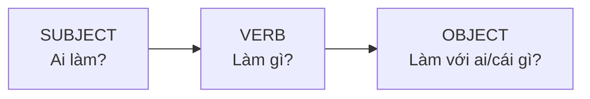
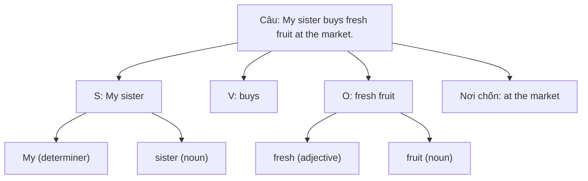

# A0-G007 · Subject, Verb, Object — Chủ ngữ, động từ, tân ngữ

## Mục lục

- [A. Lesson Information](#a-lesson-information)
- [B. Warm-up](#b-warm-up-tình-huống-thực-tế)
- [C. WHAT](#c-what-ba-thành-phần-cốt-lõi-của-câu)
- [D. WHY](#d-why-vì-sao-trật-tự-s--v--o-quan-trọng)
- [E. FORM](#e-form-cách-tìm-s-v-o)
- [F. HOW](#f-how-ví-dụ-phân-tích)
- [G. VISUAL](#g-visual-explanation)
- [H. COMPARISON](#h-comparison)
- [I. COMMON MISTAKES](#i-common-mistakes)
- [J. MEMORY TRICKS](#j-memory-tricks)
- [K. REAL-LIFE APPLICATION](#k-real-life-application)
- [L. PRACTICE EXERCISES](#l-practice-exercises)
- [M. KNOWLEDGE CHECK](#m-knowledge-check)
- [N. ANSWER KEY](#n-answer-key)

---

## A. Lesson Information

| Mục | Nội dung |
|---|---|
| **Lesson ID** | A0-G007 |
| **Topic** | Subject, Verb and Object |
| **Tên tiếng Việt** | Chủ ngữ, động từ và tân ngữ |
| **CEFR Level** | A0 |
| **Prerequisites** | [A0-G005](A0-G005-nouns-verbs-adjectives-adverbs.md), [A0-G006](A0-G006-subject-pronouns.md) |
| **Estimated Time** | 75 phút |

**Learning Objectives:**

1. Xác định **chủ ngữ (S)**, **động từ (V)**, **tân ngữ (O)** trong câu đơn.
2. Hiểu rằng chủ ngữ có thể là **một từ** hoặc **một cụm từ** (*My old friend*).
3. Phân biệt động từ **cần** tân ngữ (transitive) và **không cần** tân ngữ (intransitive) ở mức nhận biết.
4. Đặt trạng từ cách thức ở vị trí thông dụng, tránh chen giữa động từ và tân ngữ ngắn trong mẫu đang luyện.
5. Không bỏ chủ ngữ hoặc động từ khi viết câu tiếng Anh.

---

## B. Warm-up: Tình huống thực tế

So sánh hai câu:

> 1. **The dog** bites **the man**. (Con chó cắn người đàn ông.)
> 2. **The man** bites **the dog**. (Người đàn ông cắn con chó.)

Cùng các từ, chỉ đổi chỗ — nghĩa hoàn toàn khác. Câu 1 là chuyện bình thường; câu 2 là... tin giật gân! 😄

🤔 **Hãy suy nghĩ:** Điều gì cho bạn biết **ai cắn ai**? Nếu một người viết *"The man the dog bites"*, bạn có hiểu không?

---

## C. WHAT: Ba thành phần cốt lõi của câu

| Thành phần | English | Câu hỏi để tìm | Ví dụ: *Lan reads books.* |
|---|---|---|---|
| **Chủ ngữ** | **Subject (S)** | **Ai / Cái gì** thực hiện hành động hoặc được nói đến? | **Lan** |
| **Động từ** | **Verb (V)** | Chủ ngữ **làm gì / ở trạng thái gì**? | **reads** |
| **Tân ngữ** | **Object (O)** | Hành động tác động lên **ai / cái gì**? | **books** |

**Chủ ngữ** có thể là:

- Đại từ: ***She** sings.*
- Danh từ: ***Birds** fly.*
- Cụm danh từ: ***My little brother** plays games.* (cả cụm là chủ ngữ)

**Tân ngữ** có thể là:

- Danh từ / cụm danh từ: *I like **coffee**.* / *I like **strong black coffee**.*
- Đại từ tân ngữ: *I love **you**.* (các đại từ tân ngữ *me, him, her, us, them* sẽ học ở [A1-G007](../../02-A1-BEGINNER/grammar/A1-G007-object-pronouns.md))

---

## D. WHY: Vì sao trật tự S – V – O quan trọng?

Tiếng Anh dùng **vị trí** để cho biết ai làm gì với ai. Với câu chủ động đơn giản đang học, chủ ngữ thường đứng trước động từ và tân ngữ đứng sau. Không phải mọi từ trước/sau động từ đều là S/O: She often smiles không có tân ngữ.

Tiếng Việt cũng theo trật tự S – V – O (*Tôi ăn cơm*), nên bạn đã có lợi thế. Nhưng tiếng Việt **linh hoạt hơn**: có thể đưa tân ngữ lên đầu (*"Cơm thì tôi ăn rồi"*) hoặc bỏ chủ ngữ (*"Ăn cơm chưa?"*). Tiếng Anh **cứng hơn nhiều**: ở câu khẳng định thông thường, dùng **S + V + O** làm mẫu trung tính. Tiếng Anh cũng có cấu trúc đưa chủ đề lên trước, nhưng chưa luyện ở bài này.



---

## E. FORM: Cách tìm S, V, O

### Quy trình 3 bước

1. **Tìm động từ trước** — đó là "trái tim" của câu. Hỏi: "Có hành động hoặc trạng thái nào?"
2. **Hỏi "Ai/cái gì + động từ?"** → câu trả lời là **chủ ngữ**.
3. **Hỏi "Động từ + ai/cái gì?"** → câu trả lời là **tân ngữ** (nếu có).

Ví dụ: *My mother cooks dinner.*

1. Động từ: **cooks**
2. Ai nấu? → **My mother** (S)
3. Nấu cái gì? → **dinner** (O)

### Động từ cần và không cần tân ngữ

| Loại | Giải thích | Ví dụ |
|---|---|---|
| **Transitive verb** (ngoại động từ) | Dùng với tân ngữ trực tiếp trong nghĩa/cách dùng đang xét | *I need...* (cần gì?) → *I need **help**.* |
| **Intransitive verb** (nội động từ) | **Không cần** tân ngữ | *She sleeps.* / *The baby cries.* |
| Cả hai | Tùy nghĩa | *He eats.* / *He eats **rice**.* |

> 💡 Từ điển ghi **[T]** (transitive) hoặc **[I]** (intransitive) bên cạnh động từ. Ở A0, bạn chỉ cần hiểu: một số động từ như *need, want, like, have, make, buy* thường đi với tân ngữ trong các mẫu ở đây. Một số tân ngữ có thể lược khi ngữ cảnh đã rõ, như I already know. Kiểm tra cách dùng cụ thể thay vì gắn một luật cho mọi nghĩa của động từ.

### Vị trí của các thành phần khác

```text
S  +  V  +  O  +  (nơi chốn)  +  (thời gian)
I     eat   rice  at home        every day.
```

Trạng từ cách thức thường đứng **sau tân ngữ**, **không chen giữa V và O**:

- ✅ *She speaks English **well**.*
- ❌ *She speaks **well** English.*

---

## F. HOW: Ví dụ phân tích

| # | Câu | S | V | O | Ghi chú |
|---|---|---|---|---|---|
| 1 | **I** **drink** **coffee**. | I | drink | coffee | Câu S-V-O cơ bản |
| 2 | **My brother** **plays** **the guitar**. | My brother | plays | the guitar | Chủ ngữ là cụm danh từ |
| 3 | **The baby** **sleeps**. | The baby | sleeps | — | *sleep* không cần tân ngữ |
| 4 | **They** **watch** **films** **at night**. | They | watch | films | *at night* = thời gian, không phải tân ngữ |
| 5 | **We** **need** **a new car**. | We | need | a new car | A new car nêu thứ cần, là O của need trong câu này |
| 6 | **Students** **study** **English** **at school**. | Students | study | English | *at school* = nơi chốn |
| 7 | **The sun** **rises**. | The sun | rises | — | Nội động từ |
| 8 | **Hoa** **speaks** **Japanese** **very well**. | Hoa | speaks | Japanese | Trạng từ đứng sau tân ngữ |
| 9 | **My friends and I** **love** **pizza**. | My friends and I | love | pizza | Chủ ngữ ghép: tôi và các bạn, không nhất thiết chỉ hai người |
| 10 | **The teacher** **opens** **the door** **slowly**. | The teacher | opens | the door | Slowly mô tả cách mở, đứng sau O; không thuộc O |

**Nghĩa 10 ví dụ:** (1) Tôi uống cà phê. (2) Anh/em trai tôi chơi guitar. (3) Em bé ngủ. (4) Họ xem phim ban đêm. (5) Chúng tôi cần xe mới. (6) Học sinh học tiếng Anh ở trường. (7) Mặt trời mọc. (8) Hoa nói tiếng Nhật rất giỏi. (9) Tôi và các bạn thích pizza. (10) Giáo viên mở cửa chậm rãi.

> 💡 Ví dụ 4, 6: **Cụm chỉ nơi chốn, thời gian không phải tân ngữ.** Tân ngữ trả lời "**cái gì/ai**" chứ không phải "**ở đâu/khi nào**".

---

## G. VISUAL EXPLANATION

### Cây cấu trúc câu



### Tô màu thành phần

| 🟦 Subject | 🟥 Verb | 🟩 Object | ⬜ Other |
|---|---|---|---|
| My sister | buys | fresh fruit | at the market |
| The children | eat | ice cream | in summer |
| I | read | the news | every morning |

---

## H. COMPARISON

### Tiếng Việt và tiếng Anh

| Hiện tượng | Tiếng Việt | Tiếng Anh |
|---|---|---|
| Bỏ chủ ngữ | "Ăn không?" | ***Do you** eat rice?* — trong câu hỏi đầy đủ giữ you; học cách hỏi sau |
| Nêu chủ đề trước | "Phim này thì tôi thích." | Mẫu trung tính: *I like **this film**.* Tiếng Anh cũng có cách nhấn chủ đề riêng, không phải mọi trường hợp đưa O lên trước đều sai |
| Câu không có động từ | "Tôi mệt." | *I **am** tired.* — phải có động từ |
| Trạng từ chen giữa | "Tôi thích lắm cà phê" (không tự nhiên) | Không được: ~~I like very much coffee~~ |

### Tân ngữ và cụm trạng ngữ

| Tân ngữ (Object) | Cụm trạng ngữ (Adverbial) |
|---|---|
| Trả lời: **cái gì? ai?** | Trả lời: **ở đâu? khi nào? thế nào?** |
| Thường không có giới từ đi trước | Thường có giới từ (*at, in, on*) hoặc là trạng từ |
| *She visits **her grandmother**.* | *She visits her grandmother **on Sundays**.* |

---

## I. COMMON MISTAKES

| # | ❌ Sai | ✅ Đúng | Nguyên nhân | Cách tránh |
|---|---|---|---|---|
| 1 | Like coffee very much. | **I** like coffee very much. | Bỏ chủ ngữ như tiếng Việt | Câu khẳng định luôn có S |
| 2 | I like very much coffee. | I like coffee very much. | Chen trạng từ giữa V và O | Giữ cụm V + O ngắn trong mẫu trung tính |
| 3 | My brother he likes films. | My brother likes films. | Lặp S trong mẫu câu đơn trung tính | Chọn cụm danh từ hoặc đại từ làm S |
| 4 | I need. | I need **some water**. | Quên tân ngữ cho động từ cần tân ngữ | *need, want, like, buy* → hỏi "cái gì?" |
| 5 | My father very busy. | My father **is** very busy. | Thiếu động từ | Mỗi câu phải có V |
| 6 | My mother tea every morning. | My mother drinks tea every morning. | Thiếu V trong câu trần thuật | Tìm động từ trước rồi xác định S/O |

---

## J. MEMORY TRICKS

1. **"Tìm trái tim trước":** Động từ là trái tim của câu — tìm nó trước, mọi thứ khác xoay quanh.
2. **Giữ V + O ngắn liền nhau** là cách an toàn khi luyện câu trung tính: speaks English well. Trạng từ có nhiều vị trí tùy loại và trọng tâm; không coi đây là lệnh cấm tuyệt đối.
3. **Công thức PT: Place → Time** — nơi chốn trước, thời gian sau: *I study **at home** **in the evening***. ⚠️ Đây là trật tự **thường gặp**, thời gian cũng có thể đưa lên đầu câu: *In the evening, I study at home.*

---

## K. REAL-LIFE APPLICATION

### Bài đọc: A busy morning

> *Every morning, my mother makes breakfast. My father reads the newspaper. My little sister feeds the cat. I drink a glass of milk and take the bus to school. Our cat sleeps all morning!*

**Vietnamese explanation:** Mỗi sáng mẹ nấu bữa sáng, bố đọc báo, em gái cho mèo ăn, "tôi" uống sữa và bắt xe buýt đi học. Còn con mèo thì ngủ cả buổi sáng.

**Grammar highlights:**

| S | V | O | Khác |
|---|---|---|---|
| my mother | makes | breakfast | Every morning (thời gian, ở đầu câu) |
| My father | reads | the newspaper | |
| My little sister | feeds | the cat | |
| I | drink / take | a glass of milk / the bus | to school |
| Our cat | sleeps | — | all morning |

**Useful expressions:** *make breakfast* (làm bữa sáng), *read the newspaper* (đọc báo), *feed the cat* (cho mèo ăn), *take the bus* (đi xe buýt).

---

## L. PRACTICE EXERCISES

> ✍️ Đáp án: [A0-G007-ANSWERS](../../12-ANSWERS-AND-EXPLANATIONS/A0/A0-G007-ANSWERS.md)

**Trước bài tập:** Dạng động từ đã cho sẵn trong câu mẫu. Với phần viết, có thể dùng I drink..., I read..., My brother plays..., My mother cooks..., We visit.... Bài này chấm thành phần và trật tự; chia thì học sau. Làm mỗi câu như phát biểu đầy đủ, độc lập, theo trật tự trung tính.

### Level 1 — Recognition

Xác định S, V, O (nếu có) trong mỗi câu.

**L1.1.** Nam eats bread.
**L1.2.** The children laugh.
**L1.3.** My grandmother grows vegetables in her garden.
**L1.4.** We visit our parents on Sundays.
**L1.5.** The old man walks slowly.
**L1.6.** Lan and her sister make cakes.

### Level 2 — Controlled Practice

Sắp xếp thành câu đúng trật tự.

**L2.1.** football / play / they
**L2.2.** milk / the cat / drinks
**L2.3.** every day / English / I / study
**L2.4.** a new phone / wants / my brother
**L2.5.** at home / my father / newspapers / reads
**L2.6.** sings / beautifully / she / songs
**L2.7.** the window / opens / the teacher

### Level 3 — Error Correction

**L3.1.** I like very much music.
**L3.2.** Every day cook dinner.
**L3.3.** My brother he reads this book.
**L3.4.** My mother tea every morning. (Thêm động từ drinks.)
**L3.5.** She wants. (Đang giới thiệu điều cô ấy muốn lần đầu; thêm cụm a new bag.)
**L3.6.** He speaks well French.

### Level 4 — Production

**L4.1.** Viết 3 câu S-V-O về những việc bạn làm mỗi sáng.
**L4.2.** Viết 2 câu S-V (không có tân ngữ) với các động từ *sleep, run, cry, laugh, smile*.
**L4.3.** Dịch: *"Tôi uống trà ở nhà vào buổi tối."*
**L4.4.** Dịch: *"Em trai tôi chơi game rất giỏi."* (*games, very well*)

### Level 5 — Real Communication

**L5.1.** Viết đoạn văn 5–6 câu: *A busy morning in my house*. Mỗi câu ghi chú S – V – O bằng ngoặc vuông, ví dụ: *[My mother]S [cooks]V [rice]O.*
**L5.2.** **Speaking:** Nói 5 câu về những việc người trong gia đình bạn làm vào cuối tuần. Ghi âm và kiểm tra: câu nào cũng có chủ ngữ? Không có trạng từ chen giữa V và O?

---

## M. KNOWLEDGE CHECK

### 5 câu hỏi tự kiểm tra

1. Ba câu hỏi nào giúp tìm S, V, O?
2. Chủ ngữ có thể dài nhiều từ không? Cho ví dụ.
3. *at school, every day* có phải là tân ngữ không? Vì sao?
4. Vì sao *I like very much coffee* sai?
5. Kể 3 động từ không cần tân ngữ.

### Checklist

- [ ] Tôi tìm được S, V, O trong câu đơn.
- [ ] Tôi không bỏ chủ ngữ.
- [ ] Tôi không chen trạng từ giữa V và O.
- [ ] Tôi đặt nơi chốn trước thời gian ở cuối câu.

### 3 lỗi quan trọng cần nhớ

1. ~~Like coffee~~ → **I** like coffee.
2. ~~like very much coffee~~ → like coffee very much.
3. ~~My mother tea~~ → My mother **drinks** tea.

### Lịch ôn tập

| Ngày | Việc cần làm |
|---|---|
| Ngày 1 | Làm lại L1, L2 |
| Ngày 3 | Phân tích S-V-O của 5 câu trong bất kỳ bài đọc A0 nào |
| Ngày 7 | Viết lại đoạn L5.1 về một ngày cuối tuần |

### Liên kết

- ➡️ Bài tiếp theo: [A0-G008 — Sentence Patterns](A0-G008-sentence-patterns.md)
- 🔁 Tra cứu: [Sentence Patterns Reference](../../06-GRAMMAR-REFERENCE/SENTENCE-PATTERNS.md)

---

## N. ANSWER KEY

👉 [A0-G007-ANSWERS.md](../../12-ANSWERS-AND-EXPLANATIONS/A0/A0-G007-ANSWERS.md)
