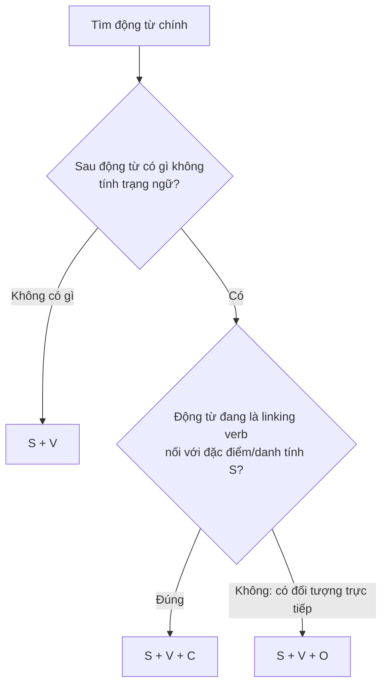

# A0-G008 · Sentence Patterns: S+V, S+V+O, S+V+C — Các mẫu câu cơ bản

## Mục lục

- [A. Lesson Information](#a-lesson-information)
- [B. Warm-up](#b-warm-up-tình-huống-thực-tế)
- [C. WHAT](#c-what-mẫu-câu-là-gì)
- [D. WHY](#d-why-vì-sao-cần-học-mẫu-câu)
- [E. FORM](#e-form-ba-mẫu-câu-cốt-lõi)
- [F. HOW](#f-how-ví-dụ-phân-tích)
- [G. VISUAL](#g-visual-explanation)
- [H. COMPARISON](#h-comparison-tân-ngữ-object-và-bổ-ngữ-complement)
- [I. COMMON MISTAKES](#i-common-mistakes)
- [J. MEMORY TRICKS](#j-memory-tricks)
- [K. REAL-LIFE APPLICATION](#k-real-life-application)
- [L. PRACTICE EXERCISES](#l-practice-exercises)
- [M. KNOWLEDGE CHECK](#m-knowledge-check)
- [N. ANSWER KEY](#n-answer-key)

---

## A. Lesson Information

| Mục | Nội dung |
|---|---|
| **Lesson ID** | A0-G008 |
| **Topic** | Basic Sentence Patterns: S+V, S+V+O, S+V+C |
| **Tên tiếng Việt** | Các mẫu câu cơ bản |
| **CEFR Level** | A0 |
| **Prerequisites** | [A0-G007 — Subject, Verb, Object](A0-G007-subject-verb-object.md) |
| **Estimated Time** | 90 phút |

**Learning Objectives:**

1. Nhận diện và tạo câu theo 3 mẫu: **S + V**, **S + V + O**, **S + V + C**.
2. Hiểu **bổ ngữ (complement)** là gì và khác **tân ngữ (object)** thế nào.
3. Biết các **động từ liên kết (linking verbs)** thông dụng: *be, become, look, feel, seem, taste, sound, smell, get*.
4. Mở rộng câu bằng **trạng ngữ (adverbial)** chỉ nơi chốn, thời gian, cách thức.
5. Nhận biết hai mẫu nâng cao S+V+O+O và S+V+O+C (sẽ học kỹ sau).

---

## B. Warm-up: Tình huống thực tế

Đọc ba câu:

> 1. *She smiles.* — Cô ấy cười.
> 2. *She makes cakes.* — Cô ấy làm bánh.
> 3. *She is a baker.* — Cô ấy là thợ làm bánh.

🤔 **Hãy suy nghĩ:** Trong câu 2, *cakes* là thứ cô ấy **làm ra**. Trong câu 3, *a baker* có phải là thứ cô ấy "làm" không? Hay *a baker* chính là **cô ấy**?

Sự khác biệt này là nội dung chính của bài: **tân ngữ trực tiếp** của động từ và **bổ ngữ cho chủ ngữ** sau động từ liên kết. Ta xét chức năng ngữ pháp, không chỉ xét hai phần có cùng chỉ một người/vật hay không.

---

## C. WHAT: Mẫu câu là gì?

**Sentence pattern** (mẫu câu) là "khung xương" của câu — các thành phần **bắt buộc** phải có để câu đủ nghĩa. Bài này chọn ba mẫu câu đơn để luyện. Câu phức có thể gồm nhiều mệnh đề, mỗi mệnh đề có khung riêng; không phải mọi câu chỉ thuộc đúng ba mẫu này.

| Ký hiệu | Tên | Ý nghĩa |
|---|---|---|
| **S** | Subject — Chủ ngữ | Ai/cái gì |
| **V** | Verb — Động từ | Làm gì/thế nào |
| **O** | Object — Tân ngữ | Thành phần do động từ nhận làm đối tượng, như books trong read books |
| **C** | Complement — Bổ ngữ | Thông tin **mô tả hoặc định danh chính chủ ngữ** (sau động từ liên kết) |
| **A** | Adverbial — Trạng ngữ | Thông tin thêm: ở đâu, khi nào, thế nào (thường **không bắt buộc**) |

---

## D. WHY: Vì sao cần học mẫu câu?

1. **Viết câu đúng ngay từ khung:** Khi bạn biết mẫu, bạn biết câu cần **những gì**. Ví dụ: *become* phải có bổ ngữ (*become a doctor*), *need* phải có tân ngữ (*need help*).
2. **Đọc câu dài dễ hơn:** Câu dài có thể gồm nhiều khung mệnh đề và phần mở rộng. Tìm từng khung giúp đọc dễ hơn nhưng vẫn cần hiểu từ vựng và quan hệ ý.
3. **Tránh lỗi "thiếu động từ" kinh điển của người Việt:** *She very beautiful* → thiếu V. Mẫu **S + V + C** nhắc bạn rằng trước tính từ cần một động từ liên kết.

---

## E. FORM: Ba mẫu câu cốt lõi

**Phạm vi:** C trong ba mẫu chính là subject complement (bổ ngữ chủ ngữ), không phải tên gọi cho mọi thành phần bắt buộc sau động từ. Một số trạng ngữ nơi chốn có thể cần thiết, như put the book **on the table**; không xóa mọi cụm nơi chốn rồi coi câu vẫn đủ. Dạng stopped/became/are sleeping trong ví dụ được cho sẵn để phân tích, chưa kiểm tra quy tắc thì.

### Mẫu 1: S + V

Động từ **không cần** tân ngữ hay bổ ngữ (nội động từ).

| S | V |
|---|---|
| Babies | cry. |
| The bus | stopped. |

### Mẫu 2: S + V + O

Động từ **cần** tân ngữ (ngoại động từ).

| S | V | O |
|---|---|---|
| I | love | music. |
| My father | drives | a taxi. |

### Mẫu 3: S + V + C

Động từ là **linking verb** (động từ liên kết) — nó **không diễn tả hành động**, mà **nối** chủ ngữ với thông tin về chủ ngữ.

| S | V (linking) | C |
|---|---|---|
| She | is | a nurse. (C = danh từ) |
| The soup | tastes | delicious. (C = tính từ) |
| My brother | became | a pilot. (C = danh từ) |
| You | look | tired. (C = tính từ) |

**Các linking verb thông dụng:**

| Động từ | Nghĩa | Ví dụ |
|---|---|---|
| **be** (am/is/are) | là, thì, ở | *He **is** tall.* |
| **become** | trở thành | *She **became** famous.* |
| **look** | trông có vẻ | *You **look** happy.* |
| **feel** | cảm thấy | *I **feel** cold.* |
| **seem** | dường như | *It **seems** easy.* |
| **taste / smell / sound** | có vị / có mùi / nghe có vẻ | *It **sounds** good.* |
| **get** | trở nên | *It **gets** dark early.* |

### Mở rộng: Trạng ngữ (A) có thể thêm vào mọi mẫu

| Mẫu | + A | Câu hoàn chỉnh |
|---|---|---|
| S + V | + *loudly* | *The baby cries **loudly**.* |
| S + V + O | + *every morning* | *I drink coffee **every morning**.* |
| S + V + C | + *today* | *You look tired **today**.* |

### Xem trước: Hai mẫu nâng cao

| Mẫu | Ví dụ | Học kỹ ở |
|---|---|---|
| **S + V + O + O** (hai tân ngữ) | *She gave **me** **a gift**.* | [A1-G007 Object Pronouns](../../02-A1-BEGINNER/grammar/A1-G007-object-pronouns.md), [B1-G021 Verb Patterns](../../04-B1-INTERMEDIATE/grammar/B1-G021-verb-patterns.md) |
| **S + V + O + C** (tân ngữ + bổ ngữ cho tân ngữ) | *The news made **her** **happy**.* | [B1-G021 Verb Patterns](../../04-B1-INTERMEDIATE/grammar/B1-G021-verb-patterns.md) |

---

## F. HOW: Ví dụ phân tích

| # | Câu và nghĩa | Mẫu | Phân tích và lý do |
|---|---|---|---|
| 1 | Birds fly. — Chim bay. | S+V | Birds (S), fly (V); không có O/C vì fly đủ nghĩa trong cách dùng này. |
| 2 | The children are sleeping. — Bọn trẻ đang ngủ. | S+V | The children là S; are sleeping là cả cụm V (đang ngủ), không coi sleeping là C chỉ vì trước nó có are. |
| 3 | I need a pen. — Tôi cần bút. | S+V+O | I là S, need là V, a pen là O nêu thứ cần. |
| 4 | We watch TV in the evening. — Chúng tôi xem TV buổi tối. | S+V+O+A | We là S, watch là V, TV là O; in the evening nêu thời gian, có thể bỏ mà vẫn đủ khung. |
| 5 | My mother is a teacher. — Mẹ tôi là giáo viên. | S+V+C | My mother là S; is nối với a teacher, thông tin định danh về mẹ, không phải đối tượng bị tác động. |
| 6 | This coffee tastes bitter. — Cà phê này có vị đắng. | S+V+C | This coffee là S; tastes nêu vị, bitter là tính từ mô tả coffee nên làm C. |
| 7 | He looks angry. — Anh ấy trông giận dữ. | S+V+C | He là S; looks nghĩa trông có vẻ; angry là C mô tả he, không phải cách nhìn. |
| 8 | He looks at the board. — Anh ấy nhìn bảng. | S+V+A | He là S; looks nêu hành động; at the board là cụm giới từ chỉ hướng nhìn, ký hiệu A trong khung đơn giản của bài. Board là đối tượng của giới từ at, không phải tân ngữ trực tiếp của looks. |
| 9 | The weather gets cold in December. — Trời trở lạnh vào tháng Mười Hai. | S+V+C+A | The weather là S, gets nêu thay đổi trạng thái, cold là C; in December là thời gian. |
| 10 | She became a doctor in 2020. — Cô ấy trở thành bác sĩ năm 2020. | S+V+C+A | She là S; became là V liên kết quá khứ; a doctor là C nêu nghề; in 2020 là thời gian. |

> 💡 Câu 7 và 8 cho thấy **cùng động từ *look*** có thể là linking verb (*look angry* — trông giận dữ) hoặc động từ hành động (*look at* — nhìn vào).

---

## G. VISUAL EXPLANATION

### Sơ đồ quyết định mẫu câu

### Phép thử dấu bằng (=)

Dấu = chỉ quan hệ mô tả/định danh trong các ví dụ này, không phải đồng nhất toán học. Muốn kết luận C, phải kiểm tra động từ có đang dùng như linking verb không. Ví dụ I wash myself có tân ngữ myself, không trở thành SVC chỉ vì cùng chỉ một người.

Với mẫu **S + V + C**, bạn có thể thay động từ bằng dấu **=**:

| Câu | Thử dấu = | Kết quả |
|---|---|---|
| *My mother is a teacher.* | My mother = a teacher | ✅ Đúng → C |
| *She looks tired.* | She = tired | ✅ Đúng → C |
| *I need a pen.* | I = a pen | ❌ Vô lý → O |
| *He plays football.* | He = football | ❌ Vô lý → O |

---

## H. COMPARISON: Tân ngữ (Object) và bổ ngữ (Complement)

| | Object | Complement |
|---|---|---|
| Đứng sau | Động từ hành động (*eat, buy, need*) | Động từ liên kết (*be, become, look, feel*) |
| Chức năng | Đối tượng của động từ, như cakes trong makes cakes | Định danh/mô tả chủ ngữ sau linking verb |
| Có thể là tính từ? | **Không** | **Có** (*She is happy*) |
| Phép thử dấu = | Không thỏa | Thỏa |
| Ví dụ | *She makes **cakes**.* | *She is **a baker**.* |

**Quy tắc ra quyết định trong ba mẫu chính:** Xem nghĩa của động từ trong câu. Look nghĩa trông có vẻ + happy → C; look at the board là nhìn vào bảng. Với feel, cả *I feel happy* (tôi cảm thấy vui: C là tính từ) và *I feel happiness* (tôi cảm nhận niềm vui: happiness là O) đều đúng.

---

## I. COMMON MISTAKES

| # | ❌ Sai | ✅ Đúng | Nguyên nhân | Cách tránh |
|---|---|---|---|---|
| 1 | She very beautiful. | She **is** very beautiful. | Thiếu linking verb (tiếng Việt: "Cô ấy rất đẹp") | Trước tính từ làm bổ ngữ cần *be/look/seem...* |
| 2 | You look **tiredly**. | You look **tired**. | Dùng trạng từ sau linking verb | Bổ ngữ mô tả **người** → tính từ |
| 3 | The food tastes **well**. | The food tastes **good**. | Dùng trạng từ | *taste* là linking verb → tính từ |
| 4 | He became. | He became **a manager**. | Thiếu bổ ngữ | *become* luôn cần C |
| 5 | I **am feel** happy. | I **feel** happy. | Thêm am vào trước động từ feel đã làm V chính | Dùng feel hoặc am để nối với happy trong mẫu đơn này |
| 6 | She **is becomes** a teacher. | She **becomes** a teacher. | Ghép hai dạng động từ chính trong mẫu đơn | Becomes tự làm V liên kết; không thêm is |

---

## J. MEMORY TRICKS

1. **Phép thử dấu "="** là mẹo gợi ý với câu nối trong mục G, không phải phép kiểm tra tuyệt đối. I wash myself vẫn có O là myself dù người rửa và người được rửa trùng nhau (phản thân học ở A2).
2. **"Năm giác quan + be/become/seem":** Các động từ giác quan *look, sound, smell, taste, feel* thường là linking verb khi đi với tính từ. ⚠️ Chúng cũng có thể là động từ hành động: *I **smell** the flowers* (tôi ngửi hoa — S + V + O).
3. **"Trước tính từ mô tả chủ ngữ, kiểm tra V":** Mỗi lần bạn viết một tính từ sau chủ ngữ, kiểm tra xem đã có động từ liên kết chưa.

---

## K. REAL-LIFE APPLICATION

### Hội thoại: Ở quán ăn

> **Waiter:** How is your food?
> **Mai:** It **tastes** great! The soup **is** really hot, and the fish **smells** wonderful.
> **Waiter:** Thank you. Our chef **became** famous for this fish.
> **Mai:** I can see why. My friend **loves** it too. She **looks** very happy!
> **Waiter:** I'm glad. Enjoy your meal.

**Vietnamese explanation:** Mai khen món ăn: vị tuyệt vời, súp rất nóng, cá thơm. Phục vụ nói đầu bếp nổi tiếng nhờ món cá này. Mai nói bạn cô cũng rất thích, trông bạn ấy rất vui.

**Grammar highlights:**

| Câu | Mẫu |
|---|---|
| It tastes great. | S + V + C |
| The soup is really hot. | S + V + C |
| The fish smells wonderful. | S + V + C |
| Our chef became famous... | S + V + C + A |
| My friend loves it. | S + V + O |
| She looks very happy. | S + V + C |

**Useful expressions:** *How is your food?* · *It tastes great!* · *Enjoy your meal.* (Chúc ngon miệng.)

---

## L. PRACTICE EXERCISES

> ✍️ Đáp án: [A0-G008-ANSWERS](../../12-ANSWERS-AND-EXPLANATIONS/A0/A0-G008-ANSWERS.md)

**Hỗ trợ làm bài:** Dùng các khung I feel..., The food tastes..., My room is..., They look.... Became = trở thành trong quá khứ, last year = năm ngoái. Với phần tự viết, giữ dạng động từ theo ví dụ rồi thay thông tin; hiện tại chỉ chấm việc chọn khung và thành phần.

### Level 1 — Recognition

Câu sau thuộc mẫu nào: **S+V**, **S+V+O** hay **S+V+C**? (Bỏ qua trạng ngữ.)

**L1.1.** The baby laughs.
**L1.2.** My uncle is a farmer.
**L1.3.** We eat noodles for breakfast.
**L1.4.** The milk smells bad.
**L1.5.** The train arrives at 9 a.m.
**L1.6.** She feels nervous today.
**L1.7.** They build houses.

### Level 2 — Controlled Practice

Chọn từ đúng.

**L2.1.** This cake tastes (sweet / sweetly).
**L2.2.** You look (beautiful / beautifully) in that dress.
**L2.3.** She sings (beautiful / beautifully).
**L2.4.** I feel (sad / sadness) today. (Chọn **tính từ** để tạo S+V+C; không khẳng định lựa chọn còn lại luôn sai.)
**L2.5.** The music sounds (loud / loudly).

Hoàn thành câu bằng **một** từ phù hợp để tạo mẫu được yêu cầu.

**L2.6.** (S+V+C) My sister ___ a nurse.
**L2.7.** (S+V+O) My brother reads ___.
**L2.8.** (S+V) The sun ___.

### Level 3 — Error Correction

**L3.1.** My room very small.
**L3.2.** The pizza smells well.
**L3.3.** He is becomes a pilot.
**L3.4.** They look happily.
**L3.5.** I am feel tired.

### Level 4 — Production

**L4.1.** Viết 2 câu cho mỗi mẫu S+V, S+V+O, S+V+C về gia đình bạn (tổng 6 câu).
**L4.2.** Dịch: *"Phòng này trông sạch sẽ."* · *"Món phở này có vị rất ngon."* · *"Em gái tôi trở thành giáo viên năm ngoái."* (gợi ý: *became, last year*)
**L4.3.** Đổi linking verb rồi giải thích nghĩa thay đổi thế nào (không yêu cầu giữ nguyên hoàn toàn nghĩa): *The weather is cold.* → (dùng *get*) / *You are tired.* → (dùng *look*)

### Level 5 — Real Communication

**L5.1.** Viết 5–6 câu bình luận về một quán ăn/quán cà phê bạn thích. Dùng ít nhất 4 linking verb khác nhau (*is, looks, tastes, smells, sounds, feels*).
**L5.2.** **Speaking:** Bạn gọi video cho một người bạn. Nhận xét về họ và căn phòng phía sau họ trong 30 giây (*You look..., Your room looks..., The music sounds...*).

---

## M. KNOWLEDGE CHECK

### 5 câu hỏi tự kiểm tra

1. Ba mẫu câu cơ bản là gì?
2. Bổ ngữ khác tân ngữ ở điểm nào?
3. Kể 5 linking verb.
4. Vì sao *The food tastes well* là sai?
5. Phép thử dấu "=" dùng để làm gì?

### Checklist

- [ ] Tôi nhận ra 3 mẫu câu trong câu đơn.
- [ ] Tôi dùng tính từ (không dùng trạng từ) sau linking verb.
- [ ] Tôi không quên động từ trước tính từ làm bổ ngữ.

### 3 lỗi quan trọng cần nhớ

1. ~~She very beautiful~~ → She **is** very beautiful.
2. ~~look happily~~ → look **happy**.
3. ~~tastes well~~ → tastes **good**.

### Lịch ôn tập

| Ngày | Việc cần làm |
|---|---|
| Ngày 1 | Làm lại L1, L2 |
| Ngày 3 | Viết 3 câu mỗi mẫu về đồng nghiệp/bạn học |
| Ngày 7 | Làm lại L3 và giải thích bằng lời vì sao sai |

### Liên kết

- ➡️ Bài tiếp theo: [A0-G009 — The Verb To Be](A0-G009-verb-to-be.md)
- 🔁 Tra cứu: [SENTENCE-PATTERNS](../../06-GRAMMAR-REFERENCE/SENTENCE-PATTERNS.md)

---

## N. ANSWER KEY

👉 [A0-G008-ANSWERS.md](../../12-ANSWERS-AND-EXPLANATIONS/A0/A0-G008-ANSWERS.md)
