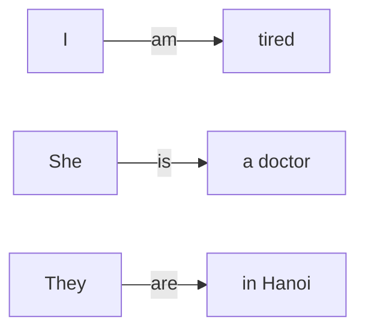
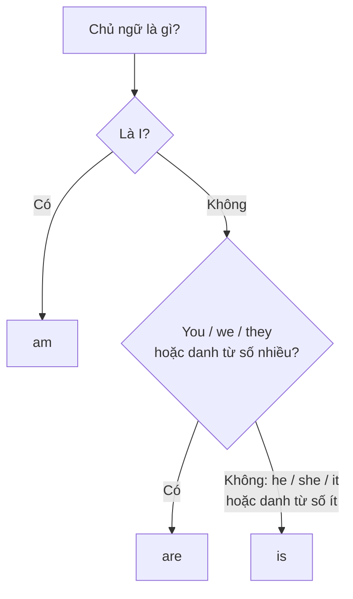

# A0-G009 · The Verb *To Be* — Động từ To Be (am / is / are)

## Mục lục

- [A. Lesson Information](#a-lesson-information)
- [B. Warm-up](#b-warm-up-tình-huống-thực-tế)
- [C. WHAT](#c-what-to-be-là-gì)
- [D. WHY](#d-why-vì-sao-tiếng-anh-cần-to-be)
- [E. FORM](#e-form-công-thức-đầy-đủ)
- [F. HOW](#f-how-các-cách-dùng-chính)
- [G. VISUAL](#g-visual-explanation)
- [H. COMPARISON](#h-comparison)
- [I. COMMON MISTAKES](#i-common-mistakes)
- [J. MEMORY TRICKS](#j-memory-tricks)
- [K. REAL-LIFE APPLICATION](#k-real-life-application)
- [L. PRACTICE EXERCISES](#l-practice-exercises)
- [M. KNOWLEDGE CHECK](#m-knowledge-check)
- [N. ANSWER KEY](#n-answer-key)

---

## A. Lesson Information

| Mục | Nội dung |
|---|---|
| **Lesson ID** | A0-G009 |
| **Topic** | The Verb *To Be* (present: am, is, are) |
| **Tên tiếng Việt** | Động từ To Be ở hiện tại |
| **CEFR Level** | A0 |
| **Prerequisites** | [A0-G006 — Subject Pronouns](A0-G006-subject-pronouns.md), [A0-G008 — Sentence Patterns](A0-G008-sentence-patterns.md) |
| **Estimated Time** | 90 phút |

**Learning Objectives:**

1. Chia đúng *am / is / are* theo chủ ngữ.
2. Tạo câu khẳng định, phủ định, nghi vấn và trả lời ngắn với *be*.
3. Dùng dạng rút gọn (*I'm, she's, they aren't*) trong văn nói.
4. Dùng *be* để nói về tên, tuổi, nghề nghiệp, quốc tịch, cảm xúc, vị trí, thời tiết.
5. Tránh 3 lỗi lớn nhất: thiếu *be*, dùng *be* với động từ thường (*I am go*), và *I have 20 years old*.

---

## B. Warm-up: Tình huống thực tế

Bạn gặp một người nước ngoài ở sân bay và muốn nói:

> "Tôi tên Hà. Tôi 25 tuổi. Tôi người Việt Nam. Tôi là kỹ sư. Tôi hơi mệt."

Nhiều người mới học sẽ viết:

> *My name Ha. I 25 years old. I Vietnamese. I engineer. I little tired.*

🤔 **Hãy suy nghĩ:** Mỗi câu tiếng Việt trên có động từ không? ("tên", "tuổi", "người Việt Nam", "mệt" — đâu là hành động?) Vì sao bản tiếng Anh nghe "thiếu thiếu"?

---

## C. WHAT: *To be* là gì?

**To be** là một động từ rất thường gặp trong tiếng Anh. Trong bài này, be là động từ liên kết, dùng để:

- **Nối** chủ ngữ với thông tin về chủ ngữ (là linking verb — bài [A0-G008](A0-G008-sentence-patterns.md)).
- Diễn tả **trạng thái**, **đặc điểm**, **danh tính**, **vị trí**.

Ở thì hiện tại, *be* có **3 dạng**: **am**, **is**, **are**. Dạng nào được dùng phụ thuộc vào **chủ ngữ**.

Tiếng Việt dịch *be* theo nhiều cách: "là", "thì", "ở", "bị", hoặc **không dịch gì cả**:

| English | Tiếng Việt |
|---|---|
| I **am** a teacher. | Tôi **là** giáo viên. |
| She **is** in the kitchen. | Cô ấy **ở** trong bếp. |
| We **are** hungry. | Chúng tôi đói. (*không có từ tương ứng*) |

**Khi nào KHÔNG thêm be?** Với động từ chính đã chia ở hiện tại đơn (eat, go, work...): *I **work** here*, không phải *I **am** work here*.

---

## D. WHY: Vì sao tiếng Anh cần *to be*?

Như bạn đã học ở A0-G005: câu trần thuật đầy đủ trong mẫu đang học cần động từ. Tiếng Việt cho phép tính từ đứng ngay sau chủ ngữ ("Tôi mệt"), nhưng tiếng Anh thì không — tired trong I am tired là tính từ, không thay thế vị trí động từ; nurse trong She is a nurse là danh từ, cần is để nối.

*Be* giống như một **dấu bằng (=)** hoặc **cây cầu** nối chủ ngữ với phần mô tả:

Vì sao lại có **3 dạng** khác nhau? Tiếng Anh xưa chia động từ theo chủ ngữ phức tạp hơn nhiều; ngày nay hầu hết động từ đã đơn giản hóa, nhưng *be* — vì được dùng quá nhiều — vẫn giữ lại nhiều dạng. Các dạng này bất quy tắc, nên học theo nhóm chủ ngữ.

---

## E. FORM: Công thức đầy đủ

### E1. Chia động từ *be* theo chủ ngữ

| Chủ ngữ | *be* | Rút gọn (contraction) |
|---|---|---|
| **I** | **am** | I'm |
| **He / She / It** / danh từ số ít | **is** | he's, she's, it's, Lan's |
| **You / We / They** / danh từ số nhiều | **are** | you're, we're, they're |

**You luôn dùng are**, kể cả một người; **they cũng dùng are** khi chỉ một người. Amn't có ở một số phương ngữ; mẫu phủ định thông dụng trong giáo trình này là I'm not. Không dùng amn't trong bài luyện dạng này.

### E2. Câu khẳng định (Affirmative)

**S + am/is/are + C (danh từ / tính từ / cụm nơi chốn)**

- *I **am** a student.* → *I'm a student.*
- *My brother **is** tall.* → *My brother's tall.*
- *They **are** at home.* → *They're at home.*

### E3. Câu phủ định (Negative)

**S + am/is/are + not + C**

| Đầy đủ | Rút gọn kiểu 1 | Rút gọn kiểu 2 |
|---|---|---|
| I am not | I'm not | — (bài này dùng I'm not) |
| He is not | he's not | he isn't |
| You are not | you're not | you aren't |

- *I'm **not** hungry.*
- *She **isn't** at work today.*
- *We **aren't** ready.*

### E4. Câu nghi vấn (Interrogative — Yes/No questions)

**Am/Is/Are + S + C?** — Đưa *be* lên **trước** chủ ngữ.

| Khẳng định | Nghi vấn |
|---|---|
| You **are** a student. | **Are** you a student? |
| He **is** from Hue. | **Is** he from Hue? |
| It **is** expensive. | **Is** it expensive? |

### E5. Trả lời ngắn (Short answers)

| Câu hỏi | Yes | No |
|---|---|---|
| Are you tired? | Yes, I **am**. | No, I'**m not**. |
| Is she a doctor? | Yes, she **is**. | No, she **isn't**. / No, she's not. |
| Are they at home? | Yes, they **are**. | No, they **aren't**. |

> ⚠️ **Không** rút gọn trong câu trả lời ngắn khẳng định: ❌ *Yes, I'm.* / ❌ *Yes, she's.* → ✅ *Yes, I am.* / ✅ *Yes, she is.*

**Giải thích ký hiệu:**

- **S** = chủ ngữ; **C** = bổ ngữ (thông tin về chủ ngữ — danh từ, tính từ hoặc cụm chỉ nơi chốn).
- **Contraction** (dạng rút gọn): ghép hai từ, dùng dấu **'** (apostrophe) thay cho chữ bị lược. Dùng trong văn nói và văn viết thân mật.

---

## F. HOW: các cách dùng chính

| # | Cách dùng | English | Tiếng Việt | Phân tích |
|---|---|---|---|---|
| 1 | **Tên, danh tính** | *I'**m** Ha. This **is** my friend Nam.* | Tôi là Hà. Đây là bạn tôi, Nam. | I đi với am; This đi với is; tên Ha/Nam định danh đối tượng |
| 2 | **Tuổi** | *I **am** 25 (years old).* | Tôi 25 tuổi. | I dùng am; 25 years old nêu tuổi, không phải tân ngữ của have |
| 3 | **Nghề nghiệp** | *She **is** a nurse.* | Cô ấy là y tá. | She (S) + is (be) + a nurse (nghề); a nurse định danh She |
| 4 | **Quốc tịch, quê quán** | *We **are** Vietnamese. We **are** from Can Tho.* | Chúng tôi là người Việt Nam, đến từ Cần Thơ. | We dùng are; Vietnamese là tính từ quốc tịch; from Can Tho nêu quê quán |
| 5 | **Cảm xúc, trạng thái** | *I'**m** hungry. They **are** tired.* | Tôi đói. Họ mệt. | I dùng am, They dùng are; hungry/tired mô tả trạng thái chủ ngữ |
| 6 | **Vị trí** | *The keys **are** on the table.* | Chìa khóa ở trên bàn. | The keys là số nhiều → are; on the table nêu vị trí, không phải hành động |
| 7 | **Thời tiết, thời gian, giá cả** | *It'**s** sunny. It'**s** 8 o'clock. It'**s** 50,000 dong.* | Trời nắng. 8 giờ rồi. Nó giá 50.000 đồng. | It là chủ ngữ hình thức ở thời tiết/thời gian; khi nói giá, it thường chỉ món hàng đã biết; cả ba dùng is |
| 8 | **Mô tả đặc điểm** | *The house **is** big and old.* | Ngôi nhà to và cũ. | The house số ít → is; big và old cùng mô tả nhà |
| 9 | **Câu hỏi** | ***Are** you OK? — Yes, I **am**.* | Bạn ổn chứ? — Vâng, tôi ổn. | Đảo *be* lên trước S |
| 10 | **Phủ định** | *He **isn't** married.* | Anh ấy chưa kết hôn. | He số ít dùng is; not phủ định tình trạng married; isn't = is not |

> 💡 **Chú ý cách dùng 2 và 5**: "Tôi có 20 tuổi" → ❌ *I have 20 years*. Đây là cách diễn đạt tuổi thông dụng của tiếng Anh, không phải quy luật logic về sở hữu.

---

## G. VISUAL EXPLANATION

### G1. Sơ đồ chọn am / is / are

### G2. Sentence breakdown — biến đổi một câu

| Loại câu | Thứ tự thành phần | Câu đầy đủ |
|---|---|---|
| Khẳng định | S + be + C | She is a teacher. |
| Phủ định | S + be + not + C | She is not a teacher. |
| Nghi vấn | be + S + C | Is she a teacher? |

Câu nghi vấn: **be** "nhảy" lên trước chủ ngữ.

---

## H. COMPARISON

### *Be* với tính từ và *be* với động từ thường

| Đúng ✅ | Sai ❌ | Giải thích |
|---|---|---|
| I **am** tired. | I tired. | Tính từ cần *be* |
| I **work** here. | I **am** work here. | Câu đã có động từ hành động → không thêm *be* |
| She **is** a cook. | She **is** cook. | Nghề số ít cần *a/an* |
| She **cooks** well. | She **is** cooks well. | Hai động từ chính không đứng cạnh nhau |

**Quy tắc ra quyết định:**

1. Sau chủ ngữ là **tính từ / danh từ / nơi chốn** → cần **be**.
2. Sau chủ ngữ là **động từ hành động** → **không** dùng *be* (ở thì hiện tại đơn — sẽ học kỹ ở [A1-G001](../../02-A1-BEGINNER/grammar/A1-G001-present-simple-affirmative.md)).

> ⚠️ Ngoại lệ bạn sẽ học sau: *be + V-ing* (hiện tại tiếp diễn: *I **am working***) ở [A1-G004](../../02-A1-BEGINNER/grammar/A1-G004-present-continuous.md). Đó là một cấu trúc riêng, không phải *be* + động từ nguyên mẫu.

**Câu hỏi xác nhận giữ trật tự câu kể** như You are a student? cũng có thể đúng, kể cả khi viết; bài này luyện câu hỏi trung tính Are you a student?

### Tuổi và cảm giác: *be* chứ không phải *have*

| Tiếng Việt | ❌ Dịch từng chữ | ✅ Đúng |
|---|---|---|
| Tôi **có** 20 tuổi. | I have 20 years. | I **am** 20 (years old). |
| Tôi **bị** đói. | I have hungry. | I **am** hungry. |
| Tôi **thấy** lạnh. | I have cold. | I **am** cold. / I feel cold. |
| Anh ấy **đúng**. | He has right. | He **is** right. |

---

## I. COMMON MISTAKES

| # | ❌ Sai | ✅ Đúng | Nguyên nhân | Cách tránh |
|---|---|---|---|---|
| 1 | I tired. / She very beautiful. | I **am** tired. / She **is** very beautiful. | Tiếng Việt không cần động từ trước tính từ | Tính từ sau chủ ngữ → cần *be* |
| 2 | I **am** go to school every day. | I go to school every day. | Nghĩ *am/is/are* là "dấu hiệu hiện tại" | Động từ hành động không đi với *be* (trừ V-ing) |
| 3 | I **have** 20 years old. | I **am** 20 years old. | Dịch "có ... tuổi" | Tuổi luôn dùng *be* |
| 4 | **Yes, I'm.** | Yes, I **am**. | Rút gọn sai chỗ | Không rút gọn ở cuối câu trả lời ngắn khẳng định |
| 5 | They **is** students. | They **are** students. | Nhầm số ít/số nhiều | *they* luôn đi với *are* |
| 6 | She is **doctor**. | She is **a** doctor. | Tiếng Việt không có mạo từ | Nghề số ít: *a/an* + nghề |
| 7 | **Are is** she a student? | **Is she** a student? | Dùng thừa hai dạng be | Câu hỏi thông thường: chọn đúng be rồi đảo trước S |
| 8 | I **amn't** ready. | I'**m not** ready. | Rút gọn theo mẫu *isn't/aren't* | Dùng I'm not trong mẫu thông dụng này |

---

## J. MEMORY TRICKS

1. **"I – am, một mình một chữ":** *I* đặc biệt, chỉ đi với *am*. You/we/they → are; he/she/it → is. They dùng are cả khi chỉ một người. Danh từ số ít → is, số nhiều → are.
2. **"Be là dấu bằng":** Khi muốn nói "A là/ở/thì B" hoặc "A + tính từ", hãy nghĩ ngay đến dấu "=" → *be*.
3. **Học cả cụm tuổi:** I am 20 years old. Đừng dịch từng từ từ một ngôn ngữ khác.
4. **Câu hỏi = "nhảy cóc":** *be* nhảy qua đầu chủ ngữ: *She is → Is she?*

---

## K. REAL-LIFE APPLICATION

### Hội thoại: Làm quen ở lớp học tiếng Anh

> **Teacher:** Hello! I'**m** Sarah. I'**m** your English teacher. What's your name?
> **Ha:** Hi, Sarah. I'**m** Ha.
> **Teacher:** Nice to meet you, Ha. Where **are** you from?
> **Ha:** I'**m** from Nam Dinh, but now I live in Hanoi.
> **Teacher:** **Are** you a student?
> **Ha:** No, I'**m not**. I'**m** an engineer.
> **Teacher:** Oh, interesting! **Is** your job difficult?
> **Ha:** Yes, it **is**. But it'**s** very interesting too.
> **Teacher:** And how **are** you today?
> **Ha:** I'**m** a bit nervous! My English **isn't** very good.
> **Teacher:** Don't worry. You'**re** in the right place!

**Vietnamese explanation:** Hà làm quen với cô giáo Sarah: giới thiệu tên, quê quán (Nam Định, đang sống ở Hà Nội), nghề nghiệp (kỹ sư), cảm xúc (hơi lo lắng vì tiếng Anh chưa tốt). Cô giáo động viên: "Bạn đến đúng chỗ rồi!"

**Grammar highlights:**

- Khẳng định: *I'm Sarah, I'm from Nam Dinh, It's very interesting.*
- Phủ định: *I'm not, isn't very good.*
- Nghi vấn + trả lời ngắn: *Are you a student? – No, I'm not. Is your job difficult? – Yes, it is.*

**Useful expressions:**

- *Nice to meet you.* — Rất vui được gặp bạn.
- *Where are you from?* — Bạn đến từ đâu?
- *How are you today?* — Hôm nay bạn thế nào?
- *I'm a bit nervous.* — Tôi hơi lo lắng.
- *Don't worry.* — Đừng lo.

---

## L. PRACTICE EXERCISES

> ✍️ Đáp án: [A0-G009-ANSWERS](../../12-ANSWERS-AND-EXPLANATIONS/A0/A0-G009-ANSWERS.md)

**Cụm hỗ trợ:** a student/a teacher, an engineer là mẫu danh từ nghề nghiệp cho sẵn; quy tắc a/an học ở G012. Trong L1.5/L3.5, chỉ nhận diện không thêm be vào mẫu động từ thường; dạng goes/works được cung cấp, chưa cần tự suy quy tắc thêm s.

### Level 1 — Recognition

Chọn đáp án đúng.

**L1.1.** I ___ a student.  A. is  B. am  C. are
**L1.2.** My parents ___ teachers.  A. is  B. am  C. are
**L1.3.** The weather ___ nice today.  A. is  B. are  C. am
**L1.4.** "Are you from Hue?" – "Yes, I ___."  A. am  B. 'm  C. is
**L1.5.** Which sentence is correct?  A. She is go to work.  B. She goes to work.  C. She is goes to work.
**L1.6.** Which sentence is correct?  A. I have 30 years old.  B. I am 30 years old.  C. I 30 years old.

### Level 2 — Controlled Practice

Điền *am / is / are* (hoặc dạng phủ định khi có *(not)*).

**L2.1.** We ___ hungry.
**L2.2.** It ___ (not) cold today.
**L2.3.** My sister ___ a singer.
**L2.4.** You ___ late again!
**L2.5.** I ___ (not) from Hanoi.
**L2.6.** The children ___ in the garden.
**L2.7.** ___ your father a doctor?
**L2.8.** Tom and Linda ___ (not) married.

Viết câu hỏi và trả lời ngắn theo gợi ý:

**L2.9.** (you / tired?) — Yes, ...
**L2.10.** (it / expensive?) — No, ...

### Level 3 — Error Correction

**L3.1.** She very kind.
**L3.2.** They is my friends.
**L3.3.** I have 18 years old.
**L3.4.** "Is he a teacher?" – "Yes, he's."
**L3.5.** My brother is work in a bank. (Sửa sang hiện tại đơn; dạng động từ đúng cho sẵn: works.)
**L3.6.** He is engineer.
**L3.7.** I isn't busy today.

### Level 4 — Production

Dịch sang tiếng Anh:

**L4.1.** Tôi 22 tuổi và tôi là sinh viên.
**L4.2.** Hôm nay trời không nóng.
**L4.3.** Bố mẹ tôi đang ở nhà. (*at home*)
**L4.4.** Bạn có đói không? — Không, tôi không đói.
**L4.5.** Cái túi này đắt quá. (*this bag, too expensive*)

### Level 5 — Real Communication

**L5.1.** Viết đoạn giới thiệu bản thân 6–8 câu: tên, tuổi, quê quán, nghề nghiệp, tính cách, cảm xúc hôm nay. Dùng ít nhất 1 câu phủ định.
**L5.2.** **Speaking — Role-play:** Đóng vai người mới đến lớp học. Trả lời to các câu hỏi sau (ghi âm):
1. What's your name?
2. How old are you?
3. Where are you from?
4. Are you a student?
5. How are you today?

---

## M. KNOWLEDGE CHECK

### 5 câu hỏi tự kiểm tra

1. *I, she, they, my mother, the books* đi với dạng nào của *be*?
2. Viết câu phủ định và nghi vấn của: *He is happy.*
3. Vì sao *Yes, I'm* là sai?
4. Tuổi dùng *be* hay *have*?
5. Khi nào **không** dùng *be*?

### Checklist

- [ ] Tôi chia *am/is/are* đúng 100% với đại từ.
- [ ] Tôi tạo được câu phủ định, nghi vấn, trả lời ngắn.
- [ ] Tôi không còn viết thiếu *be* trước tính từ.
- [ ] Tôi không ghép *be* với động từ hành động.
- [ ] Tôi giới thiệu bản thân được 6 câu không cần nhìn.

### 3 lỗi quan trọng cần nhớ

1. ~~I tired~~ → I **am** tired.
2. ~~I am go~~ → I go.
3. ~~I have 20 years~~ → I **am** 20.

### Lịch ôn tập

| Ngày | Việc cần làm |
|---|---|
| Ngày 1 | Làm lại L2, L3 |
| Ngày 3 | Giới thiệu bản thân (L5.1) không nhìn bài |
| Ngày 7 | Viết 5 câu hỏi Yes/No với *be* và tự trả lời ngắn |

### Liên kết

- ➡️ Bài tiếp theo: [A0-G010 — Have / Has](A0-G010-have-has.md)
- 🔜 *Be* ở quá khứ: [A1-G016 — was/were](../../02-A1-BEGINNER/grammar/A1-G016-past-simple-be.md)
- 🔁 Tra cứu: [GRAMMAR-CHEAT-SHEET](../../06-GRAMMAR-REFERENCE/GRAMMAR-CHEAT-SHEET.md)

---

## N. ANSWER KEY

👉 [A0-G009-ANSWERS.md](../../12-ANSWERS-AND-EXPLANATIONS/A0/A0-G009-ANSWERS.md)
