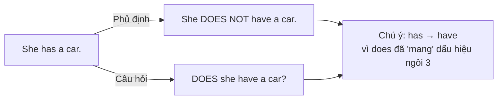

# A0-G010 · Have / Has — Động từ Have và Has

## Mục lục

- [A. Lesson Information](#a-lesson-information)
- [B. Warm-up](#b-warm-up-tình-huống-thực-tế)
- [C. WHAT](#c-what-have--has-là-gì)
- [D. WHY](#d-why-vì-sao-có-have-và-has-vì-sao-cần-dodoes)
- [E. FORM](#e-form-công-thức)
- [F. HOW](#f-how-các-cách-dùng)
- [G. VISUAL](#g-visual-explanation)
- [H. COMPARISON](#h-comparison-have-và-be)
- [I. COMMON MISTAKES](#i-common-mistakes)
- [J. MEMORY TRICKS](#j-memory-tricks)
- [K. REAL-LIFE APPLICATION](#k-real-life-application)
- [L. PRACTICE EXERCISES](#l-practice-exercises)
- [M. KNOWLEDGE CHECK](#m-knowledge-check)
- [N. ANSWER KEY](#n-answer-key)

---

## A. Lesson Information

| Mục | Nội dung |
|---|---|
| **Lesson ID** | A0-G010 |
| **Topic** | Have / Has (present) |
| **Tên tiếng Việt** | Động từ Have / Has ở hiện tại |
| **CEFR Level** | A0 |
| **Prerequisites** | [A0-G009 — To Be](A0-G009-verb-to-be.md) |
| **Estimated Time** | 75 phút |

**Learning Objectives:**

1. Dùng đúng *have* và *has* theo chủ ngữ.
2. Tạo câu phủ định với **don't / doesn't have** và câu hỏi với **Do / Does ... have?**
3. Hiểu vai trò của **trợ động từ (auxiliary verb)** *do/does* — nền tảng cho toàn bộ thì hiện tại đơn ở A1.
4. Dùng *have* cho: sở hữu, gia đình, đặc điểm ngoại hình, bệnh nhẹ, bữa ăn/hoạt động.
5. Phân biệt khi nào dùng *have*, khi nào dùng *be*.

---

## B. Warm-up: Tình huống thực tế

Bạn đang kể về gia đình:

> "Tôi **có** một anh trai. Anh ấy **có** một chiếc xe máy màu đỏ. Chúng tôi **có** một con mèo."

Trong tiếng Việt, từ "có" không bao giờ thay đổi. Nhưng trong tiếng Anh:

> *I **have** a brother. He **has** a red motorbike. We **have** a cat.*

🤔 **Hãy suy nghĩ:** Vì sao câu thứ hai dùng *has* mà không phải *have*? Bạn có nhận ra mẫu nào giống với *am/is/are* ở bài trước không?

---

## C. WHAT: Have / Has là gì?

**Have** (và dạng **has**) là động từ có nghĩa cơ bản là **"có"** — sở hữu, có quan hệ, có đặc điểm. Ngoài ra, *have* còn được dùng trong nhiều cụm cố định như *have breakfast* (ăn sáng), *have a shower* (tắm).

| Chủ ngữ | Dạng |
|---|---|
| I, you, we, they, danh từ số nhiều | **have** |
| he, she, it, danh từ số ít | **has** |

**Khi nào dùng?** Nói về những gì ai đó **sở hữu**, **có trong gia đình**, **có đặc điểm cơ thể**, **mắc bệnh nhẹ**.

**Khi nào KHÔNG dùng?** Tuổi (*I **am** 20*), cảm giác đói/khát/lạnh (*I **am** hungry*), nghĩa "có (tồn tại) ở một nơi" (*There **is** a bank near here* — học ở [A0-G015](A0-G015-there-is-there-are.md)).

---

## D. WHY: Vì sao có *have* và *has*? Vì sao cần *do/does*?

### Vì sao có *has*?

Trong tiếng Anh hiện tại, động từ thường **thay đổi khi chủ ngữ là ngôi thứ ba số ít** (*he, she, it*). *have* → *has* là một ví dụ (không theo quy tắc thêm *-s* thông thường, không dùng haves để chia động từ have ở nghĩa này). Bạn sẽ thấy quy tắc này với nhiều **động từ thường** ở [A1-G001](../../02-A1-BEGINNER/grammar/A1-G001-present-simple-affirmative.md): *work → works, go → goes*.

### Vì sao phủ định và câu hỏi cần *do/does*?

Với *be*, bạn chỉ cần thêm *not* hoặc đảo *be* lên trước. Bài này chọn mẫu have với trợ động từ do/does, thông dụng trong cả Anh–Anh và Anh–Mỹ. Have còn có cách hỏi/phủ định khác trong một số cách dùng Anh–Anh (Have you a pen? / I haven't any money) và cấu trúc have got; không coi các biến thể đó là sai chỉ vì không theo mẫu của bài.



**Điểm then chốt:** Khi đã có *does*, động từ chính **trở về dạng gốc** *have*. *Does* đã "gánh" thông tin ngôi thứ ba số ít, nên *has* không cần nữa.

---

## E. FORM: Công thức

**Giải thích ký hiệu:**

- **S** = chủ ngữ; **O** = tân ngữ (thứ được "có").
- **Auxiliary verb** (trợ động từ) = động từ "phụ" giúp tạo phủ định/câu hỏi: ở đây là *do/does*.
- **Bare infinitive** (động từ nguyên mẫu không *to*): dạng gốc của động từ, ví dụ *have*.

### E1. Khẳng định (Affirmative)

| Chủ ngữ | Công thức | Ví dụ |
|---|---|---|
| I / You / We / They | S + **have** + O | *They **have** two children.* |
| He / She / It | S + **has** + O | *She **has** long hair.* |

### E2. Phủ định (Negative)

| Chủ ngữ | Công thức | Rút gọn | Ví dụ |
|---|---|---|---|
| I / You / We / They | S + **do not** + have + O | **don't** | *I **don't have** a car.* |
| He / She / It | S + **does not** + have + O | **doesn't** | *He **doesn't have** a job.* |

### E3. Nghi vấn (Interrogative)

| Chủ ngữ | Công thức | Ví dụ |
|---|---|---|
| I / You / We / They | **Do** + S + have + O? | ***Do** you **have** a pen?* |
| He / She / It | **Does** + S + have + O? | ***Does** she **have** a sister?* |

### E4. Trả lời ngắn (Short answers)

| Câu hỏi | Yes | No |
|---|---|---|
| Do you have a pen? | Yes, I **do**. | No, I **don't**. |
| Does he have a car? | Yes, he **does**. | No, he **doesn't**. |
| Do they have children? | Yes, they **do**. | No, they **don't**. |

> ⚠️ Trả lời ngắn dùng **do/does**, không lặp lại *have*: ❌ *Yes, I have.* (trong tiếng Anh – Mỹ và phổ biến hiện nay, cách đúng là *Yes, I do.*)

> 💡 Tiếng Anh – Anh còn dùng **have got** (*I've got a car*). Đó là cấu trúc riêng, sẽ học ở [A1-G008](../../02-A1-BEGINNER/grammar/A1-G008-have-got.md). Trong bài này, bạn học dạng *have* chuẩn, dùng được ở mọi nơi.

---

## F. HOW: Các cách dùng

| # | Cách dùng | English | Tiếng Việt | Phân tích |
|---|---|---|---|---|
| 1 | Sở hữu đồ vật | *I **have** a new laptop.* | Tôi có một laptop mới. | S (I) + have + O |
| 2 | Sở hữu (ngôi 3) | *My father **has** an old car.* | Bố tôi có một chiếc xe cũ. | *My father* = he → *has* |
| 3 | Gia đình, quan hệ | *We **have** three children.* | Chúng tôi có ba con. | We dùng have; three children là O nêu quan hệ gia đình |
| 4 | Gia đình (phủ định) | *She **doesn't have** any brothers.* | Cô ấy không có anh/em trai nào. | *doesn't* + *have* (không phải *has*) |
| 5 | Đặc điểm ngoại hình | *He **has** brown eyes and short hair.* | Anh ấy có mắt nâu và tóc ngắn. | He dùng has; brown eyes và short hair cùng làm đối tượng mô tả đặc điểm |
| 6 | Bệnh nhẹ | *I **have** a headache.* | Tôi bị đau đầu. | Have a headache là cụm đau đầu; không phải tên bệnh nào cũng có a, nên học từng cụm |
| 7 | Bữa ăn | *We **have** breakfast at 7.* | Chúng tôi ăn sáng lúc 7 giờ. | *have* = ăn/uống trong cụm cố định |
| 8 | Hoạt động | *I **have** a shower every morning.* | Sáng nào tôi cũng tắm. | *have a shower* = tắm vòi sen |
| 9 | Lịch trình | *She **has** a meeting at 10.* | Cô ấy có cuộc họp lúc 10 giờ. | She dùng has; a meeting là sự kiện trong lịch, at 10 chỉ giờ |
| 10 | Câu hỏi | ***Does** your house **have** a garden?* | Nhà bạn có vườn không? | Chủ ngữ *your house* = it → *Does* |
| 11 | Câu hỏi | ***Do** you **have** time now?* | Bây giờ bạn có thời gian không? | You dùng Do; have giữ nguyên, time là O; now chỉ thời gian |
| 12 | Trả lời ngắn | *"Do they have a dog?" – "No, they **don't**."* | Họ có chó không? — Không. | Hỏi Do nên trả lời don't; không phải No, they aren't |

---

## G. VISUAL EXPLANATION

### G1. Bảng biến đổi

| Loại câu | I / you / we / they | he / she / it |
|---|---|---|
| ➕ Khẳng định | I **have** a cat. | She **has** a cat. |
| ➖ Phủ định | I **don't have** a cat. | She **doesn't have** a cat. |
| ❓ Nghi vấn | **Do** you **have** a cat? | **Does** she **have** a cat? |
| 💬 Trả lời | Yes, I do. / No, I don't. | Yes, she does. / No, she doesn't. |

### G2. Quy tắc "chỉ một dấu hiệu ngôi 3"

```text
She  has  a cat.            ← dấu hiệu ngôi 3 nằm ở "has"
She  does  not  have  a cat. ← dấu hiệu chuyển sang "does", động từ chính về "have"
Does  she  have  a cat?      ← tương tự
```

Trong **cụm động từ đơn với does** đang luyện, have giữ nguyên. Một câu vẫn có thể chứa nhiều động từ đã chia: She has a cat and works at home; không đếm chữ s cho cả câu.

---

## H. COMPARISON: *Have* và *be*

| Ý nghĩa | Dùng | Ví dụ | ❌ Sai thường gặp |
|---|---|---|---|
| Tuổi | **be** | I **am** 30. | ~~I have 30 years.~~ |
| Đói, khát, lạnh, nóng | **be** | I **am** thirsty. | ~~I have thirsty.~~ |
| Nghề nghiệp | **be** | She **is** a lawyer. | She has a lawyer đúng ngữ pháp nhưng nghĩa là cô ấy có luật sư, không phải cô ấy làm luật sư |
| Sở hữu | **have** | She **has** a lawyer. (cô ấy có luật sư riêng) | |
| Ngoại hình (tính từ) | **be** | He **is** tall. | |
| Ngoại hình (bộ phận + tính từ) | **have** | He **has** big eyes. | |
| Bệnh | **have** + danh từ / **be** + tính từ | I **have** a fever. / I **am** sick. | ~~I am fever.~~ |

**Quy tắc ra quyết định:**
- Phần sau là **tính từ** → *be*.
- Phần sau là **danh từ chỉ thứ sở hữu / bộ phận / bệnh** → *have*.
- Phần sau là **danh từ chỉ chính chủ ngữ** (nghề, danh tính) → *be*.

---

## I. COMMON MISTAKES

| # | ❌ Sai | ✅ Đúng | Nguyên nhân | Cách tránh |
|---|---|---|---|---|
| 1 | She **have** a sister. | She **has** a sister. | Quên quy tắc ngôi 3 | *he/she/it* → *has* |
| 2 | She **doesn't has** a car. | She **doesn't have** a car. | Hai dấu hiệu ngôi 3 | Sau *does/doesn't* → *have* |
| 3 | **Does** he **has** a job? | **Does** he **have** a job? | Như trên | Như trên |
| 4 | I **am have** a cat. | I **have** a cat. | Ghép *be* + động từ | Không dùng *be* trước *have* |
| 5 | I **doesn't have** a car. | I **don't have** a car. | Chọn sai trợ động từ cho I | I/you/we/they dùng do, không dùng does |
| 6 | **Does** you have a pen? | **Do** you have a pen? | Chọn sai trợ động từ cho you | You dùng do cả khi chỉ một người |
| 7 | I **have** hungry. | I **am** hungry. | Dịch "bị/thấy đói" | Tính từ → *be* |

---

## J. MEMORY TRICKS

1. **"Has là have của he/she/it":** Nhớ cả nhóm he/she/it → has; I/you/we/they → have. They vẫn dùng have khi chỉ một người.
2. **"Một chữ S thôi!"**: Trong câu có *does/doesn't*, động từ chính **không** mang dấu hiệu ngôi 3 nữa. Hai dấu hiệu là thừa.
3. **Học cả mẫu:** Do you have...? / Does she have...?; trả lời theo trợ động từ của câu hỏi. Mẹo này áp dụng mẫu do/does đang học, không phủ nhận biến thể khác.

---

## K. REAL-LIFE APPLICATION

### Hội thoại: Hỏi thăm gia đình

> **Linh:** **Do** you **have** any brothers or sisters, Mark?
> **Mark:** Yes, I **do**. I **have** one sister. She **has** two kids.
> **Linh:** Oh, so you're an uncle! **Does** she live near you?
> **Mark:** No, she **doesn't**. She lives in Australia. What about you?
> **Linh:** I **don't have** any brothers, but I **have** two sisters. We **have** a big family dinner every Sunday.
> **Mark:** That sounds lovely. **Do** you **have** a photo?
> **Linh:** Sure, look!

**Vietnamese explanation:** Linh hỏi Mark có anh chị em không. Mark có một chị/em gái, người này có hai con và sống ở Úc. Linh không có anh/em trai nhưng có hai chị/em gái; gia đình cô ăn tối cùng nhau mỗi chủ nhật.

**Grammar highlights:**
- Câu hỏi: *Do you have...? Does she live...?* (cùng mẫu *Does + S + V nguyên mẫu*)
- Phủ định: *I don't have any brothers. She doesn't.*
- Ngôi 3: *She has two kids.*
- *have dinner* = ăn tối.

**Useful expressions:**
- *Do you have any brothers or sisters?* — Bạn có anh chị em không?
- *What about you?* — Còn bạn thì sao?
- *That sounds lovely.* — Nghe thật tuyệt.

> 💡 *any* trong câu hỏi và phủ định sẽ được học kỹ ở [A1-G014 Some/Any](../../02-A1-BEGINNER/grammar/A1-G014-some-any.md).

---

## L. PRACTICE EXERCISES

> ✍️ Đáp án: [A0-G010-ANSWERS](../../12-ANSWERS-AND-EXPLANATIONS/A0/A0-G010-ANSWERS.md)

**Ngữ cảnh bài tập:** Ở L2, các câu không có dấu hiệu phủ định cần điền khẳng định; câu 2 và 5 có gợi ý nghĩa phủ định. Any trong don't have any... nghĩa là không có ... nào; can't swim = không thể bơi. His company = công ty của anh ấy; dùng nguyên cụm trong bản dịch.

### Level 1 — Recognition

**L1.1.** My mother ___ a small shop.  A. have  B. has  C. is
**L1.2.** We ___ English class on Monday.  A. have  B. has  C. are
**L1.3.** ___ your brother have a girlfriend?  A. Do  B. Does  C. Is
**L1.4.** They ___ a car.  A. doesn't have  B. don't have  C. don't has
**L1.5.** "Does Lan have a bike?" – "Yes, she ___."  A. has  B. have  C. does
**L1.6.** Which is correct?  A. I am hungry.  B. I have hungry.  C. I hungry.

### Level 2 — Controlled Practice

Điền *have, has, don't have, doesn't have, Do, Does*.

**L2.1.** Hoa ___ two cats.
**L2.2.** I ___ a sister. I only have brothers.
**L2.3.** ___ you have a pen?
**L2.4.** My grandparents ___ a big garden.
**L2.5.** The hotel ___ a swimming pool, so we can't swim there.
**L2.6.** ___ your phone have a good camera?
**L2.7.** My son ___ a fever today.
**L2.8.** We ___ lunch at 12 o'clock.

Chuyển sang phủ định (–) và nghi vấn (?):

**L2.9.** He has a motorbike. (–) / (?)
**L2.10.** They have a big house. (–) / (?)

### Level 3 — Error Correction

**L3.1.** My father have a lot of books.
**L3.2.** She doesn't has any money.
**L3.3.** Does you have a car?
**L3.4.** Does he has a brother?
**L3.5.** I have 25 years old.
**L3.6.** We are have a dog.

### Level 4 — Production

Dịch sang tiếng Anh:

**L4.1.** Tôi bị đau đầu.
**L4.2.** Em gái tôi có mắt to và tóc dài.
**L4.3.** Bạn có xe máy không? — Không, tôi không có.
**L4.4.** Công ty của anh ấy không có căng-tin. (*company, canteen*)
**L4.5.** Gia đình tôi ăn tối lúc 7 giờ.

### Level 5 — Real Communication

**L5.1.** Viết 6–8 câu về gia đình bạn (khung giới thiệu số thành viên: There are ... people in my family = Gia đình tôi có ... người; quy tắc học ở G015): số thành viên, ai có gì (đồ vật, thú cưng), ngoại hình một người. Dùng ít nhất 2 câu phủ định.
**L5.2.** **Speaking — Interview:** Tự hỏi và tự trả lời to (hoặc hỏi một người bạn) 5 câu: *Do you have a pet? Do you have any brothers or sisters? Does your best friend have a car? Do you have breakfast every day? Does your house have a balcony?*

---

## M. KNOWLEDGE CHECK

### 5 câu hỏi tự kiểm tra

1. Chủ ngữ nào đi với *has*?
2. Phủ định của *She has a dog* là gì?
3. Vì sao sau *does* lại dùng *have* chứ không phải *has*?
4. Trả lời ngắn cho *Do you have a car?* thế nào?
5. Tuổi, cảm giác đói dùng *be* hay *have*?

### Checklist

- [ ] Tôi dùng *has* với ngôi 3 số ít.
- [ ] Tôi tạo phủ định/câu hỏi với *do/does* và giữ *have* nguyên mẫu.
- [ ] Tôi phân biệt khi nào dùng *be*, khi nào dùng *have*.

### 3 lỗi quan trọng cần nhớ

1. ~~doesn't has~~ → **doesn't have**.
2. ~~Does you have a pen?~~ → **Do you have** a pen?
3. ~~I have hungry~~ → I **am** hungry.

### Lịch ôn tập

| Ngày | Việc cần làm |
|---|---|
| Ngày 1 | Làm lại L2.9–L2.10 với 5 câu mới |
| Ngày 3 | Mô tả ngoại hình 3 người bằng *be* và *have* |
| Ngày 7 | Làm lại L3 và bảng so sánh mục H |

### Liên kết

- ➡️ Bài tiếp theo: [A0-G011 — This, That, These, Those](A0-G011-this-that-these-those.md)
- 🔜 [A1-G002 — Present Simple Negatives & Questions](../../02-A1-BEGINNER/grammar/A1-G002-present-simple-negatives-questions.md) (cùng cơ chế *do/does*)
- 🔜 [A1-G008 — Have Got](../../02-A1-BEGINNER/grammar/A1-G008-have-got.md)

---

## N. ANSWER KEY

👉 [A0-G010-ANSWERS.md](../../12-ANSWERS-AND-EXPLANATIONS/A0/A0-G010-ANSWERS.md)
