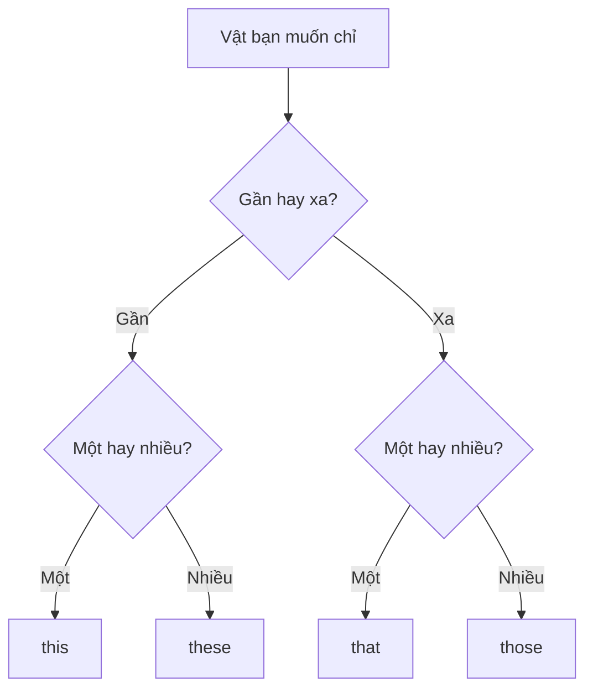

# A0-G011 · This, That, These, Those — Từ chỉ định

## Mục lục

- [A. Lesson Information](#a-lesson-information)
- [B. Warm-up](#b-warm-up-tình-huống-thực-tế)
- [C. WHAT](#c-what-từ-chỉ-định-là-gì)
- [D. WHY](#d-why-hai-câu-hỏi--gần-hay-xa-một-hay-nhiều)
- [E. FORM](#e-form-công-thức)
- [F. HOW](#f-how-các-cách-dùng)
- [G. VISUAL](#g-visual-explanation)
- [H. COMPARISON](#h-comparison)
- [I. COMMON MISTAKES](#i-common-mistakes)
- [J. MEMORY TRICKS](#j-memory-tricks)
- [K. REAL-LIFE APPLICATION](#k-real-life-application)
- [L. PRACTICE EXERCISES](#l-practice-exercises)
- [M. KNOWLEDGE CHECK](#m-knowledge-check)
- [N. ANSWER KEY](#n-answer-key)

---

## A. Lesson Information

| Mục | Nội dung |
|---|---|
| **Lesson ID** | A0-G011 |
| **Topic** | Demonstratives: This, That, These, Those |
| **Tên tiếng Việt** | Từ chỉ định |
| **CEFR Level** | A0 |
| **Prerequisites** | [A0-G009 — To Be](A0-G009-verb-to-be.md) |
| **Estimated Time** | 60 phút |

**Learning Objectives:**

1. Chọn đúng *this/that/these/those* dựa trên **khoảng cách** (gần/xa) và **số lượng** (một/nhiều).
2. Dùng từ chỉ định **trước danh từ** (*this book*) và **thay cho danh từ** (*This is my book*).
3. Chia *is/are* đúng sau từ chỉ định.
4. Dùng *this/that* trong giới thiệu, gọi điện thoại, phản hồi (*That's great!*).
5. Trả lời câu hỏi *What is this/that?* và *What are these/those?*

---

## B. Warm-up: Tình huống thực tế

Bạn đi chợ cùng một người bạn nước ngoài. Bạn cầm một quả xoài trên tay và chỉ vào rổ nhãn ở sạp bên kia đường:

> *"**This** is a mango. And **those** are longans."*

🤔 **Hãy suy nghĩ:** Tiếng Việt chỉ cần "cái này", "cái kia", "mấy cái này", "mấy cái kia". Tiếng Anh dùng 4 từ khác nhau. Hai yếu tố nào quyết định từ được chọn?

---

## C. WHAT: Từ chỉ định là gì?

**Demonstratives** (từ chỉ định) là từ dùng để **chỉ ra** người hoặc vật cụ thể, cho biết nó ở **gần** hay **xa** người nói, và là **một** hay **nhiều**.

| | Gần (near) | Xa (far) |
|---|---|---|
| **Số ít (singular)** | **this** — này, đây | **that** — đó, kia |
| **Số nhiều (plural)** | **these** — những ... này | **those** — những ... kia |

"Gần" và "xa" có thể là:

- **Không gian:** trong tay/bên cạnh (*this*) – bên kia phòng (*that*).
- **Thời gian:** hiện tại (*this week*) – quá khứ hoặc xa hơn (*that day*).
- **Tâm lý:** điều đang diễn ra/vừa nói (*this*) – điều người khác vừa nói (*That's true*).

---

## D. WHY: Hai câu hỏi — gần hay xa? một hay nhiều?

Tiếng Anh "đóng gói" hai thông tin (khoảng cách + số lượng) vào **một từ**. Khi bạn chọn từ chỉ định, hãy luôn trả lời hai câu hỏi theo thứ tự:



Vì từ chỉ định đã chứa thông tin số lượng, **danh từ và động từ theo sau cũng phải khớp**: *these books **are***, không phải *these book is*.

---

## E. FORM: Công thức

### E1. Từ chỉ định + danh từ (determiner)

| Công thức | Ví dụ |
|---|---|
| **this / that** + danh từ số ít | *this phone*, *that car* |
| **this / that** + danh từ không đếm được | *this water*, *that music* (học ở [A0-G014](A0-G014-countable-uncountable.md)) |
| **these / those** + danh từ số nhiều | *these phones*, *those cars* |

### E2. Từ chỉ định đứng một mình (pronoun)

| Khẳng định | Phủ định | Nghi vấn |
|---|---|---|
| **This is** my bag. | **This isn't** my bag. | **Is this** your bag? |
| **That is** (**That's**) a temple. | **That isn't** a temple. | **Is that** a temple? |
| **These are** my keys. | **These aren't** my keys. | **Are these** your keys? |
| **Those are** apples. | **Those aren't** apples. | **Are those** apples? |

### E3. Trả lời câu hỏi với từ chỉ định

Khi trả lời, ta thường dùng **it** (cho *this/that*) và **they** (cho *these/those*):

| Câu hỏi | Trả lời |
|---|---|
| *Is this your pen?* | *Yes, **it** is.* / *No, **it** isn't.* |
| *What's that?* | ***It**'s a bank.* |
| *Are those your shoes?* | *Yes, **they** are.* / *No, **they** aren't.* |
| *What are these?* | ***They**'re rambutans.* |

> 💡 Trong văn viết chuẩn của bài, viết **This is**, không viết **This's**. *That's* thì đúng và rất phổ biến.

---

## F. HOW: Các cách dùng

| # | Cách dùng | English | Tiếng Việt | Phân tích |
|---|---|---|---|---|
| 1 | Chỉ vật gần, số ít | ***This** coffee is delicious.* | Cà phê này ngon. | Đang cầm ly → gần |
| 2 | Chỉ vật xa, số ít | *Look at **that** building!* | Nhìn tòa nhà kia kìa! | Ở xa |
| 3 | Chỉ vật gần, số nhiều | ***These** shoes are too small.* | Đôi giày này chật quá. | Shoes là số nhiều trong câu này → these; một chiếc giày là a shoe |
| 4 | Chỉ vật xa, số nhiều | ***Those** students are from Japan.* | Những sinh viên kia đến từ Nhật. | Those xác định nhóm ở xa; students số nhiều nên are, from Japan chỉ nguồn gốc |
| 5 | Giới thiệu người | ***This is** my friend, Tuan.* | Đây là bạn tôi, Tuấn. | This is là mẫu thông dụng khi giới thiệu một người ở gần; nhiều người dùng These are. Không suy ra mọi lời giới thiệu đều phải có this |
| 6 | Gọi điện thoại | *Hello, **this is** Mai.* | Alô, Mai đây. | This is là mẫu tự giới thiệu thông dụng qua điện thoại; I am không tự động sai trong mọi ngữ cảnh |
| 7 | Thời gian gần | *I'm busy **this** week.* | Tuần này tôi bận. | *this week/month/year* = hiện tại |
| 8 | Phản hồi điều vừa nghe | *"I passed the exam!" – "**That**'s great!"* | "Tôi đỗ rồi!" – "Tuyệt quá!" | *That* chỉ thông tin người khác vừa nói |
| 9 | Câu hỏi | *What's **that** noise?* | Tiếng ồn gì thế? | That đi trước noise để chỉ tiếng động người nói đang chú ý; không cần nhìn thấy vật để dùng từ chỉ định |
| 10 | Trả lời bằng *it/they* | *"Are **these** your glasses?" – "Yes, **they** are. Thanks!"* | Đây là kính của bạn à? — Vâng, cảm ơn! | *glasses* (kính) luôn số nhiều |

---

## G. VISUAL EXPLANATION

### G1. Bảng 2×2

```text
                 GẦN 👋            XA 👉
              ┌──────────────┬──────────────┐
  MỘT (1)     │    this      │    that      │
              │  this book   │  that house  │
              ├──────────────┼──────────────┤
  NHIỀU (2+)  │    these     │    those     │
              │ these books  │ those houses │
              └──────────────┴──────────────┘
```

### G2. Sentence breakdown

`These | apples | are | very sweet.`

- **These** → từ chỉ định (gần, số nhiều)
- **apples** → danh từ số nhiều (có *-s*)
- **are** → *be* số nhiều
- **very sweet** → bổ ngữ (tính từ)

Ba chỗ phải **khớp số nhiều**: *These – apples – are*.

---

## H. COMPARISON

### *This/That* với *It*

| | *This/That* | *It* |
|---|---|---|
| Chức năng | **Chỉ ra** vật lần đầu, nhấn mạnh vị trí | **Thay thế** vật đã biết |
| Ví dụ | ***This** is my new phone.* | ***It** is very fast.* |

**Mẫu thông dụng:** Dùng this/that để chỉ vật, rồi it để tiếp tục nói về vật đó. Không phải luật lần đầu/lần sau: có thể nhắc lại this/that để đối chiếu, và dùng it ngay khi vật đã rõ trong hoàn cảnh.

### *These/Those* với *They*

Tương tự: *Those are my parents. **They** live in Da Lat.*

### Từ chỉ định với *the*

*the* chỉ cho biết vật đã xác định; *this/that* còn cho biết **khoảng cách**. *The book* = cuốn sách (đã biết); *this book* = cuốn sách **này** (ở gần). Học kỹ *the* ở [A0-G012](A0-G012-articles-basic.md).

---

## I. COMMON MISTAKES

| # | ❌ Sai | ✅ Đúng | Nguyên nhân | Cách tránh |
|---|---|---|---|---|
| 1 | **This** books are new. | **These** books are new. | Không khớp số nhiều | Kiểm tra số của danh từ; không chỉ nhìn chữ s (children số nhiều nhưng không có s) |
| 2 | **These** is my sister. | **This** is my sister. | Nhầm *these* với *this* | Một người → *this* |
| 3 | **Those** car is expensive. | **That** car is expensive. | | Một vật → *that* |
| 4 | These **are** my friend. | These are my **friends**. | Quên *-s* ở danh từ | *these/those* + danh từ số nhiều |
| 5 | **These books is** new. | These books **are** new. | Chọn be không khớp danh từ số nhiều | These/those + danh từ số nhiều dùng are |
| 6 | "Are these your bags?" – "Yes, **it is**." | "Yes, **they are**." | Đổi nhóm nhiều vật thành một vật | Đáp ngắn về nhóm này dùng they are |
| 7 | **This's** my room. | **This is** my room. | Rút gọn sai | Không rút gọn *this is* |

---

## J. MEMORY TRICKS

1. **Nhớ hai cặp:** this → these; that → those. Không lấy chữ s cuối làm dấu hiệu số nhiều vì this kết thúc bằng s nhưng chỉ số ít.
2. **"This – here, that – there":** *this* đi với *here* (ở đây), *that* đi với *there* (ở đó). *This book here, that book over there.*
3. **Phát âm phân biệt:** *this* /ðɪs/ (i ngắn) – *these* /ðiːz/ (i dài + âm /z/). Hai từ khác cả nguyên âm và âm cuối /s/–/z/, nên không gọi là cặp tối thiểu (vốn chỉ khác một âm). /ɪ/–/iː/ khác cả chất lượng âm, không chỉ độ dài.

---

## K. REAL-LIFE APPLICATION

### Hội thoại: Ở chợ đêm

> **Tourist:** Excuse me, what's **this**?
> **Seller:** **It**'s *bánh xèo*, a Vietnamese pancake.
> **Tourist:** And what are **those**, over there?
> **Seller:** **Those** are spring rolls. **They**'re really good.
> **Tourist:** How much is **this** pancake?
> **Seller:** **It**'s 30,000 dong.
> **Tourist:** OK, I'll take **this** one and two of **those** spring rolls, please.
> **Seller:** Here you are. Enjoy!
> **Tourist:** Thanks! Wow, **this** is delicious!

**Vietnamese explanation:** Một du khách hỏi về các món ăn ở chợ đêm: bánh xèo (gần — *this*), chả giò ở xa (*those*). Du khách mua một bánh xèo và hai cuốn chả giò, rồi khen ngon.

**Grammar highlights:** *this* (vật gần, một) → trả lời *It's...*; *those* (vật xa, nhiều) → *They're...*; *this one* = cái này (tránh lặp danh từ).

**Useful expressions:**
- *What's this?* / *What are those?* — Đây/Kia là gì?
- *How much is this?* — Cái này bao nhiêu tiền?
- *I'll take this one.* — Tôi lấy cái này. (*will* sẽ học ở [A1-G019](../../02-A1-BEGINNER/grammar/A1-G019-future-will.md))
- *Here you are.* — Của bạn đây.

---

## L. PRACTICE EXERCISES

> ✍️ Đáp án: [A0-G011-ANSWERS](../../12-ANSWERS-AND-EXPLANATIONS/A0/A0-G011-ANSWERS.md)

**Hỗ trợ:** Với số nhiều thường thêm s (book/books); a/an chỉ một nên bỏ khi đổi sang số nhiều. Children = nhiều trẻ em; parents = bố mẹ. Trong bài chọn từ chỉ định, coi gần/xa đã được đề xác định; thực tế người nói còn có thể lựa chọn theo điểm nhìn và sự đối chiếu.

### Level 1 — Recognition

**L1.1.** (đang cầm một cuốn sách) ___ is my book.  A. This  B. That  C. These
**L1.2.** (chỉ những ngôi sao trên trời) ___ are stars.  A. These  B. Those  C. That
**L1.3.** ___ shoes are new. (đang mang)  A. This  B. These  C. Those
**L1.4.** "Is that your car?" – "Yes, ___ is."  A. that  B. this  C. it
**L1.5.** (điện thoại) "Hello, ___ Nam." (Chọn mẫu tự giới thiệu.)  A. these is  B. this is  C. this are
**L1.6.** ___ my parents. (ảnh trên tay)  A. This are  B. These are  C. Those is

### Level 2 — Controlled Practice

Điền *this, that, these, those*.

**L2.1.** (gần) ___ flowers are beautiful.
**L2.2.** (xa) Who is ___ man?
**L2.3.** (gần) I love ___ song!
**L2.4.** (xa) ___ children are very noisy.
**L2.5.** (thời gian hiện tại) I'm on holiday ___ week.

Viết lại sang số nhiều:

**L2.6.** This is a pen. → ______
**L2.7.** That is my friend. → ______
**L2.8.** Is this your key? → ______

### Level 3 — Error Correction

**L3.1.** This apples are green.
**L3.2.** Those is my brother.
**L3.3.** These are my friend.
**L3.4.** "Are these your bags?" – "Yes, it is."
**L3.5.** This's my new car.
**L3.6.** That houses are old.

### Level 4 — Production

Dịch sang tiếng Anh:

**L4.1.** Đây là mẹ tôi.
**L4.2.** Những cái ghế kia có thoải mái không? (*comfortable*)
**L4.3.** Cái áo này đẹp nhưng đắt. (*shirt*)
**L4.4.** Alô, Hằng đây. Bạn có rảnh không? (*free*)
**L4.5.** "Kia là cái gì?" – "Đó là một cái chùa." (*pagoda*)

### Level 5 — Real Communication

**L5.1.** Viết đoạn hội thoại 8 dòng giữa bạn và một người bán hàng ở cửa hàng quần áo, dùng đủ 4 từ chỉ định.
**L5.2.** **Speaking:** Đi quanh nhà, chỉ vào đồ vật và nói 10 câu: 5 câu với vật gần (*This is.../These are...*), 5 câu với vật xa (*That is.../Those are...*). Thêm một câu mô tả với *it/they*.

---

## M. KNOWLEDGE CHECK

### 5 câu hỏi tự kiểm tra

1. Hai yếu tố nào quyết định chọn *this/that/these/those*?
2. Khi trả lời *Is this...?*, ta dùng đại từ nào?
3. Tự giới thiệu trên điện thoại nói thế nào?
4. Viết số nhiều của: *That is an old bike.*
5. *this* và *these* phát âm khác nhau thế nào?

### Checklist

- [ ] Tôi chọn đúng từ chỉ định theo khoảng cách và số lượng.
- [ ] Danh từ và động từ sau *these/those* luôn ở số nhiều.
- [ ] Tôi trả lời bằng *it/they*.

### 3 lỗi quan trọng cần nhớ

1. ~~this books~~ → **these** books.
2. ~~These are my friend~~ → These are my **friends**.
3. Khi trả lời về nhóm túi: ~~Yes, it is~~ → Yes, **they are**.

### Lịch ôn tập

| Ngày | Việc cần làm |
|---|---|
| Ngày 1 | Làm lại L2 |
| Ngày 3 | Làm lại L5.2 ở một nơi khác (văn phòng, lớp học) |
| Ngày 7 | Luyện phát âm *this – these* 20 lần, ghi âm |

### Liên kết

- ➡️ Bài tiếp theo: [A0-G012 — Articles A, An, The](A0-G012-articles-basic.md)
- 🔁 Phát âm /ɪ/ – /iː/: [PRON-03 — Minimal Pairs](../../08-PRONUNCIATION/PRON-03-minimal-pairs.md)

---

## N. ANSWER KEY

👉 [A0-G011-ANSWERS.md](../../12-ANSWERS-AND-EXPLANATIONS/A0/A0-G011-ANSWERS.md)
