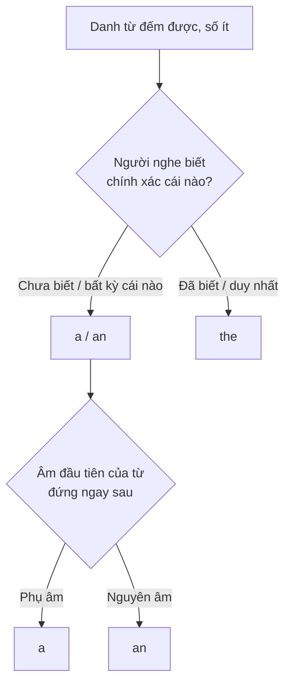

# A0-G012 · Articles A, An, The (basic) — Mạo từ cơ bản

## Mục lục

- [A. Lesson Information](#a-lesson-information)
- [B. Warm-up](#b-warm-up-tình-huống-thực-tế)
- [C. WHAT](#c-what-mạo-từ-là-gì)
- [D. WHY](#d-why-người-nghe-đã-biết-vật-đó-chưa)
- [E. FORM](#e-form-quy-tắc-cơ-bản)
- [F. HOW](#f-how-các-cách-dùng)
- [G. VISUAL](#g-visual-explanation)
- [H. COMPARISON](#h-comparison)
- [I. COMMON MISTAKES](#i-common-mistakes)
- [J. MEMORY TRICKS](#j-memory-tricks)
- [K. REAL-LIFE APPLICATION](#k-real-life-application)
- [L. PRACTICE EXERCISES](#l-practice-exercises)
- [M. KNOWLEDGE CHECK](#m-knowledge-check)
- [N. ANSWER KEY](#n-answer-key)

---

## A. Lesson Information

| Mục | Nội dung |
|---|---|
| **Lesson ID** | A0-G012 |
| **Topic** | Articles: A, An, The (basic use) |
| **Tên tiếng Việt** | Mạo từ cơ bản |
| **CEFR Level** | A0 |
| **Prerequisites** | [A0-G005](A0-G005-nouns-verbs-adjectives-adverbs.md); nên học [A0-G001](A0-G001-alphabet.md)–[G003](A0-G003-english-sounds-ipa.md) để phân biệt nguyên âm |
| **Estimated Time** | 75 phút |

**Learning Objectives:**

1. Dùng *a/an* với danh từ số ít, đếm được, khi nhắc đến **lần đầu** hoặc **một trong nhiều**.
2. Chọn *a* hay *an* dựa trên **âm** (không phải chữ cái) đầu tiên.
3. Dùng *the* khi người nghe **đã biết** vật đó hoặc vật đó là **duy nhất**.
4. Dùng *a/an* trước nghề nghiệp.
5. Không dùng mạo từ khi nói **chung chung** với danh từ số nhiều.

---

## B. Warm-up: Tình huống thực tế

Đọc đoạn văn:

> *I have **a** dog and **a** cat. **The** dog is black and **the** cat is white.*

🤔 **Hãy suy nghĩ:** Vì sao câu đầu dùng *a dog*, câu sau lại dùng *the dog*? Con chó có thay đổi không? Điều gì đã thay đổi giữa hai câu?

Gợi ý: Hãy nghĩ về **người nghe**. Ở câu 1, người nghe biết gì về con chó? Ở câu 2 thì sao?

---

## C. WHAT: Mạo từ là gì?

**Article** (mạo từ) là từ nhỏ đứng **trước danh từ** để cho người nghe biết danh từ đó là **xác định** hay **không xác định**.

| Mạo từ | Tên gọi | Ý nghĩa cốt lõi | Tương đương gần đúng |
|---|---|---|---|
| **a / an** | Indefinite article (mạo từ không xác định) | **một** (cái/người) — bất kỳ, chưa xác định, người nghe chưa biết cụ thể | "một" |
| **the** | Definite article (mạo từ xác định) | **cái/người đó** — người nghe biết đang nói về cái nào | "cái... đó/này", hoặc không dịch |

Tiếng Việt **không có mạo từ**, nên đây là điểm khó thật sự với người Việt — kể cả người học lâu năm. Bài này dạy **các quy tắc cơ bản nhất**, dùng để luyện các tình huống thường gặp. Các trường hợp nâng cao học ở [A2-G026](../../03-A2-ELEMENTARY/grammar/A2-G026-articles-advanced.md).

---

## D. WHY: Người nghe đã biết vật đó chưa?

Một câu hỏi hữu ích khi lựa chọn a/an và the trong các mẫu của bài là: *"Người nghe có biết chính xác tôi đang nói về cái nào không?"*



**Phạm vi sơ đồ:** Chỉ xét việc chọn a/an hay the trước danh từ đếm được số ít; không thêm mạo từ khi đã có my/this như my book, this book. Lần đầu vẫn dùng the nếu người nghe xác định được đối tượng trong hoàn cảnh, chẳng hạn the door.

Trong warm-up: lần đầu, người nghe chưa biết con chó nào → *a dog*. Lần sau, người nghe đã biết (chính con chó tôi vừa nói) → *the dog*.

---

## E. FORM: Quy tắc cơ bản

**Khái niệm dùng trong bài:** Danh từ đếm được có đơn vị riêng (one book, two books); số ít chỉ một; số nhiều chỉ nhiều đơn vị. Water theo nghĩa chất nước không đếm trực tiếp, không thêm a/an khi đang dùng nghĩa này. Các phần G013/G014 sẽ luyện kỹ. Có thể gọi a water ở quán khi chuyển sang nghĩa một phần/chai nước; đây là cách dùng đếm được khác.

### E1. *A* hay *an*? — Quyết định bằng **âm**, không phải chữ

| Dùng | Khi từ ngay sau bắt đầu bằng | Ví dụ |
|---|---|---|
| **a** /ə/ | **âm phụ âm** | a book, a car, **a university** /juː/, **a European** /jʊə/, **a one**-way ticket /w/ |
| **an** /ən/ | **âm nguyên âm** | an apple, an egg, an idea, **an hour** /aʊə/ (h câm), **an MP3 player** /em/, an honest man |

> ⚠️ *university* bắt đầu bằng chữ **u** (nguyên âm) nhưng **âm** /j/ (phụ âm) → *a university*. *hour* bắt đầu bằng chữ **h** (phụ âm) nhưng **h câm**, âm đầu là /aʊ/ → *an hour*.

Nếu có tính từ đứng trước danh từ, xét **âm đầu của tính từ**: *an apple* → *a red apple*; *a car* → *an old car*.

### E2. Khi nào dùng *a/an*

| # | Quy tắc | Ví dụ |
|---|---|---|
| 1 | Giới thiệu một đối tượng **chưa được xác định với người nghe** | *I saw **a** cat in the garden.* |
| 2 | **Một trong nhiều**, không cụ thể | *Can I borrow **a** pen?* (cây nào cũng được) |
| 3 | **Nghề nghiệp** (số ít) | *She's **a** doctor. He's **an** engineer.* |
| 4 | Nghĩa "**một**" | *I have **a** brother.* |
| 5 | Mô tả/xếp loại | *It's **a** beautiful city.* |

**Điều kiện:** *a/an* **chỉ** dùng với **danh từ số ít, đếm được**. Không dùng với số nhiều (~~a books~~) hay danh từ không đếm được (~~a water~~ — học ở A0-G014).

### E3. Khi nào dùng *the*

| # | Quy tắc | Ví dụ |
|---|---|---|
| 1 | Đã **nhắc đến trước đó** | *I saw a cat. **The** cat was black.* |
| 2 | **Duy nhất** (trên đời, hoặc trong ngữ cảnh) | ***The** sun, **the** moon, **the** sky, **the** world* |
| 3 | Cả người nói và người nghe **cùng biết** | *Close **the** door, please.* (cánh cửa phòng này) |
| 4 | Có thông tin **xác định** đi kèm | ***The** man in the blue shirt is my boss.* |
| 5 | Một số cụm cố định | *in **the** morning, play **the** guitar, go to **the** cinema* |

*the* dùng được với **mọi loại danh từ**: số ít, số nhiều, không đếm được: *the book, the books, the water*.

**Phát âm *the*:** /ðə/ trước âm phụ âm (*the book*), /ðiː/ hoặc /ði/ trước âm nguyên âm (*the apple*).

### E4. Khi nào **không** dùng mạo từ (zero article) — cơ bản

| Trường hợp | Ví dụ |
|---|---|
| Danh từ số nhiều nói **chung chung** | *I like **cats**.* (mèo nói chung) |
| Danh từ không đếm được nói chung | ***Water** is important.* |
| Tên người, hầu hết tên thành phố, quốc gia | *Lan lives in Hanoi, Vietnam.* |
| Bữa ăn, môn học, ngôn ngữ, môn thể thao | *have **lunch**, study **maths**, speak **English**, play **football*** |

---

## F. HOW: Các cách dùng

| # | English | Tiếng Việt | Phân tích |
|---|---|---|---|
| 1 | *There's **a** bank near my house.* | Có một ngân hàng gần nhà tôi. | Lần đầu nhắc → *a* |
| 2 | ***The** bank opens at 8.* | Ngân hàng (đó) mở cửa lúc 8 giờ. | Đã nhắc → *the* |
| 3 | *My sister is **an** accountant.* | Chị tôi là kế toán. | Nghề + âm /ə/ → *an* |
| 4 | *I waited for **an** hour.* | Tôi đã đợi một tiếng. | *h* câm → *an* |
| 5 | *She studies at **a** university in Hue.* | Cô ấy học ở một trường đại học tại Huế. | Âm /j/ → *a* |
| 6 | ***The** moon is beautiful tonight.* | Trăng đêm nay đẹp. | Duy nhất → *the* |
| 7 | *Can you open **the** window?* | Bạn mở cửa sổ được không? | Cả hai cùng biết cửa sổ nào |
| 8 | *I love **dogs**.* | Tôi yêu chó. | Nói chung, số nhiều → không mạo từ |
| 9 | *I love **the dogs** next door.* | Tôi yêu mấy con chó nhà bên. | Những con chó cụ thể → *the* |
| 10 | *It's **an** old house.* | Đó là một ngôi nhà cũ. | *old* bắt đầu bằng âm nguyên âm → *an* |
| 11 | *We have **lunch** at 12.* | Chúng tôi ăn trưa lúc 12 giờ. | Bữa ăn → không mạo từ |
| 12 | *She plays **the** piano.* | Cô ấy chơi piano. | Nhạc cụ → *the* (cụm cố định) |

---

## G. VISUAL EXPLANATION

### G1. Câu chuyện "từ a sang the"

```text
Lần 1:  I bought  a  shirt  and  a  hat.        ← người nghe chưa biết
Lần 2:  The shirt  is blue.  The hat  is too big. ← giờ đã biết
```

### G2. Bảng tổng hợp

| Loại danh từ | Không xác định / chung | Xác định |
|---|---|---|
| Số ít, đếm được | **a** book / **an** apple | **the** book |
| Số nhiều | **∅** books (không mạo từ) | **the** books |
| Không đếm được | **∅** water | **the** water |

(∅ = không dùng mạo từ)

---

## H. COMPARISON

### *a/an* và *the*

| | a / an | the |
|---|---|---|
| Người nghe đã biết? | Chưa | Rồi |
| Số lượng | Chỉ số ít | Số ít, số nhiều, không đếm được |
| Ví dụ | *I need **a** taxi.* (taxi nào cũng được) | ***The** taxi is here.* (chiếc taxi tôi đã gọi) |

### Có mạo từ và không có mạo từ

| Câu | Ý nghĩa |
|---|---|
| *I like **coffee**.* | Tôi thích cà phê (nói chung). |
| *I like **the coffee** here.* | Tôi thích cà phê ở quán này (cụ thể). |
| *She is **a teacher**.* | Cô ấy làm nghề giáo viên. |
| *She is **the teacher**.* | Cô ấy chính là giáo viên (mà chúng ta đang nói đến). |

---

## I. COMMON MISTAKES

| # | ❌ Sai | ✅ Đúng | Nguyên nhân | Cách tránh |
|---|---|---|---|---|
| 1 | She is **doctor**. | She is **a** doctor. | Tiếng Việt không có mạo từ | Khi xếp loại nghề thông thường: a/an + nghề; the có thể dùng khi xác định người cụ thể |
| 2 | I have **a** apple. | I have **an** apple. | Không để ý âm đầu | Nguyên âm → *an* |
| 3 | **An** university | **A** university | Nhìn chữ *u* thay vì nghe âm /j/ | Quyết định bằng **âm** |
| 4 | **A** hour | **An** hour | *h* câm | Đọc to từ đó trước khi chọn |
| 5 | I like **the** music. (ý: âm nhạc nói chung) | I like music. | Thêm *the* thừa | Nói chung → không mạo từ |
| 6 | **Sun** is hot. | **The** sun is hot. | Quên *the* với vật duy nhất | *the sun, the moon, the sky, the world* |
| 7 | I have **a** books. | I have **some** books. / I have books. | *a* với số nhiều | *a/an* = một → chỉ số ít |
| 8 | She plays **the** football. | She plays football. | Áp quy tắc nhạc cụ cho thể thao | Thể thao: không mạo từ; nhạc cụ: *the* |

---

## J. MEMORY TRICKS

1. **"A là lần đầu, The là lần sau"** — đúng với phần lớn câu chuyện, mô tả. (Không áp dụng cho vật duy nhất như *the sun* — dùng *the* ngay từ lần đầu.)
2. **"Tai quyết định, không phải mắt"**: Đọc to từ đứng sau. Dựa vào âm nói thực tế/IPA, không đo chỉ bằng việc miệng mở: /j/ trong university và /w/ trong one là phụ âm.
3. **"The = bạn biết cái nào mà"**: Mỗi lần dùng *the*, hãy tưởng tượng người nghe gật đầu "à, cái đó".
4. **Học mẫu giới thiệu nghề:** She is a teacher / He is an engineer. Có thể dùng the teacher khi nói đúng người đã xác định; số nhiều là They are teachers.

---

## K. REAL-LIFE APPLICATION

### Bài đọc: My first day in London

> *On my first day in London, I stayed in **a** small hotel near **the** river. **The** hotel was old but clean. In **the** morning, I went to **a** café and ordered **an** egg sandwich and **a** cup of tea. **The** sandwich was delicious, but **the** tea was cold! Then I took **a** bus to **the** British Museum. It was **an** amazing day.*

**Vietnamese explanation:** Ngày đầu ở London, tác giả ở một khách sạn nhỏ gần con sông (người kể giả định người nghe xác định được con sông đang nói tới; bản thân câu không chứng minh London chỉ có một con sông). Buổi sáng, vào một quán cà phê gọi bánh mì trứng và trà. Bánh ngon nhưng trà nguội. Sau đó bắt xe buýt đến Bảo tàng Anh.

**Grammar highlights:**

| Cụm | Quy tắc |
|---|---|
| *a small hotel* → *The hotel* | Lần đầu → lần sau |
| *the river* | Con sông người kể/người nghe đã xác định trong tình huống; nếu chưa rõ, có thể giới thiệu a river |
| *in the morning* | Cụm cố định |
| *an egg sandwich* | Âm nguyên âm /e/ |
| *a cup of tea* → *the tea* | Lần đầu → lần sau |
| *the British Museum* | Tên một số công trình nổi tiếng có *the* (học kỹ ở A2-G026) |
| *an amazing day* | Âm /ə/ |

---

## L. PRACTICE EXERCISES

> ✍️ Đáp án: [A0-G012-ANSWERS](../../12-ANSWERS-AND-EXPLANATIONS/A0/A0-G012-ANSWERS.md)

**Hỗ trợ trước bài tập:** Chỉ chấm mạo từ; các thì chưa học được cung cấp như cụm: I waited for... = Tôi đã đợi...; ...was late = ...đến muộn; I bought... = Tôi đã mua.... Với L5.1 có thể viết về hiện tại: I am at a new school. I have a new desk. The desk is.... Không buộc dùng quá khứ. There is.../there's... = Có một..., dùng theo mẫu trước khi học G015.

### Level 1 — Recognition

Chọn *a* hoặc *an*.

**L1.1.** ___ orange  **L1.2.** ___ banana  **L1.3.** ___ hour  **L1.4.** ___ umbrella  **L1.5.** ___ uniform  **L1.6.** ___ old man  **L1.7.** ___ honest girl  **L1.8.** ___ big egg

### Level 2 — Controlled Practice

Điền a, an, the hoặc ∅ theo ý cho sẵn: câu 1 giới thiệu nghề; câu 2/8 giới thiệu đối tượng mới rồi nhắc lại; câu 5 cả hai biết cánh cửa phòng; câu 6 nói khả năng chơi nhạc cụ nói chung; câu 7 bữa ăn thường lệ; câu 9 ngôn ngữ nói chung; câu 10 cần một cái ô bất kỳ.

**L2.1.** My father is ___ engineer.
**L2.2.** I have ___ cat. ___ cat is very lazy.
**L2.3.** ___ sun rises in the east.
**L2.4.** I don't like ___ vegetables. (nói chung)
**L2.5.** Please close ___ door. It's cold.
**L2.6.** She plays ___ guitar very well.
**L2.7.** We have ___ dinner at 7 p.m.
**L2.8.** There is ___ new student in our class. ___ student is from Laos.
**L2.9.** He speaks ___ English and ___ French.
**L2.10.** I need ___ umbrella. It's raining.

### Level 3 — Error Correction

**L3.1.** My mother is nurse.
**L3.2.** I eat a apple every day.
**L3.3.** She studies at an university.
**L3.4.** Moon is very bright tonight.
**L3.5.** I love the music. It makes me happy. (ý: âm nhạc nói chung)
**L3.6.** I bought a shirt yesterday. A shirt is blue. (Câu sau muốn mô tả **đúng chiếc áo vừa mua**.)

### Level 4 — Production

**L4.1.** Viết 3 câu về nghề nghiệp của 3 người bạn biết (dùng *a/an*).
**L4.2.** Viết một mẩu chuyện 3 câu theo mẫu "lần đầu *a* – lần sau *the*" (ví dụ: tôi mua một cái gì đó, rồi mô tả nó).
**L4.3.** Dịch: *"Tôi đợi xe buýt một tiếng. Xe buýt đến muộn."* (Cho sẵn: I waited for ___ bus for ___ hour. ___ bus was late.)

### Level 5 — Real Communication

**L5.1.** Viết đoạn văn 6–8 câu: *My first day at a new place* (trường mới, công ty mới, thành phố mới). Gạch chân mọi mạo từ và giải thích ngắn vì sao dùng *a, an, the* hay không dùng.
**L5.2.** **Speaking:** Mô tả căn bếp của bạn trong 45 giây theo mẫu: *In my kitchen, there's a fridge. The fridge is... There's also an oven...*

---

## M. KNOWLEDGE CHECK

### 5 câu hỏi tự kiểm tra

1. Câu hỏi then chốt để chọn *a/an* hay *the* là gì?
2. Vì sao *a university* nhưng *an hour*?
3. Kể 3 trường hợp dùng *the*.
4. *I like cats* và *I like the cats* khác nhau thế nào?
5. Nghề nghiệp dùng mạo từ nào?

### Checklist

- [ ] Tôi chọn *a/an* theo âm.
- [ ] Tôi dùng *a/an* khi nhắc lần đầu, *the* khi nhắc lại.
- [ ] Tôi dùng a/an khi giới thiệu nghề theo loại, phân biệt the teacher khi người đã xác định.
- [ ] Tôi dùng dạng không mạo từ cho danh từ số nhiều/không đếm được nói chung trong các mẫu đang học.

### 3 lỗi quan trọng cần nhớ

1. ~~She is doctor~~ → She is **a** doctor.
2. ~~an university~~ → **a** university; ~~a hour~~ → **an** hour.
3. ~~I like the music~~ (nói chung) → I like music.

### Lịch ôn tập

| Ngày | Việc cần làm |
|---|---|
| Ngày 1 | Làm lại L2 |
| Ngày 3 | Đọc một đoạn văn tiếng Anh ngắn, khoanh tròn mọi mạo từ và giải thích |
| Ngày 7 | Viết lại L4.2 với câu chuyện khác |

### Liên kết

- ➡️ Bài tiếp theo: [A0-G013 — Singular & Plural Nouns](A0-G013-singular-plural-nouns.md)
- 🔜 Nâng cao: [A2-G026 — Articles (developing)](../../03-A2-ELEMENTARY/grammar/A2-G026-articles-advanced.md)
- 🔁 Tra cứu: [ARTICLES-GUIDE](../../06-GRAMMAR-REFERENCE/ARTICLES-GUIDE.md)

---

## N. ANSWER KEY

👉 [A0-G012-ANSWERS.md](../../12-ANSWERS-AND-EXPLANATIONS/A0/A0-G012-ANSWERS.md)
