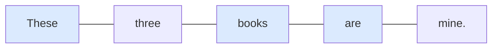
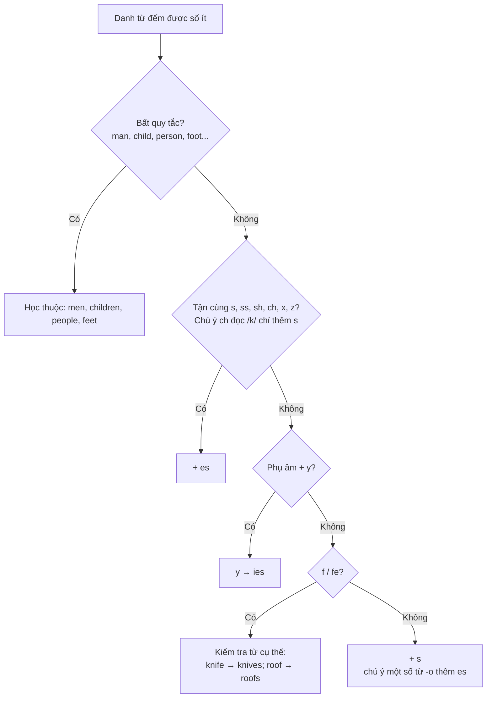

# A0-G013 · Singular & Plural Nouns — Danh từ số ít và số nhiều

## Mục lục

- [A. Lesson Information](#a-lesson-information)
- [B. Warm-up](#b-warm-up-tình-huống-thực-tế)
- [C. WHAT](#c-what-số-ít-và-số-nhiều-là-gì)
- [D. WHY](#d-why-vì-sao-tiếng-anh-đánh-dấu-số-nhiều)
- [E. FORM](#e-form-quy-tắc-tạo-số-nhiều)
- [F. HOW](#f-how-cách-dùng-và-ví-dụ)
- [G. VISUAL](#g-visual-explanation)
- [H. COMPARISON](#h-comparison)
- [I. COMMON MISTAKES](#i-common-mistakes)
- [J. MEMORY TRICKS](#j-memory-tricks)
- [K. REAL-LIFE APPLICATION](#k-real-life-application)
- [L. PRACTICE EXERCISES](#l-practice-exercises)
- [M. KNOWLEDGE CHECK](#m-knowledge-check)
- [N. ANSWER KEY](#n-answer-key)

---

## A. Lesson Information

| Mục | Nội dung |
|---|---|
| **Lesson ID** | A0-G013 |
| **Topic** | Singular & Plural Nouns |
| **Tên tiếng Việt** | Danh từ số ít và số nhiều |
| **CEFR Level** | A0 |
| **Prerequisites** | [A0-G012 — Articles](A0-G012-articles-basic.md) |
| **Estimated Time** | 75 phút |

**Learning Objectives:**

1. Tạo số nhiều có quy tắc: *-s*, *-es*, *-ies*, *-ves*.
2. Thuộc 8 cặp danh từ số nhiều bất quy tắc thông dụng trong bảng E6 (*man – men, child – children, person – people...*).
3. Phát âm đúng đuôi số nhiều: /s/, /z/, /ɪz/.
4. Biết các danh từ **luôn ở số nhiều** (*jeans, glasses, scissors*) và danh từ **không đổi** (*sheep, fish*).
5. Khớp danh từ số nhiều với *are*, *these/those*, số đếm.

---

## B. Warm-up: Tình huống thực tế

Bạn đi siêu thị và viết danh sách mua sắm cho một người bạn nước ngoài:

> *two tomato, three potato, one box of egg, two knife, some banana*

Bạn của bạn cười và sửa:

> *two tomato**es**, three potato**es**, one box of egg**s**, two kni**ves**, some banana**s***

🤔 **Hãy suy nghĩ:** Tiếng Việt nói "hai quả cà chua", "ba củ khoai" — danh từ không thay đổi. Vì sao tiếng Anh phải thêm *-s/-es* khi đã có số "two, three" rồi? Và vì sao *knife* lại thành *knives*?

---

## C. WHAT: Số ít và số nhiều là gì?

- **Singular noun** (danh từ số ít): chỉ **một** người/vật: *a book, one child*.
- **Plural noun** (danh từ số nhiều): chỉ **từ hai trở lên** (hoặc số lượng không xác định nhưng nhiều hơn một): *two books, many children, books*.

Bài này luyện danh từ trong cách dùng đếm được. Một từ có thể có nghĩa không đếm được và nghĩa đếm được khác; không thêm s khi vẫn dùng nghĩa không đếm được. Danh từ không đếm được (*water, rice, information*) sẽ học ở [A0-G014](A0-G014-countable-uncountable.md).

> 💡 Một lưu ý thú vị: trong tiếng Anh, **số 0** cũng dùng số nhiều: *zero degrees*. No có thể đi với số ít hoặc số nhiều tùy nghĩa: no book / no books; đừng coi no luôn ép số nhiều. Và các số thập phân như 1.5 cũng thường dùng số nhiều: *1.5 kilometres*.

---

## D. WHY: Vì sao tiếng Anh đánh dấu số nhiều?

Tiếng Việt cho biết số lượng bằng **từ đứng trước** danh từ: "**những** cuốn sách", "**các** bạn", "**ba** con mèo". Danh từ giữ nguyên.

Tiếng Anh đánh dấu số lượng **trên chính danh từ** — và **bắt buộc**, kể cả khi đã có số đếm. Đây là quy tắc **hòa hợp (agreement)**: những thành phần có đối lập số cần khớp trong mẫu đó, như these/books/are. Tính từ không thêm s: *these new books*, không viết ~~these news books~~.

*These – books – are*: ba dấu hiệu số nhiều khớp nhau. Nếu một chỗ sai (*these book are*), câu nghe "lệch" ngay với người bản ngữ.

---

## E. FORM: Quy tắc tạo số nhiều

### E1. Quy tắc chung: thêm *-s*

*book → books, car → cars, girl → girls, phone → phones*

### E2. Thêm *-es* khi tận cùng là -s, -ss, -sh, -ch, -x, -z

| Tận cùng | Ví dụ |
|---|---|
| -s, -ss | bus → bus**es**, class → class**es** |
| -sh | dish → dish**es**, brush → brush**es** |
| -ch | watch → watch**es**, sandwich → sandwich**es** |
| -x | box → box**es**, fox → fox**es** |
| -z | quiz → quiz**zes** |

**Âm và chữ:** Sau nhóm âm /s, z, ʃ, ʒ, tʃ, dʒ/, đuôi thường có thêm âm tiết /ɪz/ (hoặc /əz/ theo giọng). X trong box kết thúc bằng /s/ trong /ks/. Ch đọc /k/ như stomach thì chỉ thêm s: stomachs. Không áp quy tắc viết ch một cách máy móc.

### E3. Tận cùng là *-o*

| Quy tắc | Ví dụ |
|---|---|
| Một số từ thêm *-es* | potato**es**, tomato**es**, hero**es**, echo**es** |
| Nhiều từ (đặc biệt từ mượn, từ viết tắt) chỉ thêm *-s* | photo**s**, piano**s**, radio**s**, video**s**, kilo**s** |

### E4. Tận cùng là *-y*

| Trước *y* là | Quy tắc | Ví dụ |
|---|---|---|
| **Phụ âm** | *y* → *i* + *es* | baby → bab**ies**, city → cit**ies**, party → part**ies** |
| **Nguyên âm** (a, e, o, u) | Chỉ thêm *-s* | boy → boy**s**, day → day**s**, key → key**s** |

### E5. Tận cùng là *-f / -fe*

| Quy tắc | Ví dụ | Ngoại lệ |
|---|---|---|
| **Một số từ** đổi *f/fe* → *ves* | knife → kni**ves**, leaf → lea**ves**, wife → wi**ves**, half → hal**ves** | roof → roof**s**, chief → chief**s**, belief → belief**s** |

### E6. Số nhiều bất quy tắc (Irregular plurals) — phải học thuộc

| Số ít | Số nhiều | Nghĩa |
|---|---|---|
| man | **men** | đàn ông |
| woman | **women** /ˈwɪmɪn/ | phụ nữ |
| child | **children** | trẻ em |
| person | **people** | người |
| foot | **feet** | bàn chân |
| tooth | **teeth** | răng |
| mouse | **mice** | chuột |
| goose | **geese** | ngỗng |

### E7. Không đổi và luôn số nhiều

| Loại | Ví dụ |
|---|---|
| **Số ít = số nhiều** | sheep, fish (thường dùng), deer: *one sheep, ten sheep* |
| **Luôn số nhiều** (vật có hai phần) | jeans, trousers, shorts, glasses (kính), scissors, pyjamas → *My jeans **are** new.* Đếm: *a pair of jeans, two pairs of glasses* |

### E8. Phát âm đuôi *-s / -es*

| Âm cuối của danh từ số ít | Đuôi đọc là | Ví dụ |
|---|---|---|
| Vô thanh /p, t, k, f, θ/ | **/s/** | books /bʊks/, cats /kæts/, cups |
| Hữu thanh (nguyên âm, /b, d, ɡ, v, m, n, l, r.../) | **/z/** | dogs /dɒɡz/, phones /fəʊnz/, days /deɪz/ |
| /s, z, ʃ, tʃ, dʒ, ʒ/ | **/ɪz/** (thêm một âm tiết) | buses /ˈbʌsɪz/, watches /ˈwɒtʃɪz/, pages /ˈpeɪdʒɪz/ |

> 💡 Quy tắc phát âm này cũng áp dụng cho động từ ngôi 3 số ít (*works, goes, watches*) ở [A1-G001](../../02-A1-BEGINNER/grammar/A1-G001-present-simple-affirmative.md).

---

## F. HOW: Cách dùng và ví dụ

| # | English | Tiếng Việt | Phân tích |
|---|---|---|---|
| 1 | *I have two **sisters**.* | Tôi có hai chị/em gái. | Số đếm > 1 → danh từ thêm *-s* |
| 2 | *There are 30 **students** in my class.* | Lớp tôi có 30 học sinh. | *are* khớp với số nhiều |
| 3 | *The **boxes** are heavy.* | Mấy cái hộp nặng. | *-x* → *-es* /ɪz/ |
| 4 | *My **children** love ice cream.* | Các con tôi thích kem. | Bất quy tắc |
| 5 | *Many **people** live in big **cities**.* | Nhiều người sống ở các thành phố lớn. | *person → people*; *city → cities* |
| 6 | *Brush your **teeth** twice a day.* | Đánh răng hai lần mỗi ngày. | *tooth → teeth* |
| 7 | *These **knives** are sharp.* | Những con dao này sắc. | *knife → knives* |
| 8 | *My **glasses** are on the table.* | Kính của tôi ở trên bàn. | Luôn số nhiều → *are* |
| 9 | *I need **a pair of** scissors.* | Tôi cần một cái kéo. | Đếm vật hai phần: *a pair of* |
| 10 | *We saw ten **sheep** on the farm.* | Chúng tôi thấy mười con cừu ở trang trại. | Không đổi |
| 11 | *I bought two kilos of **tomatoes**.* | Tôi mua hai ký cà chua. | *-o* → *-es*; *kilo → kilos* |
| 12 | *Those **women** are nurses.* | Những người phụ nữ kia là y tá. | Mọi thành phần đều số nhiều: *those – women – are – nurses* |

---

## G. VISUAL EXPLANATION

### Sơ đồ quyết định cách tạo số nhiều

---

## H. COMPARISON

### Tiếng Việt và tiếng Anh

| Tiếng Việt | Tiếng Anh | Ghi chú |
|---|---|---|
| ba **quyển sách** | three **books** | Tiếng Anh thêm *-s* dù đã có số |
| **những** người bạn | **friends** | "những" ≈ đuôi *-s* |
| **các** em học sinh | **the students** | |
| một **cái quần** | **a pair of trousers** / **trousers** | Tiếng Anh coi quần là số nhiều |

### *person – people – persons*

- *people* là số nhiều thông dụng của *person*: *two people, many people*.
- *persons* thường dùng trong văn bản pháp lý, biển báo hoặc ngữ cảnh trang trọng (*Lift capacity: 8 persons*).
- *peoples* nghĩa là "các dân tộc": *the peoples of Asia*.

---

## I. COMMON MISTAKES

| # | ❌ Sai | ✅ Đúng | Nguyên nhân | Cách tránh |
|---|---|---|---|---|
| 1 | I have three **brother**. | I have three **brothers**. | Tiếng Việt không đổi danh từ | Số > 1 → số nhiều |
| 2 | two **childs** / two **childrens** | two **children** | Áp quy tắc *-s* cho từ bất quy tắc | Học thuộc bảng E6 |
| 3 | many **peoples** | many **people** | *people* đã là số nhiều | |
| 4 | two **babys** | two **babies** | Quên quy tắc phụ âm + y | |
| 5 | My jeans **is** old. | My jeans **are** old. | Không biết *jeans* luôn số nhiều | Vật hai phần → *are* |
| 6 | ten **sheeps** | ten **sheep** | Thêm s vào từ giữ nguyên dạng | Fish thường dùng fish; fishes cũng là dạng có thật, nhất là khi nói loài cá, nên không chấm sai tuyệt đối |
| 7 | Đọc *watches* là "wát-ch" | /ˈwɒtʃɪz/ — có âm tiết /ɪz/ | Bỏ âm cuối | Sau /tʃ, ʃ, s, z, dʒ/ đọc thêm /ɪz/ |
| 8 | **This** shoes are nice. | **These** shoes are nice. | Không khớp | Ôn [A0-G011](A0-G011-this-that-these-those.md) |

---

## J. MEMORY TRICKS

1. **"Có số nhiều, kiểm tra dạng số nhiều"**: books thêm s; children đổi dạng; sheep giữ nguyên. Không ép mọi từ thêm s.
2. **Nhóm bất quy tắc "đổi nguyên âm"**: *man → men, woman → women, foot → feet, tooth → teeth, goose → geese* — tất cả đều đổi **nguyên âm giữa** thay vì thêm *-s*. Nhớ theo nhóm dễ hơn nhớ lẻ.
3. **"Câu chuyện 2 củ khoai và 2 quả cà chua"**: *potatoes, tomatoes* là hai từ *-o + es* phổ biến nhất. Các từ *photo, piano, video, radio* chỉ thêm *-s*. (Mẹo nhóm, có những từ khác ngoài danh sách.)
4. **Xét nhóm âm trước:** /s z ʃ ʒ tʃ dʒ/ → thêm âm tiết /ɪz/; ngoài nhóm đó, âm vô thanh → /s/, hữu thanh/nguyên âm → /z/. Mẹo độ rung áp dụng sau khi loại nhóm thêm âm tiết.

---

## K. REAL-LIFE APPLICATION

### Danh sách mua sắm và cuộc gọi

> **Mai:** Hi, Tom. I'm at the supermarket. What do we need?
> **Tom:** We need six **eggs**, two **tomatoes**, and some **potatoes**.
> **Mai:** OK. Anything else?
> **Tom:** Yes, three **boxes** of tissues and two **toothbrushes** — the old ones are terrible.
> **Mai:** Got it. Oh, and the kids need new **sandwich boxes** for school.
> **Tom:** Right. Two **boxes**, please — one for each of the **children**.
> **Mai:** Sure. See you soon!

**Vietnamese explanation:** Mai gọi cho Tom từ siêu thị hỏi cần mua gì: 6 quả trứng, 2 quả cà chua, ít khoai tây, 3 hộp khăn giấy, 2 bàn chải đánh răng, và 2 hộp đựng bánh mì cho hai con đi học.

**Grammar highlights:** *eggs* (+s), *tomatoes, potatoes* (-o + es), *boxes, toothbrushes* (+es), *children* (bất quy tắc).

**Useful expressions:** *What do we need?* · *Anything else?* (Còn gì nữa không?) · *Got it.* (Hiểu rồi.) · *one for each of...* (mỗi người một cái)

---

## L. PRACTICE EXERCISES

> ✍️ Đáp án: [A0-G013-ANSWERS](../../12-ANSWERS-AND-EXPLANATIONS/A0/A0-G013-ANSWERS.md)

**Hỗ trợ:** There are... = Có nhiều...; Where are...? = ...ở đâu?; I brush... = Tôi chải/đánh...; I want to buy... = Tôi muốn mua.... Dùng các cụm cho sẵn, bài này chấm dạng danh từ. Với L5.1 dùng We need... because... = Chúng ta cần... vì...; chưa kiểm tra quy tắc mệnh đề.

### Level 1 — Recognition

Chọn dạng số nhiều đúng.

**L1.1.** baby → A. babys  B. babies  C. babyes
**L1.2.** knife → A. knifes  B. knives  C. knive
**L1.3.** child → A. childs  B. childrens  C. children
**L1.4.** box → A. boxs  B. boxes  C. boxies
**L1.5.** day → A. daies  B. days  C. dayes
**L1.6.** Đuôi *-es* trong *watches* đọc là:  A. /s/  B. /z/  C. /ɪz/

### Level 2 — Controlled Practice

Viết số nhiều.

**L2.1.** city → ______  **L2.2.** woman → ______  **L2.3.** tomato → ______  **L2.4.** photo → ______  **L2.5.** foot → ______
**L2.6.** dish → ______  **L2.7.** key → ______  **L2.8.** leaf → ______  **L2.9.** person → ______  **L2.10.** sheep → ______

Phân loại cách đọc đuôi số nhiều /s/, /z/, /ɪz/:

**L2.11.** cats, dogs, buses, books, pens, oranges

### Level 3 — Error Correction

**L3.1.** I have two brother and one sister.
**L3.2.** There are many peoples in the park. (Ý muốn nói nhiều **người**, không phải các dân tộc.)
**L3.3.** My trousers is too long.
**L3.4.** She has three childrens.
**L3.5.** We need two knifes.
**L3.6.** These box are very heavy.

### Level 4 — Production

Dịch sang tiếng Anh:

**L4.1.** Lớp tôi có 25 học sinh. (*There are...*)
**L4.2.** Kính của tôi ở đâu? (*Where are...*)
**L4.3.** Tôi đánh răng hai lần một ngày. (*brush, twice a day*)
**L4.4.** Hai người phụ nữ kia là chị em.
**L4.5.** Tôi muốn mua ba cái áo sơ mi và một cái quần jean. (*want to buy, shirts, a pair of jeans*)

### Level 5 — Real Communication

**L5.1.** Viết danh sách mua sắm cho một bữa tiệc sinh nhật 10 người (ít nhất 8 món, có số lượng), sau đó viết 3 câu giải thích vì sao cần mua những thứ đó.
**L5.2.** **Speaking:** Mô tả những thứ có trong tủ lạnh hoặc túi xách của bạn trong 30–45 giây. Chú ý phát âm đuôi /s/, /z/, /ɪz/ rõ ràng.

---

## M. KNOWLEDGE CHECK

### 5 câu hỏi tự kiểm tra

1. Khi nào thêm *-es*?
2. *baby* và *boy* tạo số nhiều khác nhau thế nào? Vì sao?
3. Kể 5 danh từ số nhiều bất quy tắc.
4. Vì sao *My jeans are new* dùng *are*?
5. Ba cách đọc đuôi *-s* là gì?

### Checklist

- [ ] Tôi tạo số nhiều đúng theo 5 quy tắc.
- [ ] Tôi thuộc bảng bất quy tắc.
- [ ] Tôi đọc rõ âm đuôi số nhiều.
- [ ] Tôi khớp danh từ số nhiều với *are/these/those*.

### 3 lỗi quan trọng cần nhớ

1. ~~three brother~~ → three **brothers**.
2. ~~childrens, peoples~~ → **children, people**.
3. ~~My jeans is~~ → My jeans **are**.

### Lịch ôn tập

| Ngày | Việc cần làm |
|---|---|
| Ngày 1 | Làm lại L2 |
| Ngày 3 | Viết số nhiều của 20 danh từ trong phòng bạn |
| Ngày 7 | Đọc to bảng E8 với 15 từ mới |

### Liên kết

- ➡️ Bài tiếp theo: [A0-G014 — Countable & Uncountable Nouns](A0-G014-countable-uncountable.md)
- 🔁 Phát âm âm cuối: [PRON-11](../../08-PRONUNCIATION/PRON-11-vietnamese-learner-mistakes.md)

---

## N. ANSWER KEY

👉 [A0-G013-ANSWERS.md](../../12-ANSWERS-AND-EXPLANATIONS/A0/A0-G013-ANSWERS.md)
