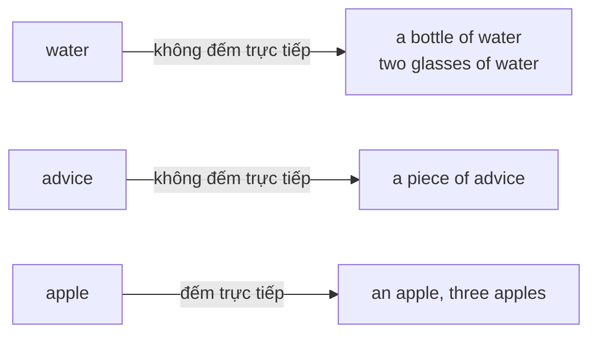
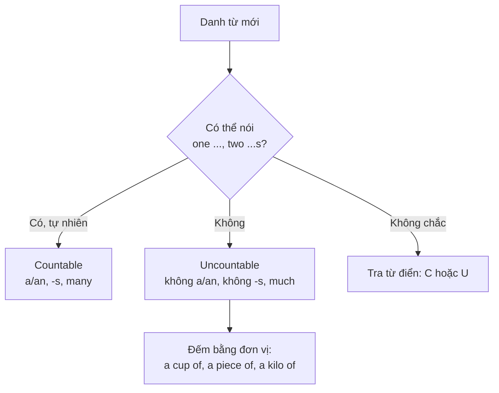

# A0-G014 · Countable & Uncountable Nouns — Danh từ đếm được và không đếm được

## Mục lục

- [A. Lesson Information](#a-lesson-information)
- [B. Warm-up](#b-warm-up-tình-huống-thực-tế)
- [C. WHAT](#c-what-đếm-được-và-không-đếm-được)
- [D. WHY](#d-why-tiếng-anh-nhìn-sự-vật-như-thế-nào)
- [E. FORM](#e-form-quy-tắc-ngữ-pháp)
- [F. HOW](#f-how-cách-đếm-danh-từ-không-đếm-được)
- [G. VISUAL](#g-visual-explanation)
- [H. COMPARISON](#h-comparison)
- [I. COMMON MISTAKES](#i-common-mistakes)
- [J. MEMORY TRICKS](#j-memory-tricks)
- [K. REAL-LIFE APPLICATION](#k-real-life-application)
- [L. PRACTICE EXERCISES](#l-practice-exercises)
- [M. KNOWLEDGE CHECK](#m-knowledge-check)
- [N. ANSWER KEY](#n-answer-key)

---

## A. Lesson Information

| Mục | Nội dung |
|---|---|
| **Lesson ID** | A0-G014 |
| **Topic** | Countable & Uncountable Nouns |
| **Tên tiếng Việt** | Danh từ đếm được và không đếm được |
| **CEFR Level** | A0 |
| **Prerequisites** | [A0-G013 — Singular & Plural](A0-G013-singular-plural-nouns.md) |
| **Estimated Time** | 75 phút |

**Learning Objectives:**

1. Phân biệt **countable nouns** (danh từ đếm được) và **uncountable nouns** (danh từ không đếm được).
2. Biết các nhóm danh từ không đếm được thường gặp: chất lỏng, chất liệu, thực phẩm dạng hạt/khối, khái niệm trừu tượng.
3. Dùng **đơn vị đo lường** (*a cup of, a piece of, a bottle of*) để đếm danh từ không đếm được.
4. Chia động từ **số ít** (*is*) với danh từ không đếm được.
5. Tránh các lỗi kinh điển: *informations, advices, furnitures, a news*.

---

## B. Warm-up: Tình huống thực tế

Bạn ở quán cà phê và nói:

> *"Can I have two coffee and one water, please?"*

Nhân viên hiểu ý bạn, nhưng trong sách ngữ pháp, *coffee* và *water* được gọi là danh từ **không đếm được**. Thế nhưng trong quán cà phê, người ta vẫn nói *two coffees*!

🤔 **Hãy suy nghĩ:** Làm sao một danh từ có thể "không đếm được" mà vẫn có lúc đếm? Bạn có thể đếm "nước" không? Hay bạn đếm "chai nước", "cốc nước"?

---

## C. WHAT: Đếm được và không đếm được

| | Countable nouns (đếm được) | Uncountable nouns (không đếm được) |
|---|---|---|
| Định nghĩa | Những thứ có thể đếm từng cái riêng lẻ | Những thứ được coi là một khối, chất, hoặc khái niệm — không tách thành từng đơn vị |
| Có số nhiều? | Có: *book → books* | **Không**: ~~waters~~, ~~rices~~ (trừ nghĩa đặc biệt) |
| Dùng *a/an*? | Có (số ít): *a book* | **Không**: ~~a water~~, ~~a rice~~ |
| Động từ | Số ít/số nhiều tùy | Luôn **số ít**: *Rice **is** cheap.* |
| Ví dụ | apple, chair, student, idea, job | water, rice, money, information, advice, furniture |

### Các nhóm danh từ không đếm được thông dụng

| Nhóm | Ví dụ |
|---|---|
| Chất lỏng | water, milk, coffee, tea, juice, oil |
| Chất liệu | wood, paper, glass, plastic, gold |
| Thực phẩm dạng hạt, bột, khối | rice, sugar, salt, flour, bread, cheese, butter, meat |
| Khí | air, oxygen, smoke |
| Khái niệm trừu tượng | love, happiness, time, help, information, advice, knowledge, music |
| Danh từ chỉ một nhóm/loại chung | furniture (đồ nội thất), luggage/baggage (hành lý), money, homework, equipment |
| Thời tiết | weather, rain, snow, sunshine |

---

## D. WHY: Tiếng Anh nhìn sự vật như thế nào?

Đây không phải chuyện "vật đó có đếm được ngoài đời không" mà là chuyện **tiếng Anh nhìn vật đó như thế nào**.

- **Nước**: Đổ nước vào nước, bạn vẫn chỉ có... nước. Không có "một nước", "hai nước". → *water* không đếm được.
- **Bàn ghế**: Ngoài đời bạn đếm được từng cái ghế, nhưng từ *furniture* chỉ **cả nhóm** đồ nội thất nói chung. Muốn đếm, bạn đếm *chairs, tables* hoặc dùng *a piece of furniture*.
- **Lời khuyên**: Tiếng Việt nói "hai lời khuyên", nhưng tiếng Anh coi *advice* là một khái niệm chung. Muốn đếm: *two pieces of advice*.

Thực ra tiếng Việt cũng có hiện tượng tương tự! Ta nói "**ba con** gà" (đếm trực tiếp được với loại từ), nhưng nói "**ba ký** gạo", "**hai chai** nước" — khi nói rõ lượng gạo/nước ta thường cần đơn vị; trong gọi món cả hai ngôn ngữ đều có thể lược đơn vị khi đã rõ. Tiếng Anh cũng vậy: với danh từ không đếm được, ta đếm **đơn vị chứa đựng hoặc đo lường**.

---

## E. FORM: Quy tắc ngữ pháp

| Quy tắc | Countable | Uncountable |
|---|---|---|
| Số ít | ***a/an*** + N: *a car* | **∅** + N: *water* |
| Số nhiều | N + *s*: *cars* | ❌ Không có |
| Động từ *be* | *The car **is** / The cars **are*** | Luôn ***is***: *The water **is** cold.* |
| Hỏi số lượng | ***How many** cars?* | ***How much** water?* |
| "Một ít" (khẳng định) | *some cars* | *some water* |
| "Nhiều" | *many cars / a lot of cars* | *much water / a lot of water* |
| "Ít" | *a few cars* | *a little water* |

> Các lượng từ *some/any, much/many, a few/a little* sẽ được dạy kỹ ở [A1-G014](../../02-A1-BEGINNER/grammar/A1-G014-some-any.md), [A1-G015](../../02-A1-BEGINNER/grammar/A1-G015-much-many-a-lot-of.md) và [A2-G024](../../03-A2-ELEMENTARY/grammar/A2-G024-quantifiers.md). Bảng trên chỉ để bạn thấy toàn cảnh.

### Đơn vị đếm (units / containers)

| Đơn vị | Dùng cho | Ví dụ |
|---|---|---|
| a **cup** of | đồ uống/phần đựng trong cốc | a cup of tea, two cups of coffee |
| a **glass** of | đồ uống trong ly | a glass of water, a glass of milk |
| a **bottle** of | chai | a bottle of water, two bottles of oil |
| a **can** / **tin** of | lon | a can of Coke |
| a **bowl** of | bát | a bowl of rice, a bowl of soup |
| a **piece** of | một phần/mẩu (dùng rất rộng) | a piece of cake, a piece of paper, a piece of advice, a piece of furniture, a piece of information |
| a **slice** of | lát | a slice of bread, a slice of pizza |
| a **loaf** of | ổ (bánh mì) | a loaf of bread |
| a **kilo** of | ký | a kilo of rice, two kilos of meat |
| a **bag** / **packet** of | túi, gói | a bag of sugar, a packet of tea |
| a **bar** of | thanh | a bar of chocolate, a bar of soap |

Khi đếm, **đơn vị** mới chuyển sang số nhiều, danh từ không đếm được giữ nguyên: *two cup**s** of coffee* (không phải ~~two cups of coffees~~).

---

## F. HOW: Cách đếm danh từ không đếm được

| # | English | Tiếng Việt | Phân tích |
|---|---|---|---|
| 1 | *I drink a lot of **water**.* | Tôi uống nhiều nước. | *water* không có *-s* |
| 2 | *Can I have **a glass of** water?* | Cho tôi một ly nước được không? | Đếm bằng *a glass of* |
| 3 | ***The rice is** ready.* | Cơm chín rồi. | Động từ số ít |
| 4 | *She gave me **some good advice**.* | Cô ấy cho tôi vài lời khuyên hay. | ~~advices~~ |
| 5 | *That's **a useful piece of advice**.* | Đó là một lời khuyên hữu ích. | Tính từ đứng trước *piece* |
| 6 | *We need **new furniture** for the living room.* | Chúng tôi cần đồ nội thất mới cho phòng khách. | ~~furnitures~~ |
| 7 | ***The information is** on the website.* | Thông tin có trên trang web. | ~~informations are~~ |
| 8 | *How **much money** do you have?* | Bạn có bao nhiêu tiền? | *money* không đếm được; đếm *dollars, dong* thì được |
| 9 | *I have **two 100,000-dong notes**.* | Tôi có hai tờ 100.000 đồng. | Tờ tiền (*notes*) đếm được |
| 10 | *I bought **two loaves of bread**.* | Tôi mua hai ổ bánh mì. | *loaf → loaves* |
| 11 | ***The news is** good.* | Tin tức tốt. | *news* có *-s* nhưng **không đếm được**, dùng *is* |
| 12 | *I have **a lot of homework** today.* | Hôm nay tôi có nhiều bài tập về nhà. | ~~homeworks~~ |

### Danh từ có thể vừa đếm được vừa không (thay đổi nghĩa)

| Không đếm được | Đếm được |
|---|---|
| *I like **coffee**.* (cà phê nói chung) | *Two **coffees**, please.* (hai cốc cà phê — văn nói ở quán) |
| *Hurry up! We don't have much **time**.* (thời gian) | *I go there three **times** a week.* (Tôi đến đó ba lần mỗi tuần; times = lần) |
| *The window is made of **glass**.* (thủy tinh) | *Can I have two **glasses**?* (cái ly) |
| *Paper is made from wood.* (giấy) | *I read **a paper** every morning.* (tờ báo) |
| *There's **chicken** in the soup.* (thịt gà) | *They have three **chickens**.* (con gà) |

---

## G. VISUAL EXPLANATION

### Sơ đồ kiểm tra

> 💡 Từ điển học thuật (Cambridge, Oxford Learner's, Longman) ghi **[C]** = countable, **[U]** = uncountable, **[C, U]** = cả hai.

---

## H. COMPARISON

### Những cặp "gần nghĩa nhưng khác loại"

| Uncountable | Countable tương ứng |
|---|---|
| money | coin, note, dollar |
| furniture | chair, table, sofa |
| luggage / baggage | suitcase, bag |
| work (công việc nói chung) | job (một công việc cụ thể) |
| advice | tip, suggestion |
| bread | loaf, roll, sandwich |
| traffic | car, motorbike |
| travel (việc du lịch nói chung) | trip, journey |

**Ví dụ:** *I'm looking for **work**.* = *I'm looking for **a job**.* — cả hai đúng, nhưng ~~a work~~ là sai (khi mang nghĩa công việc).

---

## I. COMMON MISTAKES

| # | ❌ Sai | ✅ Đúng | Nguyên nhân | Cách tránh |
|---|---|---|---|---|
| 1 | I need some **informations**. | I need some **information**. | Tiếng Việt "các thông tin" | *information* không có số nhiều |
| 2 | He gave me **an advice**. | He gave me **a piece of advice** / **some advice**. | Tiếng Việt "một lời khuyên" | Đếm bằng *a piece of* |
| 3 | We bought new **furnitures**. | We bought new **furniture**. | Nghĩ là nhiều món | *furniture* là danh từ chung |
| 4 | The news **are** good. | The news **is** good. | Thấy đuôi *-s* | *news* luôn số ít |
| 5 | I have **many homeworks**. | I have **a lot of homework**. | | ~~homeworks~~; dùng *a lot of / much* |
| 6 | **A** rice, please. | **A bowl of** rice, please. | Dùng *a* với danh từ không đếm được | Thêm đơn vị |
| 7 | How **many** money? | How **much** money? | | Không đếm được → *much* |
| 8 | two cups of **coffees** | two cups of **coffee** | Thêm *-s* hai lần | Chỉ đơn vị có *-s* |

---

## J. MEMORY TRICKS

1. **Nhóm chất gợi ý nghĩa không đếm được:** water/rice/sugar thường dùng như chất/khối. Không dùng phép thử đổ được để kết luận: beans có thể đổ ra nhưng vẫn đếm được.
2. **"Ô dù" (umbrella nouns)**: *furniture, luggage, equipment, money* là những từ "ô dù" che cả một nhóm vật — các từ liệt kê ở đây dùng không đếm được trong nghĩa thông dụng. Không suy ra mọi từ gọi nhóm đều không đếm được: group/team là danh từ đếm được.
3. **Danh sách đen của người Việt**: Thuộc lòng 8 từ hay sai nhất: **information, advice, furniture, luggage, homework, news, money, equipment**. Trong những nghĩa thông dụng đang học, không thêm s hoặc a/an trực tiếp; không khẳng định không có nghĩa chuyên biệt khác.
4. ⚠️ Mẹo 1 chỉ là gợi ý — *bread, cheese, meat* không "đổ" được nhưng vẫn không đếm được. Khi nghi ngờ, tra từ điển.

---

## K. REAL-LIFE APPLICATION

### Hội thoại: Ở nhà hàng

> **Waiter:** Are you ready to order?
> **Nam:** Yes. Can I have **a bowl of** beef noodle soup and **a glass of** orange juice, please?
> **Waiter:** Sure. And for you, madam?
> **Hien:** I'd like **some** fried rice and **a cup of** green tea.
> **Waiter:** Would you like **some bread** with that?
> **Hien:** Just **a slice**, please.
> **Nam:** Excuse me, could we have **some more water**? And can you give us **some information** about the desserts?
> **Waiter:** Of course. We have chocolate cake and fresh fruit today.

**Vietnamese explanation:** Nam gọi một bát phở bò và một ly nước cam. Hiền gọi cơm chiên và một tách trà xanh, thêm một lát bánh mì. Nam xin thêm nước và hỏi thông tin về món tráng miệng.

**Grammar highlights:** *a bowl of, a glass of, a cup of, a slice* (đơn vị đếm); *some bread, some water, some information* (không đếm được, không *-s*); *desserts* (đếm được, số nhiều).

**Useful expressions:**
- *Are you ready to order?* — Quý khách gọi món chưa?
- *Can I have...?* / *I'd like...* — Cho tôi... (*I'd like* học kỹ ở A1-G013)
- *Could we have some more...?* — Cho chúng tôi thêm... được không?

---

## L. PRACTICE EXERCISES

> ✍️ Đáp án: [A0-G014-ANSWERS](../../12-ANSWERS-AND-EXPLANATIONS/A0/A0-G014-ANSWERS.md)

**Hỗ trợ:** Các câu mẫu có cấu trúc chưa học chỉ dùng làm khung: Can I have...? = Cho tôi... được không?; She gave me... = Cô ấy cho tôi...; I bought... = Tôi đã mua.... Với L5.1, dùng các động từ mệnh lệnh theo cụm cho sẵn: cut = cắt, add = thêm, mix = trộn, serve = dọn món; bài này chấm danh từ và đơn vị.

### Level 1 — Recognition

Viết C/U theo nghĩa thông dụng: milk là chất sữa, egg là quả trứng nguyên; không xét loại/phần đồ uống trong bài nhận diện này.

**L1.1.** milk  **L1.2.** egg  **L1.3.** furniture  **L1.4.** chair  **L1.5.** advice  **L1.6.** idea  **L1.7.** money  **L1.8.** coin  **L1.9.** news  **L1.10.** job

### Level 2 — Controlled Practice

Chọn đơn vị phù hợp: bottle, slice, piece, cup, bowl, bar, kilo. Có câu nhận nhiều cách nói tự nhiên; giải thích đơn vị bạn chọn, không bắt buộc dùng mỗi từ đúng một lần.

**L2.1.** a ___ of soap
**L2.2.** a ___ of pizza
**L2.3.** two ___s of rice (khi mua ở chợ)
**L2.4.** a ___ of hot chocolate
**L2.5.** a ___ of information
**L2.6.** three ___s of water (bằng nhựa)
**L2.7.** a ___ of soup

Chọn đáp án đúng:

**L2.8.** The information (is / are) wrong.
**L2.9.** How (much / many) eggs do you need?
**L2.10.** I need (an advice / some advice).

### Level 3 — Error Correction

**L3.1.** Can you give me some informations about the course?
**L3.2.** My parents bought a lot of new furnitures.
**L3.3.** The news are very surprising.
**L3.4.** I'd like two cups of teas. (Hai cốc cùng một loại trà, không nói nhiều giống trà.)
**L3.5.** How many money do you need?
**L3.6.** She gave me a good advice.

### Level 4 — Production

Dịch sang tiếng Anh:

**L4.1.** Tôi uống ba ly nước mỗi sáng.
**L4.2.** Cô ấy có rất nhiều hành lý. (*a lot of luggage*)
**L4.3.** Cho tôi một lát bánh mì và một tách cà phê.
**L4.4.** Thông tin này rất hữu ích. (*useful*)
**L4.5.** Hôm nay tôi không có nhiều bài tập về nhà. (*don't have much...*)

### Level 5 — Real Communication

**L5.1.** Viết công thức nấu một món ăn đơn giản (6–8 dòng), liệt kê nguyên liệu với đơn vị đo lường (ví dụ: *two eggs, a cup of flour, a little salt*).
**L5.2.** **Speaking — Role-play:** Bạn gọi đồ ăn cho cả gia đình ở một quán ăn. Nói ít nhất 6 món/đồ uống với đơn vị đúng.

---

## M. KNOWLEDGE CHECK

### 5 câu hỏi tự kiểm tra

1. Danh từ không đếm được có 3 đặc điểm ngữ pháp nào?
2. Làm sao để "đếm" *bread*, *advice*, *water*?
3. Vì sao *The news is good* dùng *is*?
4. Kể 5 danh từ người Việt hay thêm *-s* sai.
5. *time* và *times* khác nghĩa thế nào?

### Checklist

- [ ] Tôi phân loại được danh từ C/U thông dụng.
- [ ] Tôi dùng được 8 đơn vị đếm.
- [ ] Tôi không còn viết *informations, advices, furnitures*.
- [ ] Tôi dùng *is* với danh từ không đếm được.

### 3 lỗi quan trọng cần nhớ

1. ~~informations / advices / furnitures~~ → giữ nguyên trong các nghĩa đang học.
2. ~~an advice~~ → **a piece of** advice.
3. ~~The news are~~ → The news **is**.

### Lịch ôn tập

| Ngày | Việc cần làm |
|---|---|
| Ngày 1 | Làm lại L1, L2 |
| Ngày 3 | Viết 10 cụm "đơn vị + of + danh từ" về đồ trong bếp |
| Ngày 7 | Làm lại L3; đọc to "danh sách đen" 8 từ |

### Liên kết

- ➡️ Bài tiếp theo: [A0-G015 — There is / There are](A0-G015-there-is-there-are.md)
- 🔜 [A1-G014 — Some / Any](../../02-A1-BEGINNER/grammar/A1-G014-some-any.md) · [A1-G015 — Much / Many](../../02-A1-BEGINNER/grammar/A1-G015-much-many-a-lot-of.md)
- 🔁 Từ vựng: [VOC-06 — Food & Health](../../07-VOCABULARY/VOC-06-food-health.md)

---

## N. ANSWER KEY

👉 [A0-G014-ANSWERS.md](../../12-ANSWERS-AND-EXPLANATIONS/A0/A0-G014-ANSWERS.md)
