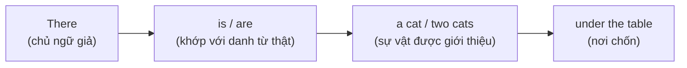
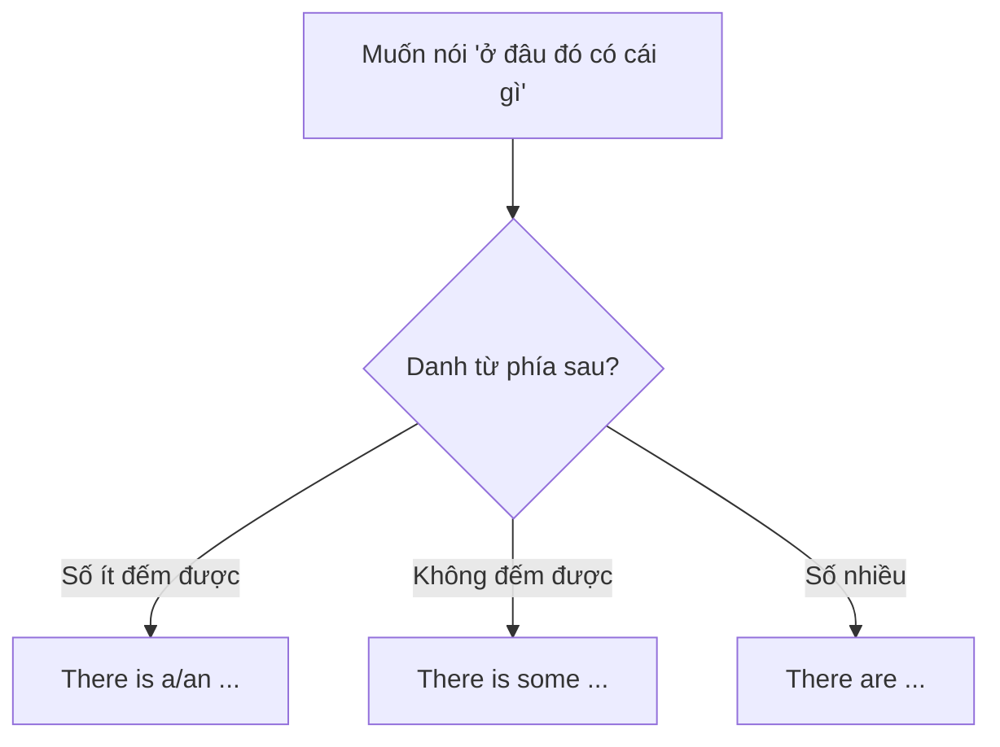

# A0-G015 · There is / There are — Cấu trúc "có" (sự tồn tại)

## Mục lục

- [A. Lesson Information](#a-lesson-information)
- [B. Warm-up](#b-warm-up-tình-huống-thực-tế)
- [C. WHAT](#c-what-there-is--there-are-là-gì)
- [D. WHY](#d-why-vì-sao-cần-there)
- [E. FORM](#e-form-công-thức-đầy-đủ)
- [F. HOW](#f-how-cách-dùng)
- [G. VISUAL](#g-visual-explanation)
- [H. COMPARISON](#h-comparison-there-is-và-have)
- [I. COMMON MISTAKES](#i-common-mistakes)
- [J. MEMORY TRICKS](#j-memory-tricks)
- [K. REAL-LIFE APPLICATION](#k-real-life-application)
- [L. PRACTICE EXERCISES](#l-practice-exercises)
- [M. KNOWLEDGE CHECK](#m-knowledge-check)
- [N. ANSWER KEY](#n-answer-key)

---

## A. Lesson Information

| Mục | Nội dung |
|---|---|
| **Lesson ID** | A0-G015 |
| **Topic** | There is / There are |
| **Tên tiếng Việt** | Cấu trúc "có" chỉ sự tồn tại |
| **CEFR Level** | A0 |
| **Prerequisites** | [A0-G009 — To Be](A0-G009-verb-to-be.md), [A0-G014 — Countable & Uncountable](A0-G014-countable-uncountable.md) |
| **Estimated Time** | 75 phút |

**Learning Objectives:**

1. Dùng *there is* với danh từ số ít/không đếm được và *there are* với danh từ số nhiều.
2. Tạo câu phủ định (*there isn't / there aren't*) và câu hỏi (*Is there...? / Are there...?*).
3. Hỏi số lượng: *How many ... are there?*
4. Phân biệt *There is* (sự tồn tại) với *have* (sở hữu) và với *It is*.
5. Mô tả một căn phòng, một khu phố, một thành phố.

---

## B. Warm-up: Tình huống thực tế

Bạn mô tả căn hộ mới của mình:

> "Căn hộ của tôi **có** hai phòng ngủ. Trong phòng khách **có** một cái ghế sofa lớn. Gần nhà **có** một siêu thị."

Nhiều người học dịch:

> ✅ *My apartment has two bedrooms.*
> ❌ *In the living room has a big sofa.*
> ❌ *Near my house has a supermarket.*

🤔 **Hãy suy nghĩ:** Câu 1 đúng vì căn hộ "sở hữu" phòng ngủ. Nhưng ở câu 2 và 3, ai/cái gì "sở hữu" cái sofa hay siêu thị? Khi tiếng Việt nói "**ở đâu đó có cái gì**", tiếng Anh dùng cấu trúc nào?

---

## C. WHAT: *There is / There are* là gì?

**There is / There are** dùng để nói rằng **một cái gì đó tồn tại** hoặc **có mặt** ở một nơi nào đó. Đây là cách tự nhiên nhất để **giới thiệu thông tin mới** về sự vật ở một địa điểm.

| Cấu trúc | Dùng với | Ví dụ |
|---|---|---|
| **There is** (*there's*) | Danh từ **số ít** hoặc **không đếm được** | *There is a bank near here.* / *There is some milk in the fridge.* |
| **There are** | Danh từ **số nhiều** | *There are two banks near here.* |

**Lưu ý:** *There* ở đây **không** mang nghĩa "ở đó". Nó chỉ là **chủ ngữ hình thức** (dummy subject) trong cấu trúc tồn tại. Danh từ sau be nêu sự vật được giới thiệu; bài dùng danh từ đó để chọn hòa hợp is/are.

---

## D. WHY: Vì sao cần *there*?

Câu trần thuật đầy đủ của mẫu này có vị trí chủ ngữ trước động từ; câu hỏi sẽ đảo be lên trước there. Khi muốn nói "Có một con mèo dưới gầm bàn", về lý thuyết ta có thể nói:

> *A cat is under the table.*

Câu này đúng và có thể tự nhiên khi muốn xác định vị trí con mèo. Khi muốn nhấn mạnh rằng có một con mèo hiện diện, There is a cat... là cách giới thiệu thuận tiện. Lựa chọn phụ thuộc mục đích thông báo:

> *There is **a cat** under the table.* ✅ (tự nhiên)

Trong mẫu viết đang luyện, chọn is/are theo số và tính đếm được của danh từ được giới thiệu phía sau.

---

## E. FORM: Công thức đầy đủ

### E1. Khẳng định

| Công thức | Ví dụ |
|---|---|
| **There is** + a/an + N số ít (+ nơi chốn) | *There is a pen on the desk.* |
| **There is** + (some) + N không đếm được | *There is some water in the bottle.* |
| **There are** + (số/some) + N số nhiều | *There are three pens on the desk.* |

Rút gọn: *There is* → **There's** (rất phổ biến). *There are* thường **không** rút gọn khi viết.

### E2. Phủ định

| Công thức | Ví dụ |
|---|---|
| **There isn't** + a/an + N số ít | *There isn't a hospital in my village.* |
| **There isn't** + any + N không đếm được | *There isn't any milk.* |
| **There aren't** + any + N số nhiều | *There aren't any chairs.* |
| **There is no** / **There are no** + N | *There is no milk. / There are no chairs.* (có thể nhấn mạnh hơn tùy ngữ cảnh) |

### E3. Câu hỏi và trả lời ngắn

| Câu hỏi | Trả lời |
|---|---|
| **Is there** a bank near here? | Yes, **there is**. / No, **there isn't**. |
| **Is there** any coffee? | Yes, **there is**. / No, **there isn't**. |
| **Are there** any good restaurants here? | Yes, **there are**. / No, **there aren't**. |

> ⚠️ Không rút gọn trong câu trả lời khẳng định: ❌ *Yes, there's.*

### E4. Hỏi số lượng

| Công thức | Ví dụ |
|---|---|
| **How many** + N số nhiều + **are there** (+ nơi chốn)? | *How many students are there in your class?* |
| **How much** + N không đếm được + **is there**? | *How much milk is there?* |

> *any, some, how much/how many* sẽ được học kỹ ở A1. Ở đây hãy dùng chúng như mẫu cố định.

**Khẩu ngữ:** Bạn có thể nghe There's two people...; bài này dùng There are two people... trong văn viết chuẩn. Không biến khác biệt khẩu ngữ thành nhận xét rằng người nói không biết tiếng Anh.

### E5. Quy tắc hòa hợp với danh sách

Khi liệt kê nhiều thứ, *is/are* thường khớp với **danh từ đầu tiên** ngay sau nó (trong văn nói):

- *There **is** a sofa and two chairs in the room.* (*a sofa* đứng đầu → *is*)
- *There **are** two chairs and a sofa in the room.* (*two chairs* đứng đầu → *are*)

Khi muốn tránh khác biệt giữa quy tắc theo toàn danh sách và theo thành phần đầu, đặt danh từ số nhiều trước hoặc tách câu: There is a sofa. There are two chairs. Không dùng danh sách hỗn hợp làm câu trắc nghiệm chỉ có một đáp án bắt buộc.

---

## F. HOW: Cách dùng

| # | Cách dùng | English | Tiếng Việt | Phân tích |
|---|---|---|---|---|
| 1 | Mô tả phòng | *There's a big window in my bedroom.* | Phòng ngủ tôi có một cửa sổ lớn. | Số ít → *There's* |
| 2 | Mô tả khu phố | *There are two schools near my house.* | Gần nhà tôi có hai trường học. | Số nhiều → *are* |
| 3 | Chất/không đếm được | *There is some rice in the cooker.* | Trong nồi có ít cơm. | Không đếm được → *is* |
| 4 | Phủ định | *There isn't a lift in this building.* | Tòa nhà này không có thang máy. | A lift số ít nên is; not phủ định, in this building là địa điểm |
| 5 | Phủ định số nhiều | *There aren't any taxis at the station.* | Ở ga không có chiếc taxi nào. | *any* trong phủ định |
| 6 | Câu hỏi tìm đường | *Excuse me, is there an ATM near here?* | Xin lỗi, gần đây có cây ATM không? | Is đảo trước there để hỏi; an ATM là một máy, an theo âm /eɪ/ đầu tên A |
| 7 | Hỏi số lượng | *How many people are there in your family?* | Gia đình bạn có mấy người? | Câu hỏi rất thông dụng |
| 8 | Trả lời | *There are four (people in my family).* | Có bốn người. | Four chỉ số nhiều nên are; có thể lược people in my family vì câu hỏi đã nêu |
| 9 | Sự kiện | *There's a concert in the park tonight.* | Tối nay có buổi hòa nhạc ở công viên. | Sự kiện → *there is* |
| 10 | Vấn đề | *There's a problem with my computer.* | Máy tính của tôi có vấn đề. | Cụm thông dụng |
| 11 | Nhấn mạnh "không có" | *There's no time!* | Không còn thời gian! | *no* + N |

---

## G. VISUAL EXPLANATION

### Bảng tóm tắt

| | Số ít / Không đếm được | Số nhiều |
|---|---|---|
| ➕ | There **is** a / some ... | There **are** two / some ... |
| ➖ | There **isn't** a / any ... | There **aren't** any ... |
| ❓ | **Is there** a / any ...? | **Are there** any ...? |
| 💬 | Yes, there is. / No, there isn't. | Yes, there are. / No, there aren't. |

### Sơ đồ quyết định

---

## H. COMPARISON: *There is* và *have*

| | *There is / are* | *Have / has* |
|---|---|---|
| Ý nghĩa | **Tồn tại** ở một nơi | **Sở hữu**, thuộc về |
| Chủ ngữ | *There* (giả) | Người/vật sở hữu |
| Ví dụ | *There's a garden behind the house.* | *The house has a garden.* / *We have a garden.* |

Cả hai câu *There's a garden behind the house* và *The house has a garden* đều đúng. Nhưng **không được trộn**: ❌ *Behind the house has a garden.*

### *There is* và *It is*

| *There is* | *It is* |
|---|---|
| Giới thiệu **sự tồn tại** | **Mô tả** vật đã biết; thời tiết, thời gian |
| *There's a café on the corner.* | ***It**'s very small but cosy.* |

Thường dùng nối tiếp: *There's a café on the corner. It's very cosy.*

---

## I. COMMON MISTAKES

| # | ❌ Sai | ✅ Đúng | Nguyên nhân | Cách tránh |
|---|---|---|---|---|
| 1 | In my room **has** a bed. | **There is** a bed in my room. | Dịch "trong phòng có" | Nơi chốn + "có" → *There is/are* |
| 2 | **There have** many people. | **There are** many people. | Trộn *there* với *have* | *There* + **be**, không dùng have đơn lẻ để thay is/are trong mẫu hiện tại này |
| 3 | There **is** two cats. | There **are** two cats. | Không khớp số nhiều | Nhìn danh từ phía sau |
| 4 | There **are** some milk. | There **is** some milk. | *milk* không đếm được | Không đếm được → *is* |
| 5 | **Have** a bank near here? | **Is there** a bank near here? | Dịch "có... không" | Câu hỏi: *Is/Are there...?* |
| 6 | How many students **there are**? | How many students **are there**? | Giữ trật tự câu kể | Câu hỏi: đảo *are there* |
| 7 | Yes, **there's**. | Yes, **there is**. | Rút gọn sai chỗ | |
| 8 | **There are** a good restaurant here. | **There is** a good restaurant here. | Chọn are trước một danh từ số ít | A restaurant chọn is |

---

## J. MEMORY TRICKS

1. **"Có ở đâu → There; Có của ai → Have"**: Hỏi "có **ở đâu**?" hay "có **của ai**?".
2. **"Nhìn danh từ được giới thiệu để chọn is/are"**: there là thành phần hình thức; a bank chọn is, two banks chọn are.
3. **"There không bao giờ đi với have"**: *There have* luôn sai trong cấu trúc này. ⚠️ (Bạn sẽ gặp *There have been...* ở thì hiện tại hoàn thành — đó là *have been*, tức vẫn là động từ *be*, học ở A2.)

---

## K. REAL-LIFE APPLICATION

### Bài đọc: My neighbourhood

Tình huống tự biên soạn về một khu phố giả định; không phải mô tả tiện ích hiện tại của mọi khu phố trong thành phố.

> *I live in a small neighbourhood in Da Lat. **There's** a beautiful lake near my house, and **there are** many pine trees around it. **There isn't** a big supermarket, but **there's** a market with fresh vegetables and flowers. **There are** three cafés on my street, and one of them has the best coffee in town! **There aren't** many cars, so it's very quiet. **Is there** anything I don't like? Yes — **there's** a lot of rain in summer!*

**Vietnamese explanation:** Tác giả sống ở một khu phố nhỏ ở Đà Lạt: gần nhà có hồ đẹp, xung quanh nhiều cây thông; không có siêu thị lớn nhưng có chợ rau hoa tươi; con phố có ba quán cà phê; ít xe nên yên tĩnh; điều không thích là mùa hè mưa nhiều.

**Grammar highlights:**

- *There's a beautiful lake* (số ít) / *There are many pine trees* (số nhiều).
- *There isn't a big supermarket* / *There aren't many cars* (phủ định).
- *one of them **has** the best coffee* — quán cà phê "sở hữu" cà phê ngon → *has*.
- *there's a lot of rain* — *rain* không đếm được → *is*.

**Useful expressions:** *near my house, around it, on my street, in town, the best ... in town*.

---

## L. PRACTICE EXERCISES

> ✍️ Đáp án: [A0-G015-ANSWERS](../../12-ANSWERS-AND-EXPLANATIONS/A0/A0-G015-ANSWERS.md)

### Level 1 — Recognition

**L1.1.** There ___ a cat on the sofa.  A. is  B. are  C. have
**L1.2.** There ___ ten students in the room.  A. is  B. are  C. has
**L1.3.** There ___ some juice in the fridge.  A. is  B. are  C. have
**L1.4.** ___ there any eggs?  A. Is  B. Are  C. Do
**L1.5.** Which is correct?  A. In my city has a big park.  B. There is a big park in my city.  C. There has a big park in my city.
**L1.6.** "Is there a pharmacy near here?" – "Yes, ___."  A. there's  B. there is  C. it is

### Level 2 — Controlled Practice

Điền is/are ở câu 1, 2, 5, 6; điền isn't/aren't ở câu 3, 4. Mục tiêu là chọn hòa hợp, không đoán rằng cứ Chủ nhật thì chắc chắn trường trống.

**L2.1.** There ___ a lot of traffic today.
**L2.2.** There ___ two bathrooms in our flat.
**L2.3.** There ___ any bread. Let's buy some.
**L2.4.** There ___ any students in the classroom. It's Sunday.
**L2.5.** ___ there a swimming pool in the hotel?
**L2.6.** How many bedrooms ___ there?

Viết câu theo gợi ý:

**L2.7.** (+) a TV / living room
**L2.8.** (–) any shops / my village
**L2.9.** (?) a bus stop / near here
**L2.10.** (?) How many / people / your family

### Level 3 — Error Correction

**L3.1.** There have a lot of trees in my garden.
**L3.2.** There are a book on the table.
**L3.3.** In my class has 30 students.
**L3.4.** How many rooms there are in your house?
**L3.5.** There are some water in the glass.
**L3.6.** There are a good restaurant on this street.

### Level 4 — Production

Dịch sang tiếng Anh:

**L4.1.** Trong phòng tôi có một cái giường và hai cái ghế.
**L4.2.** Ở làng tôi không có bệnh viện.
**L4.3.** Gần đây có nhà vệ sinh không? (*toilet*)
**L4.4.** Lớp bạn có bao nhiêu học sinh?
**L4.5.** Trong tủ lạnh không còn sữa. (*no milk / any milk*)

### Level 5 — Real Communication

**L5.1.** Viết đoạn văn 7–9 câu mô tả khu phố bạn sống (theo mẫu bài đọc K). Dùng cả *there is/are*, *there isn't/aren't* và ít nhất 1 câu với *It is* hoặc *have/has*.
**L5.2.** **Speaking — Role-play:** Bạn là khách du lịch hỏi đường ở khách sạn. Hỏi lễ tân ít nhất 4 câu với *Is there...?* / *Are there...?* (ATM, nhà thuốc, nhà hàng chay, bãi biển...).

---

## M. KNOWLEDGE CHECK

### 5 câu hỏi tự kiểm tra

1. *There is* và *there are* khác nhau thế nào?
2. *There is* dùng với danh từ không đếm được hay số nhiều?
3. Vì sao *In my room has a bed* sai?
4. Viết câu hỏi: "Lớp bạn có bao nhiêu học sinh?"
5. *There's a garden* và *We have a garden* khác nhau ở điểm nào?

### Checklist

- [ ] Tôi chọn *is/are* dựa vào danh từ phía sau.
- [ ] Tôi không dùng *have* với *there*.
- [ ] Tôi hỏi được *Is there...? / How many... are there?*
- [ ] Tôi mô tả được căn phòng/khu phố của mình.

### 3 lỗi quan trọng cần nhớ

1. ~~In my room has~~ → **There is** ... in my room.
2. ~~There have~~ → **There are**.
3. ~~How many ... there are?~~ → How many ... **are there**?

### Lịch ôn tập

| Ngày | Việc cần làm |
|---|---|
| Ngày 1 | Làm lại L2 |
| Ngày 3 | Mô tả phòng làm việc/lớp học bằng 8 câu |
| Ngày 7 | Viết lại L5.1 về thành phố bạn muốn đến |

### Liên kết

- ➡️ Bài tiếp theo: [A0-G016 — Sentence Types](A0-G016-sentence-types.md)
- 🔜 [A1-G009 — Prepositions of Place](../../02-A1-BEGINNER/grammar/A1-G009-prepositions-of-place.md)

---

## N. ANSWER KEY

👉 [A0-G015-ANSWERS.md](../../12-ANSWERS-AND-EXPLANATIONS/A0/A0-G015-ANSWERS.md)
