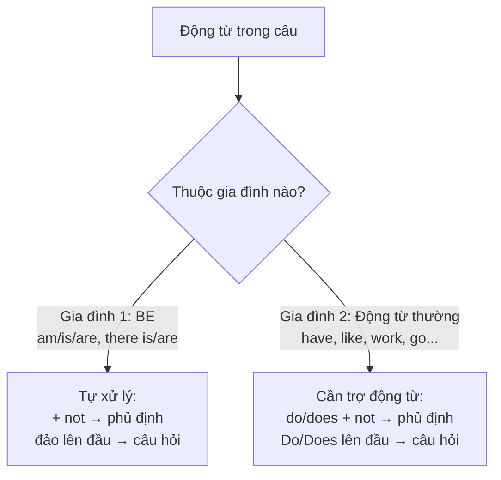

# A0-G016 · Affirmative, Negative & Interrogative Sentences — Câu khẳng định, phủ định và nghi vấn

## Mục lục

- [A. Lesson Information](#a-lesson-information)
- [B. Warm-up](#b-warm-up-tình-huống-thực-tế)
- [C. WHAT](#c-what-ba-loại-câu)
- [D. WHY](#d-why-hai-gia-đình-động-từ)
- [E. FORM](#e-form-công-thức-cho-từng-gia-đình)
- [F. HOW](#f-how-ví-dụ-phân-tích)
- [G. VISUAL](#g-visual-explanation)
- [H. COMPARISON](#h-comparison-câu-hỏi-tiếng-việt-và-tiếng-anh)
- [I. COMMON MISTAKES](#i-common-mistakes)
- [J. MEMORY TRICKS](#j-memory-tricks)
- [K. REAL-LIFE APPLICATION](#k-real-life-application)
- [L. PRACTICE EXERCISES](#l-practice-exercises)
- [M. KNOWLEDGE CHECK](#m-knowledge-check)
- [N. ANSWER KEY](#n-answer-key)

---

## A. Lesson Information

| Mục | Nội dung |
|---|---|
| **Lesson ID** | A0-G016 |
| **Topic** | Affirmative, Negative and Interrogative Sentences |
| **Tên tiếng Việt** | Câu khẳng định, phủ định và nghi vấn |
| **CEFR Level** | A0 |
| **Prerequisites** | [A0-G009 — To Be](A0-G009-verb-to-be.md), [A0-G010 — Have/Has](A0-G010-have-has.md), [A0-G015 — There is/are](A0-G015-there-is-there-are.md) |
| **Estimated Time** | 90 phút |

**Learning Objectives:**

1. Hiểu khái niệm **khẳng định** (affirmative), **phủ định** (negative), **nghi vấn** (interrogative).
2. Nắm mô hình **"hai gia đình động từ"**: (1) gia đình *be* tự biến đổi; (2) gia đình động từ thường cần trợ động từ *do/does*.
3. Biến đổi linh hoạt một câu sang phủ định và câu hỏi Yes/No.
4. Trả lời ngắn đúng cách.
5. Tránh lỗi trộn hai gia đình: *Do you are...?*, *I don't be...*, *Are you like...?*

---

## B. Warm-up: Tình huống thực tế

Bạn có hai câu:

> 1. *You are a teacher.*
> 2. *You like coffee.*

Bạn muốn hỏi người đối diện. Nhiều người học viết:

> ❌ *Are you like coffee?*
> ❌ *Do you are a teacher?*

🤔 **Hãy suy nghĩ:** Ở bài [A0-G009](A0-G009-verb-to-be.md), bạn hỏi bằng cách đảo *are* lên trước. Ở bài [A0-G010](A0-G010-have-has.md), bạn hỏi với *Do/Does*. Vậy với động từ *like*, bạn sẽ theo cách nào? Có quy luật chung nào không?

---

## C. WHAT: Ba loại câu

| Loại câu | English | Chức năng | Ví dụ |
|---|---|---|---|
| **Câu khẳng định** | Affirmative / Positive sentence | Nói một điều là đúng | *She is a nurse.* |
| **Câu phủ định** | Negative sentence | Nói một điều là không đúng | *She isn't a nurse.* |
| **Câu nghi vấn** | Interrogative sentence / Question | Hỏi thông tin | *Is she a nurse?* |

Khẳng định/phủ định là cách thể hiện nội dung, nghi vấn là dạng câu; một câu hỏi cũng có thể phủ định (Isn't she...?). Bảng chỉ trình bày ba thao tác luyện cơ bản.

Bài này tập trung vào **câu hỏi Yes/No** (câu hỏi có thể trả lời bằng *Yes* hoặc *No*). Câu hỏi với từ để hỏi (*What, Where, When...*) sẽ học ở bài tiếp theo [A0-G017](A0-G017-question-words.md).

---

## D. WHY: Hai "gia đình" động từ

Đây là mô hình hỗ trợ cho **hiện tại đơn** trong bài: be và động từ thường dùng do/does. Không coi hai nhóm này là toàn bộ phân loại động từ tiếng Anh.

Trong tiếng Anh, có hai nhóm động từ hành xử khác nhau khi tạo phủ định và câu hỏi:



**Vì sao lại như vậy?** *Be* là động từ đặc biệt, rất "mạnh" — nó có thể tự đứng ra làm mọi việc. Động từ thường "yếu" hơn — chúng không tự đảo lên trước chủ ngữ hay gắn *not* được, nên cần **trợ động từ** (auxiliary verb) *do/does* làm thay.

> 💡 Sau này bạn sẽ gặp thêm "gia đình 1" mở rộng: *can, will, should, have (trong thì hoàn thành)*... Chúng cũng **tự đảo lên đầu** và **tự gắn *not*** như *be*. Nắm vững mô hình hai gia đình hôm nay sẽ giúp bạn học các thì sau rất nhanh.

---

## E. FORM: Công thức cho từng gia đình

**Ký hiệu:** **S** = chủ ngữ · **V** = động từ thường nguyên mẫu (không *-s*) · **V(s/es)** = động từ có *-s/-es* khi chủ ngữ là *he/she/it* · **C** = bổ ngữ · **O** = tân ngữ.

### Gia đình 1 — *Be* (am/is/are)

| Loại | Công thức | Ví dụ |
|---|---|---|
| ➕ | S + am/is/are + C | *He is tired.* |
| ➖ | S + am/is/are + **not** + C | *He **isn't** tired.* |
| ❓ | **Am/Is/Are** + S + C? | ***Is** he tired?* |
| 💬 | Yes, S + am/is/are. / No, S + am/is/are + not. | *Yes, he is. / No, he isn't.* |

*There is/are* cũng thuộc gia đình 1: *There isn't... / Is there...?*

### Gia đình 2 — Động từ thường (have, like, live, work...)

| Loại | I / you / we / they | he / she / it |
|---|---|---|
| ➕ | S + **V** (+ O/phần khác): *They **like** tea.* | S + **V(s/es)** (+ O/phần khác): *She **likes** tea.* |
| ➖ | S + **don't** + V (+ O/phần khác): *They **don't like** tea.* | S + **doesn't** + V (+ O/phần khác): *She **doesn't like** tea.* |
| ❓ | **Do** + S + V (+ O/phần khác)?: ***Do** they **like** tea?* | **Does** + S + V (+ O/phần khác)?: ***Does** she **like** tea?* |
| 💬 | Yes, they **do**. / No, they **don't**. | Yes, she **does**. / No, she **doesn't**. |

> 📌 Quy tắc thêm *-s/-es* vào động từ (*like → likes, go → goes, watch → watches*) sẽ được dạy đầy đủ ở [A1-G001](../../02-A1-BEGINNER/grammar/A1-G001-present-simple-affirmative.md). Ở bài này, bạn chỉ cần biết: với *he/she/it* trong câu khẳng định, động từ thường có thêm *-s*; khi có *does/doesn't*, động từ trở về nguyên mẫu.

### Câu hỏi với *or* (lựa chọn)

Cùng công thức câu hỏi Yes/No nhưng thêm *or*:

- *Is it hot **or** cold?* — *It's cold.*
- *Do you want tea **or** coffee?* — *Coffee, please.*

Nếu câu hỏi yêu cầu chọn một trong hai, trả lời lựa chọn. Cùng chuỗi từ Do you want tea or coffee? cũng có thể hỏi bạn có muốn một trong hai hay không tùy ngữ điệu; hãy làm rõ ý người hỏi.

---

## F. HOW: Ví dụ phân tích

| # | Câu gốc | Gia đình | Phủ định | Câu hỏi + trả lời ngắn |
|---|---|---|---|---|
| 1 | *I am hungry.* | 1 (be) | *I'm not hungry.* | *Are you hungry? – Yes, I am.* |
| 2 | *They are at home.* | 1 | *They aren't at home.* | *Are they at home? – No, they aren't.* |
| 3 | *There is a park here.* | 1 | *There isn't a park here.* | *Is there a park here? – Yes, there is.* |
| 4 | *You have a car.* | 2 | *You don't have a car.* | *Do you have a car? – Yes, I do.* |
| 5 | *She has a dog.* | 2 | *She doesn't have a dog.* | *Does she have a dog? – No, she doesn't.* |
| 6 | *We live in Hue.* | 2 | *We don't live in Hue.* | *Do you live in Hue? – Yes, we do.* |
| 7 | *He likes football.* | 2 | *He doesn't like football.* | *Does he like football? – Yes, he does.* |
| 8 | *It is expensive.* | 1 | *It isn't expensive.* | *Is it expensive? – No, it isn't.* |
| 9 | *My parents work in a bank.* | 2 | *My parents don't work in a bank.* | *Do your parents work in a bank? – Yes, they do.* |
| 10 | *The film is interesting.* | 1 | *The film isn't interesting.* | *Is the film interesting? – Yes, it is.* |

**Nghĩa và phân tích theo từng dòng:**

1. Tôi đói: I chọn am; phủ định am not. Khi người khác hỏi tôi, họ dùng you → Are you hungry?; tôi đáp I am.
2. Họ ở nhà: They chọn are; phủ định aren't; hỏi Are they...?; câu trả lời mẫu có thể phủ định dù câu gốc dùng để luyện cấu trúc khẳng định.
3. Có công viên ở đây: a park số ít → there is; hỏi đảo Is there, đáp giữ there.
4. Bạn có xe: have dùng do; hỏi người nghe bằng you, người đó đáp I do.
5. Cô ấy có chó: has → doesn't have / Does she have; dấu hiệu ngôi nằm ở does.
6. Chúng tôi ở Huế: live dùng do với we; người khác hỏi cả nhóm bằng you, nhóm trả lời we do.
7. Anh ấy thích bóng đá: likes là V thường; doesn't/does đứng trước like nguyên thể.
8. Nó đắt: expensive là tính từ, cần is; hỏi Is it, đáp it is/isn't.
9. Bố mẹ tôi làm ở ngân hàng: parents số nhiều, work dùng do/don't; khi hỏi người kể đổi my → your, đáp they do.
10. Phim thú vị: film số ít chọn is; not phủ định interesting; trả lời ngắn thay the film bằng it.

**Phân tích ví dụ 7:** *He likes football.* → động từ chính là *likes* (động từ thường) → gia đình 2 → chủ ngữ *he* → dùng *does* → *Does he like football?* (*likes* trở về *like*).

**Phân tích ví dụ 9:** Câu hỏi đổi *My* thành *your* vì người hỏi nói với người kia. Chú ý đổi chủ ngữ cho đúng ngữ cảnh khi chuyển câu hỏi.

---

## G. VISUAL EXPLANATION

### G1. Ba bước biến đổi

```text
Bước 1: Tìm động từ chính.
Bước 2: Hỏi "Đây là BE hay động từ thường?"
Bước 3: Áp công thức của gia đình đó.

  She  is   a nurse.         →  Is   she  a nurse?           (BE nhảy lên)
  She  works in a hospital.  →  Does she  work in a hospital? (DOES đến giúp, works → work)
```

### G2. Bảng so sánh song song

| | Gia đình 1: BE | Gia đình 2: Động từ thường |
|---|---|---|
| ➕ | You **are** happy. | You **like** music. |
| ➖ | You **are not** happy. | You **do not like** music. |
| ❓ | **Are** you happy? | **Do** you **like** music? |
| 💬 | Yes, I **am**. | Yes, I **do**. |

---

## H. COMPARISON: Câu hỏi tiếng Việt và tiếng Anh

| Tiếng Việt | Tiếng Anh | Khác biệt |
|---|---|---|
| Bạn **có** mệt **không**? | **Are** you tired? | Tiếng Việt thêm "có... không" quanh động từ; tiếng Anh đảo *be* |
| Bạn **có** thích cà phê **không**? | **Do** you like coffee? | Tiếng Anh thêm *Do* ở đầu |
| Anh ấy **có phải** bác sĩ **không**? | **Is** he a doctor? | "có phải... không" ↔ đảo *is* |
| Bạn mệt **à**? / Bạn mệt **hả**? | You're tired? (văn nói, lên giọng) | Câu hỏi xác nhận có thể giữ trật tự câu kể trong nói và viết; câu hỏi trung tính của bài dùng đảo |

**Trả lời "Không":**

Tiếng Việt: *"Bạn không thích cà phê à?" – "Không, tôi thích."* (đồng ý/không đồng ý với câu hỏi)
Tiếng Anh: *"Don't you like coffee?" – "**Yes**, I do."* (trả lời theo sự thật: thích → *Yes*)

Tiếng Anh trả lời *Yes/No* theo **sự thật**, không theo việc đồng ý với câu hỏi. Đây là chỗ người Việt hay trả lời ngược. (Câu hỏi phủ định là kiến thức mở rộng — chỉ cần nhớ nguyên tắc: *Yes* = khẳng định sự việc, *No* = phủ định sự việc.)

---

## I. COMMON MISTAKES

| # | ❌ Sai | ✅ Đúng | Nguyên nhân | Cách tránh |
|---|---|---|---|---|
| 1 | **Are** you like coffee? | **Do** you like coffee? | Dùng *be* với động từ thường | *like* = gia đình 2 → *Do* |
| 2 | **Do** you **are** a student? | **Are** you a student? | Dùng *do* với *be* | *be* = gia đình 1 → tự đảo |
| 3 | I **don't be** hungry. | I'**m not** hungry. | Dùng *do* với *be* | |
| 4 | She **doesn't likes** tea. | She **doesn't like** tea. | Hai dấu hiệu ngôi 3 | Sau *doesn't* → nguyên mẫu |
| 5 | **Does** she **works** here? | **Does** she **work** here? | Như trên | |
| 6 | He **not** like football. | He **doesn't** like football. | Dịch "không" thành *not* trực tiếp | Động từ thường cần *don't/doesn't* |
| 7 | "Do you like it?" – "Yes, I **like**." | "Yes, I **do**." | Lặp động từ chính | Trả lời ngắn dùng trợ động từ |
| 8 | **Does are** you from Hanoi? | **Are you** from Hanoi? | Ghép do/does vào câu đã có be | Trong câu hỏi trung tính hiện tại với be, chỉ đảo be |

---

## J. MEMORY TRICKS

1. **"Be tự lập, động từ thường cần người giúp"**: *Be* tự nhảy, tự mang *not*. Động từ thường gọi *do/does* đến giúp.
2. **Xác định động từ trong mẫu đang học:** be tự đảo; work/like/have với do/does theo bài. Mẹo này chỉ cho hiện tại đơn, không áp vào can/will hoặc câu đã có trợ động từ khác.
3. **"Does ăn mất chữ s"**: Khi *does* xuất hiện, nó "ăn" chữ *s* của động từ: *works → does ... work*.
4. **Đừng thêm be vào động từ chính hiện tại đơn:** I like coffee, không phải I am like coffee khi muốn nói tôi thích cà phê. Be + V-ing sẽ học sau; trong They are like sisters, like là giới từ nghĩa giống như, nên câu đó đúng.

---

## K. REAL-LIFE APPLICATION

### Hội thoại: Phỏng vấn tìm bạn cùng phòng

> **Anh:** Hi, I'm Anh. **Are** you Phuong?
> **Phuong:** Yes, I **am**. Nice to meet you.
> **Anh:** Nice to meet you too. So, **are** you a student?
> **Phuong:** No, I'**m not**. I work in an office near here.
> **Anh:** Great. **Do** you smoke?
> **Phuong:** No, I **don't**.
> **Anh:** **Do** you **have** a pet?
> **Phuong:** Yes, I **do**. I have a small cat. **Is** that OK?
> **Anh:** Hmm, I'm not sure. My boyfriend **doesn't like** cats. But he **doesn't live** here, so it's fine!
> **Phuong:** Ha ha, perfect. **Is there** a washing machine in the flat?
> **Anh:** Yes, **there is**. And **there's** a big balcony too.

**Vietnamese explanation:** Anh phỏng vấn Phương để tìm bạn ở ghép: Phương không phải sinh viên mà làm văn phòng gần đó, không hút thuốc, có nuôi một con mèo. Bạn trai của Anh không thích mèo nhưng không sống ở đây nên không sao. Căn hộ có máy giặt và ban công lớn.

**Grammar highlights:**

| Câu | Gia đình |
|---|---|
| *Are you Phuong? / Are you a student? / Is that OK? / Is there...?* | 1 (be) |
| *Do you smoke? / Do you have a pet? / doesn't like / doesn't live* | 2 (động từ thường) |

**Useful expressions:** *Nice to meet you too.* · *I'm not sure.* · *It's fine!* · *Perfect.*

---

## L. PRACTICE EXERCISES

> ✍️ Đáp án: [A0-G016-ANSWERS](../../12-ANSWERS-AND-EXPLANATIONS/A0/A0-G016-ANSWERS.md)

### Level 1 — Recognition

Câu sau thuộc gia đình 1 (*be*) hay gia đình 2 (động từ thường)?

**L1.1.** My brother is a pilot.
**L1.2.** We live near the sea.
**L1.3.** There are many trees in the park.
**L1.4.** She has two sisters.
**L1.5.** They like Korean food.

Chọn câu hỏi đúng:

**L1.6.** A. Are you speak English?  B. Do you speak English?  C. Do you are speak English?
**L1.7.** A. Does he is a doctor?  B. Is he a doctor?  C. Is he doctor?
**L1.8.** A. Does she likes cats?  B. Does she like cats?  C. Is she like cats?

### Level 2 — Controlled Practice

Viết câu phủ định (–) và câu hỏi (?) cùng trả lời ngắn (Yes).

**L2.1.** You are busy.
**L2.2.** He works on Saturdays.
**L2.3.** They have a garden.
**L2.4.** It is cold today.
**L2.5.** There are two bedrooms.
**L2.6.** She speaks Japanese.

Điền *am, is, are, do, does, don't, doesn't*:

**L2.7.** ___ your sister like music?
**L2.8.** I ___ not ready yet.
**L2.9.** We ___ have any money.
**L2.10.** ___ there a post office here?

### Level 3 — Error Correction

**L3.1.** Are you like Vietnamese coffee?
**L3.2.** She doesn't works on Sundays.
**L3.3.** I don't be tired.
**L3.4.** Do they are your friends?
**L3.5.** He not have a car.
**L3.6.** "Do you have a pen?" – "Yes, I have."
**L3.7.** Does your father drives a taxi?

### Level 4 — Production

Dịch sang tiếng Anh:

**L4.1.** Bạn có phải là người Hà Nội không? (*from Hanoi*)
**L4.2.** Mẹ tôi không thích trà.
**L4.3.** Anh ấy có làm việc ở đây không? — Không.
**L4.4.** Trong phòng không có cửa sổ.
**L4.5.** Bạn muốn trà hay cà phê? (*want*)

### Level 5 — Real Communication

**L5.1.** Viết 8 câu hỏi Yes/No để phỏng vấn một người bạn cùng phòng tương lai (4 câu gia đình 1, 4 câu gia đình 2). Tự trả lời ngắn cho mỗi câu.
**L5.2.** **Speaking — Find someone who...:** Đọc to các câu hỏi, ghi âm câu trả lời thật của bạn:
*Do you get up before 6? · Are you a morning person? · Do you have a pet? · Is your home near your work/school? · Does your best friend live in another city? · Are there any parks near your house?*

---

## M. KNOWLEDGE CHECK

### 5 câu hỏi tự kiểm tra

1. Hai "gia đình" động từ là gì? Mỗi gia đình tạo câu hỏi thế nào?
2. Vì sao *Are you like...?* sai?
3. Phủ định của *She has a car* là gì?
4. Trả lời ngắn cho *Does he work here?* (có/không).
5. Khi nào động từ thường **không** có *-s* dù chủ ngữ là *he/she/it*?

### Checklist

- [ ] Tôi xác định được gia đình của động từ trong mọi câu A0.
- [ ] Tôi biến đổi câu sang phủ định/nghi vấn không cần nhìn bảng.
- [ ] Tôi không còn trộn *be* với *do*.
- [ ] Tôi trả lời ngắn bằng trợ động từ.

### 3 lỗi quan trọng cần nhớ

1. ~~Are you like~~ → **Do** you like.
2. ~~Does she likes~~ → Does she **like**.
3. ~~I don't be~~ → I'**m not**.

### Lịch ôn tập

| Ngày | Việc cần làm |
|---|---|
| Ngày 1 | Làm lại L2 |
| Ngày 3 | Lấy 10 câu khẳng định trong các bài A0 trước, biến thành phủ định và câu hỏi |
| Ngày 7 | Làm lại L3 + L5.2 |

### Liên kết

- ➡️ Bài tiếp theo: [A0-G017 — Question Words](A0-G017-question-words.md)
- 🔜 [A1-G002 — Present Simple: Negatives & Questions](../../02-A1-BEGINNER/grammar/A1-G002-present-simple-negatives-questions.md)
- 🔁 Tra cứu: [GRAMMAR-CHEAT-SHEET](../../06-GRAMMAR-REFERENCE/GRAMMAR-CHEAT-SHEET.md)

---

## N. ANSWER KEY

👉 [A0-G016-ANSWERS.md](../../12-ANSWERS-AND-EXPLANATIONS/A0/A0-G016-ANSWERS.md)
