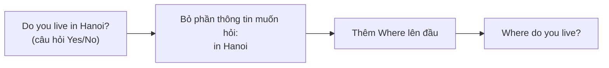
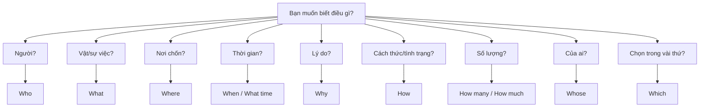

# A0-G017 · Question Words — Từ để hỏi cơ bản

## Mục lục

- [A. Lesson Information](#a-lesson-information)
- [B. Warm-up](#b-warm-up-tình-huống-thực-tế)
- [C. WHAT](#c-what-từ-để-hỏi-là-gì)
- [D. WHY](#d-why-câu-hỏi-wh--được-xây-như-thế-nào)
- [E. FORM](#e-form-công-thức)
- [F. HOW](#f-how-từng-từ-để-hỏi)
- [G. VISUAL](#g-visual-explanation)
- [H. COMPARISON](#h-comparison)
- [I. COMMON MISTAKES](#i-common-mistakes)
- [J. MEMORY TRICKS](#j-memory-tricks)
- [K. REAL-LIFE APPLICATION](#k-real-life-application)
- [L. PRACTICE EXERCISES](#l-practice-exercises)
- [M. KNOWLEDGE CHECK](#m-knowledge-check)
- [N. ANSWER KEY](#n-answer-key)

---

## A. Lesson Information

| Mục | Nội dung |
|---|---|
| **Lesson ID** | A0-G017 |
| **Topic** | Question Words (Wh-questions) |
| **Tên tiếng Việt** | Từ để hỏi cơ bản |
| **CEFR Level** | A0 |
| **Prerequisites** | [A0-G016 — Sentence Types](A0-G016-sentence-types.md) |
| **Estimated Time** | 75 phút |

**Learning Objectives:**

1. Biết nghĩa và cách dùng các từ để hỏi: *What, Where, When, Who, Why, How, Which, Whose* và các cụm *How old / How many / How much / What time*.
2. Tạo câu hỏi Wh- theo công thức: **Wh- + câu hỏi Yes/No**.
3. Áp dụng đúng "hai gia đình động từ" trong câu hỏi Wh-.
4. Trả lời câu hỏi Wh- đầy đủ hoặc ngắn gọn tự nhiên.
5. Phân biệt các cặp dễ nhầm: *What/Which*, *How many/How much*, *Who/Whose*.

---

## B. Warm-up: Tình huống thực tế

Bạn gặp một người mới ở buổi họp mặt. Bạn muốn biết: họ tên gì, ở đâu, làm nghề gì, bao nhiêu tuổi, vì sao đến đây.

Bạn biết hỏi câu Yes/No: *Are you a teacher? Do you live in Hanoi?* — nhưng nếu đoán sai mãi thì cuộc trò chuyện sẽ rất dài!

🤔 **Hãy suy nghĩ:** Làm sao hỏi trực tiếp "Bạn làm nghề **gì**?", "Bạn sống ở **đâu**?" Từ câu *Do you live in Hanoi?*, bạn sẽ thay đổi gì để thành "Bạn sống ở đâu?"

---

## C. WHAT: Từ để hỏi là gì?

**Question words** (từ để hỏi), còn gọi là **Wh-words** vì hầu hết bắt đầu bằng *wh-*, dùng để hỏi **thông tin cụ thể** — câu trả lời không phải *Yes/No*.

| Từ để hỏi | Hỏi về | Nghĩa | Ví dụ trả lời |
|---|---|---|---|
| **What** | Sự vật, sự việc, thông tin | Cái gì, gì | *A book. / My name is Lan.* |
| **Where** | Nơi chốn | Ở đâu | *In Hanoi.* |
| **When** | Thời gian | Khi nào | *On Monday. / In 2020.* |
| **What time** | Giờ cụ thể | Mấy giờ | *At 7 o'clock.* |
| **Who** | Người | Ai | *My teacher.* |
| **Why** | Lý do | Tại sao | *Because I'm tired.* |
| **How** | Cách thức, tình trạng | Như thế nào, bằng cách nào | *By bus. / Fine, thanks.* |
| **How old** | Tuổi | Bao nhiêu tuổi | *25.* |
| **How many** | Số lượng (đếm được) | Bao nhiêu | *Three.* |
| **How much** | Số lượng (không đếm được), giá cả | Bao nhiêu | *A lot. / 50,000 dong.* |
| **Which** | Lựa chọn trong một nhóm giới hạn | Cái nào | *The red one.* |
| **Whose** | Sở hữu | Của ai | *It's Nam's.* |

---

## D. WHY: Câu hỏi Wh- được xây như thế nào?

Tin vui: Bạn có thể dùng khung Yes/No đã học cho nhiều câu hỏi Wh-: thay phần muốn hỏi bằng từ hỏi ở đầu. **Câu hỏi chủ ngữ là ngoại lệ**, không thêm do/does như sẽ giải thích bên dưới.



Ví dụ:

| Câu khẳng định | Câu hỏi Yes/No | Câu hỏi Wh- |
|---|---|---|
| She is **25**. | Is she 25? | **How old** is she? |
| They live **in Hue**. | Do they live in Hue? | **Where** do they live? |
| He works **at night**. | Does he work at night? | **When** does he work? |

---

## E. FORM: Công thức

**Ký hiệu:** **Wh-** = từ để hỏi · **S** = chủ ngữ · **V** = động từ nguyên mẫu · **C** = bổ ngữ.

### Gia đình 1 — với *be*

**Wh- + am/is/are + S (+ C)?**

- *Where **are** you from?*
- *What **is** your name?* → *What's your name?*
- *How old **is** your son?*

### Gia đình 2 — với động từ thường

**Wh- + do/does + S + V (+ O)?**

- *Where **do** you **work**?*
- *What **does** she **like**?*
- *How many children **do** they **have**?*

**Ngoại lệ cần biết ngay:** Who lives here? (Ai sống ở đây?) và Which bus goes to the airport? (Xe buýt nào đi sân bay?) hỏi chính chủ ngữ, nên không thêm do/does trong câu khẳng định trung tính. Who/Which bus đứng trực tiếp trước lives/goes. Bài A2-G029 sẽ luyện sâu; không áp QUASI cho các câu này.

### Cụm Wh- + danh từ

Với *What, Which, Whose, How many, How much*, danh từ có thể đi **ngay sau** từ để hỏi:

- ***What colour** is your car?*
- ***Which bus** goes to the airport?*
- ***Whose phone** is this?*
- ***How many brothers** do you have?*
- ***How much money** do you need?*

### Trả lời

Câu hỏi Wh- thường được trả lời **ngắn gọn** bằng thông tin chính, hoặc bằng **câu đầy đủ** khi cần lịch sự/rõ ràng.

| Câu hỏi | Trả lời ngắn | Trả lời đầy đủ |
|---|---|---|
| *Where do you live?* | *In Da Nang.* | *I live in Da Nang.* |
| *Why are you late?* | *Because the traffic was bad.* | (thường dùng *Because* + mệnh đề) |

---

## F. HOW: Từng từ để hỏi

| # | Câu hỏi | Tiếng Việt | Trả lời mẫu | Phân tích |
|---|---|---|---|---|
| 1 | **What** do you do? | Bạn làm nghề gì? | I'm a nurse. | ⚠️ Câu hỏi nghề thông dụng trong ngữ cảnh làm quen — không phải "Bạn đang làm gì?" |
| 2 | **What** is this? | Đây là cái gì? | It's a durian. | Gia đình 1 |
| 3 | **Where** are you from? | Bạn đến từ đâu? | I'm from Quang Nam. | *from* ở cuối câu |
| 4 | **When** is your birthday? | Sinh nhật bạn khi nào? | It's on 5th May. | When hỏi thời gian; birthday là số ít nên is đứng trước your birthday; on + ngày theo mẫu cho sẵn |
| 5 | **What time** does the shop open? | Cửa hàng mở cửa lúc mấy giờ? | At 8 a.m. | *What time* = giờ cụ thể |
| 6 | **Who** is that woman? | Người phụ nữ kia là ai? | She's my aunt. | Who hỏi danh tính, is trước that woman; đáp she thay người nữ đã xác định |
| 7 | **Why** do you study English? | Tại sao bạn học tiếng Anh? | Because I want a better job. | Trả lời bằng *Because...* |
| 8 | **How** are you? | Bạn khỏe không? | I'm fine, thanks. | *How* = tình trạng |
| 9 | **How** do you go to work? | Bạn đi làm bằng gì? | By motorbike. | *How* = phương tiện, cách thức |
| 10 | **How old** is your grandmother? | Bà bạn bao nhiêu tuổi? | She's 80. | *How old* + *be* |
| 11 | **How many** people are there in your family? | Gia đình bạn có mấy người? | Five. | Danh từ số nhiều |
| 12 | **How much** is this shirt? | Áo này giá bao nhiêu? | It's 200,000 dong. | Hỏi giá |
| 13 | **Which** colour do you like, blue or green? | Bạn thích màu nào, xanh dương hay xanh lá? | Green. | Lựa chọn giới hạn |
| 14 | **Whose** bag is this? | Túi này của ai? | It's Lan's. | Sở hữu |

---

## G. VISUAL EXPLANATION

### G1. Công thức "đặt lên đầu"

```text
                 ┌── Wh- ──┐ ┌─ câu hỏi Yes/No ─────────┐
Câu hỏi Wh-  =   Where       do    you   live?
                 How old     is    your  son?
                 What        does  she   like?
```

### G2. Sơ đồ chọn từ để hỏi



---

## H. COMPARISON

### *What* và *Which*

| *What* | *Which* |
|---|---|
| Lựa chọn **mở**, không giới hạn | Lựa chọn trong **nhóm giới hạn**, đã biết |
| ***What** is your favourite food?* | ***Which** do you prefer, pho or bun cha?* |

### *How many* và *How much*

| *How many* | *How much* |
|---|---|
| + danh từ **đếm được số nhiều** | + danh từ **không đếm được**; hỏi **giá** |
| *How many **apples**?* | *How much **sugar**?* / *How much **is it**?* |

### *Who* và *Whose*

| *Who* | *Whose* |
|---|---|
| Hỏi **người** | Hỏi **chủ sở hữu** |
| ***Who** is he?* — *He's my brother.* | ***Whose** car is this?* — *It's my brother's.* |

> ⚠️ *Whose* /huːz/ và *Who's* (= Who is trong ví dụ; còn có thể là Who has ở cấu trúc khác) phát âm **giống nhau** nhưng nghĩa khác: *Who's that?* (Đó là ai?) — *Whose is that?* (Cái đó của ai?).

### *What do you do?* và *What are you doing?*

| *What do you do?* | *What are you doing?* |
|---|---|
| Trong làm quen thường hỏi **nghề nghiệp**; có ngữ cảnh hỏi thói quen như What do you do on Sundays? | Hỏi việc **đang làm ngay lúc này** (thì hiện tại tiếp diễn — [A1-G004](../../02-A1-BEGINNER/grammar/A1-G004-present-continuous.md)) |

---

## I. COMMON MISTAKES

| # | ❌ Sai | ✅ Đúng | Nguyên nhân | Cách tránh |
|---|---|---|---|---|
| 1 | Where you live? | Where **do** you live? | Quên trợ động từ | Wh- + **do/does** + S + V |
| 2 | Where **are** you live? | Where **do** you live? | Trộn *be* với động từ thường | *live* → gia đình 2 |
| 3 | What your name is? | What **is your name**? | Giữ trật tự câu kể | Đảo *is* lên trước S |
| 4 | **How many** money? | **How much** money? | | Không đếm được → *much* |
| 5 | **What** old are you? | **How** old are you? | Dịch "bao nhiêu tuổi" | Tuổi → *How old* |
| 6 | What **does** she **likes**? | What does she **like**? | Hai dấu hiệu ngôi 3 | Sau *does* → nguyên mẫu |
| 7 | Why you are sad? | Why **are you** sad? | Không đảo | |
| 8 | "Why are you late?" – "**Because of** the traffic was bad." | "**Because** the traffic was bad." | Nhầm *because/because of* | *because* + mệnh đề; *because of* + danh từ |

---

## J. MEMORY TRICKS

1. **"QUASI"** — trật tự câu hỏi: **Q**uestion word – **A**uxiliary (trợ động từ/be) – **S**ubject – **I**nfinitive (động từ nguyên mẫu). Ví dụ: *Where – do – you – live?* (Mẹo hỗ trợ cho câu hỏi thông tin về tân ngữ/trạng ngữ; với be không có phần I, với câu hỏi chủ ngữ không thêm trợ động từ theo mẫu này.)
2. **Nhóm Wh- theo câu trả lời**: Who → người · Where → nơi · When → thời gian · Why → *because* · How → cách/tình trạng.
3. **"How + tính từ" = hỏi mức độ**: *How old* (tuổi), *How tall* (cao bao nhiêu), *How far* (xa bao nhiêu), *How long* (dài/bao lâu). Bạn có thể tự tạo câu hỏi mới với mẫu này.

---

## K. REAL-LIFE APPLICATION

### Hội thoại: Làm quen trên chuyến xe khách

> **Ben:** Hi! **Where** are you going?
> **Thao:** To Hoi An. And you?
> **Ben:** Me too! **What** do you do, Thao?
> **Thao:** I'm a tour guide. **Where** are you from?
> **Ben:** I'm from Canada. **How long** is the trip to Hoi An?
> **Thao:** About two hours.
> **Ben:** And **what time** do we arrive?
> **Thao:** At about 5 p.m. **Why** are you here in Vietnam?
> **Ben:** Because I love Vietnamese food! **Which** dish do you recommend in Hoi An?
> **Thao:** Cao lau, definitely. **How many** days do you have there?
> **Ben:** Three days. **Whose** bag is this, by the way? Is it yours?
> **Thao:** Oh yes, it's mine. Thanks!

**Vietnamese explanation:** Ben (người Canada) và Thảo (hướng dẫn viên) làm quen trên xe đi Hội An. Họ hỏi nhau về điểm đến, nghề nghiệp, quê quán, thời gian đi, giờ đến, lý do đến Việt Nam, món nên ăn, số ngày ở lại và chủ của một chiếc túi.

**Grammar highlights:** *Where are you going?* (*be* + V-ing — xem trước thì tiếp diễn ở A1); *What do you do?* (nghề nghiệp); *How long is...?* (bao lâu); *Which dish...?* (chọn trong các món Hội An); *Whose bag...?* (sở hữu).

**Useful expressions:** *And you?* · *Me too!* · *About two hours.* · *Definitely.* (Chắc chắn rồi.) · *By the way* (Nhân tiện) · *It's mine.* (Nó là của tôi.)

---

## L. PRACTICE EXERCISES

> ✍️ Đáp án: [A0-G017-ANSWERS](../../12-ANSWERS-AND-EXPLANATIONS/A0/A0-G017-ANSWERS.md)

**Hỗ trợ:** Mai's/Lan's = của Mai/Lan (dạng sở hữu sẽ học ở A1); usually = thường; prefer = thích hơn; get up = thức dậy. Các mẫu trả lời với because nghĩa vì; không bắt buộc mọi đáp án Why đều bắt đầu bằng because nếu lý do đã rõ.

### Level 1 — Recognition

Chọn từ để hỏi phù hợp với câu trả lời.

**L1.1.** ___ is your brother? – He's 15.  A. How old  B. What  C. How many
**L1.2.** ___ do you live? – In Can Tho.  A. When  B. Where  C. What
**L1.3.** ___ is that man? – He's my boss.  A. Who  B. Whose  C. What
**L1.4.** ___ is this jacket? – 500,000 dong.  A. How many  B. How much  C. What
**L1.5.** ___ do you study English? – Because I want to travel.  A. How  B. When  C. Why
**L1.6.** ___ pen is this? – It's Mai's.  A. Who  B. Whose  C. Which

### Level 2 — Controlled Practice

Điền từ để hỏi.

**L2.1.** ___ does the film start? – At 8 p.m.
**L2.2.** ___ do you go to school? – By bike.
**L2.3.** ___ brothers and sisters do you have? – Two.
**L2.4.** ___ is your favourite colour? – Blue.
**L2.5.** ___ one do you want, the big one or the small one? – The small one.

Viết câu hỏi cho phần in đậm. Giữ người/vật được nhắc tới; ở câu 7 có thể giữ my nếu tự hỏi, hoặc đổi your nếu đang hỏi người kể.

**L2.6.** She lives **in Hai Phong**.
**L2.7.** My father is **55**.
**L2.8.** They have **three** cats.
**L2.9.** He works **in a hospital**.
**L2.10.** The meeting is **on Friday**.

### Level 3 — Error Correction

**L3.1.** Where you work?
**L3.2.** What your name is?
**L3.3.** How many water do you drink?
**L3.4.** What does he wants for dinner?
**L3.5.** What old is your daughter?
**L3.6.** Where are you live?

### Level 4 — Production

Dịch sang tiếng Anh:

**L4.1.** Bạn làm nghề gì?
**L4.2.** Lớp học bắt đầu lúc mấy giờ?
**L4.3.** Tại sao bạn buồn? (*sad*)
**L4.4.** Chiếc xe máy này của ai?
**L4.5.** Bạn thích món nào hơn, phở hay bún chả? (*Which do you prefer...*)

### Level 5 — Real Communication

**L5.1.** Viết 10 câu hỏi (dùng ít nhất 8 từ/cụm để hỏi khác nhau) để phỏng vấn một người nổi tiếng bạn yêu thích. Sau đó tưởng tượng và viết câu trả lời, ghi rõ đây là phỏng vấn giả định; không trình bày lời tưởng tượng như phát biểu có thật.
**L5.2.** **Speaking:** Trả lời to 8 câu hỏi sau về bản thân (ghi âm): *What's your name? Where are you from? How old are you? What do you do? Where do you live? How do you go to work/school? Why do you learn English? What time do you usually get up?*

---

## M. KNOWLEDGE CHECK

### 5 câu hỏi tự kiểm tra

1. Công thức câu hỏi Wh- với động từ thường là gì?
2. *How many* và *How much* khác nhau thế nào?
3. *What do you do?* hỏi về điều gì?
4. *Whose* và *Who's* khác nhau ra sao?
5. Viết câu hỏi cho phần in đậm: *She gets up **at 6**.*

### Checklist

- [ ] Tôi nhớ nghĩa của 12 từ/cụm từ để hỏi.
- [ ] Tôi đặt trợ động từ/be đúng vị trí trong câu hỏi Wh-.
- [ ] Tôi trả lời được câu hỏi Wh- về bản thân trôi chảy.

### 3 lỗi quan trọng cần nhớ

1. ~~Where you live?~~ → Where **do** you live?
2. ~~What old~~ → **How old**.
3. ~~How many money~~ → **How much** money.

### Lịch ôn tập

| Ngày | Việc cần làm |
|---|---|
| Ngày 1 | Làm lại L2 |
| Ngày 3 | Viết 10 câu hỏi Wh- cho 10 câu khẳng định bất kỳ |
| Ngày 7 | Làm lại L5.2, so sánh bản ghi âm |

### Liên kết

- ➡️ Bài tiếp theo: [A0-G018 — Numbers, Dates, Time, Age](A0-G018-numbers-dates-time-age.md)
- 🔜 [A2-G029 — Subject & Object Questions](../../03-A2-ELEMENTARY/grammar/A2-G029-subject-object-questions.md)

---

## N. ANSWER KEY

👉 [A0-G017-ANSWERS.md](../../12-ANSWERS-AND-EXPLANATIONS/A0/A0-G017-ANSWERS.md)
