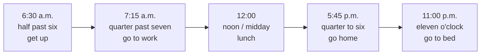

# A0-G018 · Numbers, Dates, Time & Age — Số, ngày tháng, giờ và tuổi

## Mục lục

- [A. Lesson Information](#a-lesson-information)
- [B. Warm-up](#b-warm-up-tình-huống-thực-tế)
- [C. WHAT](#c-what-các-nhóm-thông-tin-con-số)
- [D. WHY](#d-why-những-quy-ước-khác-tiếng-việt)
- [E. FORM](#e-form-cách-đọc-và-viết)
- [F. HOW](#f-how-ví-dụ-trong-giao-tiếp)
- [G. VISUAL](#g-visual-explanation)
- [H. COMPARISON](#h-comparison)
- [I. COMMON MISTAKES](#i-common-mistakes)
- [J. MEMORY TRICKS](#j-memory-tricks)
- [K. REAL-LIFE APPLICATION](#k-real-life-application)
- [L. PRACTICE EXERCISES](#l-practice-exercises)
- [M. KNOWLEDGE CHECK](#m-knowledge-check)
- [N. ANSWER KEY](#n-answer-key)

---

## A. Lesson Information

| Mục | Nội dung |
|---|---|
| **Lesson ID** | A0-G018 |
| **Topic** | Numbers, Dates, Time and Age |
| **Tên tiếng Việt** | Số đếm, số thứ tự, ngày tháng, giờ và tuổi |
| **CEFR Level** | A0 |
| **Prerequisites** | [A0-G009 — To Be](A0-G009-verb-to-be.md), [A0-G017 — Question Words](A0-G017-question-words.md) |
| **Estimated Time** | 90 phút |

**Learning Objectives:**

1. Đọc và viết **số đếm** (cardinal numbers) từ 0 đến hàng triệu; phân biệt *-teen* và *-ty*.
2. Dùng **số thứ tự** (ordinal numbers) cho ngày tháng, tầng, thứ hạng.
3. Đọc **ngày tháng** và **năm** theo kiểu Anh và Mỹ.
4. Nói **giờ** theo hai cách: kiểu số (*seven fifteen*) và kiểu truyền thống (*quarter past seven*).
5. Nói và hỏi **tuổi**, **số điện thoại**, **giá tiền**.

---

## B. Warm-up: Tình huống thực tế

Bạn gọi điện đặt bàn nhà hàng:

> **Staff:** For how many people?
> **You:** *Fourteen.*
> **Staff:** *Forty?* That's a big group!
> **You:** No, no — *one-four*, fourteen!

🤔 **Hãy suy nghĩ:** Vì sao *fourteen* và *forty* dễ nghe nhầm? Bạn có nhận ra khác biệt nguyên âm, âm /n/ cuối và trọng âm khi đọc riêng hai số này không?

---

## C. WHAT: Các nhóm thông tin con số

| Nhóm | English | Ví dụ |
|---|---|---|
| Số đếm | **Cardinal numbers** | one, two, twenty-one, a hundred |
| Số thứ tự | **Ordinal numbers** | first, second, third, twenty-first |
| Ngày tháng, năm | **Dates & years** | 2nd September 1945 |
| Giờ | **Time** | 7:30 — seven thirty / half past seven |
| Tuổi | **Age** | I'm 30 (years old). |

---

## D. WHY: Những quy ước khác tiếng Việt

1. **Tiếng Anh nhóm số theo hàng nghìn** (thousand, million, billion), giống tiếng Việt (nghìn, triệu, tỷ). Quy ước thường gặp trong tài liệu tiếng Anh và tiếng Việt khác nhau (một số hệ thống còn dùng khoảng trắng): tiếng Anh dùng **dấu phẩy** cho hàng nghìn (*1,000,000*) và **dấu chấm** cho số thập phân (*2.5*). Tiếng Việt thì ngược lại (*1.000.000* và *2,5*).
2. **Ngày tháng có hai hệ thống:** Anh – Anh viết **ngày/tháng** (*5/9* = 5 tháng 9), Anh – Mỹ viết **tháng/ngày** (*9/5* = 5 tháng 9). Khi viết email quốc tế, nên viết tên tháng bằng chữ để tránh nhầm: *5 September 2025*.
3. **Năm được đọc theo cặp:** *1998* = *nineteen ninety-eight* (19 | 98), đây là cách thông dụng; cách đọc đầy đủ one thousand nine hundred and ninety-eight vẫn có thể hiểu được, không sai giá trị số.

---

## E. FORM: Cách đọc và viết

### E1. Số đếm (Cardinal numbers)

| 0–12 | 13–19 (*-teen*) | Hàng chục (*-ty*) |
|---|---|---|
| 0 zero / oh | 13 thir**teen** | 20 twen**ty** |
| 1 one, 2 two, 3 three | 14 four**teen** | 30 thir**ty** |
| 4 four, 5 five, 6 six | 15 fif**teen** | 40 **for**ty (không có *u*!) |
| 7 seven, 8 eight, 9 nine | 16 six**teen** | 50 fif**ty** |
| 10 ten | 17 seven**teen** | 60 six**ty**, 70 seven**ty** |
| 11 eleven, 12 twelve | 18 eigh**teen**, 19 nine**teen** | 80 eigh**ty**, 90 nine**ty** |

**Trọng âm phân biệt *-teen* và *-ty*:**

| *-teen*: nhấn âm **sau** | *-ty*: nhấn âm **đầu** |
|---|---|
| 13 thir**TEEN** /ˌθɜːˈtiːn/ | 30 **THIR**ty /ˈθɜːti/ |
| 14 four**TEEN** /ˌfɔːˈtiːn/ | 40 **FOR**ty /ˈfɔːti/ |
| 15 fif**TEEN** /ˌfɪfˈtiːn/ | 50 **FIF**ty /ˈfɪfti/ |

**Trọng âm trong ngữ cảnh:** Bảng trên dành cho số đọc riêng hoặc nhấn đối chiếu. Trước danh từ có trọng âm, trọng âm của -teen có thể chuyển để thuận nhịp; đừng dựa riêng vào vị trí nhấn để nghe số. Nghe cả âm /n/ cuối và xác nhận từng chữ số khi cần.

**Số ghép:** dùng dấu gạch nối từ 21 đến 99: *twenty-one, forty-five, ninety-nine*.

**Số lớn:**

| Số | Cách đọc | Ghi chú |
|---|---|---|
| 100 | a/one hundred | |
| 105 | a hundred **and** five | Anh – Anh dùng *and* sau *hundred*; Anh – Mỹ thường bỏ |
| 999 | nine hundred and ninety-nine | |
| 1,000 | a/one thousand | |
| 2,500 | two thousand five hundred | **Không** thêm *s*: ~~two thousands~~ |
| 10,000 | ten thousand | "mười nghìn" = *ten thousand*, **không có** từ riêng cho "vạn" |
| 100,000 | a hundred thousand | |
| 1,000,000 | a/one million | |
| 3,200,000 | three point two million / three million two hundred thousand | |
| 1,000,000,000 | a/one billion | = 1 tỷ |

> ⚠️ *hundred, thousand, million* **không** thêm *-s* khi có số đứng trước: *five hundred people, two million dollars*. Chỉ thêm *-s* khi nói "hàng trăm, hàng nghìn" không có số cụ thể: *hundreds of people, thousands of birds*.

**Số thập phân và tiền:**

- *2.5* = two **point** five
- *0.75* = zero/nought point seven five
- *$15.99* = fifteen dollars ninety-nine / fifteen ninety-nine
- *150,000 VND* = a hundred and fifty thousand dong

### E2. Số thứ tự (Ordinal numbers)

| Số | Thứ tự | Viết tắt |
|---|---|---|
| 1 | **first** | 1st |
| 2 | **second** | 2nd |
| 3 | **third** | 3rd |
| 4 | fourth | 4th |
| 5 | **fifth** | 5th |
| 8 | **eighth** | 8th |
| 9 | **ninth** | 9th (không có *e*) |
| 12 | **twelfth** | 12th |
| 20 | twentieth | 20th (*y* → *ie*) |
| 21 | twenty-**first** | 21st |
| 22 | twenty-**second** | 22nd |
| 23 | twenty-**third** | 23rd |
| 31 | thirty-**first** | 31st |
| 100 | hundredth | 100th |

Quy tắc chung: số đếm + **-th**; 1, 2, 3 và các số kết thúc bằng 1, 2, 3 (trừ các số có hai chữ số cuối là 11, 12, 13) là bất quy tắc: **-st, -nd, -rd**. 11th, 12th, 13th dùng *-th*.

### E3. Ngày, tháng, năm

**Ngày trong tuần** (viết hoa): Monday, Tuesday, Wednesday /ˈwenzdeɪ/, Thursday, Friday, Saturday, Sunday.

**Tháng** (viết hoa): January, February, March, April, May, June, July, August, September, October, November, December.

**Cách viết và đọc ngày:**

| Kiểu | Viết | Đọc |
|---|---|---|
| Anh – Anh | 5 May 2025 / 5th May 2025 | the fifth of May, twenty twenty-five |
| Anh – Mỹ | May 5, 2025 | May fifth, twenty twenty-five |

**Năm:**

| Năm | Đọc |
|---|---|
| 1975 | nineteen seventy-five |
| 1900 | nineteen hundred |
| 2000 | two thousand |
| 2005 | two thousand and five (Anh – Mỹ: two thousand five) |
| 2010 | twenty ten / two thousand and ten |
| 2025 | twenty twenty-five |

### E4. Giờ (Time)

**Hỏi giờ:** *What time is it?* / *What's the time?* / *Do you have the time?* (lịch sự)

**Cách 1 — Kiểu số (dễ, dùng rất phổ biến):** đọc giờ + phút

| Giờ | Đọc |
|---|---|
| 7:00 | seven o'clock |
| 7:05 | seven oh five |
| 7:15 | seven fifteen |
| 7:30 | seven thirty |
| 7:45 | seven forty-five |

**Cách 2 — Kiểu truyền thống (phổ biến ở Anh, trong giao tiếp):**

| Giờ | Đọc | Quy tắc |
|---|---|---|
| 7:05 | five **past** seven | 1–30 phút: **phút + past + giờ** |
| 7:15 | (a) **quarter past** seven | *quarter* = 15 phút |
| 7:30 | **half past** seven | *half* = 30 phút |
| 7:40 | twenty **to** eight | 31–59 phút: **(60 − phút) + to + giờ kế tiếp** |
| 7:45 | (a) **quarter to** eight | |

**Buổi trong ngày:** a.m. từ nửa đêm tới trước trưa; p.m. từ trưa tới trước nửa đêm. 12 noon/midday = 12 giờ trưa; 12 midnight = 12 giờ đêm. Theo quy ước phổ biến 12 a.m. là nửa đêm, 12 p.m. là trưa; viết noon/midnight hoặc 24 giờ giúp tránh nhầm ở ranh giới.

> ⚠️ Cách viết gọn thông dụng: seven p.m. hoặc seven o'clock in the evening. Seven o'clock p.m. có thể gặp nhưng thừa thông tin theo cách trình bày của bài; không phải lỗi hiểu sai giờ.

### E5. Tuổi (Age)

| Mẫu | Ví dụ |
|---|---|
| S + **be** + số | *I'm 30.* |
| S + **be** + số + **years old** | *She's 8 years old.* |
| **How old** + be + S? | *How old is your father?* |
| **a** + số + **-year-old** + danh từ | *a 10-year-old boy* (không có *s* ở *year*, có dấu gạch nối) |
| Tuổi gần đúng | *He's about 40.* / *She's in her twenties.* (ở độ tuổi 20) |

### E6. Số điện thoại

Đọc **từng chữ số**; *0* thường đọc *oh* /əʊ/ (Anh) hoặc *zero* (Mỹ); hai chữ số giống nhau có thể nói *double*: *0912 334 556* → *oh nine one two, double three four, double five six*.

---

## F. HOW: Ví dụ trong giao tiếp

| # | English | Tiếng Việt | Phân tích |
|---|---|---|---|
| 1 | *There are **thirty-two** students in my class.* | Lớp tôi có 32 học sinh. | Số ghép có gạch nối |
| 2 | *My office is on the **fifth** floor.* | Văn phòng tôi ở tầng 5. | Tầng dùng số thứ tự |
| 3 | *My birthday is on **the twelfth of March**.* | Sinh nhật tôi ngày 12 tháng 3. | Ngày dùng số thứ tự; *on* + ngày |
| 4 | *Vietnam's National Day is **2nd September**.* | Quốc khánh Việt Nam là ngày 2/9. | Đọc: *the second of September* |
| 5 | *I was born in **nineteen ninety-nine**.* | Tôi sinh năm 1999. | Năm đọc theo cặp |
| 6 | *The train leaves at **half past six**.* | Tàu chạy lúc 6 rưỡi. | Half past six = 30 phút sau 6; at đặt trước giờ trong lịch |
| 7 | *It's **quarter to nine**. We're late!* | 9 giờ kém 15 rồi. Muộn rồi! | Quarter = 15 phút, to nine = còn 15 phút tới 9, tức 8:45 |
| 8 | *My son is **seven years old**.* | Con trai tôi 7 tuổi. | *be* + tuổi |
| 9 | *She has a **five-year-old** daughter.* | Cô ấy có một con gái 5 tuổi. | Tính từ ghép, không *s* |
| 10 | *This phone costs **six million five hundred thousand** dong.* | Điện thoại này giá 6,5 triệu đồng. | *million, thousand* không *s* |
| 11 | *My number is **oh nine eight, double seven, one two three four five*** | Số minh họa là 0987712345. | Đọc từng chữ số; double seven là hai số 7, không đọc thành seventy-seven |
| 12 | ***Hundreds of** people came to the concert.* | Hàng trăm người đến buổi hòa nhạc. | Không có số cụ thể → *hundreds of* |

---

## G. VISUAL EXPLANATION

### G1. Đồng hồ "past" và "to"

```text
                 12  (o'clock)
          11            1
       10    ← TO   PAST →   2
       9  (quarter to)   (quarter past)  3
       8                     4
          7             5
                 6  (half past)

  Nửa phải (1–30 phút): ... PAST giờ hiện tại
  Nửa trái (31–59 phút): ... TO giờ tiếp theo
```

### G2. Dòng thời gian một ngày



---

## H. COMPARISON

### Tiếng Việt và tiếng Anh

| Thông tin | Tiếng Việt | Tiếng Anh |
|---|---|---|
| Dấu hàng nghìn | 1.000.000 | 1,000,000 |
| Dấu thập phân | 2,5 | 2.5 |
| Thứ tự ngày tháng | ngày/tháng/năm | Anh: ngày/tháng; Mỹ: **tháng/ngày** |
| Tuổi | Tôi **có** 20 tuổi / Tôi 20 tuổi | I **am** 20. |
| Năm | hai nghìn không trăm hai mươi lăm | twenty twenty-five |
| "rưỡi" | 7 giờ rưỡi | half past seven / seven thirty |
| "kém" | 9 giờ kém 15 | quarter to nine |
| "vạn", "chục nghìn" | mười nghìn | ten thousand |

### *-teen* và *-ty* khi nghe

Khi nghe số không chắc, hãy **xác nhận**: *"Is that one-five, fifteen, or five-oh, fifty?"* — Người bản ngữ cũng làm như vậy.

---

## I. COMMON MISTAKES

| # | ❌ Sai | ✅ Đúng | Nguyên nhân | Cách tránh |
|---|---|---|---|---|
| 1 | I **have** 25 years old. | I **am** 25 (years old). | Dịch "có 25 tuổi" | Tuổi dùng *be* |
| 2 | two **thousands** people | two **thousand** people | Thêm *s* như danh từ | Có số trước → không *s* |
| 3 | a 10-**years**-old boy | a 10-**year**-old boy | | Tính từ ghép không *s* |
| 4 | **fourty** | **forty** | Theo chữ *four* | 40 viết không có *u* |
| 5 | My birthday is **in** 12 March. | My birthday is **on** 12 March. | Nhầm giới từ | Ngày cụ thể → *on* ([A1-G010](../../02-A1-BEGINNER/grammar/A1-G010-prepositions-of-time.md)) |
| 6 | Gọi 7:45 là quarter **past** seven | Quarter **to eight** | Nhầm past/to và giờ kế tiếp | 45 phút = còn 15 phút tới giờ sau |
| 7 | Đọc *1999* là nineteen **ninety** | Nineteen **ninety-nine** | Bỏ mất chữ số cuối | Kiểm tra cả hai phần 19 và 99 |
| 8 | Viết 2.500.000 trong văn bản tiếng Anh | **2,500,000** | Theo quy ước Việt | Hàng nghìn dùng dấu phẩy |
| 9 | **monday**, **january** | **Monday**, **January** | Không viết hoa | Thứ, tháng luôn viết hoa |

---

## J. MEMORY TRICKS

1. **"Teen kéo dài ở cuối, ty nhấn ở đầu"**: *fif-TEEN* (âm *teen* dài, rõ /tiːn/) vs *FIF-ty* (âm *ty* ngắn, nhẹ).
2. **"1-2-3 đặc biệt"**: first, second, third — và mọi số tận cùng 1, 2, 3 (21st, 32nd, 43rd), **trừ** 11th, 12th, 13th.
3. **"Past = đã qua giờ, To = sắp tới giờ"**: *ten past five* = đã qua 5 giờ 10 phút; *ten to five* = còn 10 phút nữa tới 5 giờ.
4. **Đọc to mọi con số bạn thấy hằng ngày**: biển số xe, giá tiền, số tầng thang máy, giờ trên điện thoại — bằng tiếng Anh.

---

## K. REAL-LIFE APPLICATION

### Hội thoại: Đặt lịch khám răng

Mọi dữ kiện hẹn, giá và số liên lạc dưới đây là dữ liệu minh họa để luyện số; ngày 15 là thứ Năm trong lịch giả định của cuộc thoại.

> **Receptionist:** Good morning, Smile Dental Clinic.
> **Hung:** Hi, I'd like to make an appointment, please.
> **Receptionist:** Sure. What's your name and date of birth?
> **Hung:** Tran Van Hung. My date of birth is **the twenty-third of October, nineteen ninety-two**.
> **Receptionist:** Thank you. And your phone number?
> **Hung:** It's **oh nine oh four, double six two, three one eight**.
> **Receptionist:** Is **Thursday the fifteenth** OK?
> **Hung:** Yes. **What time**?
> **Receptionist:** **Quarter past ten** or **two thirty in the afternoon**.
> **Hung:** **Two thirty**, please.
> **Receptionist:** Great. The check-up costs **three hundred and fifty thousand dong**. See you on Thursday!

**Vietnamese explanation:** Hùng gọi đặt lịch khám răng: cung cấp ngày sinh (23/10/1992), số điện thoại (0904 662 318), chọn thứ Năm ngày 15 lúc 2 giờ 30 chiều. Phí khám 350.000 đồng.

**Grammar highlights:** ngày sinh dùng số thứ tự (*twenty-third*); năm đọc theo cặp (*nineteen ninety-two*); số điện thoại đọc từng số với *oh* và *double*; giờ theo hai cách (*quarter past ten*, *two thirty*).

**Useful expressions:** *I'd like to make an appointment.* — Tôi muốn đặt lịch hẹn. · *date of birth* — ngày sinh · *Is ... OK?* — ... có được không?

---

## L. PRACTICE EXERCISES

> ✍️ Đáp án: [A0-G018-ANSWERS](../../12-ANSWERS-AND-EXPLANATIONS/A0/A0-G018-ANSWERS.md)

**Cụm hỗ trợ:** I was born in... = Tôi sinh năm...; The flight leaves at... = Chuyến bay khởi hành lúc...; This motorbike costs... = Xe này giá...; at + giờ, on + ngày. Dùng theo mẫu; bài này chấm số/ngày/giờ, chưa yêu cầu giải thích cấu trúc thì.

### Level 1 — Recognition

**L1.1.** Khi đọc riêng theo mẫu ở E1, số nào có trọng âm chính ở âm tiết **cuối**?  A. thirty  B. thirteen  C. sixty
**L1.2.** Cách viết đúng của 40:  A. fourty  B. forty  C. fourthy
**L1.3.** 7:45 là:  A. quarter past seven  B. quarter to eight  C. quarter to seven
**L1.4.** Số thứ tự của 12:  A. twelveth  B. twelvth  C. twelfth
**L1.5.** 2,000 people:  A. two thousand people  B. two thousands people  C. two thousands of people
**L1.6.** Năm 2008 thường đọc:  A. two thousand and eight  B. twenty zero eight  C. two zero zero eight

### Level 2 — Controlled Practice

Viết bằng chữ:

**L2.1.** 18 / 80
**L2.2.** 365
**L2.3.** 4,750,000
**L2.4.** 21st / 32nd / 53rd

Viết giờ theo **hai cách**:

**L2.5.** 9:10
**L2.6.** 4:30
**L2.7.** 11:50

Viết cách đọc ngày (kiểu Anh – Anh):

**L2.8.** 1/1/2000
**L2.9.** 30/4/1975
**L2.10.** 22/12/2026

### Level 3 — Error Correction

**L3.1.** My grandmother has 85 years old.
**L3.2.** There are five hundreds students in my school.
**L3.3.** She has a 3-years-old son.
**L3.4.** The class starts at eight o'clock a.m. (Viết gọn lại theo mẫu ở E4; đây là chỉnh cách trình bày.)
**L3.5.** My birthday is on twenty-two of june.

### Level 4 — Production

**L4.1.** Viết câu trả lời đầy đủ: *When is your birthday? How old are you? What's your phone number?* (có thể dùng số giả).
**L4.2.** Dịch: *"Chuyến bay khởi hành lúc 9 giờ kém 15 tối thứ Sáu, ngày 3 tháng 11."* (*The flight leaves...*)
**L4.3.** Dịch: *"Chiếc xe máy này giá 32 triệu đồng."*
**L4.4.** Viết 3 câu về 3 ngày lễ quan trọng ở Việt Nam và ngày của chúng.

### Level 5 — Real Communication

**L5.1.** Viết thời gian biểu một ngày điển hình của bạn (6–8 mốc giờ), mỗi mốc một câu: *I get up at half past six.*
**L5.2.** **Speaking + Listening (tự tạo audio):** Đây là luyện có chuẩn bị vì đã thấy dãy số. Che dãy lúc nghe; muốn kiểm tra độc lập, nhờ người khác chọn dãy mới và giữ đáp án.  Dùng TTS đọc dãy số sau, nghe và chép lại, rồi so sánh: *13, 30, 15, 50, 17, 70, 19, 90, 14, 40*. Sau đó tự đọc to dãy số, ghi âm, kiểm tra trọng âm.

---

## M. KNOWLEDGE CHECK

### 5 câu hỏi tự kiểm tra

1. Làm sao phân biệt *fifteen* và *fifty* khi nói?
2. Vì sao *two thousand people* không có *s*?
3. Đọc ngày 2/9/1945 kiểu Anh – Anh.
4. 8:40 nói theo cách truyền thống là gì?
5. "Một cậu bé 10 tuổi" nói thế nào?

### Checklist

- [ ] Tôi đọc được số đến hàng triệu, kể cả giá tiền VNĐ.
- [ ] Tôi nói *-teen/-ty* với trọng âm đúng.
- [ ] Tôi nói được ngày sinh, số điện thoại của mình.
- [ ] Tôi nói giờ theo hai cách.

### 3 lỗi quan trọng cần nhớ

1. ~~I have 25 years old~~ → I'**m** 25.
2. ~~two thousands~~ → two **thousand**.
3. Khi đọc riêng: -teen thường nhấn sau, -ty nhấn đầu; nghe thêm /n/ và chú ý thay đổi trọng âm trong cụm.

### Lịch ôn tập

| Ngày | Việc cần làm |
|---|---|
| Ngày 1 | Đọc to giá của 10 món đồ quanh bạn bằng tiếng Anh |
| Ngày 3 | Nói giờ hiện tại theo hai cách, 5 lần trong ngày |
| Ngày 7 | Đọc ngày sinh của 5 người thân; làm lại L2 |

### Liên kết

- ➡️ Bài tiếp theo: [A0-G019 — Likes & Hobbies](A0-G019-likes-and-hobbies.md)
- 🔜 [A1-G010 — Prepositions of Time](../../02-A1-BEGINNER/grammar/A1-G010-prepositions-of-time.md)
- 🔁 Phát âm trọng âm: [PRON-04 — Word Stress](../../08-PRONUNCIATION/PRON-04-word-stress.md)

---

## N. ANSWER KEY

👉 [A0-G018-ANSWERS.md](../../12-ANSWERS-AND-EXPLANATIONS/A0/A0-G018-ANSWERS.md)
