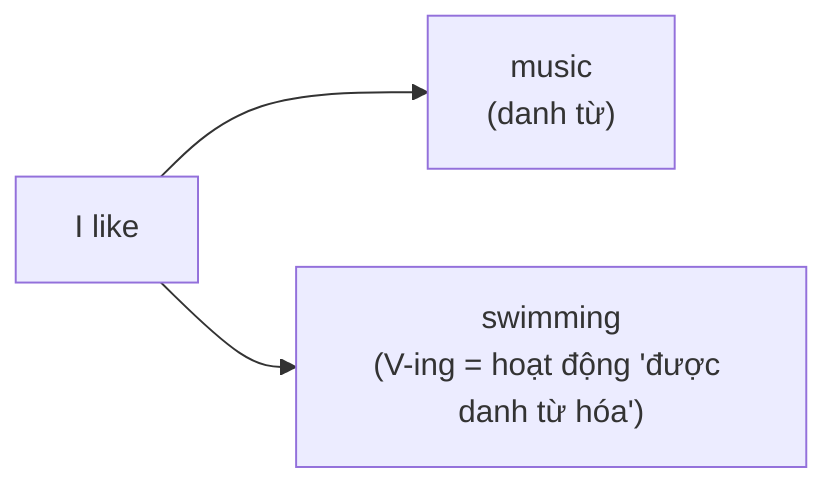

# A0-G019 · Talking about Likes & Hobbies — Nói về sở thích

## Mục lục

- [A. Lesson Information](#a-lesson-information)
- [B. Warm-up](#b-warm-up-tình-huống-thực-tế)
- [C. WHAT](#c-what-các-động-từ-chỉ-sở-thích)
- [D. WHY](#d-why-vì-sao-sau-like-lại-là-v-ing)
- [E. FORM](#e-form-công-thức)
- [F. HOW](#f-how-cách-dùng)
- [G. VISUAL](#g-visual-explanation)
- [H. COMPARISON](#h-comparison)
- [I. COMMON MISTAKES](#i-common-mistakes)
- [J. MEMORY TRICKS](#j-memory-tricks)
- [K. REAL-LIFE APPLICATION](#k-real-life-application)
- [L. PRACTICE EXERCISES](#l-practice-exercises)
- [M. KNOWLEDGE CHECK](#m-knowledge-check)
- [N. ANSWER KEY](#n-answer-key)

---

## A. Lesson Information

| Mục | Nội dung |
|---|---|
| **Lesson ID** | A0-G019 |
| **Topic** | Talking about Likes, Dislikes & Hobbies |
| **Tên tiếng Việt** | Nói về sở thích, điều thích và không thích |
| **CEFR Level** | A0 → A1 |
| **Prerequisites** | [A0-G010 — Have/Has](A0-G010-have-has.md), [A0-G016 — Sentence Types](A0-G016-sentence-types.md) |
| **Estimated Time** | 75 phút |

**Learning Objectives:**

1. Dùng thang mức độ: *love – really like – like – don't mind – don't like – hate*.
2. Dùng động từ sở thích + **danh từ** và + **V-ing**: *I like music / I like listening to music*.
3. Viết đúng chính tả **V-ing** (*swim → swimming, dance → dancing*).
4. Dùng các cụm *be interested in, be good at, my favourite ... is*.
5. Hỏi và trả lời về sở thích: *What do you like doing? What are your hobbies? Do you like...?*

---

## B. Warm-up: Tình huống thực tế

Trong buổi phỏng vấn xin việc, người phỏng vấn hỏi:

> *"What do you do in your free time?"*

Bạn muốn nói "Tôi thích đọc sách và chơi cầu lông". Bạn viết:

> ❌ *I like read books and play badminton.*

🤔 **Hãy suy nghĩ:** Câu tiếng Việt có hai động từ "thích" và "đọc" đứng cạnh nhau. Trong tiếng Anh, ở [A0-G016](A0-G016-sentence-types.md) bạn đã luyện chọn đúng mẫu động từ. Tiếng Anh có nhiều cách kết hợp động từ, không có lệnh cấm chung hai động từ đứng cạnh nhau. Vậy làm sao nói "thích làm gì"?

---

## C. WHAT: Các động từ chỉ sở thích

| Mức độ | Động từ / cụm | Nghĩa |
|---|---|---|
| 😍😍 | **love** / **adore** | rất yêu thích |
| 😍 | **really like** / **enjoy** | rất thích, tận hưởng |
| 🙂 | **like** | thích |
| 😐 | **don't mind** | không phiền, cũng được |
| 🙁 | **don't like** / **don't enjoy** | không thích |
| 😖 | **hate** / **can't stand** | ghét, không chịu nổi |

**Hobby** (sở thích) là hoạt động bạn làm thường xuyên trong thời gian rảnh vì thấy vui: *reading, cooking, playing football, gardening*.

---

## D. WHY: Vì sao sau *like* lại là V-ing?

Các động từ này có thể nhận danh từ chỉ điều thích/ghét. Khi nói về **hoạt động**, một mẫu thông dụng là dùng V-ing như swimming, cooking; like/love/hate còn nhận to + V như phần ghi chú bên dưới. Dạng đó là **V-ing** — gọi là **gerund** (danh động từ): động từ + *-ing*, hoạt động như một danh từ.



So sánh: *I like **football**.* (danh từ) — *I like **playing** football.* (V-ing, có tân ngữ *football* đi kèm).

> 💡 Với *like, love, hate*, bạn **cũng có thể** dùng *to + V*: *I like **to swim***. Cả hai đều đúng; trong tiếng Anh – Anh, *like + V-ing* phổ biến hơn khi nói về sở thích lâu dài. Riêng **enjoy** và **don't mind** chỉ đi với **V-ing** (❌ *enjoy to swim*). Bạn sẽ học kỹ quy tắc này ở [A2-G015](../../03-A2-ELEMENTARY/grammar/A2-G015-gerunds-infinitives-basic.md).

---

## E. FORM: Công thức

### E1. Câu khẳng định

| Công thức | Ví dụ |
|---|---|
| S + like/love/enjoy/hate + **N** | *I love **coffee**.* / *She hates **horror films**.* |
| S + like/love/enjoy/hate + **V-ing** (+ O) | *I enjoy **cooking**.* / *He likes **playing** chess.* |
| I/you/we/they + don't mind + **V-ing**; he/she/it + doesn't mind + V-ing | *I don't mind **waiting**.* |

Nhớ quy tắc gia đình 2 ([A0-G016](A0-G016-sentence-types.md)): với *he/she/it*, động từ thêm *-s*: *She **likes**, He **loves**, It **hates**...*

### E2. Phủ định và câu hỏi

| Loại | Công thức | Ví dụ |
|---|---|---|
| ➖ | S + don't/doesn't + like + N/V-ing | *He **doesn't like** shopping.* |
| ❓ Yes/No | Do/Does + S + like + N/V-ing? | ***Do** you **like** dancing?* — *Yes, I do. / No, I don't.* |
| ❓ Wh- | What + do/does + S + like + **doing**? | ***What do** you **like doing** at weekends?* |
| ❓ | What are your hobbies? / What do you do in your free time? | |

**Phân biệt nghĩa:** Giỏi một việc (be good at) không tự động có nghĩa thích việc đó. Don't mind nghĩa không phản đối/không thấy phiền, không nhất thiết hoàn toàn trung tính. Thang cảm xúc chỉ là gợi ý; enjoy không luôn mạnh hơn like trong mọi ngữ cảnh.

### E3. Quy tắc chính tả V-ing

| Quy tắc | Ví dụ |
|---|---|
| Thông thường: + *ing* | read → read**ing**, play → play**ing**, cook → cook**ing** |
| Tận cùng *-e* câm: bỏ *e* + *ing* | danc**e** → danc**ing**, writ**e** → writ**ing**, rid**e** → rid**ing** |
| Từ một âm tiết kết thúc bằng **một chữ nguyên âm + một chữ phụ âm** (trừ w/x/y): gấp đôi chữ phụ âm cuối + ing | swi**m** → swi**mm**ing, ru**n** → ru**nn**ing, sho**p** → sho**pp**ing, ge**t** → ge**tt**ing |
| Tận cùng *-ie*: *ie* → *y* + *ing* | l**ie** → l**y**ing, d**ie** → d**y**ing |
| Không gấp đôi *w, x, y* | play**ing**, fix**ing**, snow**ing** |

> 💡 Không bỏ e trong see → seeing, agree → agreeing (tận cùng ee); dye → dyeing giữ e để khác die → dying. Travel → travelling (Anh–Anh) / traveling (Anh–Mỹ), cả hai đúng. Từ nhiều âm tiết còn xét trọng âm, học kỹ ở A1-G004.

### E4. Các cụm hữu ích khác

| Cụm | Theo sau | Ví dụ |
|---|---|---|
| **be interested in** (quan tâm, thích) | N / V-ing | *I'm interested in **photography**.* / *...in **learning** Korean.* |
| **be good at** (giỏi về) | N / V-ing | *She's good at **maths**.* / *He's good at **drawing**.* |
| **be keen on** (Anh – Anh, thích) | N / V-ing | *We're keen on **hiking**.* |
| **My favourite** + N + **is**... (... yêu thích nhất của tôi là) | N | *My favourite sport is badminton.* |
| **be into** (thân mật — mê) | N / V-ing | *I'm really into **K-pop**.* |

---

## F. HOW: Cách dùng

| # | English | Tiếng Việt | Phân tích |
|---|---|---|---|
| 1 | *I **love** reading.* | Tôi rất thích đọc sách. | love + V-ing |
| 2 | *My sister **enjoys** cooking Vietnamese food.* | Chị tôi thích nấu món Việt. | *enjoys* (ngôi 3) + V-ing + tân ngữ |
| 3 | *I **don't like** getting up early.* | Tôi không thích dậy sớm. | *get → getting* (gấp đôi *t*) |
| 4 | *He **hates** waiting in long queues.* | Anh ấy ghét xếp hàng dài. | He chọn hates; waiting là hoạt động bị ghét, in long queues nêu hoàn cảnh |
| 5 | *I **don't mind** walking to work.* | Tôi không ngại đi bộ đi làm. | Thái độ trung tính |
| 6 | ***Do** you **like** swimming? — Yes, I **do**.* | Bạn thích bơi không? — Có. | *swim → swimming* |
| 7 | ***What do** you **like doing** at weekends?* | Cuối tuần bạn thích làm gì? | Câu hỏi sở thích phổ biến |
| 8 | *I'm **interested in** history.* | Tôi quan tâm đến lịch sử. | *be* + *interested in* + N |
| 9 | *Nam **is good at** playing the guitar.* | Nam chơi guitar giỏi. | *good at* + V-ing |
| 10 | ***My favourite** hobby **is** gardening.* | Sở thích yêu thích nhất của tôi là làm vườn. | *favourite* (Anh) / *favorite* (Mỹ) |
| 11 | *She **really likes** dancing, but she **can't stand** karaoke.* | Cô ấy rất thích nhảy nhưng không chịu nổi karaoke. | Đối lập hai mức độ |
| 12 | ***Does** your father **like** fishing? — No, he **doesn't**.* | Bố bạn có thích câu cá không? — Không. | Your father số ít chọn Does; like giữ nguyên, fishing là hoạt động; đáp he doesn't theo Does |

---

## G. VISUAL EXPLANATION

### G1. Thang cảm xúc

```text
😖 hate ── 🙁 don't like ── 😐 don't mind ── 🙂 like ── 😍 really like / enjoy ── 😍😍 love
```

### G2. Sentence breakdown

`My brother | really | enjoys | playing | video games.`

| Phần | Vai trò |
|---|---|
| My brother | Chủ ngữ (ngôi 3 số ít) |
| really | Trạng từ mức độ — đứng **trước** động từ |
| **enjoys** | Động từ sở thích (+ *s* vì ngôi 3) |
| **playing** | V-ing — "hoạt động được thích" |
| video games | Tân ngữ của *playing* |

---

## H. COMPARISON

### *like* và *would like*

| *like* | *would like* |
|---|---|
| Sở thích **chung, lâu dài** | Mong muốn **cụ thể, bây giờ** (lịch sự) |
| *I **like** coffee.* (Tôi thích cà phê — nói chung) | *I'**d like** a coffee.* (Tôi muốn một ly cà phê — bây giờ) |

*Would like* sẽ được học ở [A1-G013](../../02-A1-BEGINNER/grammar/A1-G013-would-like.md). Đừng nhầm khi gọi đồ: nói *I like a coffee* với nhân viên phục vụ là sai.

### *very* và *really* với động từ sở thích

| ❌ | ✅ |
|---|---|
| I **very like** it. | I **really like** it. / I like it **very much**. |
| I **very enjoy** it. | I **really enjoy** it. / I enjoy it **a lot**. |

### *interested* và *interesting*

| | |
|---|---|
| *I'm **interested** in art.* | Tôi **cảm thấy** thích thú (cảm xúc của người) |
| *Art is **interesting**.* | Nghệ thuật **thú vị** (đặc điểm của sự vật) |

(Học kỹ ở [A2-G023](../../03-A2-ELEMENTARY/grammar/A2-G023-ed-ing-adjectives.md).)

---

## I. COMMON MISTAKES

| # | ❌ Sai | ✅ Đúng | Nguyên nhân | Cách tránh |
|---|---|---|---|---|
| 1 | I like **read** books. | I like **reading** books. | Hai động từ đứng cạnh nhau | like + V-ing (hoặc *to read*) |
| 2 | I enjoy **to swim**. | I enjoy **swimming**. | Áp mẫu *to V* | *enjoy* chỉ + V-ing |
| 3 | I **very like** music. | I **really like** music. | Dịch "rất thích" | *really* + động từ |
| 4 | She **like** dancing. | She **likes** dancing. | Quên *-s* ngôi 3 | *he/she/it* + V-s |
| 5 | **swiming**, **runing** | **swimming**, **running** | Quên gấp đôi phụ âm | CVC → gấp đôi |
| 6 | **danceing**, **writeing** | **dancing**, **writing** | Không bỏ *e* câm | |
| 7 | I'm interested **about** music. | I'm interested **in** music. | Sai giới từ | *interested in*, *good at* |
| 8 | I'm **interesting** in music. | I'm **interested** in music. | Nhầm *-ing/-ed* | Interested in nêu sự quan tâm; interesting nêu khả năng gây hứng thú, không chia đơn giản theo người/vật |
| 9 | What do you like **do**? | What do you like **doing**? | | Câu hỏi giữ V-ing |

---

## J. MEMORY TRICKS

1. **Nhớ cụm sở thích:** like reading / enjoy swimming. Like to read cũng đúng; dùng ing ở bài này để luyện một mẫu nhất quán.
2. **Enjoy theo sau bởi động từ dùng V-ing**, không to V: *enjoy swimming, enjoy cooking*.
3. **Bộ đôi giới từ cố định**: *interested **in**, good **at**, keen **on*** — học như một khối, đừng tách.
4. **Gấp đôi phụ âm — nghe nhịp**: *swim* có nguyên âm ngắn /ɪ/ → gấp đôi *m* để "giữ" âm ngắn: *swimming*. (Mẹo hỗ trợ; quy tắc chính là mẫu CVC một âm tiết.)

---

## K. REAL-LIFE APPLICATION

### Hội thoại: Ứng dụng kết bạn học ngôn ngữ

> **Lisa:** Hi, Duc! I see you **like** travelling. Where do you go?
> **Duc:** Hi, Lisa! Yes, I **love** travelling. I usually go to the mountains. I **really enjoy** hiking. What about you? **What do you like doing** in your free time?
> **Lisa:** I'**m into** photography. I **love** taking pictures of street food!
> **Duc:** Cool! **Do** you **like** Vietnamese food?
> **Lisa:** Yes, I **do**! I **adore** pho. But I **don't like** very spicy food.
> **Duc:** Ha ha, I **don't mind** spicy food. I**'m** also **interested in** learning German. Are you **good at** teaching?
> **Lisa:** I'm not sure, but I **don't mind** trying!

**Vietnamese explanation:** Đức và Lisa làm quen trên ứng dụng trao đổi ngôn ngữ. Đức thích đi du lịch, leo núi; Lisa mê chụp ảnh đồ ăn đường phố, rất thích phở nhưng không thích đồ quá cay. Đức muốn học tiếng Đức và hỏi Lisa có giỏi dạy không.

**Grammar highlights:** *love/enjoy/like/adore/don't like/don't mind* + N/V-ing; *be into, be interested in, be good at* + V-ing.

**Useful expressions:**
- *What about you?* — Còn bạn thì sao?
- *What do you like doing in your free time?* — Lúc rảnh bạn thích làm gì?
- *Cool!* — Hay đấy! (thân mật)
- *I don't mind trying.* — Tôi không ngại thử.

---

## L. PRACTICE EXERCISES

> ✍️ Đáp án: [A0-G019-ANSWERS](../../12-ANSWERS-AND-EXPLANATIONS/A0/A0-G019-ANSWERS.md)

### Level 1 — Recognition

**L1.1.** I enjoy ___ films.  A. watch  B. watching  C. to watch
**L1.2.** She ___ cooking.  A. love  B. loves  C. loving
**L1.3.** I'm interested ___ history.  A. at  B. on  C. in
**L1.4.** He is good ___ singing.  A. at  B. in  C. for
**L1.5.** Which is correct?  A. I very like tea.  B. I really like tea.  C. I like very tea.
**L1.6.** Which spelling is correct?  A. runing  B. running  C. runeing

### Level 2 — Controlled Practice

Viết dạng V-ing:

**L2.1.** swim  **L2.2.** dance  **L2.3.** play  **L2.4.** shop  **L2.5.** write  **L2.6.** sit

Chia động từ trong ngoặc; dùng V-ing cho hoạt động theo mục tiêu bài. Với like, to + V cũng đúng nếu bạn giải thích biến thể.

**L2.7.** My father (enjoy) (fish) at weekends.
**L2.8.** I (not like) (get) up early.
**L2.9.** (your sister / like) (draw)?
**L2.10.** What (you / like / do) in the evening?

### Level 3 — Error Correction

**L3.1.** I like play football.
**L3.2.** She enjoys to read novels.
**L3.3.** He don't like cooking.
**L3.4.** I'm interesting in learning Japanese.
**L3.5.** My brother is good in drawing.
**L3.6.** We love swiming in the sea.

### Level 4 — Production

Dịch sang tiếng Anh:

**L4.1.** Tôi rất thích nghe nhạc. (*really*)
**L4.2.** Mẹ tôi không thích xem phim kinh dị. (*horror films*)
**L4.3.** Bạn có thích đi mua sắm không?
**L4.4.** Môn thể thao yêu thích của anh ấy là bóng rổ. (*basketball*)
**L4.5.** Tôi không ngại làm việc vào cuối tuần. (*at weekends*)

### Level 5 — Real Communication

**L5.1.** Có thể dùng khung I want to learn... = Tôi muốn học...; because = vì; không cần tự tạo cấu trúc nâng cao. Viết hồ sơ giới thiệu bản thân cho một ứng dụng trao đổi ngôn ngữ (80–100 từ): tên, tuổi, quê, nghề, 3 sở thích, 1 điều bạn ghét, 1 điều bạn muốn học.
**L5.2.** **Speaking:** Trả lời to trong 1 phút: *What do you like doing in your free time? Why?* Dùng ít nhất 3 mức độ khác nhau (*love, don't mind, hate...*).

---

## M. KNOWLEDGE CHECK

### 5 câu hỏi tự kiểm tra

1. Sau *like, love, enjoy* dùng gì khi nói về hoạt động?
2. *enjoy* có đi với *to V* không?
3. Viết V-ing của: *make, stop, lie, travel* (Anh – Mỹ).
4. *interested in* và *good at* — giới từ nào đi với từ nào?
5. Hỏi "Bạn thích làm gì vào cuối tuần?" bằng tiếng Anh.

### Checklist

- [ ] Tôi dùng V-ing sau động từ sở thích.
- [ ] Tôi viết đúng chính tả V-ing.
- [ ] Tôi không dùng *very like*.
- [ ] Tôi giới thiệu được 3 sở thích của mình trong 1 phút.

### 3 lỗi quan trọng cần nhớ

1. ~~like read~~ → like **reading**.
2. ~~enjoy to swim~~ → enjoy **swimming**.
3. ~~interested about~~ → interested **in**.

### Lịch ôn tập

| Ngày | Việc cần làm |
|---|---|
| Ngày 1 | Làm lại L2 |
| Ngày 3 | Viết 6 câu về sở thích của 3 người thân |
| Ngày 7 | Làm lại L5.2 và so sánh bản ghi âm |

### Liên kết

- 🎉 **Đây là bài ngữ pháp cuối cùng của A0!** Tiếp theo: [A0 Skills Practice](../A0-SKILLS-PRACTICE.md) → [A0 Exit Test](../../11-EXAMS-AND-ASSESSMENTS/A0-EXIT-TEST.md)
- ➡️ Sau khi đạt Exit Test: [A1-G001 — Present Simple](../../02-A1-BEGINNER/grammar/A1-G001-present-simple-affirmative.md)
- 🔁 Từ vựng: [VOC-01 — Daily Life](../../07-VOCABULARY/VOC-01-daily-life.md)

---

## N. ANSWER KEY

👉 [A0-G019-ANSWERS.md](../../12-ANSWERS-AND-EXPLANATIONS/A0/A0-G019-ANSWERS.md)
