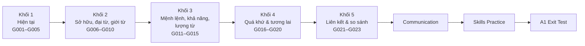

# 💬 A1 Beginner — Người giao tiếp cơ bản

> **Milestone 2: Basic Communicator.** Ở A1, bạn chuyển từ "biết câu" sang "dùng câu": nói về thói quen, việc đang làm, những gì đã xảy ra và kế hoạch sắp tới; hỏi đường, gọi món, mua sắm, mời và nhận lời mời.

## 1. Bạn sẽ làm được gì sau A1?

- Nói và viết về **thói quen hằng ngày** (hiện tại đơn) và **việc đang diễn ra** (hiện tại tiếp diễn).
- Kể lại **cuối tuần, kỳ nghỉ** bằng quá khứ đơn.
- Nói về **kế hoạch và dự đoán** với *will* và *be going to*.
- Mô tả **vị trí, thời gian** bằng giới từ chính xác.
- **So sánh** hai hoặc nhiều lựa chọn.
- Xử lý các tình huống giao tiếp cơ bản: quán ăn, cửa hàng, khách sạn, hỏi đường, điện thoại.

## 2. Lộ trình 5 khối

## 3. Danh sách bài học và checklist tiến độ

| Bài | Chủ đề | Đọc & hiểu | Bài tập | Sửa lỗi | Ôn ngày 1 | Ôn ngày 3 | Ôn ngày 7 |
|---|---|---|---|---|---|---|---|
| [A1-G001](grammar/A1-G001-present-simple-affirmative.md) | Present Simple (+) | [ ] | [ ] | [ ] | [ ] | [ ] | [ ] |
| [A1-G002](grammar/A1-G002-present-simple-negatives-questions.md) | Present Simple (–/?) | [ ] | [ ] | [ ] | [ ] | [ ] | [ ] |
| [A1-G003](grammar/A1-G003-adverbs-of-frequency.md) | Adverbs of Frequency | [ ] | [ ] | [ ] | [ ] | [ ] | [ ] |
| [A1-G004](grammar/A1-G004-present-continuous.md) | Present Continuous | [ ] | [ ] | [ ] | [ ] | [ ] | [ ] |
| [A1-G005](grammar/A1-G005-present-simple-vs-continuous.md) | Simple vs Continuous | [ ] | [ ] | [ ] | [ ] | [ ] | [ ] |
| [A1-G006](grammar/A1-G006-possessives.md) | Possessives | [ ] | [ ] | [ ] | [ ] | [ ] | [ ] |
| [A1-G007](grammar/A1-G007-object-pronouns.md) | Object Pronouns | [ ] | [ ] | [ ] | [ ] | [ ] | [ ] |
| [A1-G008](grammar/A1-G008-have-got.md) | Have Got | [ ] | [ ] | [ ] | [ ] | [ ] | [ ] |
| [A1-G009](grammar/A1-G009-prepositions-of-place.md) | Prepositions of Place | [ ] | [ ] | [ ] | [ ] | [ ] | [ ] |
| [A1-G010](grammar/A1-G010-prepositions-of-time.md) | Prepositions of Time | [ ] | [ ] | [ ] | [ ] | [ ] | [ ] |
| [A1-G011](grammar/A1-G011-imperatives.md) | Imperatives | [ ] | [ ] | [ ] | [ ] | [ ] | [ ] |
| [A1-G012](grammar/A1-G012-can-cant.md) | Can / Can't | [ ] | [ ] | [ ] | [ ] | [ ] | [ ] |
| [A1-G013](grammar/A1-G013-would-like.md) | Would Like | [ ] | [ ] | [ ] | [ ] | [ ] | [ ] |
| [A1-G014](grammar/A1-G014-some-any.md) | Some / Any | [ ] | [ ] | [ ] | [ ] | [ ] | [ ] |
| [A1-G015](grammar/A1-G015-much-many-a-lot-of.md) | Much / Many / A lot of | [ ] | [ ] | [ ] | [ ] | [ ] | [ ] |
| [A1-G016](grammar/A1-G016-past-simple-be.md) | Was / Were | [ ] | [ ] | [ ] | [ ] | [ ] | [ ] |
| [A1-G017](grammar/A1-G017-past-simple-affirmative.md) | Past Simple (+) | [ ] | [ ] | [ ] | [ ] | [ ] | [ ] |
| [A1-G018](grammar/A1-G018-past-simple-negatives-questions.md) | Past Simple (–/?) | [ ] | [ ] | [ ] | [ ] | [ ] | [ ] |
| [A1-G019](grammar/A1-G019-future-will.md) | Will | [ ] | [ ] | [ ] | [ ] | [ ] | [ ] |
| [A1-G020](grammar/A1-G020-be-going-to.md) | Be Going To | [ ] | [ ] | [ ] | [ ] | [ ] | [ ] |
| [A1-G021](grammar/A1-G021-basic-conjunctions.md) | Conjunctions | [ ] | [ ] | [ ] | [ ] | [ ] | [ ] |
| [A1-G022](grammar/A1-G022-comparatives.md) | Comparatives | [ ] | [ ] | [ ] | [ ] | [ ] | [ ] |
| [A1-G023](grammar/A1-G023-superlatives.md) | Superlatives | [ ] | [ ] | [ ] | [ ] | [ ] | [ ] |

Giao tiếp & kỹ năng: [A1 Communication](A1-COMMUNICATION.md) [ ] · [A1 Skills Practice](A1-SKILLS-PRACTICE.md) — [ ] Listening · [ ] Reading · [ ] Speaking · [ ] Writing

## 4. Học song song

| Khối | Từ vựng | Phát âm |
|---|---|---|
| 1 | [VOC-01 Daily Life](../07-VOCABULARY/VOC-01-daily-life.md) | Đuôi *-s/-es* — [PRON-02](../08-PRONUNCIATION/PRON-02-vowels-consonants.md) |
| 2 | [VOC-02 Family](../07-VOCABULARY/VOC-02-family-relationships.md) | [PRON-03 Minimal Pairs](../08-PRONUNCIATION/PRON-03-minimal-pairs.md) |
| 3 | [VOC-06 Food & Health](../07-VOCABULARY/VOC-06-food-health.md), [VOC-07 Shopping & Money](../07-VOCABULARY/VOC-07-shopping-money.md) | *can/can't* — [PRON-08 Weak Forms](../08-PRONUNCIATION/PRON-08-weak-forms.md) |
| 4 | [VOC-05 Travel & Transportation](../07-VOCABULARY/VOC-05-travel-transportation.md) | Đuôi *-ed* — [PRON-02](../08-PRONUNCIATION/PRON-02-vowels-consonants.md) |
| 5 | Ôn tập từ vựng khối 1–4 | [PRON-04 Word Stress](../08-PRONUNCIATION/PRON-04-word-stress.md) |

## 5. Mini Challenges

- [ ] **Challenge 1 — My Daily Routine** (sau khối 1): Ghi âm 1 phút mô tả một ngày điển hình của bạn và một ngày "khác thường" (hôm nay bạn đang làm gì khác). Viết lại thành đoạn văn 80–100 từ.
- [ ] **Challenge 2 — Home Tour** (sau khối 2): Mô tả nhà bạn: phòng nào, ở tầng mấy, đồ vật ở đâu, của ai. Dùng ≥ 8 giới từ và ≥ 5 hình thức sở hữu.
- [ ] **Challenge 3 — At the Café** (sau khối 3): Tự đóng vai cả khách và nhân viên: gọi 3 món, hỏi giá, hỏi có món nào không (*any*), xin thêm (*some more*), từ chối lời mời (*No, thank you*).
- [ ] **Challenge 4 — Last Weekend, Next Weekend** (sau khối 4): Nói 2 phút: 1 phút về cuối tuần trước, 1 phút về kế hoạch cuối tuần tới.
- [ ] **Challenge 5 — Two Cities** (sau khối 5): Viết 100–120 từ so sánh hai thành phố bạn biết, dùng *and, but, so, because*, so sánh hơn và so sánh nhất.

## 6. Điều kiện hoàn thành A1

- [ ] Hoàn thành 23 bài ngữ pháp.
- [ ] Hoàn thành [A1 Communication](A1-COMMUNICATION.md) và [A1 Skills Practice](A1-SKILLS-PRACTICE.md).
- [ ] Hoàn thành 5 Mini Challenges.
- [ ] Đạt **≥ 70%** tổng điểm, **≥ 60%** mỗi phần và Writing/Speaking đạt mức "Đạt" trong [A1 Exit Test](../11-EXAMS-AND-ASSESSMENTS/A1-EXIT-TEST.md).

➡️ Sau khi đạt: chuyển sang [03-A2-ELEMENTARY](../03-A2-ELEMENTARY/README.md).
