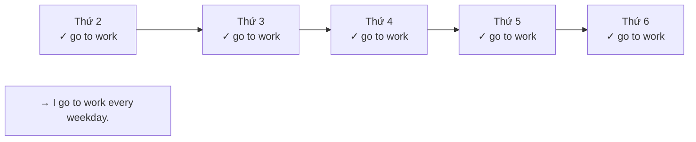
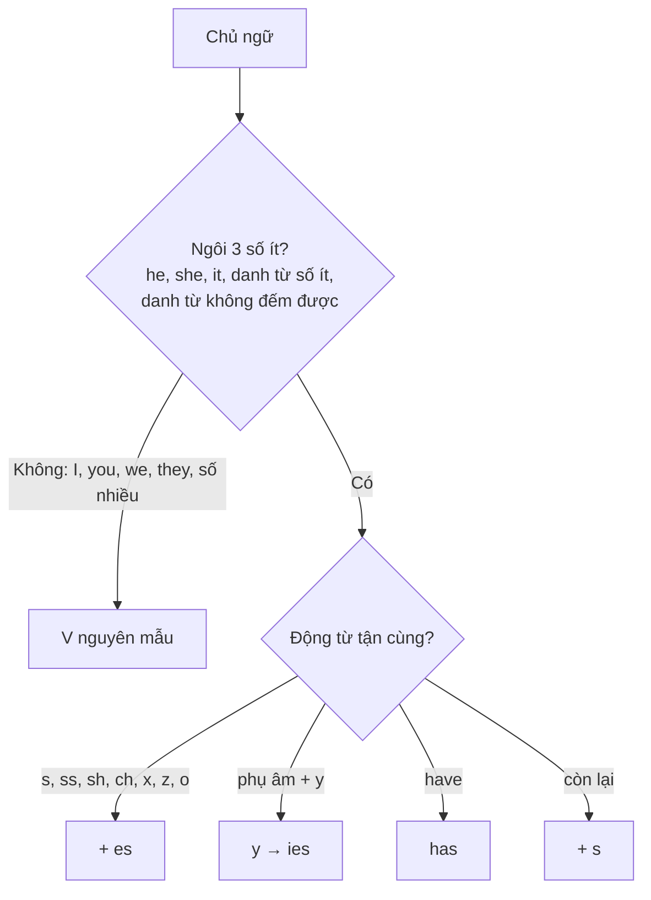

# A1-G001 · Present Simple: Affirmative — Thì hiện tại đơn: câu khẳng định

## Mục lục

- [A. Lesson Information](#a-lesson-information)
- [B. Warm-up](#b-warm-up-tình-huống-thực-tế)
- [C. WHAT](#c-what-thì-hiện-tại-đơn-là-gì)
- [D. WHY](#d-why-bản-chất-của-hiện-tại-đơn)
- [E. FORM](#e-form-công-thức-và-quy-tắc-chính-tả)
- [F. HOW](#f-how-5-cách-dùng-chính)
- [G. VISUAL](#g-visual-explanation)
- [H. COMPARISON](#h-comparison)
- [I. COMMON MISTAKES](#i-common-mistakes)
- [J. MEMORY TRICKS](#j-memory-tricks)
- [K. REAL-LIFE APPLICATION](#k-real-life-application)
- [L. PRACTICE EXERCISES](#l-practice-exercises)
- [M. KNOWLEDGE CHECK](#m-knowledge-check)
- [N. ANSWER KEY](#n-answer-key)

---

## A. Lesson Information

| Mục | Nội dung |
|---|---|
| **Lesson ID** | A1-G001 |
| **Topic** | Present Simple — Affirmative |
| **Tên tiếng Việt** | Thì hiện tại đơn — câu khẳng định |
| **CEFR Level** | A1 |
| **Prerequisites** | [A0-G016 — Sentence Types](../../01-A0-FOUNDATION/grammar/A0-G016-sentence-types.md), [A0-G010 — Have/Has](../../01-A0-FOUNDATION/grammar/A0-G010-have-has.md) |
| **Estimated Time** | 90 phút |

**Learning Objectives:**

1. Hiểu thì hiện tại đơn diễn tả **thói quen, sự thật, trạng thái lâu dài, lịch trình**.
2. Chia động từ đúng: **V** (I/you/we/they) và **V-s/es** (he/she/it).
3. Áp dụng đúng quy tắc chính tả *-s, -es, -ies* và các động từ đặc biệt *have → has, go → goes, do → does*.
4. Phát âm đúng đuôi *-s/-es*: /s/, /z/, /ɪz/.
5. Dùng các cụm thời gian đi kèm: *every day, on Mondays, at weekends, in the morning*.

---

## B. Warm-up: Tình huống thực tế

Hôm nay là thứ Bảy. Bạn đang nằm nhà xem phim. Một người bạn gọi điện hỏi về công việc của bạn. Bạn nói:

> "Tôi làm việc ở ngân hàng. Tôi đi làm lúc 7 giờ sáng, từ thứ Hai đến thứ Sáu."

Lúc này bạn **không** ở ngân hàng, **không** đang đi làm. Vậy mà bạn vẫn nói "Tôi làm việc ở ngân hàng" — và câu đó hoàn toàn đúng.

🤔 **Hãy suy nghĩ:** Câu "Tôi làm việc ở ngân hàng" đang nói về **thời điểm này** hay về **một sự thật chung, lặp đi lặp lại** trong cuộc sống của bạn? Tiếng Anh sẽ diễn đạt câu này thế nào — và có khác với câu "Bây giờ tôi đang xem phim" không?

---

## C. WHAT: Thì hiện tại đơn là gì?

**Thì hiện tại đơn (Present Simple)** dùng để nói về những điều **"nói chung là đúng"** ở hiện tại — không gắn với một khoảnh khắc cụ thể:

- Những việc **lặp đi lặp lại**: thói quen, công việc hằng ngày.
- Những điều **luôn đúng**: sự thật, quy luật tự nhiên.
- Những **trạng thái lâu dài**: nơi sống, công việc, sở thích, cảm xúc ổn định.

Khi bạn nói *I **work** in a bank*, bạn đang mô tả **cuộc sống của bạn**, không mô tả **việc bạn làm ngay lúc nói**. Có thể lúc đó bạn đang ngủ, đang ăn — câu vẫn đúng.

**Khi nào KHÔNG dùng?** Khi nói về việc **đang diễn ra ngay lúc nói** (*Bây giờ tôi đang xem phim*) — dùng thì hiện tại tiếp diễn [A1-G004](A1-G004-present-continuous.md).

---

## D. WHY: Bản chất của hiện tại đơn

Hãy hình dung hiện tại đơn như một **tấm ảnh chụp "cuộc sống thường ngày"** của ai đó — không phải một video quay một khoảnh khắc.



Những việc lặp lại nhiều lần trong quá khứ, hiện tại và (có lẽ) tương lai → được "tóm gọn" thành **một câu hiện tại đơn**.

**Vì sao ngôi thứ ba số ít lại thêm *-s*?** Đây là phần còn sót lại từ tiếng Anh cổ, khi động từ thay đổi theo mọi ngôi. Ngày nay chỉ còn lại *-s* cho *he/she/it*. Nó không có lý do logic về nghĩa — đơn giản là quy tắc hòa hợp chủ ngữ – động từ (*subject–verb agreement*) bạn **phải** tuân theo. Người bản ngữ nghe *she work* sẽ thấy "lệch" ngay, giống bạn nghe ai đó nói "tôi ăn cơm rồi chưa".

---

## E. FORM: Công thức và quy tắc chính tả

### E1. Công thức khẳng định

| Chủ ngữ | Công thức | Ví dụ |
|---|---|---|
| I / You / We / They / danh từ số nhiều | **S + V** (nguyên mẫu) | *They **live** in Hue.* |
| He / She / It / danh từ số ít / danh từ không đếm được | **S + V-s/es** | *She **lives** in Hue.* |

**Ký hiệu:**

- **V** = động từ nguyên mẫu (base form), dạng có trong từ điển: *work, go, study*.
- **V-s/es** = động từ thêm *-s* hoặc *-es* (hoặc *-ies*) theo quy tắc chính tả.
- **Third person singular** (ngôi thứ ba số ít): *he, she, it* và mọi danh từ số ít (*my father, the dog, Lan*), danh từ không đếm được (*water, time*), *everyone/somebody/nobody*.

### E2. Quy tắc chính tả thêm *-s/-es*

| Quy tắc | Ví dụ |
|---|---|
| Thông thường: + **s** | work → work**s**, play → play**s**, read → read**s** |
| Tận cùng *-s, -ss, -sh, -ch, -x, -z, -o*: + **es** | miss → miss**es**, wash → wash**es**, watch → watch**es**, fix → fix**es**, go → go**es**, do → do**es** |
| Phụ âm + *y*: *y* → **ies** | study → stud**ies**, fly → fl**ies**, cry → cr**ies** |
| Nguyên âm + *y*: + **s** | play → play**s**, buy → buy**s**, enjoy → enjoy**s** |
| Bất quy tắc | **have → has** |

### E3. Phát âm đuôi *-s/-es* (giống danh từ số nhiều ở [A0-G013](../../01-A0-FOUNDATION/grammar/A0-G013-singular-plural-nouns.md))

| Âm cuối của động từ | Đọc | Ví dụ |
|---|---|---|
| Vô thanh /p, t, k, f, θ/ | /s/ | works, stops, laughs |
| Hữu thanh & nguyên âm | /z/ | plays, lives, reads, goes |
| /s, z, ʃ, tʃ, dʒ/ | /ɪz/ | watches, washes, uses, changes |

Đặc biệt: **does** /dʌz/ (không phải /duːz/), **says** /sez/ (không phải /seɪz/), **has** /hæz/.

### E4. Cụm từ chỉ thời gian thường đi kèm

| Nhóm | Ví dụ |
|---|---|
| *every* + thời gian | every day, every morning, every week, every summer |
| *on* + thứ (số nhiều) | on Mondays, on Sundays |
| *at* + thời điểm | at weekends (Anh) / on weekends (Mỹ), at night, at 7 o'clock |
| *in* + buổi | in the morning, in the evening |
| Số lần | once a week, twice a month, three times a year |
| Trạng từ tần suất | always, usually, often, sometimes, never → [A1-G003](A1-G003-adverbs-of-frequency.md) |

---

## F. HOW: 5 cách dùng chính

### Cách dùng 1 — Thói quen, hoạt động lặp lại (habits & routines)

| # | English | Tiếng Việt | Phân tích |
|---|---|---|---|
| 1 | *I **get up** at 6 every morning.* | Sáng nào tôi cũng dậy lúc 6 giờ. | I + V; *every morning* → lặp lại |
| 2 | *My mother **goes** to the market on Sundays.* | Mẹ tôi đi chợ vào các ngày Chủ nhật. | *go → goes*; *on Sundays* = mỗi Chủ nhật |
| 3 | *He **plays** badminton twice a week.* | Anh ấy chơi cầu lông hai lần một tuần. | Nguyên âm + *y* → *plays* |

### Cách dùng 2 — Sự thật, quy luật (facts & general truths)

| # | English | Tiếng Việt | Phân tích |
|---|---|---|---|
| 4 | *Water **boils** at 100°C.* | Nước sôi ở 100 độ C. | *Water* (không đếm được) → V-s |
| 5 | *The sun **rises** in the east.* | Mặt trời mọc ở phía đông. | Luôn đúng |
| 6 | *Vietnamese people **eat** rice every day.* | Người Việt ăn cơm hằng ngày. | Sự thật chung về một nhóm người |

### Cách dùng 3 — Trạng thái lâu dài (permanent situations)

| # | English | Tiếng Việt | Phân tích |
|---|---|---|---|
| 7 | *My sister **works** for a bank.* | Chị tôi làm cho một ngân hàng. | Công việc ổn định |
| 8 | *They **live** in Da Nang.* | Họ sống ở Đà Nẵng. | Nơi sống lâu dài |

### Cách dùng 4 — Cảm xúc, suy nghĩ, sở hữu (state verbs)

| # | English | Tiếng Việt | Phân tích |
|---|---|---|---|
| 9 | *She **loves** Korean dramas.* | Cô ấy mê phim Hàn. | *love, like, hate, want, need, know, understand* thường dùng hiện tại đơn |
| 10 | *I **know** the answer.* | Tôi biết câu trả lời. | Không nói *I am knowing* |

### Cách dùng 5 — Lịch trình, thời gian biểu (timetables)

| # | English | Tiếng Việt | Phân tích |
|---|---|---|---|
| 11 | *The train **leaves** at 8:15.* | Tàu chạy lúc 8 giờ 15. | Lịch cố định, kể cả trong tương lai |
| 12 | *The museum **opens** at 9 a.m.* | Bảo tàng mở cửa lúc 9 giờ sáng. | Giờ mở cửa |

> 💡 Cách dùng 5 nói về **tương lai** (*Tomorrow the train leaves at 8:15*) nhưng vẫn dùng hiện tại đơn vì lịch trình là cố định. Bạn sẽ ôn lại điều này khi học các cách nói tương lai ở [A2-G008](../../03-A2-ELEMENTARY/grammar/A2-G008-present-continuous-future.md).

---

## G. VISUAL EXPLANATION

### G1. Timeline

```text
Quá khứ ──────────── HIỆN TẠI ──────────── Tương lai
   ✕      ✕      ✕      ✕      ✕      ✕      ✕
 (đi làm)(đi làm)(đi làm) (đi làm) (đi làm)...
            "I go to work every day."
   → Không phải một điểm, mà là một chuỗi lặp lại bao quanh hiện tại.
```

### G2. Sentence breakdown

`My brother | watches | football | on TV | every weekend.`

| Phần | Vai trò | Ghi chú |
|---|---|---|
| My brother | S — ngôi 3 số ít | → động từ phải có *-s/-es* |
| **watches** | V | *watch* tận cùng *-ch* → **-es**, đọc /ɪz/ |
| football | O | |
| on TV | Phương tiện | |
| every weekend | Thời gian lặp lại | Dấu hiệu hiện tại đơn |

### G3. Sơ đồ quyết định *-s* hay không



---

## H. COMPARISON

### *Be* và động từ thường ở hiện tại đơn

| | *Be* | Động từ thường |
|---|---|---|
| Ngôi 3 số ít | *She **is** a teacher.* | *She **teaches** English.* |
| Ngôi khác | *They **are** teachers.* | *They **teach** English.* |
| ❌ Lỗi trộn | ~~She is teaches~~ | ~~She is teach~~ |

Cả hai câu *She is a teacher* và *She teaches English* đều là hiện tại đơn, chỉ khác "gia đình" động từ ([A0-G016](../../01-A0-FOUNDATION/grammar/A0-G016-sentence-types.md)).

### Hiện tại đơn và hiện tại tiếp diễn (xem trước)

| Hiện tại đơn | Hiện tại tiếp diễn |
|---|---|
| Thói quen, sự thật, lâu dài | Đang diễn ra lúc nói, tạm thời |
| *I **drink** coffee every morning.* | *I'**m drinking** coffee now.* |

So sánh đầy đủ ở [A1-G005](A1-G005-present-simple-vs-continuous.md).

---

## I. COMMON MISTAKES

| # | ❌ Sai | ✅ Đúng | Nguyên nhân | Cách tránh |
|---|---|---|---|---|
| 1 | My father **work** in a factory. | My father **works** in a factory. | Tiếng Việt không chia động từ | Chủ ngữ là một người khác (không phải *I/you*) → kiểm tra *-s* |
| 2 | I **works** every day. | I **work** every day. | Thêm *-s* sai chỗ | *-s* chỉ dành cho ngôi 3 số ít |
| 3 | She **is work** in a hospital. | She **works** in a hospital. | Nghĩ *is* là dấu hiệu hiện tại | Không dùng *be* + V nguyên mẫu |
| 4 | He **studys** English. | He **studies** English. | Quên quy tắc *-ies* | Phụ âm + *y* → *ies* |
| 5 | She **haves** a cat. | She **has** a cat. | Áp quy tắc chung | *have → has* |
| 6 | He **gos** / **dos** | He **goes** / **does** | | Tận cùng *-o* → *-es* |
| 7 | My parents **lives** in Hue. | My parents **live** in Hue. | Nghĩ chủ ngữ "là một gia đình" | *parents* số nhiều → không *-s* |
| 8 | Đọc *watches* như *watch* | /ˈwɒtʃɪz/ — thêm âm tiết | Bỏ âm cuối | Sau /tʃ, ʃ, s/ đọc /ɪz/ |

---

## J. MEMORY TRICKS

1. **"He, She, It — thêm S cho đúng"**: Câu vần giúp nhớ ngôi 3 số ít luôn có *-s*.
2. **"Một chữ S cho một chủ ngữ"**: Danh từ số ít không có *-s* → động từ có *-s* (*The dog barks*). Danh từ số nhiều có *-s* → động từ không *-s* (*The dogs bark*). Chữ *s* "đi" một lần trong cặp chủ ngữ – động từ. ⚠️ Mẹo hỗ trợ — không áp dụng cho danh từ số nhiều bất quy tắc (*children play*) hay *I/you*.
3. **"Ảnh chụp cuộc sống"**: Nếu câu của bạn có thể bắt đầu bằng "Thường thì..." hoặc "Nói chung..." → hiện tại đơn.

---

## K. REAL-LIFE APPLICATION

### Bài đọc: A day in the life of a nurse

> *Thuy **is** a nurse in Bach Mai Hospital. She **works** from Monday to Friday. Every day, she **gets up** at five o'clock and **has** a quick breakfast. She **takes** the bus to work because the traffic **is** terrible in the morning. Her shift **starts** at six. She **checks** patients, **gives** them medicine and **talks** to their families. She **finishes** work at two and **goes** home. In the afternoon, she **sleeps** for an hour. Then she **cooks** dinner for her husband and her son. Thuy **loves** her job, but she **says** it **is** very tiring.*

**Vietnamese explanation:** Thủy là y tá ở bệnh viện Bạch Mai, làm từ thứ Hai đến thứ Sáu. Mỗi ngày cô dậy lúc 5 giờ, ăn sáng nhanh, bắt xe buýt đi làm vì buổi sáng tắc đường. Ca làm bắt đầu lúc 6 giờ: kiểm tra bệnh nhân, cho thuốc, nói chuyện với người nhà. Cô tan làm lúc 2 giờ, về nhà ngủ một tiếng rồi nấu bữa tối. Thủy yêu công việc nhưng nói rằng nó rất mệt.

**Grammar highlights:**

| Quy tắc | Ví dụ trong bài |
|---|---|
| + s | works, gets up, takes, starts, checks, gives, talks, sleeps, cooks, loves |
| + es | finishes, goes |
| have → has | has a quick breakfast |
| Phát âm đặc biệt | says /sez/ |
| *be* | is a nurse, the traffic is terrible, it is very tiring |

**Useful expressions:** *from Monday to Friday* · *take the bus* · *the traffic is terrible* · *finish work* · *a tiring job*.

---

## L. PRACTICE EXERCISES

> ✍️ Đáp án: [A1-G001-ANSWERS](../../12-ANSWERS-AND-EXPLANATIONS/A1/A1-G001-ANSWERS.md)

### Level 1 — Recognition

Chọn dạng đúng.

**L1.1.** My grandmother ___ tea every afternoon.  A. drink  B. drinks  C. is drink
**L1.2.** We ___ in a small flat.  A. live  B. lives  C. are live
**L1.3.** The shop ___ at 10 p.m.  A. close  B. closes  C. closies
**L1.4.** My son ___ maths very hard.  A. studys  B. studies  C. study
**L1.5.** Câu nào diễn tả **sự thật**?  A. I'm cooking dinner.  B. Cats sleep a lot.  C. Look! The cat is sleeping.
**L1.6.** Đuôi *-es* trong *washes* đọc là:  A. /s/  B. /z/  C. /ɪz/

### Level 2 — Controlled Practice

Chia động từ trong ngoặc.

**L2.1.** Nam (watch) ___ TV after dinner.
**L2.2.** My parents (go) ___ for a walk every evening.
**L2.3.** The baby (cry) ___ at night.
**L2.4.** Linh (have) ___ two dogs.
**L2.5.** The film (start) ___ at 8:30.
**L2.6.** My brother (fix) ___ computers.
**L2.7.** Everybody (love) ___ her cooking.
**L2.8.** I (enjoy) ___ walking in the rain.
**L2.9.** It (rain) ___ a lot in Hue in October.
**L2.10.** Mr Long (teach) ___ history at my school.

### Level 3 — Error Correction

**L3.1.** My father work in a car factory.
**L3.2.** She is speaks three languages.
**L3.3.** He studys at night.
**L3.4.** The children plays in the park after school.
**L3.5.** My aunt haves a beautiful garden.
**L3.6.** I gets up at six o'clock.

### Level 4 — Production

Dịch sang tiếng Anh:

**L4.1.** Em trai tôi đi học bằng xe đạp.
**L4.2.** Cửa hàng này mở cửa lúc 7 giờ sáng.
**L4.3.** Chị gái tôi làm việc cho một công ty du lịch.
**L4.4.** Mặt trời lặn ở phía tây. (*set*)

Viết lại đoạn văn, đổi chủ ngữ từ *I* thành *My sister*:

**L4.5.** *I get up at 6:30. I have a shower and I make coffee. I go to work by bus. I finish work at 5 and I watch TV in the evening.*

### Level 5 — Real Communication

**L5.1.** Viết đoạn văn 80–100 từ: *A day in the life of someone I know* (bố, mẹ, bạn thân, đồng nghiệp...). Dùng ít nhất 10 động từ khác nhau ở ngôi 3 số ít.
**L5.2.** **Speaking — Describe your daily routine:** Nói 1 phút về một ngày làm việc/học tập điển hình của bạn, từ lúc thức dậy đến lúc đi ngủ.

---

## M. KNOWLEDGE CHECK

### 5 câu hỏi tự kiểm tra

1. Kể 5 cách dùng của thì hiện tại đơn.
2. Khi nào thêm *-es*, khi nào *-ies*?
3. Ngôi 3 số ít gồm những chủ ngữ nào? *Everybody* có phải không?
4. Vì sao *She is work* là sai?
5. Đọc *does* và *says* thế nào?

### Checklist

- [ ] Tôi chia đúng *-s/-es/-ies* trong 90% trường hợp.
- [ ] Tôi đọc rõ âm đuôi /s/, /z/, /ɪz/.
- [ ] Tôi mô tả được thói quen hằng ngày của mình và người khác.

### 3 lỗi quan trọng cần nhớ

1. ~~My father work~~ → My father **works**.
2. ~~She is work~~ → She **works**.
3. ~~studys / haves~~ → **studies / has**.

### Lịch ôn tập

| Ngày | Việc cần làm |
|---|---|
| Ngày 1 | Làm lại L2; viết 5 câu về thói quen của một người trong gia đình |
| Ngày 3 | Làm lại L4.5 với chủ ngữ *My parents* |
| Ngày 7 | Ghi âm lại L5.2; so sánh bản ghi âm đầu tiên |

### Liên kết

- ➡️ Bài tiếp theo: [A1-G002 — Present Simple: Negatives & Questions](A1-G002-present-simple-negatives-questions.md)
- 🔁 Tra cứu: [ALL-TENSES-COMPARISON](../../06-GRAMMAR-REFERENCE/ALL-TENSES-COMPARISON.md)
- 🔁 Từ vựng: [VOC-01 — Daily Life](../../07-VOCABULARY/VOC-01-daily-life.md)

---

## N. ANSWER KEY

👉 [A1-G001-ANSWERS.md](../../12-ANSWERS-AND-EXPLANATIONS/A1/A1-G001-ANSWERS.md)
