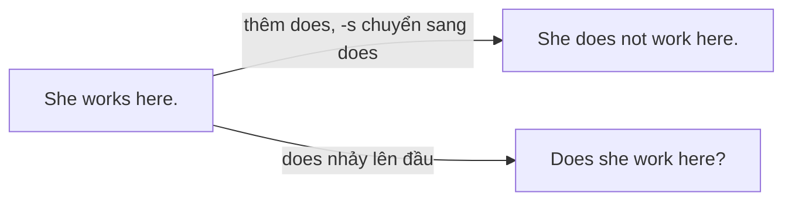

# A1-G002 · Present Simple: Negatives & Questions — Hiện tại đơn: phủ định và nghi vấn

## Mục lục

- [A. Lesson Information](#a-lesson-information)
- [B. Warm-up](#b-warm-up-tình-huống-thực-tế)
- [C. WHAT](#c-what-phủ-định-và-câu-hỏi-ở-hiện-tại-đơn)
- [D. WHY](#d-why-vai-trò-của-do-và-does)
- [E. FORM](#e-form-công-thức-đầy-đủ)
- [F. HOW](#f-how-cách-dùng-trong-giao-tiếp)
- [G. VISUAL](#g-visual-explanation)
- [H. COMPARISON](#h-comparison)
- [I. COMMON MISTAKES](#i-common-mistakes)
- [J. MEMORY TRICKS](#j-memory-tricks)
- [K. REAL-LIFE APPLICATION](#k-real-life-application)
- [L. PRACTICE EXERCISES](#l-practice-exercises)
- [M. KNOWLEDGE CHECK](#m-knowledge-check)
- [N. ANSWER KEY](#n-answer-key)

---

## A. Lesson Information

| Mục | Nội dung |
|---|---|
| **Lesson ID** | A1-G002 |
| **Topic** | Present Simple — Negatives, Yes/No Questions, Wh- Questions |
| **Tên tiếng Việt** | Hiện tại đơn — câu phủ định và câu hỏi |
| **CEFR Level** | A1 |
| **Prerequisites** | [A1-G001](A1-G001-present-simple-affirmative.md), [A0-G017 — Question Words](../../01-A0-FOUNDATION/grammar/A0-G017-question-words.md) |
| **Estimated Time** | 90 phút |

**Learning Objectives:**

1. Tạo câu phủ định với *don't / doesn't* + V nguyên mẫu với **mọi** động từ thường.
2. Tạo câu hỏi Yes/No và trả lời ngắn chính xác.
3. Tạo câu hỏi Wh- về thói quen, công việc, sở thích.
4. Phân biệt câu hỏi với *be* và với động từ thường trong cùng một cuộc hội thoại.
5. Dùng các câu hỏi giao tiếp cố định: *What does ... mean? How do you say...? What do you do?*

---

## B. Warm-up: Tình huống thực tế

Bạn đang trò chuyện với một đồng nghiệp người Úc trong giờ nghỉ trưa. Bạn muốn hỏi:

> 1. "Anh có uống cà phê không?"
> 2. "Vợ anh làm nghề gì?"
> 3. "Con anh có thích ăn đồ Việt không?"

Và trả lời câu hỏi của anh ấy: "Tôi không ăn thịt bò."

🤔 **Hãy suy nghĩ:** Ở [A0-G016](../../01-A0-FOUNDATION/grammar/A0-G016-sentence-types.md) bạn đã gặp *do/does* với *have* và *like*. Liệu mọi động từ thường (*drink, eat, work, speak...*) có hoạt động theo cùng một cơ chế không? Còn câu hỏi 2 — chủ ngữ là "vợ anh" (*your wife*) — sẽ dùng *do* hay *does*?

---

## C. WHAT: Phủ định và câu hỏi ở hiện tại đơn

Ở bài trước bạn đã học câu khẳng định. Bài này hoàn thiện thì hiện tại đơn với:

| Loại câu | Mục đích | Ví dụ |
|---|---|---|
| **Negative** (phủ định) | Nói rằng một thói quen/sự thật **không** đúng | *I **don't eat** beef.* |
| **Yes/No question** | Hỏi xem điều gì có đúng không | ***Do** you **drink** coffee?* |
| **Wh- question** | Hỏi thông tin cụ thể | *What **does** your wife **do**?* |
| **Short answer** | Trả lời ngắn, tự nhiên | *Yes, I **do**. / No, she **doesn't**.* |

Tin tốt: **mọi** động từ thường (*work, go, eat, speak, watch, study...*) đều dùng chung **một** cơ chế với *do/does* — bạn chỉ cần học một lần.

---

## D. WHY: Vai trò của *do* và *does*

Như bạn biết, động từ thường không tự đảo lên đầu câu hay tự gắn *not*. Chúng cần **trợ động từ** (auxiliary verb) *do/does*.

Điều thú vị: *does* **"lấy đi"** chữ *-s* của động từ chính. Thông tin "ngôi thứ ba số ít" chỉ cần thể hiện **một lần** trong câu:

| | Dấu hiệu ngôi 3 nằm ở đâu? |
|---|---|
| *She work**s** here.* | ở động từ chính |
| *She **does**n't work here.* | ở trợ động từ |
| ***Does** she work here?* | ở trợ động từ |

Vì vậy *She doesn't works* và *Does she works?* đều sai — dấu hiệu bị lặp hai lần.

---

## E. FORM: Công thức đầy đủ

**Ký hiệu:** **S** = chủ ngữ · **V** = động từ nguyên mẫu · **O** = tân ngữ · **Wh-** = từ để hỏi.

### E1. Phủ định

| Chủ ngữ | Đầy đủ | Rút gọn | Ví dụ |
|---|---|---|---|
| I / You / We / They / N số nhiều | S + **do not** + V | **don't** | *We **don't watch** TV.* |
| He / She / It / N số ít | S + **does not** + V | **doesn't** | *He **doesn't watch** TV.* |

### E2. Câu hỏi Yes/No và trả lời ngắn

| Chủ ngữ | Câu hỏi | Yes | No |
|---|---|---|---|
| I / you / we / they | **Do** + S + V? | Yes, S **do**. | No, S **don't**. |
| he / she / it | **Does** + S + V? | Yes, S **does**. | No, S **doesn't**. |

Ví dụ: ***Do** they **speak** English? — Yes, they **do**.* / ***Does** it **rain** much here? — No, it **doesn't**.*

### E3. Câu hỏi Wh-

**Wh- + do/does + S + V (+ O)?**

| Câu hỏi | Trả lời |
|---|---|
| *Where **do** you **work**?* | *In a hotel.* |
| *What time **does** the bank **open**?* | *At 8.* |
| *How often **do** they **visit** you?* | *Once a month.* |
| *Why **does** she **take** the bus?* | *Because she doesn't have a car.* |

### E4. Câu hỏi giao tiếp cố định (rất hữu ích)

| Câu hỏi | Nghĩa |
|---|---|
| *What **do** you **do**?* | Bạn làm nghề gì? |
| *What **does** "fluent" **mean**?* | "Fluent" nghĩa là gì? |
| *How **do** you **say** "cảm ơn" in English?* | "Cảm ơn" tiếng Anh nói thế nào? |
| *How **do** you **spell** that?* | Từ đó đánh vần thế nào? |
| *How **do** you **pronounce** this word?* | Từ này phát âm thế nào? |
| *What **do** you **think**?* | Bạn nghĩ sao? |

> 💡 Trong *What do you do?*, chữ *do* đầu tiên là **trợ động từ**, chữ *do* thứ hai là **động từ chính** (làm). Với *she*: *What **does** she **do**?*

---

## F. HOW: Cách dùng trong giao tiếp

| # | English | Tiếng Việt | Phân tích |
|---|---|---|---|
| 1 | *I **don't eat** beef.* | Tôi không ăn thịt bò. | Thói quen ăn uống — phủ định |
| 2 | *My husband **doesn't like** spicy food.* | Chồng tôi không thích đồ cay. | *My husband* = he → *doesn't* |
| 3 | ***Do** you **drink** coffee? — Yes, I **do**.* | Bạn có uống cà phê không? — Có. | Yes/No + trả lời ngắn |
| 4 | *What **does** your wife **do**? — She's an architect.* | Vợ anh làm nghề gì? — Cô ấy là kiến trúc sư. | Câu trả lời dùng *be* |
| 5 | ***Does** your son **like** Vietnamese food?* | Con anh có thích đồ ăn Việt không? | *your son* = he |
| 6 | *Where **do** your parents **live**?* | Bố mẹ bạn sống ở đâu? | *parents* số nhiều → *do* |
| 7 | *This printer **doesn't work**.* | Máy in này không hoạt động. | *work* = hoạt động (máy móc) |
| 8 | *How **do** you **get** to work?* | Bạn đi làm bằng gì? | *get to* = đến (nơi nào) |
| 9 | *What time **does** the last bus **leave**?* | Chuyến xe buýt cuối rời đi lúc mấy giờ? | Lịch trình |
| 10 | *We **don't work** on Saturdays.* | Chúng tôi không làm việc vào thứ Bảy. | |
| 11 | *What **does** "deadline" **mean**?* | "Deadline" nghĩa là gì? | Câu hỏi học ngôn ngữ |
| 12 | *"**Do** you **know** Mr Brown?" — "No, I **don't**. Who is he?"* | | Trộn gia đình 2 (*Do you know*) và gia đình 1 (*Who is he*) |

---

## G. VISUAL EXPLANATION

### G1. Bảng tổng hợp thì hiện tại đơn (động từ thường)

| | I / you / we / they | he / she / it |
|---|---|---|
| ➕ | I **work**. | She **works**. |
| ➖ | I **don't work**. | She **doesn't work**. |
| ❓ | **Do** you **work**? | **Does** she **work**? |
| 💬 | Yes, I **do**. / No, I **don't**. | Yes, she **does**. / No, she **doesn't**. |
| Wh- | Where **do** you **work**? | Where **does** she **work**? |

### G2. Trật tự câu hỏi Wh- (QUASI)

| Question word | Auxiliary | Subject | Infinitive | Rest |
|---|---|---|---|---|
| Where | do | you | live | ? |
| What time | does | the film | start | ? |
| How often | do | your parents | call | you? |
| Why | does | he | look | so tired? |

---

## H. COMPARISON

### Câu hỏi với *be* và với động từ thường

| Gia đình *be* | Gia đình động từ thường |
|---|---|
| *Where **are** you from?* | *Where **do** you **live**?* |
| ***Is** she a doctor?* | ***Does** she **work** in a hospital?* |
| *What **is** your job?* | *What **do** you **do**?* |
| *How old **is** he?* | *How many children **does** he **have**?* |

**Quy tắc ra quyết định:** Tìm động từ chính trong câu trả lời bạn mong đợi. Nếu là *am/is/are* → hỏi bằng *be*. Nếu là động từ khác → hỏi bằng *do/does*.

### *don't* và *doesn't* với chủ ngữ "khó"

| Chủ ngữ | Số | Trợ động từ |
|---|---|---|
| *My family* | số ít (thường) | *doesn't* |
| *My friends* | số nhiều | *don't* |
| *Everyone / Nobody* | số ít | *doesn't* — nhưng *Nobody* đã phủ định nên dùng khẳng định: *Nobody **knows**.* |
| *People* | số nhiều | *don't* |
| *The police* | số nhiều | *don't* |
| *Lan and her sister* | số nhiều | *don't* |

---

## I. COMMON MISTAKES

| # | ❌ Sai | ✅ Đúng | Nguyên nhân | Cách tránh |
|---|---|---|---|---|
| 1 | She **doesn't likes** fish. | She **doesn't like** fish. | Lặp dấu hiệu ngôi 3 | *does* đã "mang" *-s* |
| 2 | **Does** he **works** here? | **Does** he **work** here? | Như trên | |
| 3 | He **don't** like fish. | He **doesn't** like fish. | Dùng *don't* cho mọi ngôi | *he/she/it* → *doesn't* |
| 4 | Where you work? | Where **do** you work? | Quên trợ động từ | QUASI |
| 5 | **Are** you work here? | **Do** you work here? | Trộn *be* | Động từ thường → *do* |
| 6 | I **not** eat meat. | I **don't** eat meat. | Dịch "không" thành *not* | *not* cần *do* đi kèm |
| 7 | What **means** "deadline"? | What **does** "deadline" **mean**? | Giữ trật tự câu kể | |
| 8 | "Do you like it?" – "Yes, I **like**." | "Yes, I **do**." | Trả lời bằng động từ chính | Trả lời ngắn dùng *do/does* |
| 9 | What **do** your sister **do**? | What **does** your sister **do**? | Không để ý chủ ngữ ngôi 3 | Xác định chủ ngữ trước khi chọn *do/does* |

---

## J. MEMORY TRICKS

1. **"Does là kẻ ăn chữ S"**: Khi *does/doesn't* xuất hiện, động từ chính **luôn** trần trụi (nguyên mẫu).
2. **"Hỏi thì gọi trợ thủ"**: Động từ thường không tự hỏi được — luôn gọi *Do/Does* lên đầu câu.
3. **Câu hỏi "khóa" cho người học ngôn ngữ**: Thuộc lòng 4 câu *What does ... mean? / How do you say ...? / How do you spell ...? / How do you pronounce ...?* — bạn sẽ dùng chúng hằng ngày, và chúng luyện luôn cấu trúc *do/does*.

---

## K. REAL-LIFE APPLICATION

### Hội thoại: Giờ nghỉ trưa với đồng nghiệp

> **Minh:** **Do** you **drink** coffee, Jack?
> **Jack:** Yes, I **do**. But I **don't drink** it after 3 p.m. — I can't sleep!
> **Minh:** Ha ha. So, what **does** your wife **do**?
> **Jack:** She's a nurse. She **works** at an international hospital.
> **Minh:** Oh, nice. **Does** she **speak** Vietnamese?
> **Jack:** A little. She **understands** a lot, but she **doesn't speak** very well.
> **Minh:** And your kids? **Do** they **like** Vietnamese food?
> **Jack:** My daughter **loves** it, but my son **doesn't**. He only **eats** pizza and fried rice!
> **Minh:** Typical! By the way, what **does** "typical" **mean** exactly? I **hear** it a lot.
> **Jack:** It **means** "very normal, as you expect".

**Vietnamese explanation:** Minh và Jack nói chuyện giờ nghỉ trưa: Jack uống cà phê nhưng không uống sau 3 giờ chiều; vợ Jack là y tá ở bệnh viện quốc tế, hiểu tiếng Việt nhiều nhưng nói chưa giỏi; con gái thích đồ ăn Việt, con trai thì không. Minh hỏi nghĩa của từ *typical*.

**Grammar highlights:** *Do you drink...? / What does your wife do? / Does she speak...? / doesn't speak / Do they like...? / my son doesn't (like it) / What does "typical" mean?*

**Useful expressions:**
- *I can't sleep!* — Tôi không ngủ được!
- *A little.* — Một chút.
- *Typical!* — Đúng kiểu! / Biết ngay mà!
- *By the way* — Nhân tiện

---

## L. PRACTICE EXERCISES

> ✍️ Đáp án: [A1-G002-ANSWERS](../../12-ANSWERS-AND-EXPLANATIONS/A1/A1-G002-ANSWERS.md)

### Level 1 — Recognition

**L1.1.** My boss ___ like long meetings.  A. don't  B. doesn't  C. isn't
**L1.2.** ___ your children go to school by bus?  A. Does  B. Do  C. Are
**L1.3.** What time ___ the post office close?  A. do  B. is  C. does
**L1.4.** "Does Lan work on Saturdays?" – "No, she ___."  A. don't  B. doesn't  C. isn't
**L1.5.** Which question is correct?  A. What means this word?  B. What does this word mean?  C. What does this word means?
**L1.6.** Which question is correct?  A. Are you live near here?  B. Do you live near here?  C. Do you living near here?

### Level 2 — Controlled Practice

Viết câu phủ định.

**L2.1.** I eat breakfast every day. → ______
**L2.2.** My brother plays the piano. → ______
**L2.3.** The shop opens on Sundays. → ______

Viết câu hỏi Yes/No và trả lời ngắn theo gợi ý.

**L2.4.** (you / speak / French?) — No, ...
**L2.5.** (your father / smoke?) — Yes, ...
**L2.6.** (they / live / in an apartment?) — Yes, ...

Viết câu hỏi Wh- cho phần **in đậm**.

**L2.7.** She goes to the gym **three times a week**.
**L2.8.** They have lunch **at 12:30**.
**L2.9.** My uncle works **in Japan**.
**L2.10.** He takes the bus **because he doesn't have a car**.

### Level 3 — Error Correction

**L3.1.** My mother don't work on Mondays.
**L3.2.** Does your brother likes football?
**L3.3.** Where your parents live?
**L3.4.** What means "fluent"?
**L3.5.** I not drink alcohol.
**L3.6.** Are you go to the gym every day?
**L3.7.** "Do you know her?" – "Yes, I know."

### Level 4 — Production

Dịch sang tiếng Anh:

**L4.1.** Bố tôi không uống cà phê.
**L4.2.** Chị gái bạn sống ở đâu?
**L4.3.** "Từ này phát âm thế nào?"
**L4.4.** Bạn có làm việc vào cuối tuần không? — Không.
**L4.5.** Chuyến tàu khởi hành lúc mấy giờ? (*the train, leave*)

### Level 5 — Real Communication

**L5.1.** Viết 10 câu hỏi (5 Yes/No, 5 Wh-) để phỏng vấn một đồng nghiệp/bạn học mới về thói quen hằng ngày, công việc, gia đình, sở thích. Sau đó viết đoạn văn 60–80 từ tóm tắt câu trả lời (dùng ngôi 3 số ít, có ít nhất 3 câu phủ định).
**L5.2.** **Speaking — Two truths and a lie:** Nói 3 câu về thói quen của bạn (2 câu thật, 1 câu giả), ví dụ *I don't eat rice.* Sau đó tự đặt 3 câu hỏi Yes/No mà một người bạn có thể hỏi để tìm ra câu giả, và trả lời ngắn.

---

## M. KNOWLEDGE CHECK

### 5 câu hỏi tự kiểm tra

1. Vì sao sau *does/doesn't* động từ không có *-s*?
2. Viết câu hỏi: "Bạn làm nghề gì?" và "Anh ấy làm nghề gì?"
3. Trả lời ngắn cho *Do your parents live with you?* (không).
4. Khi nào câu hỏi dùng *be*, khi nào dùng *do/does*?
5. Hỏi nghĩa của từ *schedule* bằng tiếng Anh.

### Checklist

- [ ] Tôi tạo được phủ định và câu hỏi với mọi động từ thường.
- [ ] Tôi không còn viết *doesn't likes / Does he works*.
- [ ] Tôi hỏi và trả lời được về thói quen, công việc của người khác.

### 3 lỗi quan trọng cần nhớ

1. ~~doesn't likes~~ → **doesn't like**.
2. ~~Where you live?~~ → Where **do** you live?
3. ~~What means...?~~ → What **does** ... **mean**?

### Lịch ôn tập

| Ngày | Việc cần làm |
|---|---|
| Ngày 1 | Làm lại L2 |
| Ngày 3 | Viết 10 câu hỏi về thói quen của một người nổi tiếng |
| Ngày 7 | Làm lại L3 + mục H |

### Liên kết

- ➡️ Bài tiếp theo: [A1-G003 — Adverbs of Frequency](A1-G003-adverbs-of-frequency.md)
- 🔁 Ôn tập trộn: [LAB-01 — Daily Grammar Drills](../../10-PRACTICE-LAB/LAB-01-daily-grammar-drills.md)

---

## N. ANSWER KEY

👉 [A1-G002-ANSWERS.md](../../12-ANSWERS-AND-EXPLANATIONS/A1/A1-G002-ANSWERS.md)
