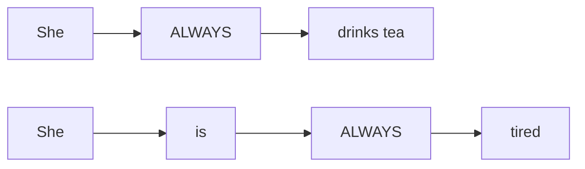
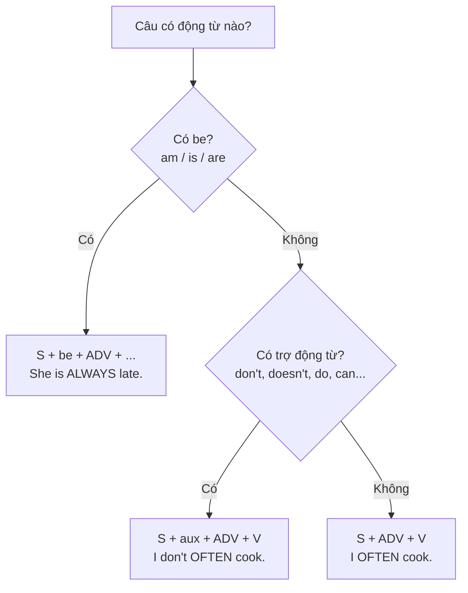

# A1-G003 · Adverbs of Frequency — Trạng từ chỉ tần suất

## Mục lục

- [A. Lesson Information](#a-lesson-information)
- [B. Warm-up](#b-warm-up-tình-huống-thực-tế)
- [C. WHAT](#c-what-trạng-từ-tần-suất-là-gì)
- [D. WHY](#d-why-vì-sao-vị-trí-lại-quan-trọng)
- [E. FORM](#e-form-thang-tần-suất-và-vị-trí)
- [F. HOW](#f-how-ví-dụ-phân-tích)
- [G. VISUAL](#g-visual-explanation)
- [H. COMPARISON](#h-comparison)
- [I. COMMON MISTAKES](#i-common-mistakes)
- [J. MEMORY TRICKS](#j-memory-tricks)
- [K. REAL-LIFE APPLICATION](#k-real-life-application)
- [L. PRACTICE EXERCISES](#l-practice-exercises)
- [M. KNOWLEDGE CHECK](#m-knowledge-check)
- [N. ANSWER KEY](#n-answer-key)

---

## A. Lesson Information

| Mục | Nội dung |
|---|---|
| **Lesson ID** | A1-G003 |
| **Topic** | Adverbs of Frequency & Frequency Expressions |
| **Tên tiếng Việt** | Trạng từ chỉ tần suất và cụm từ chỉ tần suất |
| **CEFR Level** | A1 |
| **Prerequisites** | [A1-G002](A1-G002-present-simple-negatives-questions.md) |
| **Estimated Time** | 60 phút |

**Learning Objectives:**

1. Sắp xếp các trạng từ tần suất theo mức độ: *always → never*.
2. Đặt trạng từ tần suất đúng vị trí: **trước động từ thường**, **sau *be***.
3. Dùng cụm tần suất (*every day, twice a week*) ở cuối câu.
4. Hỏi và trả lời với *How often...?* và *Do you ever...?*
5. Tránh phủ định kép với *never*.

---

## B. Warm-up: Tình huống thực tế

Bác sĩ hỏi bạn về thói quen sinh hoạt:

> **Doctor:** How often do you exercise?
> **You:** Tôi... *thỉnh thoảng* tập. Nhưng tôi *luôn luôn* ăn sáng. Và tôi *không bao giờ* hút thuốc.

🤔 **Hãy suy nghĩ:** Trong tiếng Việt, "luôn luôn", "thỉnh thoảng", "không bao giờ" thường đứng **trước động từ** ("tôi luôn ăn sáng"). Tiếng Anh có giống vậy không? Còn với câu "Tôi luôn mệt vào buổi tối" (có động từ *be*) thì sao?

---

## C. WHAT: Trạng từ tần suất là gì?

**Adverbs of frequency** (trạng từ chỉ tần suất) cho biết một việc xảy ra **thường xuyên đến mức nào**. Chúng đi rất tự nhiên với thì hiện tại đơn — vì thì này nói về thói quen.

| Trạng từ | Nghĩa | Tần suất ước lượng |
|---|---|---|
| **always** | luôn luôn | 100% |
| **usually** / **normally** | thường thường | ~ 90% |
| **often** / **frequently** | thường, hay | ~ 70% |
| **sometimes** | thỉnh thoảng | ~ 50% |
| **occasionally** | đôi khi | ~ 30% |
| **rarely** / **seldom** | hiếm khi | ~ 10% |
| **hardly ever** | hầu như không bao giờ | ~ 5% |
| **never** | không bao giờ | 0% |

> 💡 Các con số chỉ để hình dung thứ tự, không phải định nghĩa chính xác.

Ngoài ra, còn **cụm từ tần suất** (frequency expressions): *every day, every week, once a month, twice a year, three times a week, on Mondays, at weekends*.

---

## D. WHY: Vì sao vị trí lại quan trọng?

Trạng từ tần suất "mô tả" **động từ chính** — nên nó đứng **sát** động từ. Nhưng *be* là động từ đặc biệt: *be* giống như dấu "=", còn phần **sau** *be* (tính từ, danh từ) mới là "nội dung". Vì vậy trạng từ đứng **sau *be***, ngay trước nội dung mà nó mô tả:



- *She **always** drinks tea.* — trạng từ trước động từ thường.
- *She is **always** tired.* — trạng từ sau *be*.

---

## E. FORM: Thang tần suất và vị trí

### E1. Vị trí của trạng từ tần suất (một từ)

| Quy tắc | Công thức | Ví dụ |
|---|---|---|
| Trước động từ thường | S + **adv** + V | *I **often** cook dinner.* |
| Sau *be* (am/is/are/was/were) | S + be + **adv** | *He is **never** late.* |
| Giữa trợ động từ và động từ chính | S + aux + **adv** + V | *I don't **usually** eat breakfast.* / *Do you **often** travel?* |

**Ký hiệu:** **adv** = adverb (trạng từ); **aux** = auxiliary (trợ động từ: *do, does, don't, can*...).

> ⚠️ *sometimes, usually, often, normally* còn có thể đứng **đầu câu** (nhấn mạnh): ***Sometimes** I work late.* Nhưng **always, never, rarely, hardly ever** thường **không** đứng đầu câu trong văn bình thường.

### E2. Vị trí của cụm từ tần suất

Cụm từ nhiều chữ thường đứng **cuối câu** (đôi khi đầu câu):

- *I go swimming **twice a week**.*
- ***Every morning**, my dad reads the news.*

### E3. Hỏi về tần suất

| Câu hỏi | Trả lời |
|---|---|
| ***How often** do you go to the cinema?* | *About once a month.* / *Not very often.* / *Hardly ever.* |
| ***Do** you **ever** eat street food?* | *Yes, often.* / *Sometimes.* / *No, never.* |
| ***Is** he **always** this busy?* | *Yes, he usually is.* |

**Ever** (bao giờ, có khi nào) dùng trong **câu hỏi** để hỏi xem việc gì có từng/có khi nào xảy ra.

### E4. *Never* và phủ định

*Never* đã mang nghĩa phủ định → động từ ở dạng **khẳng định**:

- ✅ *I **never** drink alcohol.*
- ❌ *I **don't never** drink alcohol.* (phủ định kép)
- ✅ *I **don't ever** drink alcohol.* (đúng, nhưng ít gặp hơn — *ever* + phủ định = *never*)

---

## F. HOW: Ví dụ phân tích

| # | English | Tiếng Việt | Phân tích |
|---|---|---|---|
| 1 | *I **always** have breakfast at home.* | Tôi luôn ăn sáng ở nhà. | adv trước V thường |
| 2 | *My boss is **always** busy.* | Sếp tôi lúc nào cũng bận. | adv sau *be* |
| 3 | *We **usually** go to Da Lat in December.* | Chúng tôi thường đi Đà Lạt vào tháng 12. | |
| 4 | *She **doesn't often** wear a dress.* | Cô ấy không hay mặc váy. | adv giữa aux và V |
| 5 | *They are **rarely** at home on Sundays.* | Họ hiếm khi ở nhà vào Chủ nhật. | sau *be* |
| 6 | ***Sometimes** I forget my keys.* | Thỉnh thoảng tôi quên chìa khóa. | *sometimes* có thể đứng đầu |
| 7 | *He **never** eats vegetables.* | Anh ấy không bao giờ ăn rau. | *never* + V khẳng định (*eats*) |
| 8 | *I visit my grandparents **once a month**.* | Tôi thăm ông bà mỗi tháng một lần. | Cụm tần suất ở cuối |
| 9 | ***How often** do you check your phone?* | Bạn kiểm tra điện thoại bao lâu một lần? | |
| 10 | ***Do** you **ever** cook Western food?* | Bạn có bao giờ nấu món Tây không? | *ever* trong câu hỏi |
| 11 | *My cat **hardly ever** goes outside.* | Con mèo của tôi hầu như không bao giờ ra ngoài. | *hardly ever* = gần như *never* |
| 12 | *The buses are **usually** late in the rain.* | Trời mưa xe buýt thường đến muộn. | sau *are* |

---

## G. VISUAL EXPLANATION

### G1. Thang tần suất

```text
100% ┃ always
     ┃ usually / normally
     ┃ often / frequently
 50% ┃ sometimes
     ┃ occasionally
     ┃ rarely / seldom
     ┃ hardly ever
  0% ┃ never
```

### G2. Sơ đồ vị trí



---

## H. COMPARISON

### Tiếng Việt và tiếng Anh

| Tiếng Việt | Tiếng Anh |
|---|---|
| Tôi **luôn** **đi** bộ. | I **always walk**. ✅ (giống trật tự Việt) |
| Tôi **luôn** **mệt**. | I **am always** tired. (khác: trạng từ sau *be*) |
| Tôi **không bao giờ** hút thuốc. | I **never** smoke. (không thêm *don't*) |
| Tôi đi bơi **hai lần một tuần**. | I go swimming **twice a week**. ✅ (giống) |

### *Often* và *usually*

| | |
|---|---|
| *I **usually** take the bus.* | Bình thường tôi đi xe buýt (là lựa chọn mặc định, gần như mọi lần). |
| *I **often** take the bus.* | Tôi hay đi xe buýt (nhiều lần, nhưng không nhất thiết là mặc định). |

### *Hardly ever* và *hard*

*hardly ever* = hầu như không bao giờ. **Không** liên quan đến *hard* (chăm chỉ, khó).

---

## I. COMMON MISTAKES

| # | ❌ Sai | ✅ Đúng | Nguyên nhân | Cách tránh |
|---|---|---|---|---|
| 1 | I go **always** to work by bus. | I **always** go to work by bus. | Đặt sau động từ thường | Trước V thường |
| 2 | She **always is** late. | She **is always** late. | Đặt trước *be* | Sau *be* |
| 3 | I **don't never** eat meat. | I **never** eat meat. | Phủ định kép | *never* + khẳng định |
| 4 | **Always** I drink tea. | I **always** drink tea. | Đưa *always* lên đầu | *always* không đứng đầu câu (bình thường) |
| 5 | I go to the gym **two times in a week**. | I go to the gym **twice a week**. | Dịch "hai lần trong một tuần" | *once, twice, three times* + **a** + week |
| 6 | How often **you** go swimming? | How often **do you** go swimming? | Quên trợ động từ | QUASI |
| 7 | She **often doesn't** eat breakfast. (khi muốn nói *không hay ăn*) | She **doesn't often** eat breakfast. | Hai trật tự khác nghĩa: *often doesn't* = hay bỏ bữa; *doesn't often* = không thường ăn | Chọn trật tự theo ý muốn nói; mẫu luyện của bài là aux + adv + V |
| 8 | I **sometime** go out. | I **sometimes** go out. | Thiếu *s* | *sometimes* (thỉnh thoảng) — *sometime* nghĩa là "một lúc nào đó" |

---

## J. MEMORY TRICKS

1. **"BE đi trước, ĐỘNG TỪ đi sau"**: Trạng từ tần suất đứng **sau BE** nhưng **trước động từ thường**. Câu nhớ: *"Be trước, trạng từ, rồi mới tới hành động."*
2. **"Never là người phủ định độc lập"**: *never* không cần *not* đi kèm — một mình nó đã đủ "không".
3. **Thang nhiệt độ**: tưởng tượng *always* nóng 100°, *never* lạnh 0°. Xếp các từ khác theo "nhiệt độ".
4. **Once – twice – three times**: Chỉ 1 và 2 có từ riêng (*once, twice*). Từ 3 trở đi: *số + times*.

---

## K. REAL-LIFE APPLICATION

### Hội thoại: Khám sức khỏe

> **Doctor:** So, how often do you exercise?
> **Phong:** Hmm, not very often. I **sometimes** go jogging at weekends.
> **Doctor:** Do you **ever** smoke?
> **Phong:** No, **never**.
> **Doctor:** Good. What about your diet? Do you eat a lot of vegetables?
> **Phong:** I **usually** have vegetables at dinner, but I **hardly ever** eat fruit.
> **Doctor:** And how many hours do you sleep?
> **Phong:** I'm **often** tired because I **rarely** sleep more than six hours. I **always** check my phone in bed.
> **Doctor:** That's the problem! Try to exercise **three times a week**, eat fruit **every day**, and turn off your phone **at least** an hour before bed.

**Vietnamese explanation:** Phong đi khám sức khỏe. Anh ít tập thể dục (thỉnh thoảng chạy bộ cuối tuần), không bao giờ hút thuốc, thường ăn rau buổi tối nhưng hầu như không ăn trái cây, hay mệt vì hiếm khi ngủ quá 6 tiếng và lúc nào cũng xem điện thoại trên giường. Bác sĩ khuyên tập 3 lần/tuần, ăn trái cây mỗi ngày, tắt điện thoại ít nhất 1 tiếng trước khi ngủ.

**Grammar highlights:** *sometimes go, never, usually have, hardly ever eat, I'm often tired* (sau *be*), *rarely sleep, always check*, *three times a week, every day*.

**Useful expressions:** *not very often* (không thường lắm) · *What about...?* · *at least* (ít nhất) · *Try to...* (Hãy cố gắng...)

---

## L. PRACTICE EXERCISES

> ✍️ Đáp án: [A1-G003-ANSWERS](../../12-ANSWERS-AND-EXPLANATIONS/A1/A1-G003-ANSWERS.md)

### Level 1 — Recognition

**L1.1.** Sắp xếp từ cao xuống thấp: *sometimes, never, always, often, rarely*
**L1.2.** Câu nào đúng?  A. He always is happy.  B. He is always happy.  C. Always he is happy.
**L1.3.** Câu nào đúng?  A. I never eat sushi.  B. I don't never eat sushi.  C. I eat never sushi.
**L1.4.** Câu nào đúng?  A. We go usually by train.  B. We usually go by train.  C. We go by train usually always.
**L1.5.** "___ do you see your parents?" – "Twice a month."  A. How many  B. How often  C. How much
**L1.6.** Câu nào đúng?  A. She doesn't often call me.  B. She often doesn't calls me.  C. She doesn't calls me often.

### Level 2 — Controlled Practice

Đặt trạng từ trong ngoặc vào đúng vị trí.

**L2.1.** My father drinks coffee in the morning. (always)
**L2.2.** I am hungry after work. (usually)
**L2.3.** They go to the beach in winter. (rarely)
**L2.4.** She is late for meetings. (never)
**L2.5.** Do you eat out? (often)
**L2.6.** We don't watch TV. (usually)

Viết bằng tiếng Anh:

**L2.7.** một lần một tuần
**L2.8.** hai lần một năm
**L2.9.** bốn lần một ngày
**L2.10.** mỗi Chủ nhật (2 cách)

### Level 3 — Error Correction

**L3.1.** I go always to bed at 11.
**L3.2.** My brother never doesn't help with the housework.
**L3.3.** She usually is tired on Mondays.
**L3.4.** We visit our grandparents two times in a month.
**L3.5.** How often you clean your room?
**L3.6.** Always I forget her birthday.

### Level 4 — Production

Dịch sang tiếng Anh:

**L4.1.** Mẹ tôi luôn dậy sớm.
**L4.2.** Tôi hiếm khi ăn đồ ăn nhanh. (*fast food*)
**L4.3.** Anh ấy không bao giờ đúng giờ. (*on time*)
**L4.4.** Bạn có bao giờ đi xe buýt không?
**L4.5.** Tôi đi xem phim khoảng một tháng một lần. (*about*)

### Level 5 — Real Communication

**L5.1.** Viết đoạn văn 70–90 từ: *My healthy and unhealthy habits*. Dùng ít nhất 6 trạng từ/cụm tần suất khác nhau.
**L5.2.** **Speaking — Survey:** Trả lời to (ghi âm) 6 câu hỏi sau bằng câu đầy đủ có trạng từ tần suất: *How often do you exercise? Do you ever cook? How often do you go to the cinema? Are you ever late for work/school? How often do you call your parents? Do you ever eat breakfast in bed?*

---

## M. KNOWLEDGE CHECK

### 5 câu hỏi tự kiểm tra

1. Trạng từ tần suất đứng ở đâu với động từ thường? Với *be*?
2. Vì sao *I don't never...* là sai?
3. Nói "ba lần một tuần" bằng tiếng Anh.
4. *Ever* dùng trong loại câu nào?
5. *sometime* và *sometimes* khác nhau thế nào?

### Checklist

- [ ] Tôi xếp được 8 trạng từ theo thứ tự tần suất.
- [ ] Tôi đặt trạng từ đúng vị trí với *be* và động từ thường.
- [ ] Tôi hỏi và trả lời được *How often...?*

### 3 lỗi quan trọng cần nhớ

1. ~~go always~~ → **always go**.
2. ~~always is~~ → **is always**.
3. ~~don't never~~ → **never**.

### Lịch ôn tập

| Ngày | Việc cần làm |
|---|---|
| Ngày 1 | Làm lại L2 |
| Ngày 3 | Viết 8 câu về thói quen của bạn, mỗi câu một trạng từ khác nhau |
| Ngày 7 | Làm lại L5.2, thêm 4 câu hỏi mới |

### Liên kết

- ➡️ Bài tiếp theo: [A1-G004 — Present Continuous](A1-G004-present-continuous.md)
- 🔁 Ôn: [A1-G001](A1-G001-present-simple-affirmative.md), [A1-G002](A1-G002-present-simple-negatives-questions.md)

---

## N. ANSWER KEY

👉 [A1-G003-ANSWERS.md](../../12-ANSWERS-AND-EXPLANATIONS/A1/A1-G003-ANSWERS.md)
