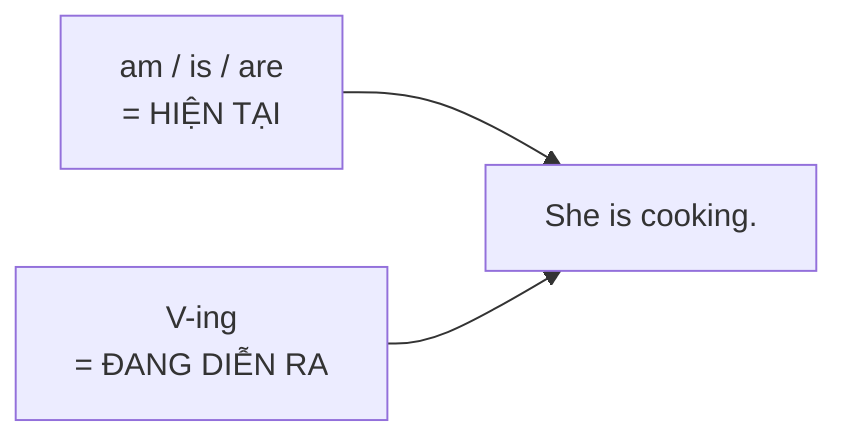

# A1-G004 · Present Continuous — Thì hiện tại tiếp diễn

## Mục lục

- [A. Lesson Information](#a-lesson-information)
- [B. Warm-up](#b-warm-up-tình-huống-thực-tế)
- [C. WHAT](#c-what-hiện-tại-tiếp-diễn-là-gì)
- [D. WHY](#d-why-vì-sao-cần-be--v-ing)
- [E. FORM](#e-form-công-thức)
- [F. HOW](#f-how-các-cách-dùng)
- [G. VISUAL](#g-visual-explanation)
- [H. COMPARISON](#h-comparison)
- [I. COMMON MISTAKES](#i-common-mistakes)
- [J. MEMORY TRICKS](#j-memory-tricks)
- [K. REAL-LIFE APPLICATION](#k-real-life-application)
- [L. PRACTICE EXERCISES](#l-practice-exercises)
- [M. KNOWLEDGE CHECK](#m-knowledge-check)
- [N. ANSWER KEY](#n-answer-key)

---

## A. Lesson Information

| Mục | Nội dung |
|---|---|
| **Lesson ID** | A1-G004 |
| **Topic** | Present Continuous (Present Progressive) |
| **Tên tiếng Việt** | Thì hiện tại tiếp diễn |
| **CEFR Level** | A1 |
| **Prerequisites** | [A0-G009 — To Be](../../01-A0-FOUNDATION/grammar/A0-G009-verb-to-be.md), [A0-G019 — V-ing spelling](../../01-A0-FOUNDATION/grammar/A0-G019-likes-and-hobbies.md), [A1-G002](A1-G002-present-simple-negatives-questions.md) |
| **Estimated Time** | 90 phút |

**Learning Objectives:**

1. Tạo câu khẳng định, phủ định, nghi vấn với **am/is/are + V-ing**.
2. Dùng thì hiện tại tiếp diễn cho việc **đang xảy ra lúc nói** và **tạm thời quanh thời điểm hiện tại**.
3. Mô tả **sự thay đổi đang diễn ra** (*It's getting colder*).
4. Viết đúng chính tả V-ing, kể cả động từ hai âm tiết.
5. Biết các **động từ trạng thái** (*know, like, want...*) thường không dùng ở thì tiếp diễn.

---

## B. Warm-up: Tình huống thực tế

Điện thoại reo. Bạn của bạn gọi:

> **Friend:** Hey! What are you doing?
> **You:** "Tôi **đang** nấu cơm. Chồng tôi **đang** tắm cho con. Còn trời thì **đang** mưa to."

🤔 **Hãy suy nghĩ:** Tiếng Việt chỉ cần thêm chữ "**đang**". Tiếng Anh cần những gì? Bạn đã học *be* (A0) và V-ing (A0-G019). Hai thứ đó ghép lại có thể tạo ra nghĩa "đang" không?

---

## C. WHAT: Hiện tại tiếp diễn là gì?

**Thì hiện tại tiếp diễn (Present Continuous)** diễn tả hành động **đang diễn ra** — chưa kết thúc — **ngay lúc nói** hoặc **trong giai đoạn hiện tại**.

| Ý nghĩa | Ví dụ | Dịch |
|---|---|---|
| Đang xảy ra **ngay bây giờ** | *I'm cooking.* | Tôi đang nấu ăn. |
| Đang xảy ra **quanh thời điểm hiện tại** (tạm thời) | *I'm reading a great book this week.* | Tuần này tôi đang đọc một cuốn sách hay. (có thể không đọc đúng lúc nói) |
| **Thay đổi** đang diễn ra | *Prices are going up.* | Giá cả đang tăng. |
| Kế hoạch tương lai đã sắp xếp (xem trước) | *I'm meeting Lan tomorrow.* | Mai tôi gặp Lan. → học kỹ ở [A2-G008](../../03-A2-ELEMENTARY/grammar/A2-G008-present-continuous-future.md) |

**Khi nào KHÔNG dùng?**
- Thói quen, sự thật chung → hiện tại đơn ([A1-G001](A1-G001-present-simple-affirmative.md)).
- Với động từ trạng thái (*know, like, want, need, believe...*) → thường dùng hiện tại đơn dù nói về "bây giờ": *I **want** a coffee now* (không phải ~~I'm wanting~~).

---

## D. WHY: Vì sao cần *be* + V-ing?

Mỗi phần trong cấu trúc mang một ý nghĩa:

- **be** (*am/is/are*) — cho biết **thời gian**: hiện tại (và chia theo chủ ngữ).
- **V-ing** — cho biết **trạng thái "đang diễn ra, chưa xong"**: hành động đang "chạy", như một video đang phát.



So sánh với hiện tại đơn: hiện tại đơn là **ảnh chụp cuộc sống** (thói quen), hiện tại tiếp diễn là **video quay trực tiếp** khoảnh khắc này.

---

## E. FORM: Công thức

**Ký hiệu:** **S** = chủ ngữ · **V-ing** = động từ nguyên mẫu + *-ing* (present participle — phân từ hiện tại).

### E1. Khẳng định, phủ định, nghi vấn

| | Công thức | Ví dụ |
|---|---|---|
| ➕ | S + **am/is/are** + V-ing | *She **is working**.* → *She's working.* |
| ➖ | S + am/is/are + **not** + V-ing | *They **aren't listening**.* / *I'**m not sleeping**.* |
| ❓ | **Am/Is/Are** + S + V-ing? | ***Are** you **listening**?* |
| 💬 | Yes, S + am/is/are. / No, S + am/is/are + not. | *Yes, I am. / No, I'm not.* |
| Wh- | Wh- + am/is/are + S + V-ing? | *What **are** you **doing**?* / *Why **is** she **crying**?* |

Thì này thuộc **"gia đình *be*"** ([A0-G016](../../01-A0-FOUNDATION/grammar/A0-G016-sentence-types.md)) — không dùng *do/does*.

### E2. Chính tả V-ing (mở rộng từ A0-G019)

| Quy tắc | Ví dụ |
|---|---|
| Thông thường: + *ing* | work → working, eat → eating |
| *-e* câm: bỏ *e* | make → making, write → writing (nhưng *see → seeing*, *be → being*: *ee* giữ nguyên) |
| *-ie* → *-ying* | lie → lying, die → dying |
| Một âm tiết, CVC: gấp đôi phụ âm cuối | sit → sitting, run → running, stop → stopping |
| **Hai âm tiết, nhấn âm cuối**, kết thúc CVC: gấp đôi | be**gin** → begi**nn**ing, pre**fer** → prefe**rr**ing, for**get** → forge**tt**ing |
| Hai âm tiết, nhấn âm **đầu**: không gấp đôi | **vis**it → visiting, **lis**ten → listening, **hap**pen → happening |
| Tận cùng *-l* sau một nguyên âm (Anh – Anh gấp đôi) | travel → travel**l**ing (Anh) / traveling (Mỹ) |

### E3. Cụm từ thời gian thường đi kèm

*now, right now, at the moment, at present, today, this week/month/year, currently, Look! Listen!*

---

## F. HOW: Các cách dùng

### Cách dùng 1 — Đang xảy ra ngay lúc nói

| # | English | Tiếng Việt | Phân tích |
|---|---|---|---|
| 1 | *Shh! The baby **is sleeping**.* | Suỵt! Em bé đang ngủ. | Đang diễn ra lúc nói |
| 2 | *Look! It'**s raining**.* | Nhìn kìa! Trời đang mưa. | *Look!* báo hiệu |
| 3 | *"What **are** you **doing**?" — "I'**m cooking** dinner."* | "Bạn đang làm gì?" — "Tôi đang nấu bữa tối." | Câu hỏi Wh- |
| 4 | *I **can't** talk now. I'**m driving**.* | Tôi không nói chuyện được. Tôi đang lái xe. | |

### Cách dùng 2 — Tạm thời, quanh thời điểm hiện tại

| # | English | Tiếng Việt | Phân tích |
|---|---|---|---|
| 5 | *I'**m studying** for an exam this week.* | Tuần này tôi đang ôn thi. | Không nhất thiết đang học đúng lúc nói |
| 6 | *My brother **is living** with us at the moment.* | Hiện giờ anh tôi đang ở với chúng tôi. | Tạm thời (bình thường anh ấy sống nơi khác) |
| 7 | *She'**s working** from home this month.* | Tháng này cô ấy làm việc ở nhà. | Tạm thời |

### Cách dùng 3 — Thay đổi, xu hướng

| # | English | Tiếng Việt | Phân tích |
|---|---|---|---|
| 8 | *The weather **is getting** colder.* | Thời tiết đang lạnh dần. | *get + so sánh hơn* = trở nên ... hơn |
| 9 | *Your English **is improving**!* | Tiếng Anh của bạn đang tiến bộ! | |
| 10 | *More and more people **are buying** electric motorbikes.* | Ngày càng nhiều người mua xe máy điện. | Xu hướng |

### Phủ định và câu hỏi

| # | English | Tiếng Việt |
|---|---|---|
| 11 | *I'**m not watching** TV. You can turn it off.* | Tôi không xem TV. Bạn tắt đi được. |
| 12 | ***Is** it **raining** in Hanoi? — No, it **isn't**.* | Hà Nội có đang mưa không? — Không. |

---

## G. VISUAL EXPLANATION

### G1. Timeline

```text
Quá khứ ─────────────[ ~~~~~ NOW ~~~~~ ]───────────── Tương lai
                       hành động đang "chạy",
                       bắt đầu trước, chưa kết thúc
                       "She is cooking."
```

### G2. Sentence breakdown

`My parents | are | travelling | in Japan | this week.`

| Phần | Vai trò |
|---|---|
| My parents | S — số nhiều → *are* |
| are | *be* — hiện tại |
| travelling | V-ing — đang diễn ra (Anh – Anh gấp đôi *l*) |
| in Japan | Nơi chốn |
| this week | Giai đoạn tạm thời |

---

## H. COMPARISON

### Hiện tại đơn và hiện tại tiếp diễn (giới thiệu — so sánh đầy đủ ở [A1-G005](A1-G005-present-simple-vs-continuous.md))

| Present Simple | Present Continuous |
|---|---|
| *I **work** in a bank.* (công việc lâu dài) | *I'**m working** in a café this summer.* (tạm thời) |
| *It **rains** a lot in Hue.* (sự thật) | *It'**s raining** now.* (đang mưa) |

### Động từ trạng thái (state verbs) — không dùng tiếp diễn

| Nhóm | Động từ | ✅ Đúng | ❌ Sai |
|---|---|---|---|
| Thích/ghét | like, love, hate, prefer | *I **like** this song.* | ~~I'm liking~~ |
| Muốn/cần | want, need | *I **need** help now.* | ~~I'm needing~~ |
| Suy nghĩ/biết | know, understand, believe, remember, mean | *I **understand**.* | ~~I'm understanding~~ |
| Sở hữu | own, belong | *This bag **belongs** to me.* | ~~is belonging~~ |

> ⚠️ Một số động từ có thể dùng tiếp diễn khi đổi nghĩa thành hành động: *I **have** a car* (sở hữu) vs *I'**m having** lunch* (đang ăn). *I **think** it's good* (ý kiến) vs *I'**m thinking** about my plan* (đang suy nghĩ). Chi tiết ở A1-G005.

---

## I. COMMON MISTAKES

| # | ❌ Sai | ✅ Đúng | Nguyên nhân | Cách tránh |
|---|---|---|---|---|
| 1 | I **cooking** now. | I'**m cooking** now. | Quên *be* (tiếng Việt chỉ cần "đang") | *be* + V-ing — không thiếu phần nào |
| 2 | She **is cook** now. | She **is cooking** now. | Quên *-ing* | |
| 3 | **Do** you **working**? | **Are** you working? | Dùng *do* | Thì này thuộc gia đình *be* |
| 4 | I'**m knowing** the answer. | I **know** the answer. | Dùng tiếp diễn với động từ trạng thái | Xem bảng state verbs |
| 5 | **writting**, **comeing**, **siting** | **writing**, **coming**, **sitting** | Sai chính tả | Ôn E2 |
| 6 | I'**m going** to school every day. | I **go** to school every day. | Dùng tiếp diễn cho thói quen | *every day* → hiện tại đơn |
| 7 | **Is raining** now. | **It's** raining now. | Thiếu chủ ngữ | Luôn có *it* |
| 8 | "Are you busy?" — "Yes, I'm." | "Yes, I **am**." | Rút gọn ở cuối | |

---

## J. MEMORY TRICKS

1. **"Đang = be + ing"**: Mỗi khi tiếng Việt có "đang", hãy kiểm tra **cả hai** thành phần *be* và *-ing*.
2. **"Video, không phải ảnh"**: Nếu bạn có thể "quay video" hành động ngay lúc nói → tiếp diễn.
3. **"Động từ trong đầu không chạy"**: Những động từ diễn ra **trong đầu** (*know, like, want, believe, understand*) không phải hành động có thể "quay video" → thường không dùng *-ing*. (Mẹo hỗ trợ; có ngoại lệ như *think about*.)

---

## K. REAL-LIFE APPLICATION

### Tin nhắn trong nhóm gia đình

> **Mom:** Where **is** everyone? What **are** you all **doing**? 😊
> **Dad:** I'**m sitting** in a traffic jam. It'**s raining** really hard.
> **Lan:** I'**m studying** at the library. My exams **are starting** next week, so I'**m working** very hard this week.
> **Huy:** I'**m playing** football with my friends. We'**re winning**! ⚽
> **Mom:** OK! I'**m making** pho for dinner. The water **is boiling** now. Come home soon!
> **Dad:** The traffic **is moving** now. See you in 20 minutes.

**Vietnamese explanation:** Mẹ hỏi cả nhà đang làm gì. Bố đang kẹt xe vì mưa to; Lan đang ở thư viện ôn thi (tuần này học rất chăm vì tuần sau thi); Huy đang đá bóng và đội đang thắng; mẹ đang nấu phở. Cuối cùng xe của bố bắt đầu di chuyển.

**Grammar highlights:**
- Đang diễn ra: *I'm sitting, It's raining, I'm playing, We're winning, The water is boiling, The traffic is moving*.
- Tạm thời: *I'm working very hard this week*.
- *My exams are starting next week* — kế hoạch đã định (xem trước A2-G008).

**Useful expressions:** *a traffic jam* (kẹt xe) · *really hard* (rất to/rất chăm) · *Come home soon!* · *See you in 20 minutes.*

---

## L. PRACTICE EXERCISES

> ✍️ Đáp án: [A1-G004-ANSWERS](../../12-ANSWERS-AND-EXPLANATIONS/A1/A1-G004-ANSWERS.md)

### Level 1 — Recognition

**L1.1.** Listen! Someone ___ at the door.  A. knocks  B. is knocking  C. knocking
**L1.2.** We ___ dinner right now.  A. have  B. are having  C. are have
**L1.3.** ___ you listening to me?  A. Do  B. Are  C. Is
**L1.4.** Which is spelled correctly?  A. swiming  B. swimming  C. swimmming
**L1.5.** Which sentence is correct?  A. I'm wanting a drink.  B. I want a drink.  C. I wanting a drink.
**L1.6.** Which spelling is correct?  A. beginning  B. begining  C. beginnig

### Level 2 — Controlled Practice

Chia động từ ở thì hiện tại tiếp diễn.

**L2.1.** My sister (talk) ___ on the phone.
**L2.2.** I (not / watch) ___ this film. Can I change the channel?
**L2.3.** (they / play) ___ tennis?
**L2.4.** Look! The cat (lie) ___ on your laptop.
**L2.5.** We (stay) ___ at a hotel near the beach this week.
**L2.6.** Why (you / smile) ___?
**L2.7.** The children (get) ___ bigger every day.
**L2.8.** Hurry up! The bus (come) ___.

Viết dạng V-ing:

**L2.9.** take / shop / visit / die
**L2.10.** forget / listen / see / travel (Anh – Anh)

### Level 3 — Error Correction

**L3.1.** My mother cooking in the kitchen.
**L3.2.** Do you studying now?
**L3.3.** She is write an email.
**L3.4.** I'm understanding the lesson now.
**L3.5.** Look! Is snowing!
**L3.6.** They're siting in the garden.

### Level 4 — Production

Dịch sang tiếng Anh:

**L4.1.** Bây giờ tôi đang làm việc. Tôi sẽ gọi lại cho bạn sau. (*call you back later* — dùng như cụm cố định)
**L4.2.** Tuần này anh trai tôi đang sống ở Đà Nẵng.
**L4.3.** Bạn đang đọc sách gì vậy?
**L4.4.** Trời đang tối dần. (*get dark*)
**L4.5.** Họ không đang nghe đâu. (*listen*)

### Level 5 — Real Communication

**L5.1.** Bạn đang ở một nơi công cộng (quán cà phê, công viên, sân bay...). Viết tin nhắn 60–80 từ cho bạn bè mô tả **những gì đang diễn ra** xung quanh bạn.
**L5.2.** **Speaking — Live commentary:** Nhìn ra cửa sổ hoặc xem một video không lời trong 1 phút. Mô tả to những gì đang diễn ra như một bình luận viên: *A man is crossing the street... Two children are running...*

---

## M. KNOWLEDGE CHECK

### 5 câu hỏi tự kiểm tra

1. Công thức hiện tại tiếp diễn có hai phần nào? Mỗi phần mang ý nghĩa gì?
2. Kể 3 cách dùng của thì này.
3. Vì sao *I'm knowing* là sai?
4. Viết V-ing của *begin, visit, lie, make*.
5. Câu hỏi với thì này dùng *do* hay *be*?

### Checklist

- [ ] Tôi không quên *be* hoặc *-ing*.
- [ ] Tôi viết đúng chính tả V-ing.
- [ ] Tôi nhớ 10 động từ trạng thái không dùng tiếp diễn.
- [ ] Tôi mô tả được những gì đang diễn ra xung quanh mình.

### 3 lỗi quan trọng cần nhớ

1. ~~I cooking~~ → I**'m** cooking.
2. ~~Do you working?~~ → **Are** you working?
3. ~~I'm knowing~~ → I **know**.

### Lịch ôn tập

| Ngày | Việc cần làm |
|---|---|
| Ngày 1 | Làm lại L2 |
| Ngày 3 | Viết 5 câu về những gì người trong nhà đang làm |
| Ngày 7 | Làm lại L5.2 với một cảnh khác |

### Liên kết

- ➡️ Bài tiếp theo: [A1-G005 — Present Simple vs Present Continuous](A1-G005-present-simple-vs-continuous.md)
- 🔁 Tra cứu: [ALL-TENSES-COMPARISON](../../06-GRAMMAR-REFERENCE/ALL-TENSES-COMPARISON.md)

---

## N. ANSWER KEY

👉 [A1-G004-ANSWERS.md](../../12-ANSWERS-AND-EXPLANATIONS/A1/A1-G004-ANSWERS.md)
