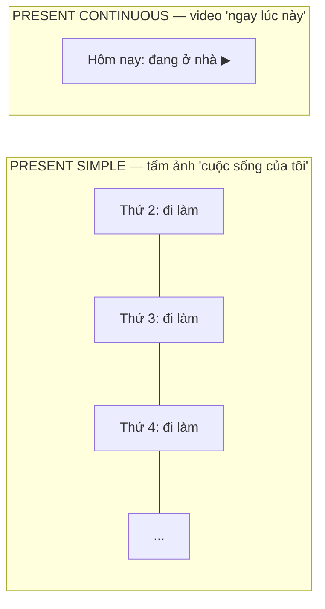
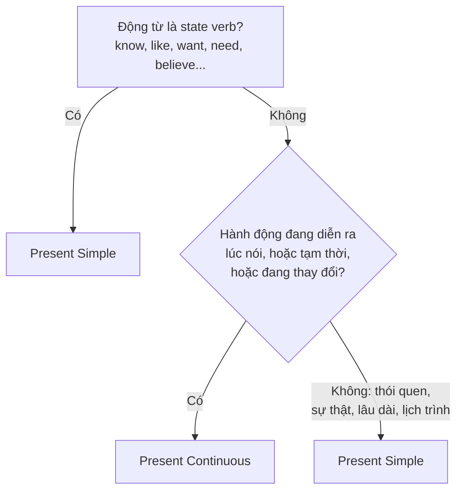

# A1-G005 · Present Simple vs Present Continuous — So sánh hai thì hiện tại

## Mục lục

- [A. Lesson Information](#a-lesson-information)
- [B. Warm-up](#b-warm-up-tình-huống-thực-tế)
- [C. WHAT](#c-what-hai-cách-nhìn-về-hiện-tại)
- [D. WHY](#d-why-ảnh-chụp-và-video)
- [E. FORM](#e-form-bảng-đối-chiếu)
- [F. HOW](#f-how-các-cặp-đối-chiếu)
- [G. VISUAL](#g-visual-explanation)
- [H. COMPARISON](#h-comparison-động-từ-có-hai-nghĩa)
- [I. COMMON MISTAKES](#i-common-mistakes)
- [J. MEMORY TRICKS](#j-memory-tricks)
- [K. REAL-LIFE APPLICATION](#k-real-life-application)
- [L. PRACTICE EXERCISES](#l-practice-exercises)
- [M. KNOWLEDGE CHECK](#m-knowledge-check)
- [N. ANSWER KEY](#n-answer-key)

---

## A. Lesson Information

| Mục | Nội dung |
|---|---|
| **Lesson ID** | A1-G005 |
| **Topic** | Present Simple vs Present Continuous |
| **Tên tiếng Việt** | So sánh thì hiện tại đơn và hiện tại tiếp diễn |
| **CEFR Level** | A1 |
| **Prerequisites** | [A1-G001](A1-G001-present-simple-affirmative.md)–[A1-G004](A1-G004-present-continuous.md) |
| **Estimated Time** | 90 phút |

**Learning Objectives:**

1. Chọn đúng thì dựa trên ý nghĩa: **thói quen/lâu dài** vs **đang diễn ra/tạm thời**.
2. Nhận diện dấu hiệu thời gian, nhưng **không phụ thuộc hoàn toàn** vào chúng.
3. Phân biệt động từ trạng thái và các động từ có **hai nghĩa** (*have, think, see, taste*).
4. Dùng cả hai thì trong cùng một đoạn văn/hội thoại tự nhiên.
5. Làm bài tập trộn không ghi sẵn tên thì.

---

## B. Warm-up: Tình huống thực tế

Đọc lại câu mở đầu của bài A1-G001:

> "Tôi **đi làm** mỗi ngày, nhưng hôm nay tôi **đang nghỉ** ở nhà."

Tiếng Việt dùng cùng động từ cơ bản, chỉ thêm "đang". Tiếng Anh thì:

> *I **go** to work every day, but today I'**m staying** at home.*

🤔 **Hãy suy nghĩ:** Hai vế của câu nói về hai "kiểu" thời gian khác nhau như thế nào? Nếu bạn chỉ dùng một thì cho cả câu, nghĩa sẽ bị sai ra sao?

---

## C. WHAT: Hai cách nhìn về hiện tại

| | Present Simple | Present Continuous |
|---|---|---|
| Nhìn vào | **Bức tranh chung** của cuộc sống | **Khoảnh khắc / giai đoạn** đang diễn ra |
| Tính chất | Lặp lại, ổn định, lâu dài, luôn đúng | Đang tiếp diễn, tạm thời, đang thay đổi |
| Câu hỏi tự đặt | "Thường thì sao?" | "Bây giờ / dạo này đang thế nào?" |
| Ví dụ | *She **teaches** English.* | *She'**s teaching** a class right now.* |

---

## D. WHY: Ảnh chụp và video



Người bản ngữ chọn thì dựa trên **cách họ nhìn sự việc**, không chỉ dựa trên sự việc. Cùng một hành động "đọc sách":

- *I **read** a lot.* — Tôi là người đọc nhiều (đặc điểm, thói quen).
- *I'**m reading** a novel by Nguyen Nhat Anh.* — Dạo này tôi đang đọc một cuốn của Nguyễn Nhật Ánh (giai đoạn tạm thời, chưa đọc xong).

---

## E. FORM: Bảng đối chiếu

| | Present Simple | Present Continuous |
|---|---|---|
| ➕ | S + V(s/es) | S + am/is/are + V-ing |
| ➖ | S + don't/doesn't + V | S + am/is/are + not + V-ing |
| ❓ | Do/Does + S + V? | Am/Is/Are + S + V-ing? |
| Gia đình | Động từ thường (cần *do/does*) | *Be* (tự đảo) |
| Dấu hiệu thường gặp | always, usually, often, every day, on Mondays, once a week | now, right now, at the moment, Look!, Listen!, today, this week, these days |

> ⚠️ **Dấu hiệu chỉ là gợi ý.** *Today* có thể đi với hiện tại đơn (*The shop doesn't open today* — lịch cố định). *Always* có thể đi với tiếp diễn để phàn nàn (*He's always losing his keys!* — kiến thức B1). Hãy luôn **dựa vào nghĩa trước**.

---

## F. HOW: Các cặp đối chiếu

| # | Present Simple | Present Continuous | Giải thích |
|---|---|---|---|
| 1 | *I **work** in Hanoi.* | *I'**m working** in Saigon this month.* | Lâu dài vs tạm thời |
| 2 | *She **drinks** tea every morning.* | *She'**s drinking** coffee today.* | Thói quen vs ngoại lệ hôm nay |
| 3 | *It **snows** a lot in Sapa in winter.* | *Look! It'**s snowing**!* | Sự thật vs đang diễn ra |
| 4 | *My dad **cooks** on Sundays.* | *My dad **is cooking** right now — come and eat!* | Thói quen vs lúc này |
| 5 | *Prices **go** up every year.* | *Prices **are going** up quickly this year.* | Quy luật vs xu hướng đang diễn ra |
| 6 | *What **do** you **do**?* (nghề gì?) | *What **are** you **doing**?* (đang làm gì?) | Hỏi nghề vs hỏi việc đang làm |
| 7 | *He **plays** the guitar.* (biết chơi) | *He'**s playing** the guitar.* (đang chơi) | Khả năng/sở thích vs hành động hiện tại |
| 8 | *We **live** in a flat.* | *We'**re living** with my parents until our new house is ready.* | Lâu dài vs tạm thời (có giới hạn) |
| 9 | *The train **leaves** at 6.* | *The train **is leaving**! Hurry!* | Lịch trình vs đang xảy ra |
| 10 | *I **don't usually** wear a suit.* | *I'**m wearing** a suit today because I have an interview.* | Thường vs hôm nay đặc biệt |

---

## G. VISUAL EXPLANATION

### G1. Cây quyết định



### G2. Timeline so sánh

```text
PRESENT SIMPLE:      ✕ ✕ ✕ ✕ ✕ ✕ ✕ ✕ ✕ ✕     (lặp lại, kéo dài vô hạn)
                              ↑ NOW
PRESENT CONTINUOUS:        [~~~~~~~]          (một đoạn có giới hạn quanh NOW)
                              ↑ NOW
```

---

## H. COMPARISON: Động từ có hai nghĩa

Một số động từ là **state verb** ở nghĩa này nhưng là **action verb** ở nghĩa khác:

| Động từ | Nghĩa trạng thái → Present Simple | Nghĩa hành động → có thể Continuous |
|---|---|---|
| **have** | *I **have** two cats.* (sở hữu) | *I'**m having** lunch.* (ăn) / *We're having a party.* |
| **think** | *I **think** it's a good idea.* (ý kiến) | *I'**m thinking** about my future.* (đang suy nghĩ) |
| **see** | *I **see** what you mean.* (hiểu) / *I see a bird.* (nhìn thấy) | *I'**m seeing** the doctor at 3.* (gặp — lịch hẹn) |
| **taste** | *This soup **tastes** salty.* (có vị) | *The chef **is tasting** the soup.* (nếm) |
| **look** | *You **look** tired.* (trông có vẻ) | *I'**m looking** for my keys.* (đang tìm) |
| **be** | *He **is** rude.* (tính cách) | *He'**s being** rude today.* (hôm nay cư xử bất lịch sự — tạm thời) |

**Quy tắc ra quyết định:** Hỏi "đây có phải **hành động** mà tôi có thể quan sát nó đang diễn ra không?" Nếu có → được dùng tiếp diễn.

---

## I. COMMON MISTAKES

| # | ❌ Sai | ✅ Đúng | Nguyên nhân | Cách tránh |
|---|---|---|---|---|
| 1 | I'**m going** to the gym every evening. | I **go** to the gym every evening. | Nghĩ "tiếp diễn = hiện tại" | Thói quen → hiện tại đơn |
| 2 | Look! The bus **comes**. | Look! The bus **is coming**. | Bỏ qua tín hiệu "đang" | *Look!* → đang diễn ra |
| 3 | I'**m liking** this song. | I **like** this song. | State verb | |
| 4 | What **do** you **do** now? (ý: đang làm gì) | What **are** you **doing** now? | Nhầm hai câu hỏi | *What do you do?* = nghề |
| 5 | She **is having** a car. | She **has** a car. | *have* = sở hữu | Sở hữu → hiện tại đơn |
| 6 | Water **is boiling** at 100°C. (ý: sự thật) | Water **boils** at 100°C. | | Sự thật → hiện tại đơn |
| 7 | I **think** about changing my job. (ý: đang cân nhắc) | I'**m thinking** about changing my job. | | *think about* = quá trình suy nghĩ |

---

## J. MEMORY TRICKS

1. **"Ảnh chụp cuộc sống — Video ngay lúc này"** (mục D).
2. **"Thử thêm 'dạo này/đang'"**: Nếu câu tiếng Việt tự nhiên khi thêm "đang" hoặc "dạo này đang" → tiếp diễn. Nếu tự nhiên khi thêm "thường/luôn" → hiện tại đơn.
3. **"Danh sách đen state verbs"**: Học nhóm 4 chữ cái **L-W-K-B**: **L**ike/love (thích), **W**ant/need (muốn), **K**now/understand (biết), **B**elong/own (sở hữu). ⚠️ Danh sách chưa đầy đủ, chỉ là nhóm cốt lõi.

---

## K. REAL-LIFE APPLICATION

### Email: A temporary job

> *Hi Anna,*
>
> *How **are** you? I'**m writing** to you from Phu Quoc! As you **know**, I usually **work** in an office in Hanoi, but this summer I'**m working** at a resort here. I **love** it! Every day, I **get up** at six and **help** guests with their tours. The weather **is** hot, but it **rains** a lot in the afternoon.*
>
> *Right now, I'**m sitting** on the beach and I'**m drinking** fresh coconut juice. My colleagues **are playing** volleyball. They always **ask** me to play, but I **don't like** sports very much!*
>
> *My English **is getting** better because I **speak** it every day. **Are** you still **studying** in London? What **are** you **doing** this summer?*
>
> *Love,*
> *Thu*

**Vietnamese explanation:** Thu viết thư cho Anna từ Phú Quốc: bình thường Thu làm văn phòng ở Hà Nội, nhưng hè này làm ở một khu nghỉ dưỡng. Mỗi ngày dậy lúc 6 giờ, giúp khách đi tour. Ngay lúc viết, Thu đang ngồi trên bãi biển uống nước dừa; đồng nghiệp đang chơi bóng chuyền. Tiếng Anh của Thu đang tiến bộ vì nói mỗi ngày.

**Grammar highlights:**

| Present Simple | Present Continuous |
|---|---|
| usually work, get up, help, rains, always ask, don't like, speak (thói quen/sự thật) | 'm writing, 'm working this summer, 'm sitting, 'm drinking, are playing, is getting better, are you studying, are you doing |
| know, love (state verbs) | |

---

## L. PRACTICE EXERCISES

> ✍️ Đáp án: [A1-G005-ANSWERS](../../12-ANSWERS-AND-EXPLANATIONS/A1/A1-G005-ANSWERS.md)

### Level 1 — Recognition

Chọn đáp án đúng.

**L1.1.** My brother ___ in a bank, but this month he ___ in a café.  A. works / works  B. works / is working  C. is working / works
**L1.2.** "What ___?" – "I'm an engineer."  A. are you doing  B. do you do  C. do you doing
**L1.3.** Shh! I ___ to the news.  A. listen  B. am listening  C. listens
**L1.4.** I ___ what you mean.  A. understand  B. am understanding  C. understanding
**L1.5.** We usually ___ at home, but tonight we ___ out.  A. eat / are eating  B. are eating / eat  C. eat / eat
**L1.6.** This coffee ___ amazing!  A. is tasting  B. tastes  C. taste

### Level 2 — Controlled Practice

Chia động từ trong ngoặc ở hiện tại đơn hoặc hiện tại tiếp diễn.

**L2.1.** Water (freeze) ___ at 0°C.
**L2.2.** Hurry up! Everyone (wait) ___ for you.
**L2.3.** I (not / usually / drink) ___ coffee, but I (drink) ___ one now because I'm sleepy.
**L2.4.** My parents (have) ___ a small house in the countryside.
**L2.5.** "Where's Tom?" – "He (have) ___ a shower."
**L2.6.** (you / know) ___ that man? He (look) ___ at us.
**L2.7.** The number of tourists in Vietnam (grow) ___ quickly these days.
**L2.8.** She (think) ___ about moving to Canada.
**L2.9.** I (think) ___ she's right.
**L2.10.** The museum (close) ___ at 5 p.m. on weekdays.

### Level 3 — Error Correction

Mỗi câu có một lỗi về thì. Tìm và sửa.

**L3.1.** I'm going to work by bus every day.
**L3.2.** Look! That man steals a bike!
**L3.3.** She is wanting a new phone.
**L3.4.** What do you do right now?
**L3.5.** He is having three children.
**L3.6.** My English improves a lot these days because I practise every day.

### Level 4 — Production

Dịch sang tiếng Anh (tự chọn thì):

**L4.1.** Bình thường tôi đi xe máy, nhưng tuần này tôi đang đi xe buýt vì xe tôi bị hỏng. (*broken*)
**L4.2.** Bạn đang nghĩ gì vậy?
**L4.3.** Mẹ tôi không thích nấu ăn, nhưng hôm nay mẹ đang làm bánh cho sinh nhật tôi. (*make a cake*)
**L4.4.** Ngày càng nhiều người Việt học tiếng Hàn. (*More and more...*)

### Level 5 — Real Communication

**L5.1.** Viết email 100–120 từ cho một người bạn: kể về cuộc sống bình thường của bạn (thói quen, công việc) **và** những gì khác biệt dạo này/ngay lúc này (ví dụ: bạn đang chuyển nhà, đang học khóa mới, đang đi du lịch).
**L5.2.** **Speaking:** Nói 1 phút: *My normal weekend vs. this weekend.* Chuyển đổi tự nhiên giữa hai thì.

---

## M. KNOWLEDGE CHECK

### 5 câu hỏi tự kiểm tra

1. Hiện tại đơn và hiện tại tiếp diễn khác nhau về "cách nhìn" như thế nào?
2. *What do you do?* và *What are you doing?* khác nhau thế nào?
3. Kể 6 state verbs.
4. Giải thích sự khác nhau: *I have a car* / *I'm having dinner*.
5. Vì sao không nên chỉ dựa vào dấu hiệu thời gian?

### Checklist

- [ ] Tôi chọn đúng thì trong bài tập trộn ≥ 80%.
- [ ] Tôi giải thích được lý do chọn thì bằng lời.
- [ ] Tôi dùng cả hai thì trong cùng một đoạn văn tự nhiên.

### 3 lỗi quan trọng cần nhớ

1. Thói quen (*every day*) → **hiện tại đơn**, không phải tiếp diễn.
2. State verbs (*like, want, know*) → **không** dùng *-ing*.
3. *What do you do?* = nghề; *What are you doing?* = đang làm gì.

### Lịch ôn tập

| Ngày | Việc cần làm |
|---|---|
| Ngày 1 | Làm lại L2, giải thích lý do từng câu |
| Ngày 3 | Viết 5 cặp câu đối chiếu về cuộc sống của bạn (như mục F) |
| Ngày 7 | Làm bài trộn trong [LAB-02 Mixed Grammar](../../10-PRACTICE-LAB/LAB-02-mixed-grammar-exercises.md) phần A1 |

### Liên kết

- ➡️ Bài tiếp theo: [A1-G006 — Possessives](A1-G006-possessives.md)
- 🔁 Tra cứu: [ALL-TENSES-COMPARISON](../../06-GRAMMAR-REFERENCE/ALL-TENSES-COMPARISON.md)
- 🎯 **Mini Challenge khối A1-1:** *Describe your daily routine* — xem [A1 README](../README.md#5-mini-challenges)

---

## N. ANSWER KEY

👉 [A1-G005-ANSWERS.md](../../12-ANSWERS-AND-EXPLANATIONS/A1/A1-G005-ANSWERS.md)
