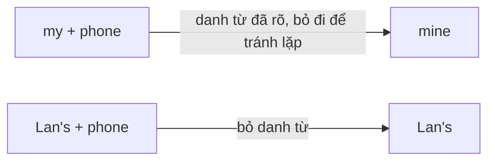
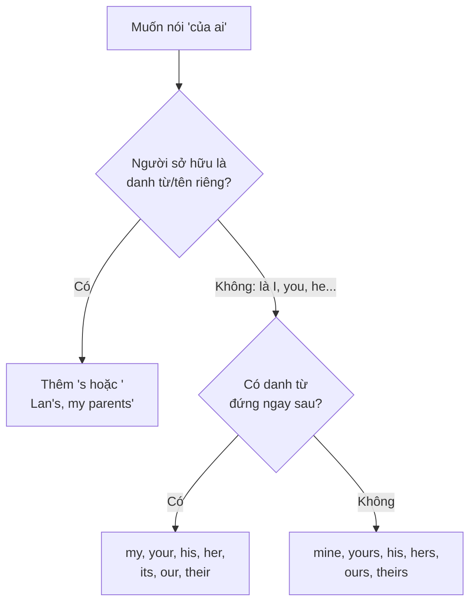

# A1-G006 · Possessive Adjectives, Possessive Pronouns & 's — Sở hữu trong tiếng Anh

## Mục lục

- [A. Lesson Information](#a-lesson-information)
- [B. Warm-up](#b-warm-up-tình-huống-thực-tế)
- [C. WHAT](#c-what-ba-cách-thể-hiện-sở-hữu)
- [D. WHY](#d-why-vì-sao-có-my-và-mine)
- [E. FORM](#e-form-bảng-tổng-hợp)
- [F. HOW](#f-how-ví-dụ-phân-tích)
- [G. VISUAL](#g-visual-explanation)
- [H. COMPARISON](#h-comparison)
- [I. COMMON MISTAKES](#i-common-mistakes)
- [J. MEMORY TRICKS](#j-memory-tricks)
- [K. REAL-LIFE APPLICATION](#k-real-life-application)
- [L. PRACTICE EXERCISES](#l-practice-exercises)
- [M. KNOWLEDGE CHECK](#m-knowledge-check)
- [N. ANSWER KEY](#n-answer-key)

---

## A. Lesson Information

| Mục | Nội dung |
|---|---|
| **Lesson ID** | A1-G006 |
| **Topic** | Possessive Adjectives, Possessive Pronouns & Possessive 's |
| **Tên tiếng Việt** | Tính từ sở hữu, đại từ sở hữu và sở hữu cách |
| **CEFR Level** | A1 |
| **Prerequisites** | [A0-G006 — Subject Pronouns](../../01-A0-FOUNDATION/grammar/A0-G006-subject-pronouns.md) |
| **Estimated Time** | 75 phút |

**Learning Objectives:**

1. Dùng **tính từ sở hữu** (*my, your, his, her, its, our, their*) trước danh từ.
2. Dùng **đại từ sở hữu** (*mine, yours, his, hers, ours, theirs*) thay cho "tính từ sở hữu + danh từ".
3. Dùng **sở hữu cách 's** (*Lan's bag, my parents' house*).
4. Hỏi *Whose...?* và trả lời.
5. Phân biệt các cặp dễ nhầm: *its/it's, your/you're, their/there/they're, his/her*.

---

## B. Warm-up: Tình huống thực tế

Sau buổi họp, có một chiếc điện thoại để quên trên bàn. Người quản lý hỏi:

> *"Whose phone is this?"*

Bạn muốn nói:
- "Đó là điện thoại **của tôi**."
- "Không, của tôi màu đen. Cái này **của Lan**."
- "Không phải **của họ** đâu."

🤔 **Hãy suy nghĩ:** Tiếng Việt chỉ cần một từ "**của**" + người sở hữu. Tiếng Anh có những cách nào để nói "của tôi", "của Lan", "của họ"? Vì sao có lúc nói *my phone*, có lúc lại nói *mine*?

---

## C. WHAT: Ba cách thể hiện sở hữu

| Cách | Tên | Vị trí | Ví dụ |
|---|---|---|---|
| 1 | **Possessive adjective** (tính từ sở hữu) | **Trước danh từ** | *This is **my** phone.* |
| 2 | **Possessive pronoun** (đại từ sở hữu) | **Đứng một mình**, thay cho cả cụm "tính từ sở hữu + danh từ" | *This phone is **mine**.* |
| 3 | **Possessive 's** (sở hữu cách) | Gắn sau **tên người/danh từ** | *This is **Lan's** phone.* / *It's **Lan's**.* |

---

## D. WHY: Vì sao có *my* và *mine*?

Trong tiếng Việt, "của tôi" có thể đứng sau danh từ ("điện thoại của tôi") hoặc đứng một mình ("cái này của tôi"). Tiếng Anh tách thành **hai từ khác nhau** cho hai vị trí này:



- **my** cần một danh từ theo sau — nó giống một tính từ "mô tả" danh từ đó thuộc về ai.
- **mine** đã "chứa" danh từ bên trong (*mine* = *my* + phone/book/bag...) — nên **không** có danh từ theo sau.

**Quan trọng:** Tính từ sở hữu thay đổi theo **người sở hữu**, không theo vật được sở hữu. *His* luôn là "của anh ấy" — dù vật đó là *his mother* hay *his car*. Đây là điểm khác một số ngôn ngữ châu Âu.

---

## E. FORM: Bảng tổng hợp

| Đại từ chủ ngữ | Tính từ sở hữu (+ N) | Đại từ sở hữu (đứng một mình) | Nghĩa |
|---|---|---|---|
| I | **my** | **mine** | của tôi |
| you | **your** | **yours** | của bạn / các bạn |
| he | **his** | **his** | của anh ấy |
| she | **her** | **hers** | của cô ấy |
| it | **its** | — (hầu như không dùng) | của nó |
| we | **our** | **ours** | của chúng tôi / chúng ta |
| they | **their** | **theirs** | của họ |

### Possessive 's — quy tắc viết

| Người sở hữu | Quy tắc | Ví dụ |
|---|---|---|
| Danh từ số ít / tên người | + **'s** | *my sister**'s** room, Nam**'s** car* |
| Tên tận cùng bằng *s* | + **'s** (phổ biến) hoặc chỉ **'** | *James**'s** bike* / *James**'** bike* (cả hai chấp nhận) |
| Danh từ số nhiều tận cùng *-s* | chỉ thêm **'** | *my parents**'** house, the students**'** books* |
| Danh từ số nhiều bất quy tắc (không có *-s*) | + **'s** | *the children**'s** toys, women**'s** clothes, people**'s** opinions* |
| Hai người cùng sở hữu một vật | 's ở người **sau cùng** | *Tom and Anna**'s** flat* (căn hộ chung) |

**Lưu ý phát âm:** *'s* đọc giống đuôi số nhiều: /s/ (*Mark's*), /z/ (*Lan's*), /ɪz/ (*George's* /ˈdʒɔːdʒɪz/).

### Hỏi về sở hữu: *Whose*

| Câu hỏi | Trả lời |
|---|---|
| ***Whose** bag is this?* | *It's **mine**. / It's **my** bag. / It's **Hoa's**.* |
| ***Whose** are these keys?* | *They're **his**.* |

---

## F. HOW: Ví dụ phân tích

| # | English | Tiếng Việt | Phân tích |
|---|---|---|---|
| 1 | ***My** sister is a doctor.* | Chị tôi là bác sĩ. | *my* + N |
| 2 | *This isn't **your** coffee. **Yours** is on the table.* | Đây không phải cà phê của bạn. Của bạn ở trên bàn. | *your* + N → *yours* đứng một mình |
| 3 | *Tuan loves **his** job.* | Tuấn yêu công việc của mình. | Người sở hữu là Tuấn (nam) → *his* |
| 4 | *Mai lives with **her** brother.* | Mai sống với anh trai của cô ấy. | Người sở hữu là Mai (nữ) → *her*, dù *brother* là nam |
| 5 | *The cat is eating **its** food.* | Con mèo đang ăn thức ăn của nó. | *its* — **không** có dấu ' |
| 6 | *We love **our** new flat.* | Chúng tôi thích căn hộ mới của mình. | |
| 7 | *They sold **their** car. Now this car is **ours**.* | Họ bán xe của họ. Giờ xe này là của chúng tôi. | |
| 8 | *This is **Minh's** laptop.* | Đây là laptop của Minh. | Tên + 's |
| 9 | *My **parents'** house is in Hue.* | Nhà bố mẹ tôi ở Huế. | Số nhiều *-s* → chỉ thêm ' |
| 10 | *The **children's** room is upstairs.* | Phòng của bọn trẻ ở tầng trên. | Số nhiều bất quy tắc → 's |
| 11 | *"**Whose** umbrella is this?" — "It's **hers**."* | "Cái ô này của ai?" — "Của cô ấy." | *hers* — không có ' |
| 12 | *A friend of **mine** lives in Paris.* | Một người bạn của tôi sống ở Paris. | Cấu trúc *a friend of mine/yours/his...* |

---

## G. VISUAL EXPLANATION

### G1. Câu "chuyển hóa" — tránh lặp từ

```text
This is my book.      →  This book is MINE.
That's your seat.     →  That seat is YOURS.
These are Lan's keys. →  These keys are LAN'S.
```

### G2. Sơ đồ chọn từ



---

## H. COMPARISON

### Các cặp đồng âm/dễ nhầm

| Từ | Nghĩa | Ví dụ |
|---|---|---|
| **its** | của nó (sở hữu) | *The dog wagged **its** tail.* |
| **it's** | = *it is* / *it has* | ***It's** raining.* |
| **your** | của bạn | *Is this **your** pen?* |
| **you're** | = *you are* | ***You're** right.* |
| **their** | của họ | ***Their** house is big.* |
| **there** | ở đó / *there is* | *Put it **there**.* |
| **they're** | = *they are* | ***They're** late.* |
| **whose** | của ai | ***Whose** is this?* |
| **who's** | = *who is* | ***Who's** that?* |

**Mẹo kiểm tra:** Thử thay bằng dạng đầy đủ (*it is, you are, they are, who is*). Nếu câu vẫn đúng → dùng dạng có dấu '. Nếu sai → dùng dạng sở hữu.

### *His* và *her* — theo người sở hữu, không theo vật

| Tiếng Việt | ❌ | ✅ |
|---|---|---|
| Lan và bố **của cô ấy** | Lan and **his** father | Lan and **her** father |
| Nam và mẹ **của anh ấy** | Nam and **her** mother | Nam and **his** mother |

---

## I. COMMON MISTAKES

| # | ❌ Sai | ✅ Đúng | Nguyên nhân | Cách tránh |
|---|---|---|---|---|
| 1 | This is **mine** book. | This is **my** book. | Dùng đại từ sở hữu trước danh từ | Có danh từ sau → *my* |
| 2 | This book is **my**. | This book is **mine**. | Dùng tính từ sở hữu đứng một mình | Không có danh từ sau → *mine* |
| 3 | Lan loves **his** mother. | Lan loves **her** mother. | Chọn theo giới tính của người được sở hữu | Theo người **sở hữu** |
| 4 | The dog is eating **it's** food. | ...**its** food. | Nhầm với *it's* | *its* sở hữu không có ' |
| 5 | **The house of my parents** is big. (đúng ngữ pháp nhưng kém tự nhiên) | **My parents' house** is big. | Dịch "nhà của bố mẹ tôi" | Với người → ưu tiên 's |
| 6 | This is **yours's**/**your's** bag. | This is **your** bag. / This bag is **yours**. | | Không có *your's* |
| 7 | The **childrens'** toys | The **children's** toys | Số nhiều bất quy tắc | *children* + 's |
| 8 | **Who's** pen is this? | **Whose** pen is this? | Đồng âm | *Who's* = *Who is* |

---

## J. MEMORY TRICKS

1. **"Mine đứng một mình"**: Các đại từ sở hữu (*mine, yours, hers, ours, theirs*) giống những người "độc lập", không cần danh từ đi kèm. Hầu hết kết thúc bằng **-s** (trừ *mine*).
2. **"Dấu phẩy trên = chữ bị mất"**: *it's* = *it **i**s* (mất chữ *i*). *its* sở hữu không mất gì → không có dấu.
3. **"Hỏi: của AI?"**: Muốn chọn *his/her*, hãy hỏi "của **ai**?", không hỏi "**cái gì**".
4. **'s cho người và động vật**: *Lan's car, the dog's bed*. Với đồ vật thường dùng *of*: *the end **of** the film, the door **of** the room* (hoặc danh từ ghép *the room door*). ⚠️ Có ngoại lệ với thời gian, nơi chốn (*today's news, Vietnam's capital*).

---

## K. REAL-LIFE APPLICATION

### Hội thoại: Đồ để quên sau buổi họp

> **Manager:** **Whose** phone is this?
> **Hien:** Not **mine**. **Mine** is in **my** bag.
> **Duc:** I think it's **Linh's**. **Her** phone has a pink case.
> **Manager:** And these glasses? Are they **yours**, Duc?
> **Duc:** No, they're not. Maybe they're **Mr Kim's**. He always forgets **his** glasses.
> **Hien:** And that's **our** report on the chair. Thanks!
> **Manager:** OK. Oh, and whose is this coffee? **It's** still hot!
> **Duc:** Oops, that's **mine**!

**Vietnamese explanation:** Sau buổi họp, quản lý hỏi đồ để quên. Điện thoại có ốp hồng là của Linh; kính có lẽ của ông Kim (hay quên kính); báo cáo là của nhóm Hiền; ly cà phê là của Đức.

**Grammar highlights:** *Whose...?; mine (×3), my bag, Linh's, Her phone, yours, Mr Kim's, his glasses, our report, It's (= it is)*.

**Useful expressions:** *Not mine.* (Không phải của tôi.) · *Maybe...* (Có lẽ...) · *Oops!* (Úi!)

---

## L. PRACTICE EXERCISES

> ✍️ Đáp án: [A1-G006-ANSWERS](../../12-ANSWERS-AND-EXPLANATIONS/A1/A1-G006-ANSWERS.md)

### Level 1 — Recognition

**L1.1.** Is this ___ pen?  A. you  B. your  C. yours
**L1.2.** That car isn't ___. Ours is red.  A. our  B. ours  C. us
**L1.3.** Hoa is talking to ___ father.  A. his  B. her  C. hers
**L1.4.** The bird is building ___ nest.  A. it's  B. its  C. it
**L1.5.** ___ is this jacket?  A. Who's  B. Whose  C. Who
**L1.6.** This is my ___ room.  A. parents'  B. parent's  C. parents's

### Level 2 — Controlled Practice

Điền tính từ sở hữu hoặc đại từ sở hữu.

**L2.1.** I have a cat. ___ name is Miu.
**L2.2.** "Is this Nam's bag?" – "No, ___ is black."
**L2.3.** We live in a small flat. ___ flat is on the third floor.
**L2.4.** "Are these your keys?" – "Yes, they're ___."
**L2.5.** My neighbours are noisy. ___ dog barks all night.
**L2.6.** Lan, is this ___ book or ___? (của bạn hay của tôi)

Viết lại dùng sở hữu cách:

**L2.7.** the car of my brother → ______
**L2.8.** the toys of the children → ______
**L2.9.** the office of the teachers → ______
**L2.10.** the flat of Tom and Anna (chung) → ______

### Level 3 — Error Correction

**L3.1.** This is mine new phone.
**L3.2.** Nam often visits her grandmother. (Nam là nam)
**L3.3.** The house of my uncle is very old.
**L3.4.** Who's car is that?
**L3.5.** These books are your's.
**L3.6.** The company has changed it's logo.

### Level 4 — Production

Dịch sang tiếng Anh:

**L4.1.** Đây là phòng của chị gái tôi.
**L4.2.** Điện thoại của tôi cũ, nhưng của anh ấy thì mới.
**L4.3.** Chiếc xe đạp này của ai? — Của bọn trẻ.
**L4.4.** Một người bạn của tôi làm việc ở Singapore.
**L4.5.** Họ yêu căn nhà của họ.

### Level 5 — Real Communication

**L5.1.** Viết 6–8 câu giới thiệu gia đình bạn qua một bức ảnh, dùng ít nhất 5 cách sở hữu khác nhau (*my, his, her, their, 's, mine...*).
**L5.2.** **Speaking — Lost and found:** Đóng vai nhân viên quầy đồ thất lạc. Nói 6 câu hỏi/đáp với *Whose...?* và đại từ sở hữu về các món: ô, ví, kính, chìa khóa, áo khoác, sạc điện thoại.

---

## M. KNOWLEDGE CHECK

### 5 câu hỏi tự kiểm tra

1. *my* và *mine* khác nhau về vị trí thế nào?
2. Khi nào chỉ thêm *'* thay vì *'s*?
3. "Lan và em trai của cô ấy" dùng *his* hay *her*? Vì sao?
4. *its* và *it's* khác nhau thế nào?
5. Hỏi "Cái áo này của ai?" bằng tiếng Anh.

### Checklist

- [ ] Tôi dùng đúng 7 tính từ sở hữu và 6 đại từ sở hữu.
- [ ] Tôi viết đúng 's cho số ít, số nhiều, số nhiều bất quy tắc.
- [ ] Tôi không còn nhầm *its/it's, your/you're, their/they're, whose/who's*.

### 3 lỗi quan trọng cần nhớ

1. ~~mine book~~ → **my** book; ~~is my~~ → is **mine**.
2. *his/her* theo **người sở hữu**.
3. ~~it's food~~ → **its** food.

### Lịch ôn tập

| Ngày | Việc cần làm |
|---|---|
| Ngày 1 | Làm lại L2 |
| Ngày 3 | Viết 10 câu về đồ vật của các thành viên trong gia đình |
| Ngày 7 | Làm lại L3; tự kiểm tra cặp đồng âm |

### Liên kết

- ➡️ Bài tiếp theo: [A1-G007 — Object Pronouns](A1-G007-object-pronouns.md)
- 🔁 Từ vựng: [VOC-02 — Family & Relationships](../../07-VOCABULARY/VOC-02-family-relationships.md)

---

## N. ANSWER KEY

👉 [A1-G006-ANSWERS.md](../../12-ANSWERS-AND-EXPLANATIONS/A1/A1-G006-ANSWERS.md)
