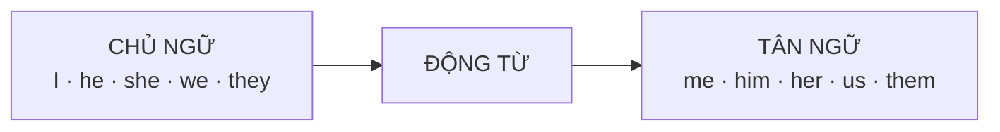

# A1-G007 · Object Pronouns — Đại từ tân ngữ

## Mục lục

- [A. Lesson Information](#a-lesson-information)
- [B. Warm-up](#b-warm-up-tình-huống-thực-tế)
- [C. WHAT](#c-what-đại-từ-tân-ngữ-là-gì)
- [D. WHY](#d-why-vì-sao-i-thành-me)
- [E. FORM](#e-form-bảng-đại-từ-đầy-đủ)
- [F. HOW](#f-how-ba-vị-trí-của-đại-từ-tân-ngữ)
- [G. VISUAL](#g-visual-explanation)
- [H. COMPARISON](#h-comparison)
- [I. COMMON MISTAKES](#i-common-mistakes)
- [J. MEMORY TRICKS](#j-memory-tricks)
- [K. REAL-LIFE APPLICATION](#k-real-life-application)
- [L. PRACTICE EXERCISES](#l-practice-exercises)
- [M. KNOWLEDGE CHECK](#m-knowledge-check)
- [N. ANSWER KEY](#n-answer-key)

---

## A. Lesson Information

| Mục | Nội dung |
|---|---|
| **Lesson ID** | A1-G007 |
| **Topic** | Object Pronouns |
| **Tên tiếng Việt** | Đại từ tân ngữ |
| **CEFR Level** | A1 |
| **Prerequisites** | [A0-G007 — Subject, Verb, Object](../../01-A0-FOUNDATION/grammar/A0-G007-subject-verb-object.md), [A1-G006](A1-G006-possessives.md) |
| **Estimated Time** | 60 phút |

**Learning Objectives:**

1. Dùng đúng 7 đại từ tân ngữ: *me, you, him, her, it, us, them*.
2. Đặt đại từ tân ngữ **sau động từ** và **sau giới từ**.
3. Dùng mẫu hai tân ngữ: *give **me** the book* / *give the book **to me***.
4. Phân biệt khi nào dùng *I/me*, *he/him*, *they/them*.
5. Hoàn thiện bảng 4 dạng đại từ: chủ ngữ – tân ngữ – tính từ sở hữu – đại từ sở hữu.

---

## B. Warm-up: Tình huống thực tế

Tin nhắn của một người học:

> *"Hi Lan, I miss you. Can you call I tonight? My mother wants to see you and she. We love they very much!"*

Người nhận hiểu ý, nhưng câu nghe rất lạ.

🤔 **Hãy suy nghĩ:** Trong tiếng Việt, "tôi" là "tôi" dù đứng đầu câu ("**Tôi** gọi bạn") hay cuối câu ("Bạn gọi **tôi**"). Tiếng Anh có giữ nguyên *I* ở cả hai vị trí không? Câu đúng sẽ là gì?

---

## C. WHAT: Đại từ tân ngữ là gì?

**Object pronoun** (đại từ tân ngữ) là đại từ đứng ở vị trí **tân ngữ** — người/vật **chịu tác động** của hành động — hoặc đứng **sau giới từ**.

| Vị trí chủ ngữ (làm hành động) | Vị trí tân ngữ (chịu hành động) |
|---|---|
| ***I** love Lan.* | *Lan loves **me**.* |
| ***She** calls us.* | *We call **her**.* |
| ***They** help him.* | *He helps **them**.* |

---

## D. WHY: Vì sao *I* thành *me*?

Tiếng Việt xác định vai trò của từ **chỉ bằng vị trí**. Tiếng Anh cũng dùng vị trí, nhưng với **đại từ** thì nó còn **đổi hình thức** — một dấu vết của hệ thống "cách" (case) trong tiếng Anh cổ. Danh từ đã mất hệ thống này (*Lan* vẫn là *Lan* ở mọi vị trí), nhưng đại từ vẫn giữ lại.



Lợi ích: Khi nghe *Him? I don't like him*, bạn biết ngay *him* là người **bị** không thích — dù không có ngữ cảnh.

---

## E. FORM: Bảng đại từ đầy đủ

| Chủ ngữ | **Tân ngữ** | Tính từ sở hữu | Đại từ sở hữu |
|---|---|---|---|
| I | **me** | my | mine |
| you | **you** | your | yours |
| he | **him** | his | his |
| she | **her** | her | hers |
| it | **it** | its | — |
| we | **us** | our | ours |
| they | **them** | their | theirs |

> 💡 *you* và *it* **không đổi** ở vị trí tân ngữ. *her* vừa là tân ngữ vừa là tính từ sở hữu (*I see **her*** / *I see **her** car*).

### Ba vị trí đại từ tân ngữ

| Vị trí | Công thức | Ví dụ |
|---|---|---|
| 1. Sau động từ | S + V + **object pronoun** | *I know **him**.* |
| 2. Sau giới từ | preposition + **object pronoun** | *This gift is for **you**.* / *Come with **us**.* |
| 3. Hai tân ngữ | S + V + **người** + **vật** | *She gave **me** a book.* |
| | S + V + **vật** + to/for + **người** | *She gave a book **to me**.* |

**Ký hiệu:** Trong mẫu 3, tân ngữ chỉ người gọi là **indirect object** (tân ngữ gián tiếp), tân ngữ chỉ vật là **direct object** (tân ngữ trực tiếp).

### Động từ hai tân ngữ thường gặp

| Với *to* | Với *for* |
|---|---|
| give, send, show, tell, teach, lend, pass, write, sell, bring | buy, make, cook, get, find, book |
| *Send **it to me**.* | *Buy **one for her**.* |

> ⚠️ Khi **vật** là đại từ (*it, them*), dùng mẫu có *to/for*: ✅ *Give **it to me**.* ❌ *Give me it.* (rất hạn chế, không chuẩn trong văn viết).

---

## F. HOW: Ba vị trí của đại từ tân ngữ

| # | English | Tiếng Việt | Phân tích |
|---|---|---|---|
| 1 | *Can you help **me**?* | Bạn giúp tôi được không? | Sau động từ *help* |
| 2 | *I don't know **him**.* | Tôi không biết anh ta. | |
| 3 | *We visit **them** every Tet.* | Tết nào chúng tôi cũng thăm họ. | *them* = ông bà, bố mẹ... |
| 4 | *"Do you like this song?" — "Yes, I love **it**!"* | | *it* thay cho *this song* |
| 5 | *Please sit next to **me**.* | Hãy ngồi cạnh tôi. | Sau giới từ *next to* |
| 6 | *Is this message for **us**?* | Tin nhắn này cho chúng ta à? | Sau giới từ *for* |
| 7 | *My dad bought **her** a bike.* | Bố tôi mua cho cô ấy một chiếc xe đạp. | Hai tân ngữ: người + vật |
| 8 | *My dad bought a bike **for her**.* | (như trên) | vật + *for* + người |
| 9 | *Can you send **it to me** today?* | Bạn gửi nó cho tôi hôm nay được không? | Vật là đại từ → dùng *to* |
| 10 | *Tell **them** the truth.* | Hãy nói với họ sự thật. | Mệnh lệnh |
| 11 | *Who's there? — It's **me**.* | Ai đó? — Tôi đây. | Sau *be* trong văn nói: *It's me* (không nói *It's I*) |
| 12 | *"I'm tired." — "**Me** too."* | "Tôi mệt." — "Tôi cũng vậy." | Trả lời ngắn thân mật dùng *me* |

---

## G. VISUAL EXPLANATION

### Bảng gương: cùng một người, hai vai trò

```text
     She   likes   him.       He   likes   her.
     ───           ───        ──           ───
   (chủ ngữ)    (tân ngữ)  (chủ ngữ)    (tân ngữ)

     We   invite   them.      They   invite   us.
```

### Breakdown câu hai tân ngữ

`My teacher | gave | us | a lot of homework.`

| Phần | Vai trò |
|---|---|
| My teacher | Chủ ngữ |
| gave | Động từ (quá khứ của *give* — học ở A1-G017) |
| **us** | Tân ngữ gián tiếp — **ai** nhận |
| a lot of homework | Tân ngữ trực tiếp — **cái gì** được cho |

---

## H. COMPARISON

### *Me* hay *I* trong cụm có hai người?

Mẹo: **bỏ người kia đi** rồi kiểm tra.

| Câu | Bỏ "Lan and" | Kết luận |
|---|---|---|
| *Lan and **I** are friends.* | *I are friends* → *I am* ✓ (chủ ngữ) | ✅ *Lan and I* |
| *Lan and **me** are friends.* | *Me am...* ✗ | ❌ |
| *She invited Lan and **me**.* | *She invited me* ✓ (tân ngữ) | ✅ *Lan and me* |
| *She invited Lan and **I**.* | *She invited I* ✗ | ❌ (lỗi cả người bản ngữ cũng hay mắc) |

> 💡 Theo phép lịch sự, đặt **người khác trước**: *Lan and I*, *my friend and me*.

### Đại từ tân ngữ và tính từ sở hữu

| | Ví dụ |
|---|---|
| Tân ngữ (đứng một mình sau V) | *I called **him**.* |
| Tính từ sở hữu (trước danh từ) | *I called **his** mother.* |

---

## I. COMMON MISTAKES

| # | ❌ Sai | ✅ Đúng | Nguyên nhân | Cách tránh |
|---|---|---|---|---|
| 1 | Can you call **I**? | Can you call **me**? | Tiếng Việt không đổi đại từ | Sau động từ → dạng tân ngữ |
| 2 | We love **they**. | We love **them**. | | |
| 3 | This is for **she**. | This is for **her**. | | Sau giới từ → dạng tân ngữ |
| 4 | **Me and my sister** live in Hue. | **My sister and I** live in Hue. | | Chủ ngữ → *I*; lịch sự đặt *I* sau |
| 5 | Give **me it**. | Give **it to me**. | | Vật là đại từ → *to/for* |
| 6 | I like **it** the film. | I like the film. / I like **it**. | Dùng cả danh từ và đại từ | Chọn một |
| 7 | She gave **to me** a gift. | She gave **me** a gift. / She gave a gift **to me**. | Trộn hai mẫu | Người + vật **hoặc** vật + *to* + người |
| 8 | My mother loves **he** very much. | My mother loves **him** very much. | | |

---

## J. MEMORY TRICKS

1. **"Sau động từ, sau giới từ → dạng tân ngữ"** — gần như không có ngoại lệ ở cấp A1.
2. **Mẹo "bỏ người kia"** (mục H) cho cụm có hai người.
3. **Cặp vần**: *I–me, he–him, she–her, we–us, they–them*. Đọc to theo nhịp 10 lần mỗi ngày trong 3 ngày.
4. **"Nhận quà"**: Trong *give/send/buy*, người **nhận** đứng ngay sau động từ (*give **me** a gift*) hoặc sau *to/for* (*give a gift **to me***).

---

## K. REAL-LIFE APPLICATION

### Tin nhắn: Kế hoạch sinh nhật bất ngờ

> **Nam:** Hi! It's Huong's birthday on Friday. Let's surprise **her**!
> **Thao:** Great idea! I can make a cake for **her**.
> **Nam:** Perfect. Can you ask Bao and Vy? Invite **them** to my place at 7.
> **Thao:** Sure. Do you know her best friend, Kim? Should we call **her** too?
> **Nam:** Yes, but I don't have her number. Can you send **it to me**?
> **Thao:** OK. And what can we buy **her**?
> **Nam:** She loves books. Let's buy **her** a novel. I can give **it to her** at the party.
> **Thao:** Sounds good. Don't tell **her** anything!

**Vietnamese explanation:** Nam và Thảo lên kế hoạch sinh nhật bất ngờ cho Hương: Thảo làm bánh, mời Bảo và Vy, gọi cả Kim (bạn thân của Hương). Họ quyết định mua tặng Hương một cuốn tiểu thuyết.

**Grammar highlights:** *surprise her, for her, invite them, call her, send it to me, buy her a novel, give it to her, tell her*. *Let's* và *should* sẽ học kỹ ở các bài sau; ở đây dùng như cụm cố định.

**Useful expressions:** *Let's surprise her!* · *Great idea!* · *Sounds good.* · *Don't tell her anything!*

---

## L. PRACTICE EXERCISES

> ✍️ Đáp án: [A1-G007-ANSWERS](../../12-ANSWERS-AND-EXPLANATIONS/A1/A1-G007-ANSWERS.md)

### Level 1 — Recognition

**L1.1.** I can't find my keys. Can you see ___?  A. it  B. them  C. they
**L1.2.** My grandmother is ill. I visit ___ every day.  A. she  B. her  C. hers
**L1.3.** Please wait for ___. We're coming!  A. we  B. our  C. us
**L1.4.** Who is that man? Do you know ___?  A. he  B. him  C. his
**L1.5.** ___ and my brother are teachers.  A. Me  B. I  C. My
**L1.6.** Which is correct?  A. Give me it.  B. Give it to me.  C. Give to me it.

### Level 2 — Controlled Practice

Thay phần in đậm bằng đại từ tân ngữ.

**L2.1.** I often call **my parents**.
**L2.2.** She loves **this song**.
**L2.3.** We meet **Mr Long** on Mondays.
**L2.4.** They invited **my wife and me**.
**L2.5.** Can you help **your sister**?

Viết lại theo mẫu còn lại (người + vật ↔ vật + to/for + người):

**L2.6.** She sent me a message. → ______
**L2.7.** I bought a scarf for my mother. → ______ (dùng *her*)
**L2.8.** Can you show us the photos? → ______
**L2.9.** He cooked dinner for them. → ______
**L2.10.** Tell him the news. → ______

### Level 3 — Error Correction

**L3.1.** My boss always helps I.
**L3.2.** Me and Tuan are best friends.
**L3.3.** This present is for she.
**L3.4.** Please give me it.
**L3.5.** My parents love we very much.
**L3.6.** She told to us a funny story.

### Level 4 — Production

Dịch sang tiếng Anh:

**L4.1.** Tôi nhớ bạn.
**L4.2.** Anh ấy gửi cho tôi một bức thư. (2 cách)
**L4.3.** Bạn có thể đi cùng chúng tôi không? (*come with*)
**L4.4.** Đừng lo về họ. (*Don't worry about...*)
**L4.5.** Mẹ tôi nấu bữa sáng cho chúng tôi mỗi ngày.

### Level 5 — Real Communication

**L5.1.** Viết đoạn tin nhắn 8–10 dòng lên kế hoạch tặng quà/bất ngờ cho một người (theo mẫu K), dùng đại từ tân ngữ ít nhất 6 lần (ít nhất 4 loại khác nhau) và 2 câu có hai tân ngữ.
**L5.2.** **Speaking:** Nói về 3 người quan trọng với bạn. Với mỗi người, nói 2–3 câu dùng đại từ tân ngữ: *My mother is very kind. I call her every day. She always helps me...*

---

## M. KNOWLEDGE CHECK

### 5 câu hỏi tự kiểm tra

1. Kể 7 đại từ tân ngữ tương ứng với 7 đại từ chủ ngữ.
2. Hai vị trí chính của đại từ tân ngữ là gì?
3. Vì sao *Give me it* không chuẩn?
4. Dùng mẹo gì để chọn *I* hay *me* trong *My friend and ___*?
5. Động từ nào đi với *for*: *give, buy, send, cook*?

### Checklist

- [ ] Tôi dùng đúng đại từ tân ngữ sau động từ và giới từ.
- [ ] Tôi dùng được mẫu hai tân ngữ theo cả hai cách.
- [ ] Tôi không còn viết *Me and X* làm chủ ngữ.

### 3 lỗi quan trọng cần nhớ

1. ~~call I / love they~~ → call **me** / love **them**.
2. ~~Me and my sister live~~ → **My sister and I** live.
3. ~~Give me it~~ → Give **it to me**.

### Lịch ôn tập

| Ngày | Việc cần làm |
|---|---|
| Ngày 1 | Làm lại L2 |
| Ngày 3 | Viết bảng 4 dạng đại từ (mục E) từ trí nhớ |
| Ngày 7 | Làm lại L3, L4 |

### Liên kết

- ➡️ Bài tiếp theo: [A1-G008 — Have Got](A1-G008-have-got.md)
- 🔜 Mở rộng: [A2-G030 — Reflexive Pronouns](../../03-A2-ELEMENTARY/grammar/A2-G030-reflexive-pronouns.md)

---

## N. ANSWER KEY

👉 [A1-G007-ANSWERS.md](../../12-ANSWERS-AND-EXPLANATIONS/A1/A1-G007-ANSWERS.md)
