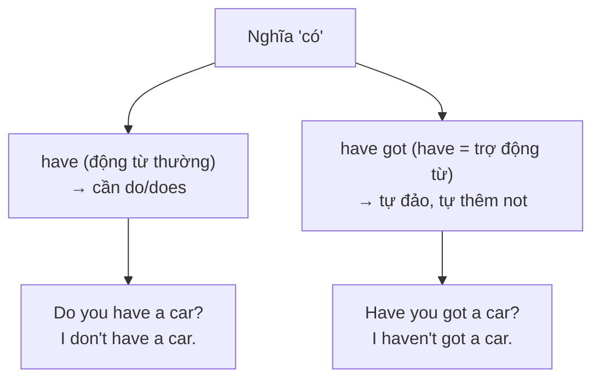

# A1-G008 · Have Got — Cấu trúc Have got

## Mục lục

- [A. Lesson Information](#a-lesson-information)
- [B. Warm-up](#b-warm-up-tình-huống-thực-tế)
- [C. WHAT](#c-what-have-got-là-gì)
- [D. WHY](#d-why-vì-sao-có-thêm-have-got)
- [E. FORM](#e-form-công-thức)
- [F. HOW](#f-how-cách-dùng)
- [G. VISUAL](#g-visual-explanation)
- [H. COMPARISON](#h-comparison-have-got-và-have)
- [I. COMMON MISTAKES](#i-common-mistakes)
- [J. MEMORY TRICKS](#j-memory-tricks)
- [K. REAL-LIFE APPLICATION](#k-real-life-application)
- [L. PRACTICE EXERCISES](#l-practice-exercises)
- [M. KNOWLEDGE CHECK](#m-knowledge-check)
- [N. ANSWER KEY](#n-answer-key)

---

## A. Lesson Information

| Mục | Nội dung |
|---|---|
| **Lesson ID** | A1-G008 |
| **Topic** | Have Got |
| **Tên tiếng Việt** | Cấu trúc *have got* (có — sở hữu) |
| **CEFR Level** | A1 |
| **Prerequisites** | [A0-G010 — Have/Has](../../01-A0-FOUNDATION/grammar/A0-G010-have-has.md), [A1-G002](A1-G002-present-simple-negatives-questions.md) |
| **Estimated Time** | 60 phút |

**Learning Objectives:**

1. Hiểu *have got / has got* = *have / has* (sở hữu, quan hệ, đặc điểm, bệnh) — phổ biến trong tiếng Anh – Anh.
2. Tạo câu phủ định (*haven't got / hasn't got*) và câu hỏi (*Have you got...?*) **không cần do/does**.
3. Biết khi nào **không** dùng được *have got* (thói quen, hành động: *have breakfast, have a shower*).
4. Nhận ra *I've got* trong văn nói nhanh.
5. Không trộn hai hệ thống: ~~Do you have got~~, ~~I don't have got~~.

---

## B. Warm-up: Tình huống thực tế

Bạn xem một bộ phim Anh và nghe các câu:

> *"**I've got** a headache."*
> *"**Have you got** a pen?" — "Yes, **I have**."*
> *"She **hasn't got** any money."*

Bạn đã học ở A0-G010: *I have a headache. Do you have a pen? She doesn't have any money.*

🤔 **Hãy suy nghĩ:** Hai cách nói này có cùng nghĩa không? Tại sao câu hỏi *Have you got...?* không cần *Do*? Còn câu trả lời ngắn *Yes, I have* khác *Yes, I do* thế nào?

---

## C. WHAT: *Have got* là gì?

**Have got** là một cách nói khác của **have** khi mang nghĩa **"có"** — sở hữu, quan hệ, đặc điểm, bệnh tật. Nó đặc biệt phổ biến trong **tiếng Anh – Anh văn nói**. Người Mỹ cũng hiểu và dùng, nhưng thường dùng *have* hơn.

| Nghĩa | *have* | *have got* |
|---|---|---|
| Sở hữu | *I have a car.* | *I've got a car.* |
| Gia đình | *She has two sons.* | *She's got two sons.* |
| Ngoại hình | *He has blue eyes.* | *He's got blue eyes.* |
| Bệnh | *I have a cold.* | *I've got a cold.* |
| Lịch hẹn | *I have a meeting at 3.* | *I've got a meeting at 3.* |

**Lưu ý:** Ở đây *got* **không** mang nghĩa quá khứ của *get* (lấy được). *Have got* chỉ là một **cụm cố định** ở thì hiện tại, nghĩa là "có".

---

## D. WHY: Vì sao có thêm *have got*?

Trong văn nói tiếng Anh – Anh, *have* thường được **rút gọn**: *I've, he's*. Nhưng *I've a car* nghe "thiếu" và không tự nhiên. Người nói thêm *got* để câu "đầy đặn" hơn: *I've got a car*. Theo thời gian, *have got* trở thành một cấu trúc riêng.

Điểm quan trọng nhất: Trong *have got*, **have là trợ động từ** (giống *be*), nên nó **tự** tạo phủ định và câu hỏi — không cần *do/does*. Nói cách khác, *have got* thuộc **"gia đình 1"** ([A0-G016](../../01-A0-FOUNDATION/grammar/A0-G016-sentence-types.md)).

---

## E. FORM: Công thức

**Ký hiệu:** **S** = chủ ngữ · **O** = tân ngữ (thứ được "có").

| | I / you / we / they | he / she / it |
|---|---|---|
| ➕ | S + **have got** + O → *I've got* | S + **has got** + O → *She's got* |
| ➖ | S + **haven't got** + O | S + **hasn't got** + O |
| ❓ | **Have** + S + **got** + O? | **Has** + S + **got** + O? |
| 💬 | Yes, I **have**. / No, I **haven't**. | Yes, she **has**. / No, she **hasn't**. |
| Wh- | *What **have** you **got** in your bag?* | *How many children **has** she **got**?* |

**Rút gọn:**

- *I have got* → **I've got**; *she has got* → **she's got** (chú ý: *she's* ở đây = *she has*, không phải *she is*).
- *have not got* → **haven't got**; *has not got* → **hasn't got**.

> ⚠️ *She's got* (= she **has** got) và *She's tired* (= she **is** tired) cùng viết *She's*. Phân biệt bằng từ đứng sau: có *got* → *has*.

---

## F. HOW: Cách dùng

| # | English | Tiếng Việt | Phân tích |
|---|---|---|---|
| 1 | *I've **got** two brothers.* | Tôi có hai anh/em trai. | Gia đình |
| 2 | *My sister's **got** a new job.* | Chị tôi có việc mới. | *'s got* = *has got* |
| 3 | *We **haven't got** much time.* | Chúng ta không có nhiều thời gian. | Phủ định |
| 4 | ***Have** you **got** a pen? — Sorry, I **haven't**.* | Bạn có bút không? — Xin lỗi, tôi không có. | Câu hỏi + trả lời ngắn |
| 5 | *He's **got** short black hair and glasses.* | Anh ấy có tóc đen ngắn và đeo kính. | Ngoại hình |
| 6 | *I've **got** a terrible headache.* | Tôi bị đau đầu kinh khủng. | Bệnh |
| 7 | ***Has** your hotel **got** a pool? — Yes, it **has**.* | Khách sạn của bạn có hồ bơi không? — Có. | |
| 8 | *What **have** you **got** in your pocket?* | Bạn có gì trong túi? | Wh- |
| 9 | *They **haven't got** a car, so they cycle everywhere.* | Họ không có ô tô nên đi đâu cũng đạp xe. | |
| 10 | *I've **got** an exam tomorrow.* | Mai tôi có bài thi. | Lịch, sự kiện sắp tới |

---

## G. VISUAL EXPLANATION

### Bảng đối chiếu hai hệ thống

| | *have* (gia đình 2) | *have got* (gia đình 1) |
|---|---|---|
| ➕ | She **has** a dog. | She**'s got** a dog. |
| ➖ | She **doesn't have** a dog. | She **hasn't got** a dog. |
| ❓ | **Does** she **have** a dog? | **Has** she **got** a dog? |
| 💬 | Yes, she **does**. | Yes, she **has**. |

Hai hệ thống **không được trộn**: chọn một và đi hết câu.

---

## H. COMPARISON: *Have got* và *have*

| | *have* | *have got* |
|---|---|---|
| Sở hữu, quan hệ, đặc điểm, bệnh | ✅ | ✅ |
| Hành động/cụm cố định: *have breakfast, have a shower, have a party, have a good time* | ✅ | ❌ |
| Thói quen (*usually, every day*) | ✅ *I usually have lunch at 12.* | ❌ |
| Thì quá khứ | *had* | ❌ (dùng *had*, không dùng *had got* với nghĩa này) |
| Văn phong | Trung tính, Anh & Mỹ | Văn nói thân mật, đặc biệt Anh – Anh |
| Văn viết trang trọng (email công việc, bài luận) | ✅ Nên dùng | Hạn chế |

**Quy tắc ra quyết định:**
1. Nghĩa "có" (sở hữu/quan hệ/đặc điểm/bệnh) → dùng được cả hai.
2. Nghĩa "ăn, uống, tắm, tổ chức..." → **chỉ** *have*.
3. Văn viết trang trọng hoặc không chắc → dùng *have*.

---

## I. COMMON MISTAKES

| # | ❌ Sai | ✅ Đúng | Nguyên nhân | Cách tránh |
|---|---|---|---|---|
| 1 | **Do** you **have got** a car? | **Have** you **got** a car? / **Do** you **have** a car? | Trộn hai hệ thống | Chọn một |
| 2 | I **don't have got** time. | I **haven't got** time. / I **don't have** time. | Trộn | |
| 3 | She **have got** a cat. | She **has got** a cat. | Quên ngôi 3 | *he/she/it* → *has got* |
| 4 | I've **got** breakfast at 7 every day. | I **have** breakfast at 7 every day. | Dùng *have got* cho hành động | *have breakfast* là hành động |
| 5 | "Have you got a pen?" — "Yes, I **do**." | "Yes, I **have**." | Trả lời theo hệ thống *do* | Câu hỏi *Have* → trả lời *have* |
| 6 | **Have** you a pen? | **Have** you **got** a pen? / **Do** you **have** a pen? | Thiếu *got* | *Have you a...?* rất cổ, không dùng |
| 7 | I **got** a car. (ý: tôi có xe) | I**'ve got** a car. | Bỏ *have* trong văn nói nhanh | Văn viết cần *'ve* (*I got* = tôi đã nhận/mua — quá khứ) |

---

## J. MEMORY TRICKS

1. **"Have got = have có bạn đồng hành"**: *got* là "bạn đồng hành" của *have*; khi có bạn, *have* đủ mạnh để tự hỏi, tự phủ định — không cần gọi *do*.
2. **"Got không phải quá khứ ở đây"**: *I've got* = *I have*, hiện tại.
3. **Phép thử "có thể thay bằng 'sở hữu' không?"**: Nếu được → dùng được *have got*. *Have breakfast* ≠ "sở hữu bữa sáng" → không dùng *have got*.

---

## K. REAL-LIFE APPLICATION

### Hội thoại: Chuẩn bị đi dã ngoại

> **Emma:** OK, let's check. **Have** we **got** everything for the picnic?
> **Khoa:** I**'ve got** the sandwiches and some fruit.
> **Emma:** **Has** Lily **got** the drinks?
> **Khoa:** Yes, she **has**. But she **hasn't got** any cups.
> **Emma:** No problem. I**'ve got** some paper cups in my bag. **Have** you **got** sunscreen? It's really sunny.
> **Khoa:** Oh no, I **haven't**. And I**'ve got** very pale skin!
> **Emma:** Ha ha. Don't worry, you can use mine.

**Vietnamese explanation:** Emma và Khoa kiểm tra đồ cho buổi dã ngoại: Khoa mang bánh mì kẹp và trái cây; Lily mang đồ uống nhưng không có cốc; Emma có cốc giấy trong túi. Khoa không có kem chống nắng mà da lại rất trắng — Emma cho mượn của cô.

**Grammar highlights:** *Have we got...? / I've got / Has Lily got...? — Yes, she has. / hasn't got / Have you got...? — I haven't.*

**Useful expressions:** *Let's check.* (Kiểm tra xem nào.) · *No problem.* · *Oh no!* · *You can use mine.* (Bạn dùng của tôi đi.)

---

## L. PRACTICE EXERCISES

> ✍️ Đáp án: [A1-G008-ANSWERS](../../12-ANSWERS-AND-EXPLANATIONS/A1/A1-G008-ANSWERS.md)

### Level 1 — Recognition

**L1.1.** My neighbour ___ a big dog.  A. have got  B. has got  C. is got
**L1.2.** ___ you got a minute?  A. Do  B. Have  C. Are
**L1.3.** "Has she got a car?" — "No, she ___."  A. doesn't  B. hasn't  C. isn't
**L1.4.** In "She's got green eyes", *'s* = ___.  A. is  B. has  C. was
**L1.5.** Which is correct?  A. I've got lunch at 12.  B. I have lunch at 12.  C. I've lunch at 12.
**L1.6.** Which is correct?  A. Do you have got a pen?  B. Have you got a pen?  C. Have you a got pen?

### Level 2 — Controlled Practice

Điền *have got, has got, haven't got, hasn't got*.

**L2.1.** Hurry up! We ___ much time.
**L2.2.** My grandfather ___ a lot of old photos.
**L2.3.** I can't call you. I ___ any credit on my phone.
**L2.4.** Tom ___ a sister, but he ___ any brothers.
**L2.5.** They ___ a beautiful house near the sea.

Viết lại câu bằng *have got* (giữ nguyên nghĩa):

**L2.6.** Do you have a bike? → ______
**L2.7.** She doesn't have any children. → ______
**L2.8.** My flat has two bedrooms. → ______
**L2.9.** Does your brother have a girlfriend? → ______
**L2.10.** I have a bad cold. → ______

### Level 3 — Error Correction

**L3.1.** Do you have got any brothers?
**L3.2.** She have got long hair.
**L3.3.** I've got a shower every morning.
**L3.4.** "Have you got a car?" — "Yes, I do."
**L3.5.** He doesn't have got a job.

### Level 4 — Production

Dịch sang tiếng Anh, dùng *have got*:

**L4.1.** Tôi có một ý tưởng hay. (*idea*)
**L4.2.** Bạn có tiền lẻ không? (*any change*)
**L4.3.** Chị gái tôi có mắt to và tóc xoăn. (*curly hair*)
**L4.4.** Chúng tôi không có thời gian.
**L4.5.** Căn hộ của bạn có ban công không? (*balcony*)

### Level 5 — Real Communication

**L5.1.** Viết 6–8 câu: *What have you got in your bag / on your desk right now?* Dùng *have got* (khẳng định và phủ định).
**L5.2.** **Speaking — Packing list:** Bạn chuẩn bị đi du lịch 3 ngày. Tự hỏi và trả lời to 6 câu với *Have I got...?* (*passport, charger, tickets, sunscreen, money, toothbrush*).

---

## M. KNOWLEDGE CHECK

### 5 câu hỏi tự kiểm tra

1. *Have got* và *have* (nghĩa "có") khác nhau về văn phong thế nào?
2. Vì sao *Have you got...?* không cần *Do*?
3. Viết phủ định của *He's got a car*.
4. Trong *She's got a cold*, *'s* là gì?
5. Vì sao không nói *I've got breakfast*?

### Checklist

- [ ] Tôi tạo được câu khẳng định, phủ định, câu hỏi với *have got*.
- [ ] Tôi không trộn *do* với *have got*.
- [ ] Tôi biết khi nào chỉ được dùng *have*.

### 3 lỗi quan trọng cần nhớ

1. ~~Do you have got~~ → **Have you got** / **Do you have**.
2. *Have you got...?* → trả lời *Yes, I **have***.
3. *have breakfast/a shower* — **không** dùng *have got*.

### Lịch ôn tập

| Ngày | Việc cần làm |
|---|---|
| Ngày 1 | Làm lại L2.6–L2.10 |
| Ngày 3 | Mô tả ngoại hình 3 người bằng *have got* |
| Ngày 7 | Viết lại 5 câu *have got* bằng *have* và ngược lại |

### Liên kết

- ➡️ Bài tiếp theo: [A1-G009 — Prepositions of Place](A1-G009-prepositions-of-place.md)
- 🔁 Ôn: [A0-G010 — Have/Has](../../01-A0-FOUNDATION/grammar/A0-G010-have-has.md)

---

## N. ANSWER KEY

👉 [A1-G008-ANSWERS.md](../../12-ANSWERS-AND-EXPLANATIONS/A1/A1-G008-ANSWERS.md)
