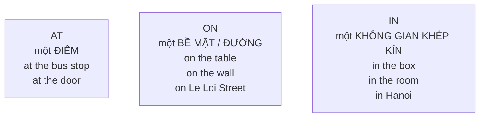

# A1-G009 · Prepositions of Place — Giới từ chỉ nơi chốn

## Mục lục

- [A. Lesson Information](#a-lesson-information)
- [B. Warm-up](#b-warm-up-tình-huống-thực-tế)
- [C. WHAT](#c-what-giới-từ-chỉ-nơi-chốn-là-gì)
- [D. WHY](#d-why-in-on-at--ba-cách-nhìn-không-gian)
- [E. FORM](#e-form-danh-sách-và-quy-tắc)
- [F. HOW](#f-how-ví-dụ-phân-tích)
- [G. VISUAL](#g-visual-explanation)
- [H. COMPARISON](#h-comparison)
- [I. COMMON MISTAKES](#i-common-mistakes)
- [J. MEMORY TRICKS](#j-memory-tricks)
- [K. REAL-LIFE APPLICATION](#k-real-life-application)
- [L. PRACTICE EXERCISES](#l-practice-exercises)
- [M. KNOWLEDGE CHECK](#m-knowledge-check)
- [N. ANSWER KEY](#n-answer-key)

---

## A. Lesson Information

| Mục | Nội dung |
|---|---|
| **Lesson ID** | A1-G009 |
| **Topic** | Prepositions of Place |
| **Tên tiếng Việt** | Giới từ chỉ nơi chốn |
| **CEFR Level** | A1 |
| **Prerequisites** | [A0-G015 — There is/are](../../01-A0-FOUNDATION/grammar/A0-G015-there-is-there-are.md) |
| **Estimated Time** | 75 phút |

**Learning Objectives:**

1. Phân biệt **in / on / at** chỉ nơi chốn theo "cách nhìn không gian".
2. Dùng đúng các giới từ vị trí: *under, next to, between, behind, in front of, opposite, near, above, below*.
3. Dùng đúng giới từ với phương tiện (*on the bus / in a car*), tầng nhà, đường phố, địa chỉ.
4. Thuộc các cụm cố định: *at home, at work, at school, in bed, in hospital, on the left*.
5. Mô tả vị trí đồ vật trong phòng và chỉ đường đơn giản.

---

## B. Warm-up: Tình huống thực tế

Bạn tìm chìa khóa và hỏi người nhà. Câu trả lời:

> "Chìa khóa **ở trên** bàn, **cạnh** điện thoại. À không, nó **ở trong** túi của em, túi **ở dưới** ghế."

Tiếng Việt có "ở" rất linh hoạt. Nhiều người học dịch "ở" thành *at* cho mọi trường hợp: *at the table, at my bag, at the chair*.

🤔 **Hãy suy nghĩ:** Chìa khóa "trên mặt bàn", "trong túi" và "dưới ghế" là ba vị trí khác nhau. Tiếng Anh phân biệt chúng thế nào? Và khi nào *at* mới là lựa chọn đúng?

---

## C. WHAT: Giới từ chỉ nơi chốn là gì?

**Prepositions of place** (giới từ chỉ nơi chốn) cho biết **vị trí** của người/vật so với một người/vật khác. Chúng đứng **trước danh từ hoặc đại từ tân ngữ**: *on **the table**, next to **me***.

Cấu trúc thường gặp: **S + be + giới từ + danh từ** (*The keys are on the table.*) hoặc **There is/are + N + giới từ + danh từ** (*There's a cat under the bed.*).

---

## D. WHY: *in, on, at* — ba cách nhìn không gian

Ba giới từ phổ biến nhất không khác nhau về "kích thước" nơi chốn, mà khác nhau về **cách người nói hình dung** nơi chốn đó:



- **at** — nơi chốn là **một điểm** trên bản đồ, chỗ diễn ra hoạt động: *at the station, at the cinema, at work*.
- **on** — nơi chốn là **một bề mặt** hoặc **một đường thẳng**: *on the floor, on the wall, on the street, on the river*.
- **in** — nơi chốn là **một không gian ba chiều, có ranh giới**: *in the car, in the kitchen, in Vietnam*.

Cùng một nơi có thể dùng giới từ khác nhau tùy cách nhìn:
- *I'm **at** the cinema.* (một điểm hẹn, đang ở đó để xem phim)
- *It's cold **in** the cinema.* (bên trong không gian của rạp)

---

## E. FORM: Danh sách và quy tắc

### E1. Giới từ vị trí cơ bản

| Giới từ | Nghĩa | Ví dụ |
|---|---|---|
| **in** | trong | *The milk is **in** the fridge.* |
| **on** | trên (tiếp xúc bề mặt) | *The book is **on** the desk.* |
| **at** | tại (một điểm) | *She's **at** the door.* |
| **under** | dưới (bên dưới, có thể che) | *The cat is **under** the table.* |
| **above** | phía trên (không tiếp xúc) | *The clock is **above** the door.* |
| **below** | phía dưới (thấp hơn) | *The flat **below** ours is empty.* |
| **next to** / **beside** | bên cạnh | *Sit **next to** me.* |
| **near** | gần | *I live **near** the station.* |
| **between** ... **and** ... | giữa (hai vật) | *The bank is **between** the café **and** the school.* |
| **among** | giữa (nhiều vật) | *a house **among** the trees* |
| **behind** | phía sau | *The garden is **behind** the house.* |
| **in front of** | phía trước | *There's a tree **in front of** my house.* |
| **opposite** | đối diện | *The pharmacy is **opposite** the hospital.* |
| **inside / outside** | bên trong / bên ngoài | *Wait **outside**, please.* |

### E2. Quy tắc *in / on / at* chi tiết

| | **in** | **on** | **at** |
|---|---|---|---|
| Địa danh | thành phố, quốc gia: *in Da Nang, in Japan* | đảo nhỏ: *on Phu Quoc Island* | — |
| Đường phố | — | tên đường: *on Hai Ba Trung Street* (Mỹ cũng dùng *on*) | **số nhà + đường**: *at 25 Hai Ba Trung Street* |
| Tòa nhà | bên trong: *in the hospital* | tầng: *on the third floor* | chỗ hoạt động: *at the hospital* (đi khám/làm việc) |
| Phương tiện | xe nhỏ, chỉ ngồi: *in a car, in a taxi* | phương tiện công cộng/có thể đứng: *on the bus, on a train, on a plane, on a bike, on a motorbike* | — |
| Cụm cố định | *in bed, in hospital (đang nằm viện), in the sky, in the world, in a photo, in the corner (of a room)* | *on the left/right, on the wall, on the floor, on TV, on the internet, on the phone* | *at home, at work, at school, at university, at the top/bottom, at the end of, at the corner (of a street), at a party* |

### E3. Cấu trúc giới từ "nhiều chữ"

- *next **to***, *in front **of***, *on top **of***, *at the end **of*** — **không bỏ** *to/of*.
- *opposite*, *near*, *behind*, *between* — thường **không** thêm *to/of*: *near the station* (*near to* có gặp nhưng ít hơn), *opposite the bank* (không nói ~~opposite of the bank~~ khi chỉ vị trí).

---

## F. HOW: Ví dụ phân tích

| # | English | Tiếng Việt | Phân tích |
|---|---|---|---|
| 1 | *Your phone is **on** the sofa.* | Điện thoại của bạn ở trên ghế sofa. | Bề mặt |
| 2 | *My keys are **in** my bag.* | Chìa khóa trong túi tôi. | Không gian khép kín |
| 3 | *I'll meet you **at** the bus stop.* | Tôi sẽ gặp bạn ở trạm xe buýt. | Một điểm hẹn |
| 4 | *We live **in** Can Tho, **on** Nguyen Trai Street.* | Chúng tôi sống ở Cần Thơ, đường Nguyễn Trãi. | Thành phố → *in*; đường → *on* |
| 5 | *Our office is **at** 12 Ly Thuong Kiet Street, **on** the fifth floor.* | Văn phòng ở số 12 Lý Thường Kiệt, tầng 5. | Địa chỉ cụ thể → *at*; tầng → *on* |
| 6 | *She's **on** the bus. He's **in** a taxi.* | Cô ấy đang trên xe buýt. Anh ấy đang trong taxi. | Phương tiện công cộng vs xe nhỏ |
| 7 | *The cat is sleeping **under** the bed.* | Con mèo ngủ dưới gầm giường. | |
| 8 | *The pharmacy is **between** the bank **and** the supermarket.* | Nhà thuốc ở giữa ngân hàng và siêu thị. | *between ... and* |
| 9 | *There's a big mirror **above** the sink.* | Có một cái gương lớn phía trên bồn rửa. | Không tiếp xúc |
| 10 | *My grandmother is **in** hospital.* | Bà tôi đang nằm viện. | Cụm cố định (Anh – Anh, không *the*) |
| 11 | *The post office is **opposite** the park.* | Bưu điện đối diện công viên. | Không có *of* |
| 12 | *Turn left. The museum is **on** your right.* | Rẽ trái. Bảo tàng ở bên tay phải bạn. | Chỉ đường |

---

## G. VISUAL EXPLANATION

### G1. Sơ đồ vị trí quanh một chiếc hộp

```text
                 above
               ┌───────┐
       behind  │  in   │  (on = trên bề mặt hộp)
   next to ←   │  BOX  │   → next to
               └───────┘
                 under
         in front of (phía người nhìn)
```

### G2. "Bản đồ phố" — between, opposite, next to, on the corner

```text
  ───────────────── Tran Phu Street ─────────────────
  [ BANK ][ CAFÉ ][ PHARMACY ]          [ PARK ]
                                  ↑ opposite ↓
  [ SCHOOL ]                     [ POST OFFICE ]
  ─────────────────────────────────────────────────

  The café is BETWEEN the bank AND the pharmacy.
  The pharmacy is NEXT TO the café.
  The post office is OPPOSITE the park.
  All these buildings are ON Tran Phu Street.
```

---

## H. COMPARISON

### *in the hospital* / *at the hospital* / *in hospital*

| Câu | Nghĩa |
|---|---|
| *She works **at** the hospital.* | Cô ấy làm việc ở bệnh viện (nơi hoạt động). |
| *It's very quiet **in** the hospital at night.* | Bên trong bệnh viện ban đêm rất yên tĩnh. |
| *He's **in hospital** with a broken leg.* | Anh ấy đang nằm viện vì gãy chân (là bệnh nhân). |

### *in the corner* / *at the corner* / *on the corner*

| Câu | Nghĩa |
|---|---|
| *There's a TV **in the corner** of the room.* | Góc **bên trong** căn phòng |
| *The shop is **at/on the corner** of the street.* | Góc **ngoài** đường phố |

### *on the bus* và *by bus*

- *I'm **on** the bus.* — Tôi đang ở trên xe buýt (vị trí).
- *I go to work **by** bus.* — Tôi đi làm bằng xe buýt (phương tiện — *by* + phương tiện, không mạo từ).

---

## I. COMMON MISTAKES

| # | ❌ Sai | ✅ Đúng | Nguyên nhân | Cách tránh |
|---|---|---|---|---|
| 1 | I'm **in** home. / I'm **at** the home. | I'm **at home**. | Dịch "ở nhà" | Cụm cố định: *at home* |
| 2 | I live **at** Hanoi. | I live **in** Hanoi. | Dùng *at* cho mọi "ở" | Thành phố, quốc gia → *in* |
| 3 | She's **on** the car. | She's **in** the car. | | Xe nhỏ → *in* |
| 4 | He's **in** the bus. | He's **on** the bus. | | Phương tiện công cộng → *on* |
| 5 | The bank is **next** the school. | ...**next to** the school. | Bỏ *to* | *next to* là một khối |
| 6 | It's **in front** the hotel. | ...**in front of** the hotel. | Bỏ *of* | *in front of* |
| 7 | It's between the bank **with** the café. | ...between the bank **and** the café. | Dịch "giữa... với..." | *between ... and* |
| 8 | My office is **in** the third floor. | ...**on** the third floor. | | Tầng → *on* |
| 9 | The clock is **on** the door. (ý: đồng hồ treo trên tường, cao hơn cửa, không chạm cửa) | The clock is **above** the door. | Nhầm *on/above* | *on* = tiếp xúc bề mặt; *above* = cao hơn, không tiếp xúc |
| 10 | The pharmacy is **opposite of** the bank. | ...**opposite** the bank. | Thêm *of* | *opposite* + N trực tiếp |

---

## J. MEMORY TRICKS

1. **"Điểm – Mặt – Hộp"**: *at* = điểm 📍, *on* = mặt phẳng ▭, *in* = cái hộp 📦.
2. **"Đứng được trên đó → on"**: Bạn có thể **đứng** trên xe buýt, tàu, máy bay → *on*. Bạn **chỉ ngồi** trong ô tô, taxi → *in*. (Xe đạp, xe máy: bạn ngồi **trên** → *on*.)
3. **"Địa chỉ đi từ lớn đến nhỏ: in → on → at"**: *in Vietnam → in Hanoi → on Kim Ma Street → at 25 Kim Ma Street*. Càng cụ thể, càng "nhỏ" giới từ.
4. **Cụm "home – work – school" luôn với *at***: *at home, at work, at school* — không *the*.

---

## K. REAL-LIFE APPLICATION

### Hội thoại: Tìm đồ và hỏi đường

> **Ha:** Mum, where's my blue folder?
> **Mum:** Isn't it **on** your desk?
> **Ha:** No. It's not **in** my bag either.
> **Mum:** Look **under** the sofa. Or maybe it's **in** the car.
> **Ha:** Oh, found it! It was **behind** the door. Thanks! I'm late for my interview.
> **Mum:** Where is it?
> **Ha:** It's **at** 45 Le Duan Street, **on** the eighth floor. The building is **opposite** the zoo, **between** a bank **and** a hotel.
> **Mum:** Are you going **by** motorbike?
> **Ha:** No, I'm taking a taxi. I don't want to arrive with messy hair!

**Vietnamese explanation:** Hà tìm tập hồ sơ màu xanh: không ở trên bàn, không trong túi; mẹ gợi ý tìm dưới ghế sofa hoặc trong xe. Hà tìm thấy sau cánh cửa. Buổi phỏng vấn ở số 45 Lê Duẩn, tầng 8, tòa nhà đối diện sở thú, giữa một ngân hàng và một khách sạn. Hà đi taxi vì không muốn tóc rối.

**Useful expressions:** *Found it!* (Tìm thấy rồi!) · *either* (cũng không — dùng cuối câu phủ định) · *messy hair* (tóc rối)

---

## L. PRACTICE EXERCISES

> ✍️ Đáp án: [A1-G009-ANSWERS](../../12-ANSWERS-AND-EXPLANATIONS/A1/A1-G009-ANSWERS.md)

### Level 1 — Recognition

**L1.1.** My parents live ___ Hai Phong.  A. at  B. in  C. on
**L1.2.** There's a beautiful painting ___ the wall.  A. on  B. in  C. at
**L1.3.** I'm ___ home tonight. Come and visit!  A. in  B. at  C. on
**L1.4.** We're ___ the train to Hue.  A. in  B. at  C. on
**L1.5.** The café is ___ the bookshop.  A. next  B. next to  C. next of
**L1.6.** My office is ___ the tenth floor.  A. in  B. on  C. at

### Level 2 — Controlled Practice

Điền giới từ phù hợp.

**L2.1.** The children are playing ___ the garden.
**L2.2.** Wait for me ___ the entrance.
**L2.3.** Put your shoes ___ the bed — not on it!
**L2.4.** The supermarket is ___ the post office ___ the bank. (giữa)
**L2.5.** She lives ___ 18 Tran Hung Dao Street.
**L2.6.** My brother is ___ hospital. He has a broken arm.
**L2.7.** There's a small shop ___ the corner of my street.
**L2.8.** I always sit ___ the front ___ the class. (*ở phía trước lớp*)
**L2.9.** The hotel is ___ the beach — it takes two minutes to walk there.
**L2.10.** Look! There's a rainbow ___ the sky.

### Level 3 — Error Correction

**L3.1.** I live at Vietnam.
**L3.2.** My father is in the work now.
**L3.3.** There is a big tree in front the school.
**L3.4.** She's waiting in the bus stop.
**L3.5.** The bank is opposite of the hotel.
**L3.6.** My flat is in the fifth floor.

### Level 4 — Production

Dịch sang tiếng Anh:

**L4.1.** Con mèo đang ngủ trên ghế sofa.
**L4.2.** Nhà thuốc ở đối diện bệnh viện.
**L4.3.** Tôi đang ở trên xe buýt. Tôi sẽ đến sau 10 phút. (*I'll be there in 10 minutes.*)
**L4.4.** Văn phòng của chúng tôi ở số 9 đường Lê Lợi, tầng 3.
**L4.5.** Có một cái đồng hồ phía trên cửa sổ.

### Level 5 — Real Communication

**L5.1.** Viết đoạn văn 80–100 từ mô tả **chi tiết vị trí** đồ vật trong phòng khách hoặc phòng làm việc của bạn. Dùng ít nhất 8 giới từ khác nhau.
**L5.2.** **Speaking — Giving directions:** Chọn một địa điểm gần nhà bạn (quán cà phê, chợ, trường học). Mô tả to cách tìm nó trong 45 giây: *It's on... Street, next to... , opposite...*

---

## M. KNOWLEDGE CHECK

### 5 câu hỏi tự kiểm tra

1. Giải thích *in/on/at* bằng ba hình ảnh.
2. *on the bus* và *in a car* — vì sao khác giới từ?
3. Viết địa chỉ: *số 12, đường Hùng Vương, Huế* với giới từ đúng (*at/on/in*).
4. Giới từ nào cần *to* hoặc *of*: *next, in front, opposite, between*?
5. *at the hospital* và *in hospital* khác nhau thế nào?

### Checklist

- [ ] Tôi dùng đúng *in/on/at* với thành phố, đường, địa chỉ, tầng.
- [ ] Tôi mô tả được vị trí đồ vật trong phòng.
- [ ] Tôi chỉ đường đơn giản được.

### 3 lỗi quan trọng cần nhớ

1. ~~in home / at Hanoi~~ → **at home / in Hanoi**.
2. ~~next the bank / in front the hotel~~ → **next to / in front of**.
3. ~~in the third floor~~ → **on** the third floor.

### Lịch ôn tập

| Ngày | Việc cần làm |
|---|---|
| Ngày 1 | Làm lại L2 |
| Ngày 3 | Mô tả vị trí 10 đồ vật trong bếp |
| Ngày 7 | Viết đường đi từ nhà đến nơi làm việc/trường học |

### Liên kết

- ➡️ Bài tiếp theo: [A1-G010 — Prepositions of Time](A1-G010-prepositions-of-time.md)
- 🔁 Tra cứu: [PREPOSITIONS-GUIDE](../../06-GRAMMAR-REFERENCE/PREPOSITIONS-GUIDE.md)
- 🔁 Từ vựng: [VOC-05 — Travel & Transportation](../../07-VOCABULARY/VOC-05-travel-transportation.md)

---

## N. ANSWER KEY

👉 [A1-G009-ANSWERS.md](../../12-ANSWERS-AND-EXPLANATIONS/A1/A1-G009-ANSWERS.md)
