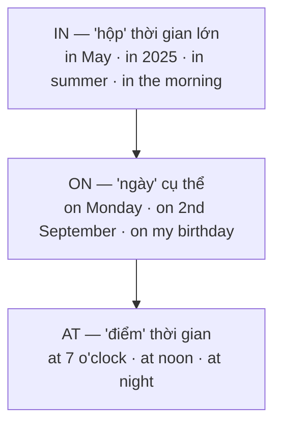
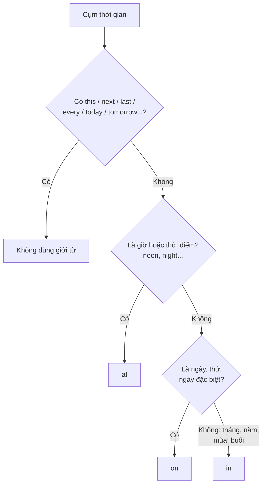

# A1-G010 · Prepositions of Time — Giới từ chỉ thời gian

## Mục lục

- [A. Lesson Information](#a-lesson-information)
- [B. Warm-up](#b-warm-up-tình-huống-thực-tế)
- [C. WHAT](#c-what-giới-từ-chỉ-thời-gian)
- [D. WHY](#d-why-hình-tam-giác-at--on--in)
- [E. FORM](#e-form-quy-tắc-đầy-đủ)
- [F. HOW](#f-how-ví-dụ-phân-tích)
- [G. VISUAL](#g-visual-explanation)
- [H. COMPARISON](#h-comparison)
- [I. COMMON MISTAKES](#i-common-mistakes)
- [J. MEMORY TRICKS](#j-memory-tricks)
- [K. REAL-LIFE APPLICATION](#k-real-life-application)
- [L. PRACTICE EXERCISES](#l-practice-exercises)
- [M. KNOWLEDGE CHECK](#m-knowledge-check)
- [N. ANSWER KEY](#n-answer-key)

---

## A. Lesson Information

| Mục | Nội dung |
|---|---|
| **Lesson ID** | A1-G010 |
| **Topic** | Prepositions of Time |
| **Tên tiếng Việt** | Giới từ chỉ thời gian |
| **CEFR Level** | A1 |
| **Prerequisites** | [A0-G018 — Numbers, Dates, Time](../../01-A0-FOUNDATION/grammar/A0-G018-numbers-dates-time-age.md), [A1-G009](A1-G009-prepositions-of-place.md) |
| **Estimated Time** | 75 phút |

**Learning Objectives:**

1. Dùng **at** với giờ và thời điểm; **on** với ngày/thứ; **in** với tháng, năm, mùa, buổi.
2. Biết khi nào **không** dùng giới từ: *this, next, last, every, today, tomorrow, yesterday*.
3. Dùng *from ... to*, *until*, *before*, *after* để nói về khoảng thời gian và trình tự.
4. Phân biệt *in the morning* và *on Monday morning*; *at the weekend* (Anh) và *on the weekend* (Mỹ).
5. Nói lịch làm việc, lịch hẹn, kế hoạch rõ ràng.

---

## B. Warm-up: Tình huống thực tế

Bạn viết email xin lịch phỏng vấn:

> *"I am free in Monday, at the morning. I can also come on next Friday at 3 p.m. or in 15th March."*

Người nhận vẫn hiểu, nhưng email có 4 lỗi giới từ.

🤔 **Hãy suy nghĩ:** Ở bài trước, *at/on/in* phân biệt "điểm – mặt – hộp" trong **không gian**. Bạn có đoán được quy luật tương tự cho **thời gian** không? Giờ (3 p.m.) giống "điểm" hay "hộp"? Tháng (March) thì sao?

---

## C. WHAT: Giới từ chỉ thời gian

**Prepositions of time** cho biết **khi nào** một việc xảy ra. Ba giới từ quan trọng nhất là **at, on, in**. Ngoài ra còn các giới từ chỉ **khoảng thời gian** và **trình tự**: *from...to, until, before, after, during*.

---

## D. WHY: Hình tam giác *at – on – in*

Logic giống hệt giới từ nơi chốn: **thời gian càng nhỏ, càng cụ thể → giới từ càng "nhỏ"**.



- **at** = một **điểm** trên đồng hồ (giờ, khoảnh khắc).
- **on** = một **ngày** (như một "mặt bằng" trên lịch).
- **in** = một **khoảng** dài hơn ngày, chứa nhiều ngày (tháng, năm, mùa) hoặc một phần của ngày (buổi).

---

## E. FORM: Quy tắc đầy đủ

### E1. AT

| Dùng với | Ví dụ |
|---|---|
| Giờ | *at 7 o'clock, at 9:30, at half past six* |
| Thời điểm trong ngày | *at noon, at midnight, at night, at sunrise, at sunset, at lunchtime* |
| Dịp lễ (cả kỳ nghỉ) | *at Christmas, at Tet, at Easter* |
| Cuối tuần (Anh – Anh) | *at the weekend* |
| Cụm cố định | *at the moment, at the same time, at the beginning/end of* |

### E2. ON

| Dùng với | Ví dụ |
|---|---|
| Thứ trong tuần | *on Monday, on Fridays* (lặp lại) |
| Ngày tháng | *on 5th May, on the 20th* |
| Ngày đặc biệt | *on my birthday, on New Year's Day, on Christmas Day, on Teachers' Day* |
| Thứ + buổi | *on Monday morning, on Saturday night* |
| Cuối tuần (Anh – Mỹ) | *on the weekend* |

### E3. IN

| Dùng với | Ví dụ |
|---|---|
| Tháng | *in March* |
| Năm, thập kỷ, thế kỷ | *in 2025, in the 1990s, in the 21st century* |
| Mùa | *in summer / in the summer, in the rainy season* |
| Buổi trong ngày | *in the morning, in the afternoon, in the evening* (nhưng **at night**) |
| Khoảng thời gian **từ bây giờ** tới tương lai | *in 10 minutes* (10 phút nữa), *in two weeks* |

### E4. Không dùng giới từ

Trước **this, next, last, every, each, today, tonight, tomorrow, yesterday**:

| ❌ | ✅ |
|---|---|
| ~~on next Monday~~ | *next Monday* |
| ~~in this morning~~ | *this morning* |
| ~~at last night~~ | *last night* |
| ~~on every Sunday~~ | *every Sunday* |
| ~~in tomorrow~~ | *tomorrow* |

### E5. Giới từ chỉ khoảng thời gian và trình tự

| Giới từ | Nghĩa | Ví dụ |
|---|---|---|
| **from ... to / until** | từ ... đến | *I work **from** 8 **to** 5.* |
| **until / till** | cho đến khi | *The shop is open **until** 10 p.m.* |
| **before** | trước | *Wash your hands **before** lunch.* |
| **after** | sau | *Let's go out **after** work.* |
| **during** | trong suốt (một sự kiện/khoảng) | *Don't talk **during** the film.* |
| **for** | trong (bao lâu — độ dài) | *I lived there **for** two years.* (học kỹ ở A2-G006) |

---

## F. HOW: Ví dụ phân tích

| # | English | Tiếng Việt | Phân tích |
|---|---|---|---|
| 1 | *The meeting starts **at** 9:30.* | Cuộc họp bắt đầu lúc 9 giờ 30. | Giờ → *at* |
| 2 | *I go swimming **on** Saturdays.* | Tôi đi bơi vào các thứ Bảy. | Thứ, lặp lại → *on* + số nhiều |
| 3 | *My birthday is **on** 14th February.* | Sinh nhật tôi là ngày 14/2. | Ngày cụ thể → *on* |
| 4 | *We're going to Japan **in** April.* | Chúng tôi sẽ đi Nhật vào tháng 4. | Tháng → *in* |
| 5 | *I was born **in** 1998.* | Tôi sinh năm 1998. | Năm → *in* |
| 6 | *It's very hot here **in** summer.* | Ở đây mùa hè rất nóng. | Mùa → *in* |
| 7 | *I study **in** the evening, but I sleep early — I never work **at** night.* | Tôi học buổi tối, nhưng ngủ sớm — không bao giờ làm việc ban đêm. | *in the evening* ≠ *at night* |
| 8 | *Let's meet **on** Friday afternoon.* | Gặp nhau chiều thứ Sáu nhé. | Thứ + buổi → *on* |
| 9 | *My family gets together **at** Tet.* | Gia đình tôi sum họp dịp Tết. | Dịp lễ → *at* |
| 10 | *I'm busy **this** week, but I'm free **next** Tuesday.* | Tuần này tôi bận, nhưng thứ Ba tuần sau rảnh. | Không giới từ |
| 11 | *The bus leaves **in** five minutes!* | Năm phút nữa xe buýt chạy! | *in* + khoảng thời gian = "nữa" |
| 12 | *The library is open **from** 8 a.m. **until** 9 p.m.* | Thư viện mở cửa từ 8 giờ sáng đến 9 giờ tối. | |

---

## G. VISUAL EXPLANATION

### G1. Tam giác ngược

```text
  ┌──────────────────────────────── IN ────────────────────────────────┐
  │ in 2026 · in summer · in July · in the morning · in five minutes    │
  └───────────────────┬────────────── ON ──────────────┬──────────────┘
                      │ on Monday · on 2nd May · on my birthday │
                      └────────────── AT ──────────────┘
                              at 6:00 · at noon · at night
```

### G2. Sơ đồ quyết định



---

## H. COMPARISON

### *in the morning* / *on Monday morning* / *this morning*

| Cụm | Giải thích |
|---|---|
| *in the morning* | Buổi sáng nói chung → *in* |
| *on Monday morning* | Buổi sáng **của một ngày cụ thể** → theo quy tắc của ngày → *on* |
| *this morning* | Có *this* → không giới từ |

### *in time* và *on time*

| | |
|---|---|
| ***on time*** | đúng giờ (theo lịch): *The train arrived **on time**.* |
| ***in time*** | kịp lúc (trước khi quá muộn): *We arrived **in time** to see the start of the film.* |

### *at the end* và *in the end*

| | |
|---|---|
| ***at the end** (of something)* | vào cuối (một thời điểm): *at the end of the month* |
| ***in the end*** | cuối cùng thì (kết quả): *In the end, we stayed at home.* |

---

## I. COMMON MISTAKES

| # | ❌ Sai | ✅ Đúng | Nguyên nhân | Cách tránh |
|---|---|---|---|---|
| 1 | I'm free **in** Monday. | I'm free **on** Monday. | Dùng *in* như tiếng Việt "vào" | Thứ → *on* |
| 2 | **at** the morning | **in** the morning | Nhầm với *at night* | Buổi → *in*; riêng *night* → *at* |
| 3 | **on** next Friday | **next** Friday | Thêm giới từ thừa | *next/last/this/every* → không giới từ |
| 4 | **in** 15th March | **on** 15th March | Thấy tháng nên dùng *in* | Có **ngày** → *on* |
| 5 | **in** 7 o'clock | **at** 7 o'clock | | Giờ → *at* |
| 6 | **in** my birthday | **on** my birthday | | Ngày đặc biệt → *on* |
| 7 | I'll be back **after** 10 minutes. | I'll be back **in** 10 minutes. | Dịch "sau 10 phút" | Tương lai tính từ bây giờ → *in* |
| 8 | I work **from** 8 **until to** 5. | I work **from** 8 **to/until** 5. | Thừa từ | Chọn *to* **hoặc** *until* |

---

## J. MEMORY TRICKS

1. **"At giờ, On ngày, In tháng-năm-mùa-buổi"** — đọc to như một câu thần chú.
2. **"Night là ngoại lệ đi ngủ"**: *in the morning, in the afternoon, in the evening* nhưng **at night** — ban đêm thì "đứng im một điểm" để ngủ. (Mẹo gợi nhớ, không giải thích lý do ngôn ngữ học.)
3. **"Có this/next/last → bỏ giới từ"**: Những từ này đã đủ "chỉ thời gian", không cần thêm.
4. **"In 10 minutes = 10 phút NỮA"**: Khi nói về tương lai, *in* + khoảng thời gian = đếm ngược từ bây giờ.

---

## K. REAL-LIFE APPLICATION

### Email: Sắp xếp lịch họp

> *Dear Ms Taylor,*
>
> *Thank you for your email. I'm afraid I'm not available **on** Monday because I have a training course **from** 9 a.m. **until** 4 p.m. However, I'm free **on** Tuesday morning or **on** Wednesday **after** 2 p.m.*
>
> *Alternatively, we can meet **next** week. I'm on holiday **from** 20th **to** 24th May, but I'll be back in the office **on** Monday, 27th May.*
>
> *Our office is closed **at** lunchtime, **from** 12 **to** 1 p.m., so please avoid that time.*
>
> *I look forward to hearing from you.*
>
> *Best regards,*
> *Tran Minh Khoa*

**Vietnamese explanation:** Khoa trả lời email xếp lịch họp: thứ Hai bận khóa đào tạo từ 9h–16h; rảnh sáng thứ Ba hoặc thứ Tư sau 2 giờ chiều; có thể gặp tuần sau nhưng nghỉ phép từ 20–24/5, quay lại văn phòng thứ Hai 27/5; văn phòng đóng cửa giờ trưa 12h–13h.

**Useful expressions (email):**
- *I'm afraid I'm not available...* — Tôi e là tôi không rảnh...
- *However,...* — Tuy nhiên,...
- *Alternatively,...* — Hoặc là,...
- *I look forward to hearing from you.* — Mong sớm nhận được phản hồi.

---

## L. PRACTICE EXERCISES

> ✍️ Đáp án: [A1-G010-ANSWERS](../../12-ANSWERS-AND-EXPLANATIONS/A1/A1-G010-ANSWERS.md)

### Level 1 — Recognition

**L1.1.** The class starts ___ 8:15.  A. in  B. on  C. at
**L1.2.** We have a holiday ___ 2nd September.  A. in  B. on  C. at
**L1.3.** It often rains ___ October.  A. in  B. on  C. at
**L1.4.** I'll see you ___ next week.  A. in  B. on  C. (không dùng giới từ)
**L1.5.** My dad listens to the radio ___ the morning.  A. at  B. in  C. on
**L1.6.** "When will dinner be ready?" — "___ 20 minutes."  A. After  B. In  C. On

### Level 2 — Controlled Practice

Điền *at, on, in* hoặc **–** (không cần giới từ).

**L2.1.** I was born ___ 2001, ___ the 5th of December, ___ night.
**L2.2.** We usually visit our grandparents ___ Tet.
**L2.3.** The shop is closed ___ Sundays.
**L2.4.** I'm meeting my friends ___ this evening.
**L2.5.** She studies ___ night because it's quiet.
**L2.6.** The concert is ___ Saturday ___ 8 p.m.
**L2.7.** Vietnam's economy grew quickly ___ the 2000s.
**L2.8.** I called you ___ yesterday afternoon.
**L2.9.** Many people go to the beach ___ summer.
**L2.10.** We're having a party ___ my birthday.

### Level 3 — Error Correction

**L3.1.** I go to the gym in Tuesday and Thursday.
**L3.2.** See you on next Monday!
**L3.3.** My flight leaves at the morning.
**L3.4.** She was born on 1995.
**L3.5.** The film starts after 10 minutes. Hurry up!
**L3.6.** We have English classes at the afternoon.

### Level 4 — Production

Dịch sang tiếng Anh:

**L4.1.** Tôi làm việc từ thứ Hai đến thứ Sáu.
**L4.2.** Cửa hàng mở cửa đến 10 giờ tối.
**L4.3.** Chúng tôi sẽ đi Đà Lạt vào tháng sau. (*We're going to...*)
**L4.4.** Tôi thường uống cà phê vào buổi sáng và đọc sách vào ban đêm.
**L4.5.** Cuộc họp vào chiều thứ Năm, lúc 3 giờ.

### Level 5 — Real Communication

**L5.1.** Viết email 70–90 từ trả lời một người muốn hẹn gặp bạn: nêu những thời điểm bạn bận và rảnh trong tuần tới, dùng ít nhất 8 cụm thời gian khác nhau (có ít nhất 1 cụm không giới từ).
**L5.2.** **Speaking — My year:** Nói 1 phút về những dịp quan trọng trong năm của bạn: sinh nhật, Tết, kỳ nghỉ, mùa bạn thích... (*My birthday is on... At Tet, I... In summer, we...*).

---

## M. KNOWLEDGE CHECK

### 5 câu hỏi tự kiểm tra

1. *at/on/in* dùng với đơn vị thời gian nào?
2. Vì sao *in the evening* nhưng *at night*?
3. Khi nào không dùng giới từ trước cụm thời gian?
4. *on Monday morning* hay *in Monday morning*? Vì sao?
5. "10 phút nữa" nói thế nào?

### Checklist

- [ ] Tôi dùng đúng *at/on/in* với giờ, ngày, tháng, năm, mùa, buổi.
- [ ] Tôi không thêm giới từ trước *next, last, this, every*.
- [ ] Tôi viết được email xếp lịch hẹn đơn giản.

### 3 lỗi quan trọng cần nhớ

1. ~~in Monday~~ → **on** Monday.
2. ~~on next Friday~~ → **next Friday**.
3. ~~after 10 minutes~~ (tương lai) → **in** 10 minutes.

### Lịch ôn tập

| Ngày | Việc cần làm |
|---|---|
| Ngày 1 | Làm lại L2 |
| Ngày 3 | Viết lịch tuần tới của bạn bằng tiếng Anh (7 câu) |
| Ngày 7 | Trộn bài A1-G009 và A1-G010: viết đoạn văn kể một ngày đi chơi (ở đâu, lúc nào) |

### Liên kết

- ➡️ Bài tiếp theo: [A1-G011 — Imperatives](A1-G011-imperatives.md)
- 🔁 Tra cứu: [PREPOSITIONS-GUIDE](../../06-GRAMMAR-REFERENCE/PREPOSITIONS-GUIDE.md)
- 🎯 **Mini Challenge khối A1-2:** mô tả nhà bạn và vị trí đồ vật — xem [A1 README](../README.md#5-mini-challenges)

---

## N. ANSWER KEY

👉 [A1-G010-ANSWERS.md](../../12-ANSWERS-AND-EXPLANATIONS/A1/A1-G010-ANSWERS.md)
