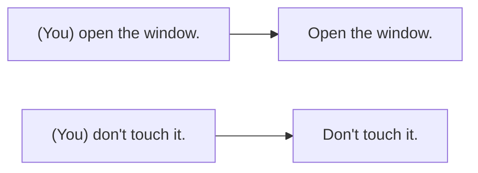

# A1-G011 · Imperatives — Câu mệnh lệnh

## Mục lục

- [A. Lesson Information](#a-lesson-information)
- [B. Warm-up](#b-warm-up-tình-huống-thực-tế)
- [C. WHAT](#c-what-câu-mệnh-lệnh-là-gì)
- [D. WHY](#d-why-vì-sao-câu-mệnh-lệnh-không-có-chủ-ngữ)
- [E. FORM](#e-form-công-thức)
- [F. HOW](#f-how-10-cách-dùng)
- [G. VISUAL](#g-visual-explanation)
- [H. COMPARISON](#h-comparison-mức-độ-lịch-sự)
- [I. COMMON MISTAKES](#i-common-mistakes)
- [J. MEMORY TRICKS](#j-memory-tricks)
- [K. REAL-LIFE APPLICATION](#k-real-life-application)
- [L. PRACTICE EXERCISES](#l-practice-exercises)
- [M. KNOWLEDGE CHECK](#m-knowledge-check)
- [N. ANSWER KEY](#n-answer-key)

---

## A. Lesson Information

| Mục | Nội dung |
|---|---|
| **Lesson ID** | A1-G011 |
| **Topic** | Imperatives & Let's |
| **Tên tiếng Việt** | Câu mệnh lệnh, câu đề nghị với *Let's* |
| **CEFR Level** | A1 |
| **Prerequisites** | [A1-G002](A1-G002-present-simple-negatives-questions.md) |
| **Estimated Time** | 60 phút |

**Learning Objectives:**

1. Tạo câu mệnh lệnh khẳng định (**V...**) và phủ định (**Don't + V...**).
2. Dùng câu mệnh lệnh cho: hướng dẫn, chỉ đường, lời khuyên, cảnh báo, lời mời, biển báo.
3. Dùng **Let's / Let's not** để đề nghị cùng làm gì.
4. Làm câu mệnh lệnh lịch sự hơn bằng *please* và biết khi nào cần cách nói lịch sự hơn (*Could you...?*).
5. Hiểu câu mệnh lệnh trong công thức nấu ăn, hướng dẫn sử dụng, biển báo.

---

## B. Warm-up: Tình huống thực tế

Bạn đọc hướng dẫn trên một gói mì ăn liền bằng tiếng Anh:

> *"**Boil** 400 ml of water. **Add** the noodles and the seasoning. **Cook** for 3 minutes. **Don't** **overcook**. **Enjoy**!"*

🤔 **Hãy suy nghĩ:** Các câu trên không có chủ ngữ (*I, you, we...*). Vậy ai là người làm những việc đó? Tiếng Việt có cách nói tương tự không ("Đun sôi 400 ml nước. Cho mì vào...")?

---

## C. WHAT: Câu mệnh lệnh là gì?

**Imperative** (câu mệnh lệnh) là câu dùng để **yêu cầu, hướng dẫn, khuyên bảo, cảnh báo hoặc mời** ai đó làm (hoặc không làm) điều gì.

- Người thực hiện **luôn là người nghe** (*you*), nên chủ ngữ được **lược bỏ**.
- Động từ ở **dạng nguyên mẫu** (base form), **không** chia theo ngôi, **không** có *-s*.

Tên gọi "mệnh lệnh" có thể gây hiểu nhầm — câu mệnh lệnh **không phải lúc nào cũng thô lỗ**. *Have a nice day!*, *Come in, please*, *Enjoy your meal!* đều là câu mệnh lệnh nhưng rất thân thiện.

---

## D. WHY: Vì sao câu mệnh lệnh không có chủ ngữ?

Ở [A0-G007](../../01-A0-FOUNDATION/grammar/A0-G007-subject-verb-object.md), bạn học rằng câu tiếng Anh **luôn cần chủ ngữ**. Câu mệnh lệnh là **ngoại lệ quan trọng đầu tiên** bạn gặp (văn nói thân mật cũng hay lược chủ ngữ, ví dụ *Sounds good*, nhưng đó là rút gọn chứ không phải một cấu trúc riêng): vì người nghe hiểu ngay rằng "bạn" là người phải làm, nên *you* không cần nói ra.



Phủ định vẫn theo "gia đình 2": cần trợ động từ *do* → **Don't** + V. Kể cả với *be*: ***Don't be** late!* (đây là trường hợp hiếm hoi *do* đi với *be*).

---

## E. FORM: Công thức

**Ký hiệu:** **V** = động từ nguyên mẫu.

| Loại | Công thức | Ví dụ |
|---|---|---|
| ➕ Khẳng định | **V** (+ O / ...) | *Close the door.* |
| ➖ Phủ định | **Don't** / **Do not** + V | *Don't close the door.* |
| Với *be* | **Be** + adj / **Don't be** + adj | *Be careful! Don't be shy.* |
| Lịch sự | **Please** + V / V + **, please** | *Please sit down. / Sit down, please.* |
| Đề nghị cùng làm | **Let's** + V / **Let's not** + V | *Let's go! Let's not argue.* |
| Nhấn mạnh (lời mời nồng nhiệt) | **Do** + V | ***Do** come in!* (Mời vào, mời vào!) |
| Trạng từ tần suất | **Always / Never** + V | ***Always** lock the door. **Never** give your password to anyone.* |

> 💡 *Let's* = *Let us*. Nhưng trong giao tiếp gần như luôn dùng *Let's*. *Let us* (không rút gọn) mang nghĩa "hãy để chúng tôi" — khác nghĩa: *Let us go!* = "Thả chúng tôi đi!"

---

## F. HOW: 10 cách dùng

| # | Cách dùng | English | Tiếng Việt | Phân tích |
|---|---|---|---|---|
| 1 | Hướng dẫn | ***Press** the red button to start.* | Nhấn nút đỏ để bắt đầu. | Hướng dẫn sử dụng |
| 2 | Công thức nấu ăn | ***Cut** the onions and **fry** them for two minutes.* | Cắt hành và phi trong hai phút. | Nhiều động từ liên tiếp |
| 3 | Chỉ đường | ***Go** straight on, then **turn** left at the traffic lights.* | Đi thẳng, rồi rẽ trái ở đèn giao thông. | |
| 4 | Lời khuyên | ***Drink** more water and **get** some rest.* | Uống nhiều nước và nghỉ ngơi đi. | |
| 5 | Cảnh báo | ***Be careful!** **Don't touch** the hot pan.* | Cẩn thận! Đừng chạm vào chảo nóng. | *Be* + tính từ |
| 6 | Lời mời / chào | ***Come** in and **have** a seat.* / ***Have** a good weekend!* | Mời vào ngồi. / Cuối tuần vui vẻ! | Thân thiện |
| 7 | Biển báo | ***Keep** off the grass. **Do not** enter.* | Không giẫm lên cỏ. Cấm vào. | Biển báo dùng *Do not* đầy đủ |
| 8 | Đề nghị cùng làm | ***Let's** take a break.* | Mình nghỉ một chút đi. | *Let's* + V |
| 9 | Đề nghị không làm | ***Let's not** waste time.* | Đừng lãng phí thời gian nữa. | *Let's not* + V |
| 10 | Quy tắc chung | ***Never** leave your bag unattended.* | Không bao giờ để túi không người trông. | *Never* + V |

---

## G. VISUAL EXPLANATION

### Sentence breakdown

`Please | don't | park | in front of the gate.`

| Phần | Vai trò |
|---|---|
| Please | Từ lịch sự |
| don't | Trợ động từ phủ định |
| park | Động từ nguyên mẫu (*you* được hiểu ngầm) |
| in front of the gate | Nơi chốn |

### Thang độ lịch sự

```text
  Thẳng thắn ◄──────────────────────────────────────► Lịch sự
  Close the window.  →  Close the window, please.  →  Can you close the window?  →  Could you close the window, please?
```

---

## H. COMPARISON: Mức độ lịch sự

| Tình huống | Câu mệnh lệnh (có thể thô) | Lịch sự hơn |
|---|---|---|
| Nhờ đồng nghiệp | *Send me the file.* | *Could you send me the file, please?* |
| Nói với người phục vụ | *Give me a coffee.* | *Can I have a coffee, please?* / *I'd like a coffee, please.* |
| Hướng dẫn, công thức, chỉ đường | *Turn left.* ✅ (bình thường) | — |
| Lời chúc, lời mời | *Have fun!* ✅ (thân thiện) | — |

**Quy tắc ra quyết định:**
- Khi **người nghe có lợi** (lời mời, lời chúc, lời khuyên, hướng dẫn họ cần) → câu mệnh lệnh hoàn toàn tự nhiên.
- Khi **bạn có lợi** (bạn nhờ người khác làm gì cho mình), đặc biệt với người lạ/cấp trên → dùng *Can/Could you...?* (học ở [A1-G012](A1-G012-can-cant.md), [A2-G013](../../03-A2-ELEMENTARY/grammar/A2-G013-permission-can-could-may.md)).

> ⚠️ Chỉ thêm *please* **không đủ** để biến một câu mệnh lệnh thành lịch sự trong mọi tình huống. *Give me the report, please* với sếp vẫn nghe như ra lệnh.

---

## I. COMMON MISTAKES

| # | ❌ Sai | ✅ Đúng | Nguyên nhân | Cách tránh |
|---|---|---|---|---|
| 1 | **Opens** the door. | **Open** the door. | Thêm *-s* | Câu mệnh lệnh: V nguyên mẫu |
| 2 | **Not** touch it! | **Don't** touch it! | Dịch "đừng" thành *not* | Phủ định: *Don't* + V |
| 3 | **Don't** shy! | **Don't be** shy! | Quên *be* | Với tính từ: *Be / Don't be* + adj |
| 4 | **Let's to go**. | **Let's go**. | Thêm *to* | *Let's* + V nguyên mẫu |
| 5 | **Let's don't** be late. | **Let's not** be late. | | *Let's not* (chuẩn); *Let's don't* chỉ gặp trong văn nói thân mật Mỹ |
| 6 | **You** don't worry. | **Don't** worry. | Dịch "Bạn đừng lo" | Thường bỏ *you* |
| 7 | **Please you** sit down. | **Please** sit down. | Dịch "Mời bạn ngồi" | Không cần *you* |
| 8 | **Careful!** (trong văn viết hướng dẫn) | **Be careful!** | Lược *be* | Văn nói nhanh có thể nói *Careful!*, văn viết dùng đầy đủ |

---

## J. MEMORY TRICKS

1. **"Mệnh lệnh = động từ trần"**: Không chủ ngữ, không *-s*, không *to* — chỉ động từ "trần trụi".
2. **"Đừng = Don't"**: Mỗi lần muốn nói "đừng", nghĩ ngay *Don't*. Kể cả với tính từ: *Don't **be**...*
3. **"Let's = Hãy cùng nhau"**: *Let's* luôn có **người nói** tham gia. *Go!* = Bạn đi đi. *Let's go!* = Chúng ta đi thôi.

---

## K. REAL-LIFE APPLICATION

### Bài đọc: A simple recipe — Vietnamese iced coffee (cà phê sữa đá)

> **You need:** 2 tablespoons of ground coffee, 2 tablespoons of condensed milk, hot water, ice.
>
> 1. **Put** the condensed milk in a glass.
> 2. **Place** the *phin* filter on top of the glass and **add** the coffee.
> 3. **Pour** a little hot water into the filter and **wait** for 30 seconds.
> 4. **Fill** the filter with hot water and **cover** it.
> 5. **Don't move** the filter — **be patient**! It takes about 5 minutes.
> 6. **Stir** the coffee and milk together.
> 7. **Add** lots of ice. **Enjoy** your *cà phê sữa đá*!
>
> 💡 *Tip: **Don't use** boiling water — it makes the coffee bitter.*

**Vietnamese explanation:** Công thức pha cà phê sữa đá: cho sữa đặc vào ly, đặt phin lên, cho cà phê, rót ít nước nóng và đợi 30 giây, đổ đầy nước rồi đậy nắp, đừng di chuyển phin — kiên nhẫn khoảng 5 phút, khuấy đều, thêm đá. Mẹo: đừng dùng nước sôi già vì cà phê sẽ đắng.

**Grammar highlights:** Toàn bộ là câu mệnh lệnh: *Put, Place, add, Pour, wait, Fill, cover, Don't move, be patient, Stir, Add, Enjoy, Don't use*.

**Useful expressions:** *a tablespoon of* (một thìa canh) · *on top of* (bên trên) · *be patient* (kiên nhẫn) · *It takes about 5 minutes* (Mất khoảng 5 phút).

---

## L. PRACTICE EXERCISES

> ✍️ Đáp án: [A1-G011-ANSWERS](../../12-ANSWERS-AND-EXPLANATIONS/A1/A1-G011-ANSWERS.md)

### Level 1 — Recognition

**L1.1.** ___ the window, please. It's cold.  A. Closes  B. Close  C. To close
**L1.2.** ___ late for the interview!  A. Don't  B. Don't be  C. Not be
**L1.3.** It's a beautiful day. ___ to the beach!  A. Let's go  B. Let's to go  C. Let's going
**L1.4.** ___ your phone during the exam.  A. Not use  B. Don't use  C. No use
**L1.5.** Câu nào **lịch sự nhất** khi nhờ sếp?  A. Sign this.  B. Sign this, please.  C. Could you sign this, please?
**L1.6.** "___ worry. Everything is fine."  A. Don't  B. Not  C. No

### Level 2 — Controlled Practice

Chọn động từ phù hợp và viết câu mệnh lệnh (khẳng định hoặc phủ định): *touch, be, turn, forget, have, eat, take, call*

**L2.1.** The paint is wet. ___ the wall!
**L2.2.** ___ your umbrella. It's going to rain.
**L2.3.** ___ left at the bank. The hotel is on your right.
**L2.4.** ___ a nice weekend!
**L2.5.** ___ quiet, please. The baby is sleeping.
**L2.6.** ___ to bring your passport!
**L2.7.** ___ me when you arrive.
**L2.8.** ___ too much sugar. It's bad for your teeth.

Viết câu đề nghị với *Let's* hoặc *Let's not*:

**L2.9.** Chúng ta mệt rồi. (take a break)
**L2.10.** Trời mưa to. (go out tonight — phủ định)

### Level 3 — Error Correction

**L3.1.** Turns off the lights when you leave.
**L3.2.** Not park here.
**L3.3.** Let's to have pizza tonight.
**L3.4.** Don't nervous. You can do it.
**L3.5.** Please you wait here.
**L3.6.** You don't forget your keys!

### Level 4 — Production

**L4.1.** Viết 5 lời khuyên cho một người bạn sắp phỏng vấn xin việc (3 khẳng định, 2 phủ định).
**L4.2.** Viết hướng dẫn đường đi từ cổng trường/cơ quan đến căng-tin (4–5 câu mệnh lệnh).
**L4.3.** Dịch: *"Đừng lo. Cứ hỏi tôi nếu bạn cần giúp đỡ."* (*just, ask, need help*)

### Level 5 — Real Communication

**L5.1.** Viết công thức (60–80 từ) cho một món ăn hoặc đồ uống bạn biết làm, theo mẫu bài đọc K.
**L5.2.** **Speaking — Classroom/office rules:** Nói 8 quy tắc cho một lớp học hoặc văn phòng (*Always..., Never..., Don't..., Please...*). Sau đó nói 3 câu đề nghị với *Let's* cho buổi team building cuối tuần.

---

## M. KNOWLEDGE CHECK

### 5 câu hỏi tự kiểm tra

1. Vì sao câu mệnh lệnh không có chủ ngữ?
2. Phủ định câu mệnh lệnh với *be* thế nào?
3. *Go!* và *Let's go!* khác nhau thế nào?
4. Khi nào câu mệnh lệnh là tự nhiên, khi nào nên dùng *Could you...?*
5. Sửa câu: *Don't to smoke here.*

### Checklist

- [ ] Tôi tạo được câu mệnh lệnh khẳng định/phủ định.
- [ ] Tôi dùng *Let's / Let's not* đúng.
- [ ] Tôi đọc hiểu và viết được một công thức/hướng dẫn đơn giản.

### 3 lỗi quan trọng cần nhớ

1. ~~Not touch~~ → **Don't** touch.
2. ~~Don't shy~~ → **Don't be** shy.
3. ~~Let's to go~~ → **Let's go**.

### Lịch ôn tập

| Ngày | Việc cần làm |
|---|---|
| Ngày 1 | Làm lại L2 |
| Ngày 3 | Đọc hướng dẫn tiếng Anh trên một sản phẩm trong nhà; gạch chân câu mệnh lệnh |
| Ngày 7 | Viết lại L5.1 cho một món khác |

### Liên kết

- ➡️ Bài tiếp theo: [A1-G012 — Can / Can't](A1-G012-can-cant.md)
- 🔁 Giao tiếp: [A1-COMMUNICATION — Asking for and giving directions](../A1-COMMUNICATION.md)

---

## N. ANSWER KEY

👉 [A1-G011-ANSWERS.md](../../12-ANSWERS-AND-EXPLANATIONS/A1/A1-G011-ANSWERS.md)
