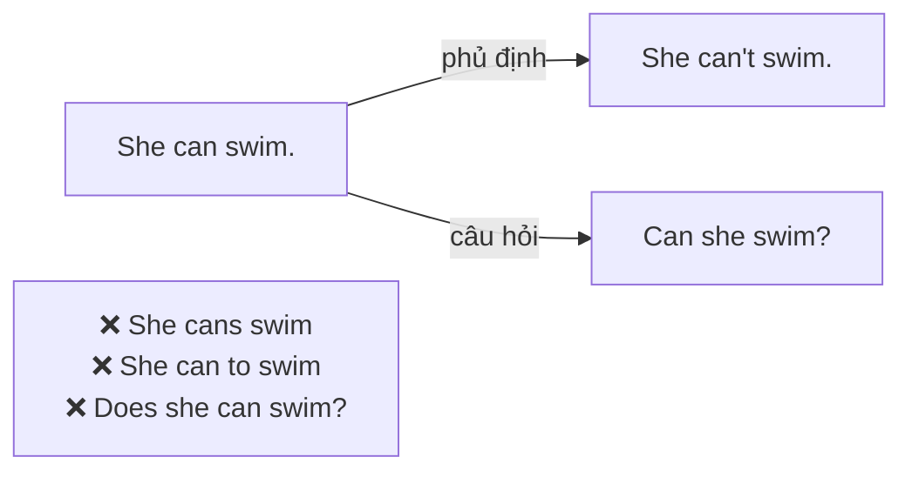
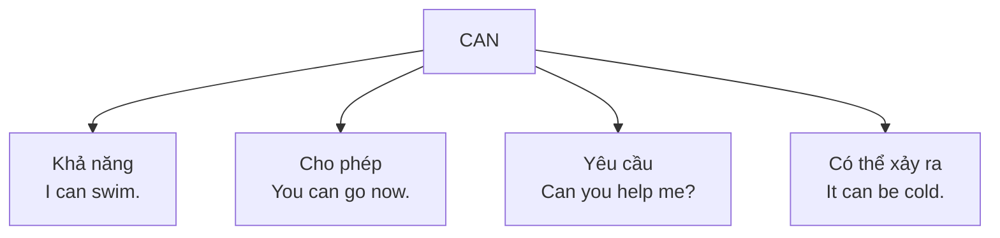

# A1-G012 · Can / Can't — Khả năng, xin phép, yêu cầu với *Can*

## Mục lục

- [A. Lesson Information](#a-lesson-information)
- [B. Warm-up](#b-warm-up-tình-huống-thực-tế)
- [C. WHAT](#c-what-can-là-gì)
- [D. WHY](#d-why-can-là-một-động-từ-khuyết-thiếu)
- [E. FORM](#e-form-công-thức-và-phát-âm)
- [F. HOW](#f-how-4-cách-dùng)
- [G. VISUAL](#g-visual-explanation)
- [H. COMPARISON](#h-comparison)
- [I. COMMON MISTAKES](#i-common-mistakes)
- [J. MEMORY TRICKS](#j-memory-tricks)
- [K. REAL-LIFE APPLICATION](#k-real-life-application)
- [L. PRACTICE EXERCISES](#l-practice-exercises)
- [M. KNOWLEDGE CHECK](#m-knowledge-check)
- [N. ANSWER KEY](#n-answer-key)

---

## A. Lesson Information

| Mục | Nội dung |
|---|---|
| **Lesson ID** | A1-G012 |
| **Topic** | Can / Can't (ability, permission, possibility, requests) |
| **Tên tiếng Việt** | Can / Can't — khả năng, xin phép, khả năng xảy ra, yêu cầu |
| **CEFR Level** | A1 |
| **Prerequisites** | [A1-G002](A1-G002-present-simple-negatives-questions.md), [A1-G011](A1-G011-imperatives.md) |
| **Estimated Time** | 75 phút |

**Learning Objectives:**

1. Hiểu *can* là **modal verb** (động từ khuyết thiếu): không chia, không *to*, không *do/does*.
2. Dùng *can/can't* để nói về **khả năng** (biết làm gì).
3. Dùng *Can I...?* để **xin phép** và *Can you...?* để **nhờ/yêu cầu**.
4. Dùng *can* nói về **khả năng xảy ra/điều có thể** (*You can buy tickets online*).
5. Phân biệt *can* /kən/ và *can't* /kɑːnt/ khi **nghe** và **nói**.

---

## B. Warm-up: Tình huống thực tế

Bạn điền hồ sơ xin việc tại một khách sạn quốc tế. Mục "Skills" yêu cầu:

> *What can you do? What languages can you speak?*

Bạn muốn viết: "Tôi **biết** nói tiếng Anh và tiếng Nhật. Tôi **biết** lái xe. Tôi **không biết** bơi."

🤔 **Hãy suy nghĩ:** Tiếng Việt dùng "biết", "có thể", "được" trong nhiều nghĩa khác nhau. Tiếng Anh có một từ ngắn gọn bao phủ cả những nghĩa này không? Và nó có cần *do/does* để tạo câu hỏi không?

---

## C. WHAT: *Can* là gì?

**Can** là một **modal verb** (động từ khuyết thiếu / động từ tình thái) — loại động từ đứng **trước động từ chính** để thêm một **"sắc thái"** vào nghĩa: khả năng, sự cho phép, khả năng xảy ra...

| Nghĩa của *can* | Tiếng Việt | Ví dụ |
|---|---|---|
| **Ability** — khả năng, năng lực | biết, có thể | *I **can** swim.* |
| **Permission** — sự cho phép | được (phép) | *You **can** park here.* / ***Can** I sit here?* |
| **Request** — yêu cầu, nhờ | có thể... giúp không | ***Can** you help me?* |
| **Possibility** — điều có thể xảy ra/có thể làm | có thể | *You **can** buy tickets at the station.* |

**Can't** (= *cannot*) là dạng phủ định: không biết, không thể, không được.

---

## D. WHY: *Can* là một động từ khuyết thiếu

Modal verbs có "hành vi" đặc biệt — chúng thuộc **gia đình 1** (giống *be*): tự đảo lên đầu câu hỏi, tự gắn *not*.

**Ba quy tắc vàng của modal verbs** (áp dụng cho *can, could, will, would, must, should, may, might* mà bạn sẽ học sau):

1. **Không chia** theo ngôi: *he can* (không phải ~~he cans~~).
2. Động từ theo sau ở **nguyên mẫu không *to***: *can swim* (không phải ~~can to swim~~, ~~can swims~~).
3. **Không dùng *do/does*** để tạo phủ định và câu hỏi.

---

## E. FORM: Công thức và phát âm

**Ký hiệu:** **S** = chủ ngữ · **V** = động từ nguyên mẫu (bare infinitive — không *to*).

| | Công thức | Ví dụ |
|---|---|---|
| ➕ | S + **can** + V | *He **can** drive.* |
| ➖ | S + **can't / cannot** + V | *He **can't** drive.* |
| ❓ | **Can** + S + V? | ***Can** he drive?* |
| 💬 | Yes, S + can. / No, S + can't. | *Yes, he **can**. / No, he **can't**.* |
| Wh- | Wh- + can + S + V? | *What **can** you **do**? / Where **can** I **buy** a SIM card?* |

> ✍️ *cannot* viết **liền** một từ (không viết *can not* trong cách dùng thông thường).

### Phát âm — rất quan trọng khi nghe

| Dạng | Phát âm | Ghi chú |
|---|---|---|
| *can* trong câu khẳng định | **/kən/** — yếu, nhanh, gần như "cờn" | *I /kən/ swim.* — trọng âm rơi vào **động từ chính** |
| *can* đứng cuối / trả lời ngắn / nhấn mạnh | **/kæn/** | *Yes, I /kæn/.* |
| *can't* | **/kɑːnt/** (Anh) · **/kænt/** (Mỹ) | Luôn được nhấn, nguyên âm dài/rõ; âm /t/ cuối thường rất nhẹ |

**Mẹo nghe:** Đừng cố nghe âm /t/ cuối của *can't* — nó thường gần như biến mất. Hãy nghe **nguyên âm và trọng âm**: *I c'n SWIM* (khẳng định — *can* lướt nhẹ) vs *I CAN'T swim* (phủ định — *can't* được nhấn rõ).

---

## F. HOW: 4 cách dùng

### Cách dùng 1 — Khả năng (ability)

| # | English | Tiếng Việt | Phân tích |
|---|---|---|---|
| 1 | *My daughter **can** read, but she **can't** write yet.* | Con gái tôi biết đọc nhưng chưa biết viết. | Năng lực |
| 2 | *I **can** speak a little Korean.* | Tôi nói được một chút tiếng Hàn. | |
| 3 | ***Can** you cook? — Yes, I **can**. I **can** make pho!* | Bạn biết nấu ăn không? — Có. Tôi nấu được phở! | |

### Cách dùng 2 — Xin phép và cho phép (permission)

| # | English | Tiếng Việt | Phân tích |
|---|---|---|---|
| 4 | ***Can** I use your charger?* | Tôi dùng sạc của bạn được không? | Xin phép thân mật |
| 5 | *You **can** leave early today.* | Hôm nay bạn được về sớm. | Cho phép |
| 6 | *You **can't** smoke in here.* | Bạn không được hút thuốc ở đây. | Không cho phép |

### Cách dùng 3 — Yêu cầu, nhờ vả (request)

| # | English | Tiếng Việt | Phân tích |
|---|---|---|---|
| 7 | ***Can** you open the door, please?* | Bạn mở cửa giúp tôi được không? | Lịch sự hơn câu mệnh lệnh |
| 8 | ***Can** you speak more slowly, please?* | Bạn nói chậm hơn được không? | Câu cứu cánh khi nghe không kịp |

### Cách dùng 4 — Khả năng xảy ra / điều có thể làm (possibility)

| # | English | Tiếng Việt | Phân tích |
|---|---|---|---|
| 9 | *You **can** pay by card or in cash.* | Bạn có thể trả bằng thẻ hoặc tiền mặt. | Lựa chọn có sẵn |
| 10 | *It **can** be very hot in Saigon in April.* | Tháng 4 Sài Gòn có thể rất nóng. | Điều đôi khi xảy ra |
| 11 | *Where **can** I buy a SIM card?* | Tôi có thể mua SIM ở đâu? | |
| 12 | *I **can** see the sea from my window.* | Tôi nhìn thấy biển từ cửa sổ. | *can + see/hear/smell* — giác quan |

---

## G. VISUAL EXPLANATION

### Sentence breakdown

`My grandmother | can't | use | a smartphone.`

| Phần | Vai trò | Ghi chú |
|---|---|---|
| My grandmother | S (ngôi 3) | Nhưng *can't* **không** đổi |
| can't | Modal verb phủ định | Không *doesn't* |
| use | V nguyên mẫu | Không *uses*, không *to use* |
| a smartphone | O | |

### Bản đồ nghĩa của *can*

---

## H. COMPARISON

### *Can* và *Can I...?* / *Can you...?*

| Câu hỏi | Ai làm hành động? | Mục đích |
|---|---|---|
| ***Can I** open the window?* | Tôi | Xin phép |
| ***Can you** open the window?* | Bạn | Nhờ |

### *Can* và *could* (giới thiệu)

| *Can* | *Could* |
|---|---|
| *Can you help me?* — bình thường, thân mật | *Could you help me?* — lịch sự hơn |
| *I can swim.* — khả năng hiện tại | *I could swim when I was five.* — khả năng trong quá khứ |

*Could* được học kỹ ở [A2-G013](../../03-A2-ELEMENTARY/grammar/A2-G013-permission-can-could-may.md).

### *Can* và *know how to*

*I **can** swim* = *I **know how to** swim* (biết cách bơi). *Know how to* nhấn mạnh **kỹ năng đã học**.

---

## I. COMMON MISTAKES

| # | ❌ Sai | ✅ Đúng | Nguyên nhân | Cách tránh |
|---|---|---|---|---|
| 1 | She **cans** sing. | She **can** sing. | Áp quy tắc ngôi 3 | Modal không chia |
| 2 | I can **to** speak English. | I can speak English. | Thêm *to* | Sau modal: V không *to* |
| 3 | He can **plays** the piano. | He can **play** the piano. | | Sau modal: V nguyên mẫu |
| 4 | **Do** you **can** swim? | **Can** you swim? | Dùng *do* | Modal tự đảo |
| 5 | I **don't can** drive. | I **can't** drive. | | Modal tự phủ định |
| 6 | I **can not** come. (trong văn bình thường) | I **cannot** / **can't** come. | Viết tách | *cannot* liền |
| 7 | "Can you swim?" — "Yes, I **can swim**." | "Yes, I **can**." | Lặp động từ (không sai nhưng không tự nhiên) | Trả lời ngắn |
| 8 | Phát âm *can* = *can't* | /kən/ vs /kɑːnt/ | Nhấn *can* quá mạnh | Khẳng định: lướt *can*, nhấn động từ chính |

---

## J. MEMORY TRICKS

1. **"Modal là ông chủ — động từ sau là nhân viên mặc đồng phục"**: Nhân viên (động từ chính) luôn mặc "đồng phục" nguyên mẫu: không *-s*, không *to*, không *-ing*.
2. **"Can không cần *do* — tự lo được"**: Giống *be*, *can* tự đảo, tự phủ định.
3. **Nghe nhịp**: Khẳng định = *ti-TAM* (*I c'n GO*). Phủ định = *TAM-TAM* (*I CAN'T GO*).

---

## K. REAL-LIFE APPLICATION

### Hội thoại: Phỏng vấn làm thêm ở quán cà phê

> **Manager:** So, tell me about your skills. **Can** you make coffee?
> **Tuan:** Yes, I **can**. I **can** make espresso and Vietnamese coffee, but I **can't** do latte art yet.
> **Manager:** That's OK. We **can** teach you. **Can** you speak English?
> **Tuan:** Yes, I **can** speak English quite well, and I **can** understand a little Chinese.
> **Manager:** Great. **Can** you work on weekends?
> **Tuan:** I **can** work on Saturdays, but I **can't** work on Sundays — I have classes.
> **Tuan:** **Can** I ask a question? **Can** staff have free coffee?
> **Manager:** Ha ha, yes, you **can** have two free drinks a day!

**Vietnamese explanation:** Tuấn phỏng vấn làm thêm: biết pha espresso và cà phê Việt nhưng chưa biết vẽ latte art (quán sẽ dạy); nói tiếng Anh khá tốt, hiểu một chút tiếng Trung; làm được thứ Bảy nhưng không làm được Chủ nhật vì có lớp. Tuấn hỏi nhân viên có được uống cà phê miễn phí không — được hai ly mỗi ngày.

**Grammar highlights:** Khả năng (*can make, can't do, can speak, can understand*), cho phép (*Can I ask...? / you can have*), possibility (*We can teach you*).

**Useful expressions:** *Tell me about...* · *quite well* (khá tốt) · *yet* (chưa — cuối câu phủ định) · *Can I ask a question?*

---

## L. PRACTICE EXERCISES

> ✍️ Đáp án: [A1-G012-ANSWERS](../../12-ANSWERS-AND-EXPLANATIONS/A1/A1-G012-ANSWERS.md)

### Level 1 — Recognition

**L1.1.** My brother ___ play the guitar very well.  A. can  B. cans  C. can to
**L1.2.** ___ you speak Japanese?  A. Do  B. Can  C. Are
**L1.3.** "Can your sister drive?" — "No, she ___."  A. doesn't  B. can't  C. isn't
**L1.4.** I can ___ the music from my room.  A. hear  B. hears  C. to hear
**L1.5.** Bạn muốn xin phép dùng nhà vệ sinh. Bạn nói:  A. Can you use the toilet?  B. Can I use the toilet?  C. Do I can use the toilet?
**L1.6.** Trong câu *"I can swim"*, từ *can* thường được đọc là:  A. /kæn/ nhấn mạnh  B. /kən/ lướt nhẹ  C. /kɑːnt/

### Level 2 — Controlled Practice

Viết câu với *can* (+) hoặc *can't* (–).

**L2.1.** a fish / walk (–)
**L2.2.** birds / fly (+)
**L2.3.** my grandfather / use a computer (+)
**L2.4.** I / come to the party / because I'm working (–)
**L2.5.** you / pay by credit card / here (+)

Viết câu hỏi phù hợp với tình huống:

**L2.6.** Bạn không nghe rõ giáo viên. → ______ (repeat that)
**L2.7.** Bạn muốn mượn bút của bạn cùng bàn. → ______ (borrow)
**L2.8.** Bạn muốn biết chỗ đổi tiền. → ______ (Where / change money)
**L2.9.** Bạn hỏi bạn mới về khả năng bơi. → ______
**L2.10.** Bạn nhờ đồng nghiệp gửi email. → ______

### Level 3 — Error Correction

**L3.1.** She can speaks three languages.
**L3.2.** Do you can help me?
**L3.3.** I can to cook Italian food.
**L3.4.** My son don't can swim.
**L3.5.** He cans play chess.
**L3.6.** "Can they come?" — "Yes, they come."

### Level 4 — Production

Dịch sang tiếng Anh:

**L4.1.** Tôi biết nói tiếng Anh nhưng tôi không biết nói tiếng Pháp.
**L4.2.** Tôi ngồi đây được không?
**L4.3.** Bạn có thể nói to hơn được không? (*speak louder*)
**L4.4.** Bạn có thể mua vé trên mạng. (*online*)
**L4.5.** Từ đây chúng ta có thể nhìn thấy núi.

### Level 5 — Real Communication

**L5.1.** Viết đoạn văn 70–90 từ: *My skills.* Bạn biết làm gì, không biết làm gì (nấu ăn, ngôn ngữ, thể thao, công nghệ, âm nhạc...) và muốn học gì.
**L5.2.** **Speaking — Role-play at a hotel:** Bạn là khách. Đặt 6 câu hỏi với *Can I...?* / *Can you...?* / *Where can I...?* (Wi-Fi, bữa sáng, gọi taxi, gửi hành lý, đổi phòng, trả phòng muộn). Tự trả lời như lễ tân.

---

## M. KNOWLEDGE CHECK

### 5 câu hỏi tự kiểm tra

1. Ba quy tắc vàng của modal verbs là gì?
2. Kể 4 nghĩa của *can*.
3. *Can I...?* và *Can you...?* khác nhau thế nào?
4. Làm sao phân biệt *can* và *can't* khi nghe?
5. Sửa: *Does he can drive?*

### Checklist

- [ ] Tôi không chia *can* và không thêm *to* sau *can*.
- [ ] Tôi xin phép và nhờ vả được bằng *Can I/you...?*
- [ ] Tôi phát âm *can* (yếu) và *can't* (mạnh) khác nhau.

### 3 lỗi quan trọng cần nhớ

1. ~~can to speak / can speaks~~ → **can speak**.
2. ~~Do you can~~ → **Can you**.
3. ~~don't can~~ → **can't**.

### Lịch ôn tập

| Ngày | Việc cần làm |
|---|---|
| Ngày 1 | Làm lại L2 |
| Ngày 3 | Viết 10 câu: 5 việc bạn làm được, 5 việc không làm được |
| Ngày 7 | Luyện nghe: dùng TTS đọc 10 câu trộn *can/can't*, nghe và đánh dấu |

### Liên kết

- ➡️ Bài tiếp theo: [A1-G013 — Would Like](A1-G013-would-like.md)
- 🔜 [A2-G013 — Permission & Requests: Can / Could / May](../../03-A2-ELEMENTARY/grammar/A2-G013-permission-can-could-may.md)
- 🔁 Tra cứu: [MODAL-VERBS-COMPARISON](../../06-GRAMMAR-REFERENCE/MODAL-VERBS-COMPARISON.md)
- 🔁 Phát âm: [PRON-08 — Weak Forms](../../08-PRONUNCIATION/PRON-08-weak-forms.md)

---

## N. ANSWER KEY

👉 [A1-G012-ANSWERS.md](../../12-ANSWERS-AND-EXPLANATIONS/A1/A1-G012-ANSWERS.md)
