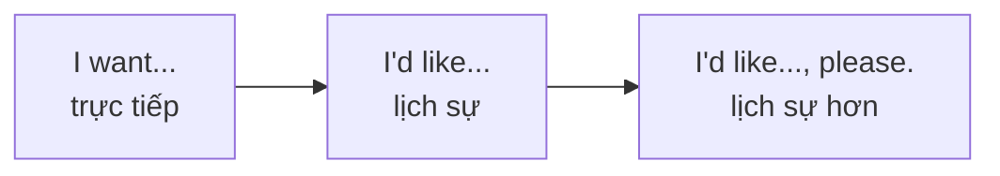
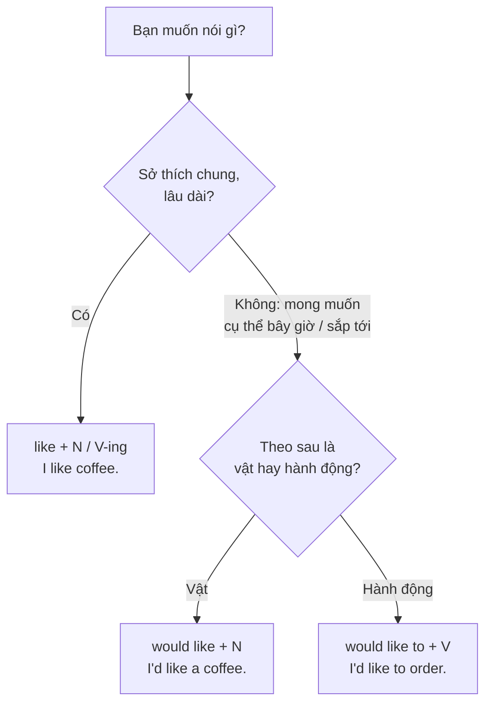

# A1-G013 · Would Like — Lời mời, yêu cầu và mong muốn lịch sự

## Mục lục

- [A. Lesson Information](#a-lesson-information)
- [B. Warm-up](#b-warm-up-tình-huống-thực-tế)
- [C. WHAT](#c-what-would-like-là-gì)
- [D. WHY](#d-why-vì-sao-would-làm-câu-lịch-sự-hơn)
- [E. FORM](#e-form-công-thức)
- [F. HOW](#f-how-cách-dùng)
- [G. VISUAL](#g-visual-explanation)
- [H. COMPARISON](#h-comparison-would-like--like--want)
- [I. COMMON MISTAKES](#i-common-mistakes)
- [J. MEMORY TRICKS](#j-memory-tricks)
- [K. REAL-LIFE APPLICATION](#k-real-life-application)
- [L. PRACTICE EXERCISES](#l-practice-exercises)
- [M. KNOWLEDGE CHECK](#m-knowledge-check)
- [N. ANSWER KEY](#n-answer-key)

---

## A. Lesson Information

| Mục | Nội dung |
|---|---|
| **Lesson ID** | A1-G013 |
| **Topic** | Would Like (offers, requests, polite wishes) |
| **Tên tiếng Việt** | *Would like* — mời, gọi món, nói mong muốn lịch sự |
| **CEFR Level** | A1 |
| **Prerequisites** | [A1-G012 — Can/Can't](A1-G012-can-cant.md), [A0-G019 — Likes](../../01-A0-FOUNDATION/grammar/A0-G019-likes-and-hobbies.md) |
| **Estimated Time** | 60 phút |

**Learning Objectives:**

1. Dùng ***I'd like + N*** và ***I'd like to + V*** để nói mong muốn/gọi món lịch sự.
2. Dùng ***Would you like + N / to V?*** để mời.
3. Trả lời lời mời: *Yes, please. / No, thank you. / I'd love to, but...*
4. Phân biệt rõ ***like*** (thích nói chung) và ***would like*** (muốn ngay bây giờ/cụ thể).
5. Phân biệt *would like* với *want* về độ lịch sự.

---

## B. Warm-up: Tình huống thực tế

Ở nhà hàng, bạn nghe hai vị khách gọi món:

> **Khách 1:** *I want a beer. Give me the menu.*
> **Khách 2:** *I'd like a glass of orange juice, please. And could I see the menu?*

🤔 **Hãy suy nghĩ:** Cả hai đều đúng ngữ pháp. Nhưng nếu bạn là người phục vụ, bạn có cảm giác thế nào với từng vị khách? Và *I'd like* có giống *I like* không?

---

## C. WHAT: *Would like* là gì?

**Would like** là cách **lịch sự** để nói "muốn". Nó dùng cho mong muốn **cụ thể, ở hiện tại hoặc sắp tới** — không phải sở thích chung.

| Chức năng | Mẫu | Ví dụ |
|---|---|---|
| Gọi món, yêu cầu | *I'd like + N* | *I'd like a coffee, please.* |
| Nói điều muốn làm | *I'd like to + V* | *I'd like to book a table.* |
| Mời ai dùng gì | *Would you like + N?* | *Would you like some tea?* |
| Mời ai làm gì | *Would you like to + V?* | *Would you like to come to my party?* |

*'d* là dạng rút gọn của *would*: *I'd = I would*, *She'd = She would*.

---

## D. WHY: Vì sao *would* làm câu lịch sự hơn?

*Would* là một modal verb (như *can* ở bài trước). Nó tạo ra **"khoảng cách"** — biến lời nói thành "giả định", mềm mại hơn:

- *I **want** a coffee.* — trực tiếp, đôi khi nghe như đòi hỏi.
- *I**'d like** a coffee.* — "Tôi sẽ thích một ly cà phê (nếu có thể)" — nhẹ nhàng, lịch sự.

Vì *would* là modal verb, nó **không chia** theo ngôi và **tự đảo** trong câu hỏi: *Would you like...?* (không có *Do you would like*).

---

## E. FORM: Công thức

**Ký hiệu:** **N** = danh từ · **V** = động từ nguyên mẫu.

| | Công thức | Ví dụ |
|---|---|---|
| ➕ + danh từ | S + **would ('d) like** + N | *We'**d like** two tickets.* |
| ➕ + động từ | S + **would ('d) like to** + V | *She'**d like to** travel to Japan.* |
| ➖ | S + **wouldn't like** (+ to V) | *I **wouldn't like to** live in a big city.* |
| ❓ mời | **Would** + S + **like** + N / **to** V? | ***Would** you **like** a drink?* / ***Would** you **like to** dance?* |
| ❓ hỏi ý muốn | **What would** + S + **like** (+ to V)? | ***What would** you **like** to eat?* |
| ❓ hỏi chỗ | **Where would** + S + **like to** + V? | ***Where would** you **like to** sit?* |

### Trả lời lời mời

| Lời mời | Đồng ý | Từ chối lịch sự |
|---|---|---|
| *Would you like some cake?* (mời **dùng**) | *Yes, please.* / *That would be lovely.* | *No, thank you.* / *No, thanks. I'm full.* |
| *Would you like to come to dinner?* (mời **làm**) | *I'd love to!* / *Yes, I'd like that.* | *I'd love to, but I can't. I'm busy.* / *Sorry, I can't.* |

> ⚠️ Không trả lời *Yes, I would like* (dù đúng ngữ pháp, nghe không tự nhiên). Với lời mời dùng đồ ăn/uống: ***Yes, please.***

---

## F. HOW: Cách dùng

| # | English | Tiếng Việt | Phân tích |
|---|---|---|---|
| 1 | *I'**d like** a bowl of pho, please.* | Cho tôi một bát phở. | Gọi món: *'d like* + N |
| 2 | *We'**d like to** book a table for four.* | Chúng tôi muốn đặt bàn bốn người. | *'d like to* + V |
| 3 | ***Would** you **like** some coffee? — Yes, please.* | Bạn uống cà phê không? — Vâng, cảm ơn. | Mời + đồng ý |
| 4 | ***Would** you **like to** join us for lunch? — I'd love to!* | Bạn ăn trưa cùng chúng tôi nhé? — Rất sẵn lòng! | Mời làm gì |
| 5 | *What **would** you **like** for dessert?* | Bạn muốn món tráng miệng gì? | Câu hỏi Wh- |
| 6 | *I'**d like to** speak to the manager, please.* | Tôi muốn nói chuyện với quản lý. | Yêu cầu lịch sự (kể cả khi phàn nàn) |
| 7 | *My son **would like to** be a pilot.* | Con trai tôi muốn trở thành phi công. | Mong muốn cho tương lai |
| 8 | ***Would** you **like** me **to** help you?* | Bạn có muốn tôi giúp không? | *would like* + **người** + *to* V — đề nghị giúp |
| 9 | *I **wouldn't like to** work at night.* | Tôi không muốn làm ca đêm. | Phủ định |
| 10 | *"Would you like to come to the cinema?" — "I'd love to, but I have to work."* | | Từ chối lịch sự kèm lý do |

---

## G. VISUAL EXPLANATION

### Breakdown

`Would | you | like | to try | some green tea ice cream?`

| Phần | Vai trò |
|---|---|
| Would | Modal — đảo lên đầu để hỏi |
| you | S |
| like | V nguyên mẫu |
| to try | *to* + V — vì sau *would like* là một **hành động** |
| some green tea ice cream | Tân ngữ của *try* |

### Sơ đồ chọn *like* / *would like*

---

## H. COMPARISON: *would like* / *like* / *want*

| | *like* | *would like* | *want* |
|---|---|---|---|
| Nghĩa | thích (nói chung) | muốn (lịch sự, cụ thể) | muốn (trực tiếp) |
| Thời gian | Thói quen, sở thích lâu dài | Bây giờ / sắp tới | Bây giờ / nói chung |
| Theo sau | N / V-ing / to V | N / **to** V | N / **to** V |
| Ví dụ | *I like tea.* | *I'd like a tea, please.* | *I want a tea.* |
| Hỏi | *Do you like tea?* (có thích không) | *Would you like a tea?* (mời) | *Do you want a tea?* (thân mật) |

> 💡 *Do you want...?* vẫn dùng được giữa bạn bè, người thân. Với khách hàng, cấp trên, người lạ — nên dùng *Would you like...?*

---

## I. COMMON MISTAKES

| # | ❌ Sai | ✅ Đúng | Nguyên nhân | Cách tránh |
|---|---|---|---|---|
| 1 | I **like** a coffee, please. (gọi món) | I'**d like** a coffee, please. | Quên *'d* — khi nói nhanh không nghe rõ | Gọi món → *I'd like* |
| 2 | I'd like **go** home. | I'd like **to go** home. | Thiếu *to* | *would like to + V* |
| 3 | I'd like **going** to Japan. | I'd like **to go** to Japan. | Nhầm với *like + V-ing* | *would like* → *to V* |
| 4 | **Do you would like** some tea? | **Would you like** some tea? | Thêm *do* | *would* tự đảo |
| 5 | She **woulds like** / She would **likes** | She **would like** | Chia động từ | Modal + V nguyên mẫu |
| 6 | "Would you like a drink?" — "**Yes, I like.**" | "**Yes, please.**" | Dịch "Có, tôi thích" | Nhận đồ mời → *Yes, please* |
| 7 | "Would you like to come?" — "**Yes, I would like.**" | "**I'd love to!**" / "**Yes, I'd like to.**" | | *I'd love to* tự nhiên nhất |
| 8 | **Do you like** a drink? (ý: mời) | **Would you like** a drink? | Nhầm câu hỏi sở thích với lời mời | *Do you like...?* = có thích không |

---

## J. MEMORY TRICKS

1. **"Like là sở thích, 'd like là đơn gọi món"**: Bạn *like* pizza (luôn thích), nhưng tối nay bạn *'d like* một chiếc pizza hải sản.
2. **"Would like đi với TO"**: *would like **to** go, would like **to** eat* — giống *want **to***.
3. **"Yes, please / No, thank you"**: Hai câu trả lời "vàng" cho mọi lời mời đồ ăn uống.

---

## K. REAL-LIFE APPLICATION

### Hội thoại: Ở nhà hàng

> **Waiter:** Good evening. **Would** you **like** something to drink first?
> **Lan:** Yes, please. I'**d like** a lemon soda.
> **Ben:** And I'**d like** a glass of water, please.
> **Waiter:** Of course. Are you ready to order?
> **Ben:** Almost. What **would** you **recommend**?
> **Waiter:** Our grilled fish is very popular.
> **Lan:** Great, I'**d like to** try that.
> **Ben:** I'**d like** the beef noodle soup, please. Not too spicy.
> **Waiter:** **Would** you **like** some fried spring rolls to start?
> **Lan:** No, thank you. But **would** you **like to** share a dessert later, Ben?
> **Ben:** I'**d love to**!

**Vietnamese explanation:** Lan và Ben ăn tối ở nhà hàng: gọi soda chanh và nước lọc; hỏi phục vụ gợi ý món; Lan thử cá nướng, Ben gọi bún/phở bò không quá cay. Họ từ chối chả giò khai vị nhưng sẽ chia nhau món tráng miệng.

**Useful expressions:**
- *Are you ready to order?* — Quý khách gọi món chưa?
- *What would you recommend?* — Bạn gợi ý món gì?
- *Not too spicy.* — Không quá cay.
- *to start* — món khai vị
- *Can I have the bill, please?* — Cho tôi thanh toán. (bổ sung)

---

## L. PRACTICE EXERCISES

> ✍️ Đáp án: [A1-G013-ANSWERS](../../12-ANSWERS-AND-EXPLANATIONS/A1/A1-G013-ANSWERS.md)

### Level 1 — Recognition

**L1.1.** (Ở quán cà phê) "I ___ a cappuccino, please."  A. like  B. 'd like  C. liking
**L1.2.** "Would you like ___ to the cinema tonight?"  A. come  B. coming  C. to come
**L1.3.** "Would you like some cake?" — "___"  A. Yes, I like.  B. Yes, please.  C. Yes, I would.
**L1.4.** "___ you like Korean food?" — "Yes, I love it." (hỏi sở thích)  A. Would  B. Do  C. Are
**L1.5.** "Would you like to have dinner with us?" — "___, but I'm busy tonight."  A. I'd love to  B. Yes, please  C. I like
**L1.6.** Câu nào **lịch sự nhất** khi nói với nhân viên khách sạn?  A. I want a room.  B. Give me a room.  C. I'd like a room, please.

### Level 2 — Controlled Practice

Điền *like, would like, would like to*.

**L2.1.** I ___ swimming. I go every week.
**L2.2.** I ___ a table for two, please.
**L2.3.** We ___ visit Paris one day.
**L2.4.** ___ you ___ a cup of tea?
**L2.5.** My children ___ chocolate very much.
**L2.6.** What ___ you ___ do this weekend?

Viết lời mời bằng *Would you like...?* và một câu trả lời (đồng ý/từ chối) theo gợi ý:

**L2.7.** (mời uống trà) — đồng ý
**L2.8.** (mời đi xem bóng đá thứ Bảy) — từ chối, bận
**L2.9.** (mời ngồi ghế này) — đồng ý
**L2.10.** (đề nghị giúp mang túi — *would you like me to...*) — đồng ý

### Level 3 — Error Correction

**L3.1.** I would like go to the beach.
**L3.2.** Do you would like some water?
**L3.3.** She'd likes a new phone.
**L3.4.** "Would you like a sandwich?" — "Yes, I like."
**L3.5.** I'd like visiting my grandparents this weekend.
**L3.6.** (Ở quầy) I like two tickets for the 7 p.m. show, please.

### Level 4 — Production

Dịch sang tiếng Anh:

**L4.1.** Tôi muốn đặt một phòng đôi cho hai đêm. (*book, double room*)
**L4.2.** Bạn muốn ăn gì?
**L4.3.** Bạn có muốn đi dạo với tôi không? (*go for a walk*)
**L4.4.** Tôi rất muốn, nhưng tôi không thể. (trả lời lời mời)
**L4.5.** Bạn có muốn tôi gọi taxi không?

### Level 5 — Real Communication

**L5.1.** Viết đoạn hội thoại 10–12 dòng ở một quán ăn: chào hỏi, gọi đồ uống, hỏi gợi ý, gọi món, từ chối một món được mời thêm, xin hóa đơn.
**L5.2.** **Speaking — Invitations:** Mời 3 người (bạn bè, đồng nghiệp, hàng xóm) tham gia 3 hoạt động khác nhau. Với mỗi lời mời, tự nói một câu đồng ý và một câu từ chối lịch sự có lý do.

---

## M. KNOWLEDGE CHECK

### 5 câu hỏi tự kiểm tra

1. *I like coffee* và *I'd like a coffee* khác nhau thế nào?
2. Sau *would like*, động từ có dạng gì?
3. Trả lời *Would you like some tea?* (đồng ý / từ chối).
4. Trả lời *Would you like to come?* (đồng ý / từ chối lịch sự).
5. Vì sao *would like* lịch sự hơn *want*?

### Checklist

- [ ] Tôi gọi món bằng *I'd like..., please*.
- [ ] Tôi mời và trả lời lời mời tự nhiên.
- [ ] Tôi không nhầm *like* và *would like*.

### 3 lỗi quan trọng cần nhớ

1. Gọi món: ~~I like a coffee~~ → I**'d like** a coffee.
2. ~~would like go~~ → would like **to** go.
3. Nhận lời mời ăn uống: ~~Yes, I like~~ → **Yes, please.**

### Lịch ôn tập

| Ngày | Việc cần làm |
|---|---|
| Ngày 1 | Làm lại L2 |
| Ngày 3 | Đóng vai gọi món ở quán quen bằng tiếng Anh (nói thầm) |
| Ngày 7 | Viết 5 lời mời và 5 câu trả lời |

### Liên kết

- ➡️ Bài tiếp theo: [A1-G014 — Some / Any](A1-G014-some-any.md)
- 🔁 Giao tiếp: [A1-COMMUNICATION — At a café / restaurant](../A1-COMMUNICATION.md)

---

## N. ANSWER KEY

👉 [A1-G013-ANSWERS.md](../../12-ANSWERS-AND-EXPLANATIONS/A1/A1-G013-ANSWERS.md)
