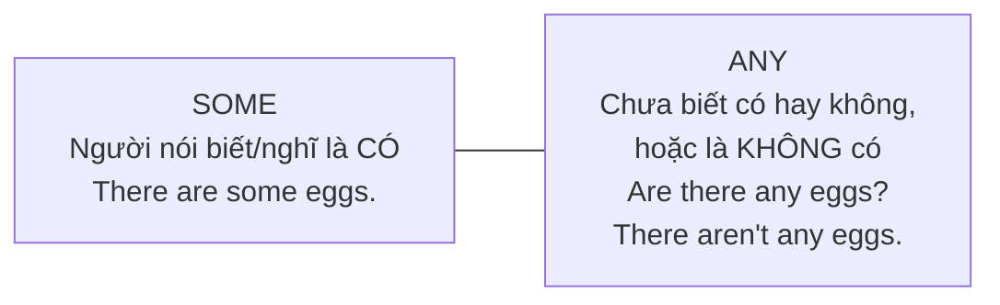
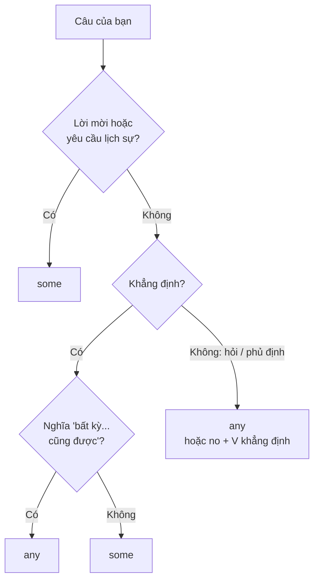

# A1-G014 · Some / Any — Một vài, một ít, bất kỳ

## Mục lục

- [A. Lesson Information](#a-lesson-information)
- [B. Warm-up](#b-warm-up-tình-huống-thực-tế)
- [C. WHAT](#c-what-some-và-any-là-gì)
- [D. WHY](#d-why-some-cho-điều-có-thật-any-cho-điều-mở)
- [E. FORM](#e-form-quy-tắc-cơ-bản-và-ngoại-lệ)
- [F. HOW](#f-how-ví-dụ-phân-tích)
- [G. VISUAL](#g-visual-explanation)
- [H. COMPARISON](#h-comparison)
- [I. COMMON MISTAKES](#i-common-mistakes)
- [J. MEMORY TRICKS](#j-memory-tricks)
- [K. REAL-LIFE APPLICATION](#k-real-life-application)
- [L. PRACTICE EXERCISES](#l-practice-exercises)
- [M. KNOWLEDGE CHECK](#m-knowledge-check)
- [N. ANSWER KEY](#n-answer-key)

---

## A. Lesson Information

| Mục | Nội dung |
|---|---|
| **Lesson ID** | A1-G014 |
| **Topic** | Some / Any (+ something, anything, someone, anyone...) |
| **Tên tiếng Việt** | *Some* và *any* |
| **CEFR Level** | A1 |
| **Prerequisites** | [A0-G014 — Countable & Uncountable](../../01-A0-FOUNDATION/grammar/A0-G014-countable-uncountable.md), [A1-G013](A1-G013-would-like.md) |
| **Estimated Time** | 60 phút |

**Learning Objectives:**

1. Dùng *some* trong câu khẳng định, *any* trong câu phủ định và câu hỏi.
2. Dùng *some/any* với **danh từ số nhiều** và **danh từ không đếm được**.
3. Dùng *some* trong **lời mời** và **yêu cầu** (*Would you like some...? / Can I have some...?*).
4. Dùng *no* = *not any*.
5. Dùng các từ ghép: *something, anything, someone/somebody, anyone/anybody, somewhere, anywhere, nothing, nobody*.

---

## B. Warm-up: Tình huống thực tế

Bạn mở tủ lạnh và nói với người cùng nhà:

> "Có **ít** trứng nhưng **không có** sữa. Bạn có muốn **ít** trà không? À, bạn có thấy **cái gì** để ăn không?"

Tiếng Việt dùng nhiều từ khác nhau: "ít", "không có", "cái gì". Tiếng Anh xử lý tất cả bằng hai từ chủ chốt: *some* và *any*.

🤔 **Hãy suy nghĩ:** Khi bạn **khẳng định** có trứng, và khi bạn **hỏi** có trứng không — người nói đang chắc chắn ở mức độ nào? Liệu đó có phải là lý do tiếng Anh dùng hai từ khác nhau?

---

## C. WHAT: *Some* và *any* là gì?

*Some* và *any* là **determiners** (từ hạn định) chỉ **một lượng không xác định** — không nói chính xác bao nhiêu. Chúng đi với:

- **Danh từ số nhiều**: *some eggs, any eggs*.
- **Danh từ không đếm được**: *some milk, any milk*.

**Không** dùng với danh từ đếm được số ít — với chúng ta dùng *a/an*: ~~some egg~~ → *an egg*.

| | Nghĩa |
|---|---|
| **some** | một vài, một ít (có, nhưng không nói rõ bao nhiêu) |
| **any** | (không...) chút nào; có ... nào không; bất kỳ |
| **no** | không có ... nào (= *not any*) |

---

## D. WHY: *Some* cho điều có thật, *any* cho điều "mở"



- **Some** = "có một lượng nào đó" → hợp với câu **khẳng định**.
- **Any** = "bất kỳ lượng nào, kể cả không có" → hợp với **câu hỏi** (chưa biết có hay không) và **phủ định** (không có chút nào).

Hiểu bản chất này, bạn sẽ hiểu được **ngoại lệ**: Trong lời mời/yêu cầu (*Would you like **some** tea?*), người nói **mong đợi câu trả lời "có"**, nên dùng *some* dù là câu hỏi.

---

## E. FORM: Quy tắc cơ bản và ngoại lệ

### E1. Quy tắc cơ bản

| Loại câu | Từ | Ví dụ (số nhiều) | Ví dụ (không đếm được) |
|---|---|---|---|
| ➕ Khẳng định | **some** | *There are **some** apples.* | *I have **some** money.* |
| ➖ Phủ định | **any** | *There aren't **any** apples.* | *I don't have **any** money.* |
| ❓ Câu hỏi | **any** | *Are there **any** apples?* | *Do you have **any** money?* |
| ➖ (nhấn mạnh) | **no** + động từ khẳng định | *There are **no** apples.* | *I have **no** money.* |

### E2. Ngoại lệ quan trọng

| Trường hợp | Dùng | Ví dụ |
|---|---|---|
| Lời mời | **some** trong câu hỏi | *Would you like **some** coffee?* |
| Yêu cầu | **some** trong câu hỏi | *Can I have **some** water, please?* |
| Mong đợi câu trả lời "có" | **some** | *Did you buy **some** bread?* (tôi nghĩ là có) |
| "Bất kỳ ... nào cũng được" trong câu khẳng định | **any** | *You can take **any** bus — they all go to the centre.* |

### E3. Từ ghép với *some / any / no / every*

| | Người | Vật | Nơi chốn |
|---|---|---|---|
| **some-** (khẳng định, mời) | someone / somebody | something | somewhere |
| **any-** (hỏi, phủ định) | anyone / anybody | anything | anywhere |
| **no-** (= not any-) | no one / nobody | nothing | nowhere |
| **every-** (tất cả) | everyone / everybody | everything | everywhere |

> ⚠️ Các từ ghép này là **số ít**: *Someone **is** at the door. Everybody **likes** her. Nothing **is** impossible.*

---

## F. HOW: Ví dụ phân tích

| # | English | Tiếng Việt | Phân tích |
|---|---|---|---|
| 1 | *There are **some** eggs in the fridge.* | Trong tủ lạnh có ít trứng. | Khẳng định + số nhiều |
| 2 | *There isn't **any** milk.* | Không có chút sữa nào. | Phủ định + không đếm được |
| 3 | *Do you have **any** questions?* | Bạn có câu hỏi nào không? | Câu hỏi |
| 4 | *Would you like **some** tea?* | Bạn uống chút trà nhé? | Lời mời → *some* |
| 5 | *Can I have **some** more rice, please?* | Cho tôi thêm ít cơm được không? | Yêu cầu → *some* |
| 6 | *We have **no** time.* | Chúng ta không còn thời gian. | *no* + V khẳng định (*have*) |
| 7 | ***Someone** is calling you.* | Có ai đó đang gọi bạn. | *someone* + *is* (số ít) |
| 8 | *I don't know **anyone** here.* | Tôi không quen ai ở đây. | Phủ định → *anyone* |
| 9 | *Is there **anything** I can do?* | Có việc gì tôi có thể làm không? | Câu hỏi → *anything* |
| 10 | *I want to go **somewhere** quiet.* | Tôi muốn đi đâu đó yên tĩnh. | Tính từ đứng **sau** *somewhere* |
| 11 | ***Nobody** knows the answer.* | Không ai biết câu trả lời. | *Nobody* + V khẳng định |
| 12 | *You can sit **anywhere**.* | Bạn ngồi đâu cũng được. | *any* = bất kỳ |

---

## G. VISUAL EXPLANATION

### Bảng quyết định nhanh



### *Something* + tính từ

Với *something, anything, somewhere, nothing...*, **tính từ đứng sau**:

```text
something  new        anything  interesting      somewhere  warm
nothing    special    someone   famous           everywhere else
```

---

## H. COMPARISON

### *not any* và *no*

| *not ... any* | *no* |
|---|---|
| *I don't have any brothers.* | *I have no brothers.* |
| Phổ biến trong văn nói | Nhấn mạnh hơn, hơi trang trọng |
| Động từ **phủ định** | Động từ **khẳng định** |

❌ Không dùng cả hai: ~~I don't have no brothers~~ (phủ định kép).

### *some* và *a/an*

| *a/an* | *some* |
|---|---|
| Một cái (số ít, đếm được) | Một vài (số nhiều) / một ít (không đếm được) |
| *I bought **an** apple.* | *I bought **some** apples. / I bought **some** fruit.* |

### *anyone* và *someone* trong câu hỏi

- *Is there **anyone** at home?* — câu hỏi trung tính (không biết có ai).
- *Is there **someone** at the door?* — người nói nghĩ là có (nghe tiếng gõ cửa).

---

## I. COMMON MISTAKES

| # | ❌ Sai | ✅ Đúng | Nguyên nhân | Cách tránh |
|---|---|---|---|---|
| 1 | I don't have **some** money. | I don't have **any** money. | Không đổi *some* trong phủ định | Phủ định → *any* |
| 2 | Are there **some** books? (câu hỏi trung tính) | Are there **any** books? | | Câu hỏi bình thường → *any* |
| 3 | Would you like **any** tea? | Would you like **some** tea? | Áp quy tắc câu hỏi cho lời mời | Lời mời → *some* |
| 4 | I don't have **no** money. | I don't have **any** money. / I have **no** money. | Phủ định kép | *no* + V khẳng định |
| 5 | I have **some** egg. | I have **an** egg / **some** eggs. | Dùng *some* với số ít | *some* + số nhiều / không đếm được |
| 6 | **Somebody are** at the door. | **Somebody is** at the door. | Nghĩ "ai đó" là nhiều người | Từ ghép → số ít |
| 7 | I want something **to eat cold**. → I want **cold something**. | I want **something cold** to eat. | Tính từ đặt trước | *something* + adj |
| 8 | **Nobody doesn't** know. | **Nobody** knows. | Phủ định kép | *Nobody* đã phủ định |

---

## J. MEMORY TRICKS

1. **"Some = Sure (chắc có), Any = Ask (hỏi) hoặc Absent (vắng)"**: *Some* — chắc chắn có; *Any* — đang hỏi, hoặc là vắng mặt (phủ định).
2. **"Mời mọc thì Some"**: Lời mời, nhờ vả → *some*, vì bạn hi vọng người ta nói "có".
3. **"Một chữ phủ định là đủ"**: *no, nobody, nothing, never* đã là phủ định → không thêm *not*.

---

## K. REAL-LIFE APPLICATION

### Hội thoại: Đi chợ cho bữa tối

> **Mai:** Let's make spring rolls tonight. **Do** we have **any** rice paper?
> **Quang:** Yes, there's **some** in the cupboard. But there aren't **any** carrots.
> **Mai:** OK. Do we need **anything** else?
> **Quang:** We need **some** pork and **some** fresh herbs. Oh, and we have **no** fish sauce!
> **Mai:** No fish sauce?! We can't make spring rolls without it.
> **Quang:** I can go to the market. Would you like **some** fruit too?
> **Mai:** Yes, please. Get **some** mangoes. And is there **anyone** coming for dinner?
> **Quang:** Yes, **someone** special — my mum!

**Vietnamese explanation:** Mai và Quang định làm nem cuốn: có bánh tráng nhưng không có cà rốt; cần thịt heo, rau thơm và hết nước mắm. Quang ra chợ, hỏi Mai có muốn mua trái cây không — Mai bảo mua xoài. Tối nay có "một người đặc biệt" đến ăn: mẹ của Quang.

**Grammar highlights:** *any rice paper?* (hỏi), *some* (khẳng định), *aren't any carrots* (phủ định), *anything else?*, *no fish sauce*, *Would you like some fruit?* (mời), *anyone coming?*, *someone special* (tính từ sau).

---

## L. PRACTICE EXERCISES

> ✍️ Đáp án: [A1-G014-ANSWERS](../../12-ANSWERS-AND-EXPLANATIONS/A1/A1-G014-ANSWERS.md)

### Level 1 — Recognition

**L1.1.** There are ___ students in the library.  A. some  B. any  C. a
**L1.2.** I don't have ___ plans for the weekend.  A. some  B. any  C. no
**L1.3.** Would you like ___ cake?  A. any  B. some  C. a
**L1.4.** Is there ___ at home?  A. anybody  B. somebody  C. nobody
**L1.5.** There's ___ milk left. Can you buy some?  A. any  B. some  C. no
**L1.6.** I'd like something ___.  A. cold to drink  B. to drink cold  C. drink cold

### Level 2 — Controlled Practice

Điền *some, any, no*.

**L2.1.** Can I have ___ water, please?
**L2.2.** There aren't ___ buses after midnight.
**L2.3.** Do you need ___ help?
**L2.4.** I have ___ good news for you!
**L2.5.** Sorry, there are ___ tickets left. (nhấn mạnh — hết sạch)
**L2.6.** You can call me ___ time. (bất kỳ lúc nào)

Điền *something, anything, someone, anyone, nothing, nobody, somewhere, anywhere*.

**L2.7.** I'm hungry. Is there ___ to eat?
**L2.8.** ___ is knocking at the door.
**L2.9.** I looked everywhere, but I couldn't find my keys ___.
**L2.10.** "What's wrong?" — "___. I'm fine."

### Level 3 — Error Correction

**L3.1.** I don't have some friends in this city.
**L3.2.** Would you like any coffee?
**L3.3.** There isn't no sugar.
**L3.4.** Somebody are waiting for you.
**L3.5.** Do you have some questions? (hỏi trung tính cuối buổi học)
**L3.6.** I want to buy interesting something for my mum.

### Level 4 — Production

Dịch sang tiếng Anh:

**L4.1.** Trong phòng không có ghế nào.
**L4.2.** Bạn có muốn ăn chút gì không?
**L4.3.** Tôi không biết ai ở bữa tiệc.
**L4.4.** Cho tôi xin ít đường được không?
**L4.5.** Không ai ở nhà.

### Level 5 — Real Communication

**L5.1.** Viết đoạn hội thoại 8–10 dòng giữa hai người chuẩn bị nấu một bữa ăn, kiểm tra những gì có/không có trong bếp (dùng *some, any, no*, ít nhất 2 từ ghép).
**L5.2.** **Speaking — At the hotel reception:** Hỏi 5 câu với *any/anything/anywhere* (*Are there any good restaurants nearby? Is there anything interesting to see?...*) và trả lời với *some/someone/somewhere*.

---

## M. KNOWLEDGE CHECK

### 5 câu hỏi tự kiểm tra

1. Quy tắc cơ bản của *some/any*?
2. Vì sao *Would you like some tea?* dùng *some*?
3. *I don't have any* và *I have no* — khác gì về động từ?
4. *Somebody* đi với *is* hay *are*?
5. Đặt tính từ *special* vào cụm *something*.

### Checklist

- [ ] Tôi dùng *some/any* đúng trong ba loại câu.
- [ ] Tôi dùng *some* trong lời mời/yêu cầu.
- [ ] Tôi dùng được 8 từ ghép *some-/any-/no-*.

### 3 lỗi quan trọng cần nhớ

1. ~~don't have some~~ → don't have **any**.
2. ~~don't have no~~ → don't have **any** / have **no**.
3. Lời mời: ~~any tea~~ → **some** tea.

### Lịch ôn tập

| Ngày | Việc cần làm |
|---|---|
| Ngày 1 | Làm lại L2 |
| Ngày 3 | Liệt kê đồ trong tủ lạnh: 5 câu *some*, 5 câu *any/no* |
| Ngày 7 | Làm lại L3 |

### Liên kết

- ➡️ Bài tiếp theo: [A1-G015 — Much / Many / A Lot Of](A1-G015-much-many-a-lot-of.md)
- 🔜 [A2-G024 — Quantifiers](../../03-A2-ELEMENTARY/grammar/A2-G024-quantifiers.md)

---

## N. ANSWER KEY

👉 [A1-G014-ANSWERS.md](../../12-ANSWERS-AND-EXPLANATIONS/A1/A1-G014-ANSWERS.md)
