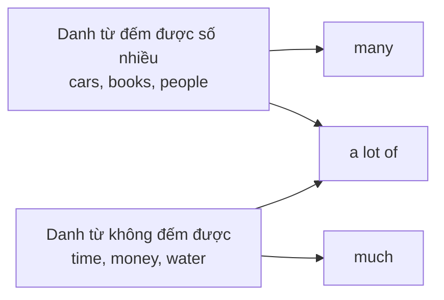
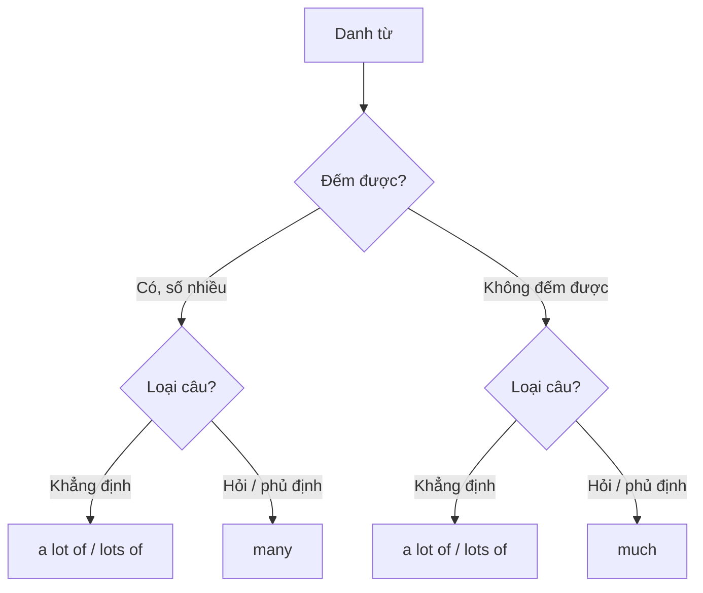

# A1-G015 · Much / Many / A Lot Of — Lượng từ "nhiều"

## Mục lục

- [A. Lesson Information](#a-lesson-information)
- [B. Warm-up](#b-warm-up-tình-huống-thực-tế)
- [C. WHAT](#c-what-much-many-a-lot-of-là-gì)
- [D. WHY](#d-why-đếm-được-hay-không-quyết-định-tất-cả)
- [E. FORM](#e-form-bảng-quy-tắc)
- [F. HOW](#f-how-ví-dụ-phân-tích)
- [G. VISUAL](#g-visual-explanation)
- [H. COMPARISON](#h-comparison)
- [I. COMMON MISTAKES](#i-common-mistakes)
- [J. MEMORY TRICKS](#j-memory-tricks)
- [K. REAL-LIFE APPLICATION](#k-real-life-application)
- [L. PRACTICE EXERCISES](#l-practice-exercises)
- [M. KNOWLEDGE CHECK](#m-knowledge-check)
- [N. ANSWER KEY](#n-answer-key)

---

## A. Lesson Information

| Mục | Nội dung |
|---|---|
| **Lesson ID** | A1-G015 |
| **Topic** | Much / Many / A Lot Of / How much / How many |
| **Tên tiếng Việt** | Lượng từ chỉ "nhiều" và câu hỏi số lượng |
| **CEFR Level** | A1 |
| **Prerequisites** | [A1-G014 — Some / Any](A1-G014-some-any.md) |
| **Estimated Time** | 60 phút |

**Learning Objectives:**

1. Dùng *many* với danh từ đếm được số nhiều, *much* với danh từ không đếm được.
2. Dùng *a lot of / lots of* với cả hai loại, đặc biệt trong câu khẳng định.
3. Biết xu hướng: *much/many* thường dùng trong **câu hỏi và phủ định**, *a lot of* trong **câu khẳng định**.
4. Hỏi số lượng và giá: *How many...? / How much...?*
5. Dùng *too much / too many* và *not much / not many* để nói "quá nhiều", "không nhiều".

---

## B. Warm-up: Tình huống thực tế

Bạn kể về chuyến đi Hà Nội:

> "Hà Nội có **nhiều** xe máy quá! Và **nhiều** tiếng ồn nữa. Tôi không có **nhiều** thời gian nên không đi được **nhiều** nơi."

Tiếng Việt chỉ có một từ "nhiều". Tiếng Anh có *many, much, a lot of*.

🤔 **Hãy suy nghĩ:** "Xe máy" đếm được, "tiếng ồn" và "thời gian" không đếm được ([A0-G014](../../01-A0-FOUNDATION/grammar/A0-G014-countable-uncountable.md)). Liệu điều đó có ảnh hưởng đến từ "nhiều" bạn chọn?

---

## C. WHAT: *Much, many, a lot of* là gì?

Đây là các **quantifiers** (lượng từ) mang nghĩa **"nhiều"**:

| Từ | Đi với | Ví dụ |
|---|---|---|
| **many** | danh từ **đếm được số nhiều** | *many cars, many people* |
| **much** | danh từ **không đếm được** | *much time, much money* |
| **a lot of / lots of** | **cả hai** | *a lot of cars, a lot of time* |

*Lots of* = *a lot of* nhưng thân mật hơn một chút.

---

## D. WHY: Đếm được hay không quyết định tất cả

*Many* nghĩa là "nhiều **cái**" — bạn có thể hình dung từng đơn vị (xe, người, cuốn sách). *Much* nghĩa là "nhiều **lượng**" — một khối không tách rời (thời gian, tiền, nước).



**Vì sao *a lot of* phổ biến hơn trong câu khẳng định?** Trong văn nói hằng ngày, *much* và *many* trong câu khẳng định nghe khá **trang trọng** hoặc "sách vở" (*I have much money* nghe rất lạ). Người bản ngữ thường dùng *a lot of*. Ngược lại, trong câu **hỏi và phủ định**, *much/many* rất tự nhiên.

---

## E. FORM: Bảng quy tắc

| Loại câu | Đếm được số nhiều | Không đếm được |
|---|---|---|
| ➕ Khẳng định | ***a lot of*** *books* (tự nhiên) / *many books* (trang trọng hơn) | ***a lot of*** *money* (tự nhiên) — ⚠️ *much money* hiếm trong khẳng định |
| ➖ Phủ định | *not **many** books* / *not a lot of books* | *not **much** money* / *not a lot of money* |
| ❓ Câu hỏi | ***many** books?* | ***much** money?* |
| Hỏi số lượng | ***How many** books...?* | ***How much** money...?* |
| Quá nhiều | ***too many** books* | ***too much** money* |
| Rất nhiều (trang trọng/nhấn mạnh) | ***so many** / **very many*** | ***so much*** |

### *A lot* đứng một mình (không có danh từ)

- *I like it **a lot**.* (Tôi rất thích nó.) — *a lot* là trạng từ, **không** có *of*.
- *"Do you have any friends there?" — "Yes, **a lot**."*

### Hỏi giá

- ***How much is** this shirt?* — *It's 300,000 dong.*
- ***How much are** these shoes?* — *They're 800,000 dong.*
- ***How much does it cost**?* — *It costs $20.*

---

## F. HOW: Ví dụ phân tích

| # | English | Tiếng Việt | Phân tích |
|---|---|---|---|
| 1 | *There are **a lot of** motorbikes in Hanoi.* | Ở Hà Nội có rất nhiều xe máy. | Khẳng định → *a lot of* |
| 2 | *There's **a lot of** noise in the city centre.* | Trung tâm thành phố rất ồn. | *noise* không đếm được |
| 3 | *I don't have **much** time.* | Tôi không có nhiều thời gian. | Phủ định + không đếm được |
| 4 | *We didn't visit **many** places.* | Chúng tôi không đi được nhiều nơi. | Phủ định + đếm được (*didn't* — quá khứ, học ở A1-G018) |
| 5 | ***How many** languages do you speak?* | Bạn nói được mấy thứ tiếng? | |
| 6 | ***How much** water do you drink a day?* | Mỗi ngày bạn uống bao nhiêu nước? | |
| 7 | *There are **too many** people here. Let's go.* | Ở đây đông người quá. Đi thôi. | Quá nhiều (tiêu cực) |
| 8 | *Don't put **too much** salt in the soup.* | Đừng cho quá nhiều muối vào súp. | |
| 9 | *She has **lots of** friends.* | Cô ấy có nhiều bạn. | Thân mật |
| 10 | *Thanks **a lot**!* | Cảm ơn nhiều! | *a lot* không có *of* |
| 11 | ***How much** is a ticket to Sapa?* | Vé đi Sa Pa giá bao nhiêu? | Hỏi giá |
| 12 | *There isn't **much** traffic on Sundays.* | Chủ nhật không có nhiều xe cộ. | *traffic* không đếm được |

---

## G. VISUAL EXPLANATION

### Sơ đồ chọn từ



### Thang số lượng (giới thiệu — đầy đủ ở A2-G024)

```text
none ── not much / not many ── some ── a lot of / lots of ── too much / too many
 0%                                                              (quá mức, tiêu cực)
```

---

## H. COMPARISON

### *a lot of* và *a lot*

| | |
|---|---|
| *a lot **of** + N* | *I have **a lot of** work.* |
| *a lot* (không có danh từ) | *I work **a lot**.* / *Thanks **a lot**.* |

### *very much* và *much*

- *I like it **very much**.* ✅ (rất thích)
- *Thank you **very much**.* ✅
- *I like it **much**.* ❌ (không đứng một mình trong câu khẳng định)

### *too many/much* và *a lot of*

| | Sắc thái |
|---|---|
| *There are **a lot of** people.* | Trung tính hoặc tích cực: đông vui. |
| *There are **too many** people.* | Tiêu cực: đông **quá mức**, gây khó chịu. |

---

## I. COMMON MISTAKES

| # | ❌ Sai | ✅ Đúng | Nguyên nhân | Cách tránh |
|---|---|---|---|---|
| 1 | How **much** people? | How **many** people? | Không xác định loại danh từ | *people* đếm được |
| 2 | I don't have **many** money. | I don't have **much** money. | | *money* không đếm được |
| 3 | I have **much** friends. | I have **a lot of** friends. | Dùng *much* với đếm được + khẳng định | |
| 4 | I have **much** work. (văn nói) | I have **a lot of** work. | *much* trong câu khẳng định nghe trang trọng/không tự nhiên | Khẳng định → *a lot of* |
| 5 | There are **a lot** cars. | There are **a lot of** cars. | Thiếu *of* | *a lot of* + N |
| 6 | I like it **a lot of**. | I like it **a lot**. | Thừa *of* | Không có N → *a lot* |
| 7 | How **many** is this bag? | How **much** is this bag? | | Hỏi giá → *How much* |
| 8 | There are **too much** cars. | There are **too many** cars. | | *cars* đếm được |

---

## J. MEMORY TRICKS

1. **"Many – nhiều cái (m-a-n-y: có chữ *y* như *yes, I can count*); Much – nhiều khối"**. (Mẹo gợi nhớ.)
2. **"A lot of — vé thông hành"**: Khi không chắc, *a lot of* luôn đúng trong câu khẳng định với mọi danh từ.
3. **"How much $"**: Hỏi giá luôn là *How much* — vì tiền là không đếm được (kể cả khi bạn trả bằng nhiều tờ).

---

## K. REAL-LIFE APPLICATION

### Hội thoại: Kể về chuyến đi Hà Nội

> **Sarah:** How was Hanoi?
> **Tuan:** Amazing! There were **a lot of** things to see. But there were **too many** motorbikes!
> **Sarah:** Ha ha. Did you visit **many** museums?
> **Tuan:** Not **many** — only two. I didn't have **much** time.
> **Sarah:** And the food?
> **Tuan:** Delicious, and not **much** money! I ate **lots of** street food. **How much** do you think a bowl of pho costs there?
> **Sarah:** Maybe 50,000 dong?
> **Tuan:** About that. I loved it **a lot**.

**Vietnamese explanation:** Tuấn kể về Hà Nội: có rất nhiều thứ để xem nhưng quá nhiều xe máy; chỉ đi được hai bảo tàng vì ít thời gian; đồ ăn ngon, rẻ, ăn nhiều đồ ăn đường phố.

**Grammar highlights:** *a lot of things, too many motorbikes, many museums? Not many, not much time, not much money, lots of street food, How much...?, a lot* (trạng từ). *was/were, did/didn't, ate* là quá khứ — học ở A1-G016–G018.

---

## L. PRACTICE EXERCISES

> ✍️ Đáp án: [A1-G015-ANSWERS](../../12-ANSWERS-AND-EXPLANATIONS/A1/A1-G015-ANSWERS.md)

### Level 1 — Recognition

**L1.1.** How ___ brothers do you have?  A. much  B. many  C. lot
**L1.2.** I don't drink ___ coffee.  A. many  B. much  C. a lot
**L1.3.** There are ___ tourists in Hoi An in summer.  A. much  B. a lot of  C. a lot
**L1.4.** ___ is this dress?  A. How many  B. How much  C. How
**L1.5.** I love this song ___!  A. a lot  B. a lot of  C. much
**L1.6.** There's ___ traffic today. We're going to be late!  A. too many  B. too much  C. many

### Level 2 — Controlled Practice

Điền *much, many, a lot of*.

**L2.1.** She doesn't have ___ free time.
**L2.2.** We saw ___ beautiful beaches in Quy Nhon.
**L2.3.** How ___ students are there in your class?
**L2.4.** There isn't ___ rice left.
**L2.5.** My father reads ___ books.
**L2.6.** Did you take ___ photos?

Viết câu hỏi *How much / How many* cho câu trả lời:

**L2.7.** I drink two litres of water a day.
**L2.8.** There are 12 people in my team.
**L2.9.** This laptop costs 15 million dong.
**L2.10.** I need three eggs for this cake.

### Level 3 — Error Correction

**L3.1.** How much people live in your house?
**L3.2.** I have much good friends.
**L3.3.** There are a lot cars on the road.
**L3.4.** Thank you a lot of!
**L3.5.** How many is a ticket?
**L3.6.** He doesn't have many money.

### Level 4 — Production

Dịch sang tiếng Anh:

**L4.1.** Tôi không có nhiều kinh nghiệm. (*experience* — không đếm được)
**L4.2.** Thành phố của tôi có nhiều công viên.
**L4.3.** Bạn uống bao nhiêu tách cà phê mỗi ngày?
**L4.4.** Có quá nhiều đường trong món này. (*this dish*)
**L4.5.** Cái túi này giá bao nhiêu?

### Level 5 — Real Communication

**L5.1.** Viết đoạn văn 70–90 từ: *My city — the good and the bad*. Dùng *a lot of, too many, too much, not many, not much* (ít nhất 6 lần).
**L5.2.** **Speaking — Shopping role-play:** Hỏi giá 4 món đồ (*How much is/are...?*), hỏi số lượng còn lại (*How many... do you have?*) và mặc cả nhẹ (*That's too much. Can you give me a discount?*).

---

## M. KNOWLEDGE CHECK

### 5 câu hỏi tự kiểm tra

1. *Much* và *many* đi với loại danh từ nào?
2. Vì sao *I have much money* nghe không tự nhiên?
3. *a lot* và *a lot of* khác nhau thế nào?
4. Hỏi giá dùng *How much* hay *How many*?
5. *a lot of people* và *too many people* khác nhau về sắc thái thế nào?

### Checklist

- [ ] Tôi chọn đúng *much/many* theo loại danh từ.
- [ ] Tôi dùng *a lot of* trong câu khẳng định.
- [ ] Tôi hỏi được giá và số lượng.

### 3 lỗi quan trọng cần nhớ

1. ~~How much people~~ → How **many** people.
2. ~~a lot cars~~ → a lot **of** cars; ~~like it a lot of~~ → like it **a lot**.
3. Hỏi giá: ~~How many is~~ → **How much** is.

### Lịch ôn tập

| Ngày | Việc cần làm |
|---|---|
| Ngày 1 | Làm lại L2 |
| Ngày 3 | Viết 10 câu hỏi *How much/How many* về cuộc sống của bạn và trả lời |
| Ngày 7 | Trộn với A1-G014: viết đoạn văn về đồ ăn trong nhà (some/any/much/many) |

### Liên kết

- ➡️ Bài tiếp theo: [A1-G016 — Past Simple of Be](A1-G016-past-simple-be.md)
- 🎯 **Mini Challenge khối A1-3:** gọi món trong quán cà phê — xem [A1 README](../README.md#5-mini-challenges)
- 🔁 Từ vựng: [VOC-07 — Shopping & Money](../../07-VOCABULARY/VOC-07-shopping-money.md)

---

## N. ANSWER KEY

👉 [A1-G015-ANSWERS.md](../../12-ANSWERS-AND-EXPLANATIONS/A1/A1-G015-ANSWERS.md)
