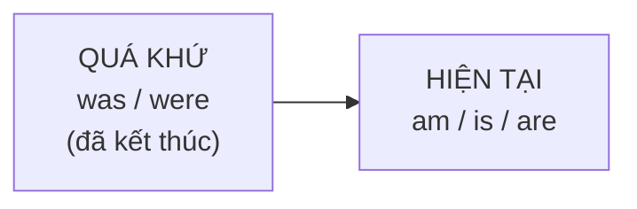

# A1-G016 · Past Simple of *Be* — Quá khứ của To Be: was / were

## Mục lục

- [A. Lesson Information](#a-lesson-information)
- [B. Warm-up](#b-warm-up-tình-huống-thực-tế)
- [C. WHAT](#c-what-was--were-là-gì)
- [D. WHY](#d-why-tiếng-anh-đánh-dấu-quá-khứ-trên-động-từ)
- [E. FORM](#e-form-công-thức)
- [F. HOW](#f-how-cách-dùng)
- [G. VISUAL](#g-visual-explanation)
- [H. COMPARISON](#h-comparison)
- [I. COMMON MISTAKES](#i-common-mistakes)
- [J. MEMORY TRICKS](#j-memory-tricks)
- [K. REAL-LIFE APPLICATION](#k-real-life-application)
- [L. PRACTICE EXERCISES](#l-practice-exercises)
- [M. KNOWLEDGE CHECK](#m-knowledge-check)
- [N. ANSWER KEY](#n-answer-key)

---

## A. Lesson Information

| Mục | Nội dung |
|---|---|
| **Lesson ID** | A1-G016 |
| **Topic** | Past Simple of *Be*: was / were (+ there was / there were) |
| **Tên tiếng Việt** | Quá khứ đơn của động từ *to be* |
| **CEFR Level** | A1 |
| **Prerequisites** | [A0-G009 — To Be](../../01-A0-FOUNDATION/grammar/A0-G009-verb-to-be.md), [A0-G015 — There is/are](../../01-A0-FOUNDATION/grammar/A0-G015-there-is-there-are.md) |
| **Estimated Time** | 75 phút |

**Learning Objectives:**

1. Chia đúng *was* (I/he/she/it) và *were* (you/we/they).
2. Tạo câu phủ định, nghi vấn, trả lời ngắn với *was/were*.
3. Dùng *there was / there were* để mô tả quá khứ.
4. Dùng các cụm thời gian quá khứ: *yesterday, last night, ago, in 2010, when I was a child*.
5. Nói về nơi bạn đã ở, cảm xúc, thời tiết, tuổi trong quá khứ.

---

## B. Warm-up: Tình huống thực tế

Thứ Hai, đồng nghiệp hỏi bạn về cuối tuần:

> *"How **was** your weekend?"*

Bạn muốn trả lời: "Tuyệt lắm! Tôi **ở** Đà Lạt. Thời tiết **lạnh** nhưng đẹp. Khách sạn **không** đắt. **Có** nhiều khách du lịch."

🤔 **Hãy suy nghĩ:** Tiếng Việt không thay đổi gì ("Tôi ở Đà Lạt" có thể là hôm nay hoặc hôm qua — ngữ cảnh sẽ cho biết). Tiếng Anh thì sao? Nếu nói *I am in Da Lat*, người nghe sẽ hiểu là bạn đang ở Đà Lạt **bây giờ**!

---

## C. WHAT: *Was / were* là gì?

**Was** và **were** là dạng **quá khứ đơn** của *be* (am/is/are). Chúng dùng để nói về **trạng thái, vị trí, cảm xúc, đặc điểm ở một thời điểm đã qua và đã kết thúc**.

| Hiện tại | Quá khứ |
|---|---|
| I **am** | I **was** |
| he / she / it **is** | he / she / it **was** |
| you / we / they **are** | you / we / they **were** |

Cách dùng giống hệt *am/is/are* ([A0-G009](../../01-A0-FOUNDATION/grammar/A0-G009-verb-to-be.md)) — chỉ khác thời gian.

---

## D. WHY: Tiếng Anh đánh dấu quá khứ trên động từ

Tiếng Việt diễn tả thời gian bằng **từ chỉ thời gian** ("hôm qua", "năm ngoái") hoặc từ như "đã". Động từ không đổi.

Tiếng Anh **bắt buộc** đánh dấu thời gian **ngay trên động từ**. Kể cả khi đã có *yesterday*, động từ vẫn phải ở dạng quá khứ:

- ❌ *Yesterday I **am** tired.*
- ✅ *Yesterday I **was** tired.*



Tin tốt: *be* ở quá khứ **đơn giản hơn** hiện tại — chỉ có 2 dạng (*was/were*) thay vì 3.

---

## E. FORM: Công thức

**Ký hiệu:** **S** = chủ ngữ · **C** = bổ ngữ (tính từ, danh từ, nơi chốn).

| | I / he / she / it | you / we / they |
|---|---|---|
| ➕ | S + **was** + C | S + **were** + C |
| ➖ | S + **wasn't** (was not) + C | S + **weren't** (were not) + C |
| ❓ | **Was** + S + C? | **Were** + S + C? |
| 💬 | Yes, S **was**. / No, S **wasn't**. | Yes, S **were**. / No, S **weren't**. |
| Wh- | *Where **was** he?* | *How **were** your exams?* |

### *There was / There were*

| | Số ít / không đếm được | Số nhiều |
|---|---|---|
| ➕ | **There was** a problem. | **There were** many people. |
| ➖ | **There wasn't** any time. | **There weren't** any taxis. |
| ❓ | **Was there** a TV? | **Were there** any messages? |

### Cụm thời gian quá khứ (past time expressions)

| Mẫu | Ví dụ |
|---|---|
| *yesterday* | yesterday, yesterday morning, the day before yesterday |
| *last* + thời gian | last night, last week, last month, last year, last Monday |
| khoảng thời gian + *ago* | two days ago, a week ago, ten years ago |
| *in* + năm/tháng đã qua | in 2015, in May |
| *when* + mệnh đề quá khứ | when I was a child, when we were at school |

> ⚠️ *last night* (tối qua), **không** dùng *yesterday night*. Và **không** có giới từ trước *last, yesterday*: ~~in last year~~ → *last year*.

### Phát âm

- *was*: /wəz/ (yếu, trong câu) · /wɒz/ (nhấn mạnh, trả lời ngắn)
- *were*: /wə/ (yếu) · /wɜː/ (nhấn mạnh)
- *wasn't* /ˈwɒznt/ · *weren't* /wɜːnt/

---

## F. HOW: Cách dùng

| # | Cách dùng | English | Tiếng Việt | Phân tích |
|---|---|---|---|---|
| 1 | Vị trí | *I **was** in Da Lat last weekend.* | Cuối tuần trước tôi ở Đà Lạt. | *was* + nơi chốn |
| 2 | Thời tiết | *It **was** cold but beautiful.* | Trời lạnh nhưng đẹp. | *It* + *was* |
| 3 | Cảm xúc | *We **were** very tired after the trip.* | Sau chuyến đi chúng tôi rất mệt. | |
| 4 | Đặc điểm | *The hotel **wasn't** expensive.* | Khách sạn không đắt. | Phủ định |
| 5 | Tuổi | *I **was** ten when we moved to Hanoi.* | Tôi 10 tuổi khi gia đình chuyển ra Hà Nội. | Tuổi → *be* |
| 6 | Nghề nghiệp | *My grandfather **was** a teacher.* | Ông tôi từng là giáo viên. | |
| 7 | Tồn tại | ***There were** a lot of tourists.* | Có rất nhiều khách du lịch. | |
| 8 | Hỏi | *"How **was** your weekend?" — "It **was** great!"* | Cuối tuần của bạn thế nào? — Tuyệt! | Câu hỏi giao tiếp rất phổ biến |
| 9 | Hỏi Yes/No | *"**Were** you at home yesterday?" — "No, I **wasn't**."* | | |
| 10 | Hỏi nơi chốn | *Where **were** you born?* — *I **was** born in Nghe An.* | Bạn sinh ra ở đâu? | *be born* luôn dùng *was/were* khi nói về quá khứ |
| 11 | Không có | ***There wasn't** any hot water in the hotel.* | Khách sạn không có nước nóng. | |
| 12 | Wh- | *Why **were** you late this morning?* | Sao sáng nay bạn đến muộn? | |

> 💡 Ví dụ 10: **"Tôi sinh ra"** luôn là ***I was born*** — không phải ~~I born~~ hay ~~I am born~~. Đây là lỗi rất phổ biến.

---

## G. VISUAL EXPLANATION

### Timeline

```text
  ───[ was / were ]───────────────── NOW ─────────► 
     (đã xảy ra, đã kết thúc)        (am / is / are)
     yesterday · last week · 2 years ago
```

### Bảng chuyển đổi hiện tại → quá khứ

| Hiện tại | Quá khứ |
|---|---|
| I **am** happy. | I **was** happy. |
| She **is** at work. | She **was** at work. |
| They **are** students. | They **were** students. |
| **There is** a café. | **There was** a café. |
| **There are** two shops. | **There were** two shops. |
| **Is** he busy? | **Was** he busy? |

---

## H. COMPARISON

### *was/were* và *am/is/are*

| | |
|---|---|
| *I **am** at the office.* | Tôi đang ở văn phòng (bây giờ). |
| *I **was** at the office.* | Tôi đã ở văn phòng (lúc đó — giờ không còn nữa, hoặc thời điểm đã qua). |

### *was/were* với động từ thường (xem trước)

*Was/were* là quá khứ của **be** — chỉ dùng với tính từ, danh từ, nơi chốn. Với hành động (*go, eat, work*), bạn dùng **quá khứ của động từ đó** ([A1-G017](A1-G017-past-simple-affirmative.md)):

- ✅ *I **was** tired.* / ✅ *I **went** home.*
- ❌ *I **was go** home.* / ❌ *I **was went** home.*

---

## I. COMMON MISTAKES

| # | ❌ Sai | ✅ Đúng | Nguyên nhân | Cách tránh |
|---|---|---|---|---|
| 1 | Yesterday I **am** sick. | Yesterday I **was** sick. | Tiếng Việt không đổi động từ | Có mốc quá khứ → *was/were* |
| 2 | They **was** at the party. | They **were** at the party. | | *they* → *were* |
| 3 | I **born** in 1995. / I **am born** in 1995. | I **was born** in 1995. | Dịch "Tôi sinh" | *was/were born* |
| 4 | **Did** you **be** at home? | **Were** you at home? | Dùng *did* với *be* | *be* tự đảo |
| 5 | I **was go** to school. | I **went** to school. | Ghép *was* với động từ thường | Hành động → quá khứ của V |
| 6 | **yesterday night** | **last night** | Dịch "tối hôm qua" | *last night* |
| 7 | **in last** week / **in** two years **ago** | **last** week / two years **ago** | Thêm giới từ | Không giới từ trước *last*, không trước cụm *ago* |
| 8 | **There was** many people. | **There were** many people. | | Số nhiều → *were* |
| 9 | **ago two years** | **two years ago** | Đặt *ago* trước | *ago* đứng **sau** khoảng thời gian |

---

## J. MEMORY TRICKS

1. **"Was cho một, were cho nhiều (và you)"**: *I/he/she/it* (một) → *was*. *we/you/they* → *were*. Giống quy tắc *is/are*, chỉ khác *I* cũng dùng *was*.
2. **"Ago đi sau như cái đuôi"**: *two days ago, ten years ago* — *ago* luôn là "cái đuôi" phía sau.
3. **"Sinh ra = was born"**: Bạn được sinh ra (bị động — người khác sinh ra bạn) → *I was born*. Học như một cụm cố định.

---

## K. REAL-LIFE APPLICATION

### Hội thoại: Thứ Hai ở văn phòng

> **Kate:** Hi, Long! How **was** your weekend?
> **Long:** It **was** great, thanks! I **was** in Da Lat with my family.
> **Kate:** Lovely! How **was** the weather?
> **Long:** It **was** quite cold, especially at night, but it **wasn't** rainy.
> **Kate:** **Were** there many tourists?
> **Long:** Yes, there **were** a lot of people at the night market. But our hotel **was** quiet.
> **Kate:** **Was** it expensive?
> **Long:** No, it **wasn't**. It **was** only 600,000 dong a night. What about you? **Were** you busy?
> **Kate:** Yes, I **was**. My parents **were** here from London. We **were** in the city centre all weekend.

**Vietnamese explanation:** Long kể cuối tuần ở Đà Lạt cùng gia đình: trời khá lạnh, nhất là ban đêm, nhưng không mưa; chợ đêm đông khách; khách sạn yên tĩnh và chỉ 600.000 đồng/đêm. Kate bận vì bố mẹ từ London sang chơi.

**Useful expressions:** *How was your weekend?* · *It was great, thanks!* · *What about you?* · *all weekend* (cả cuối tuần)

---

## L. PRACTICE EXERCISES

> ✍️ Đáp án: [A1-G016-ANSWERS](../../12-ANSWERS-AND-EXPLANATIONS/A1/A1-G016-ANSWERS.md)

### Level 1 — Recognition

**L1.1.** I ___ at the cinema last night.  A. was  B. were  C. am
**L1.2.** My parents ___ in Japan in 2019.  A. was  B. were  C. are
**L1.3.** ___ you at home yesterday?  A. Did  B. Was  C. Were
**L1.4.** There ___ any students in the class this morning.  A. wasn't  B. weren't  C. didn't
**L1.5.** She was born ___.  A. in 1998  B. on 1998  C. at 1998
**L1.6.** "Was the film good?" — "No, it ___."  A. didn't  B. wasn't  C. isn't

### Level 2 — Controlled Practice

Điền *was, were, wasn't, weren't*.

**L2.1.** The weather ___ terrible yesterday. It rained all day.
**L2.2.** We ___ at school because it ___ a holiday. (phủ định / khẳng định)
**L2.3.** ___ your grandparents farmers?
**L2.4.** There ___ a big party at my house last Saturday.
**L2.5.** I ___ hungry, so I didn't eat lunch.
**L2.6.** "Where ___ you born?" — "I ___ born in Hue."

Chuyển sang quá khứ với từ gợi ý:

**L2.7.** I am tired. (last night)
**L2.8.** There are many people at the beach. (yesterday)
**L2.9.** Is she at work? (this morning)
**L2.10.** They aren't happy with the hotel. (last week)

### Level 3 — Error Correction

**L3.1.** I born in Hai Phong in 2000.
**L3.2.** Did you be busy yesterday?
**L3.3.** We was very hungry after the game.
**L3.4.** Yesterday night I was at home.
**L3.5.** There was many cars on the road.
**L3.6.** She was here ago two hours.

### Level 4 — Production

Dịch sang tiếng Anh:

**L4.1.** Hôm qua tôi bị ốm.
**L4.2.** Bạn sinh ra ở đâu?
**L4.3.** Kỳ nghỉ của bạn thế nào?
**L4.4.** Năm ngoái ở đây không có nhà hàng nào.
**L4.5.** Khi tôi còn nhỏ, tôi rất nhút nhát. (*shy*)

### Level 5 — Real Communication

**L5.1.** Viết đoạn văn 70–90 từ: *My last holiday* — chỉ dùng *was/were/there was/there were* (bạn ở đâu, thời tiết, khách sạn, đồ ăn, con người, cảm xúc).
**L5.2.** **Speaking — When I was a child:** Nói 1 phút về tuổi thơ: bạn sinh ra ở đâu, nhà bạn thế nào, ai là bạn thân, môn học yêu thích, bạn là đứa trẻ thế nào.

---

## M. KNOWLEDGE CHECK

### 5 câu hỏi tự kiểm tra

1. Chủ ngữ nào đi với *was*, chủ ngữ nào đi với *were*?
2. Câu hỏi với *was/were* có dùng *did* không?
3. "Tôi sinh năm 2000" nói thế nào?
4. *last night* hay *yesterday night*?
5. *ago* đứng trước hay sau khoảng thời gian?

### Checklist

- [ ] Tôi chia đúng *was/were*.
- [ ] Tôi dùng được *there was/there were*.
- [ ] Tôi trả lời được *How was your weekend?* tự nhiên.

### 3 lỗi quan trọng cần nhớ

1. ~~I born~~ → I **was born**.
2. ~~Did you be~~ → **Were** you.
3. ~~yesterday night~~ → **last night**.

### Lịch ôn tập

| Ngày | Việc cần làm |
|---|---|
| Ngày 1 | Làm lại L2 |
| Ngày 3 | Viết 8 câu so sánh nơi bạn sống 10 năm trước và bây giờ (*There was... Now there is...*) |
| Ngày 7 | Làm lại L5.2 |

### Liên kết

- ➡️ Bài tiếp theo: [A1-G017 — Past Simple: Affirmative](A1-G017-past-simple-affirmative.md)
- 🔁 Tra cứu: [ALL-TENSES-COMPARISON](../../06-GRAMMAR-REFERENCE/ALL-TENSES-COMPARISON.md)

---

## N. ANSWER KEY

👉 [A1-G016-ANSWERS.md](../../12-ANSWERS-AND-EXPLANATIONS/A1/A1-G016-ANSWERS.md)
