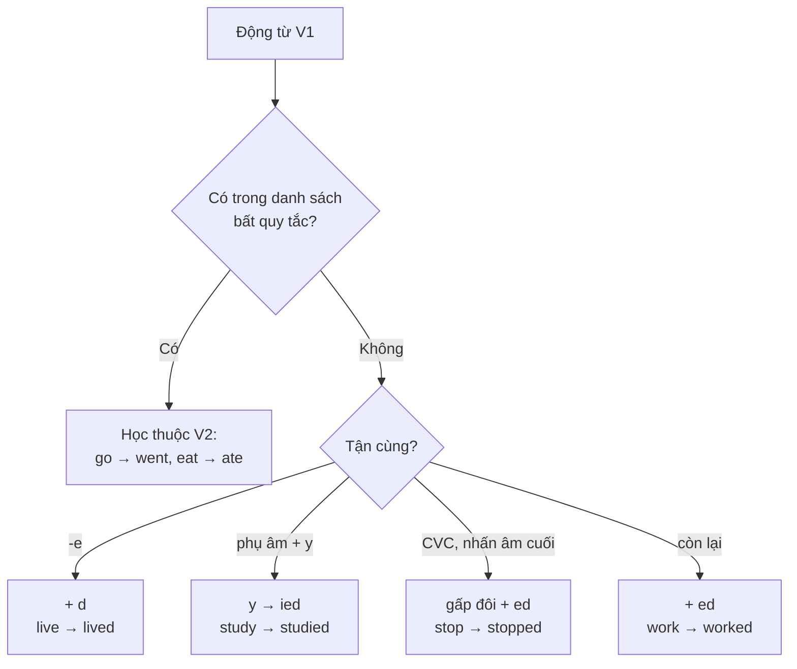

# A1-G017 · Past Simple: Regular & Irregular Verbs — Quá khứ đơn: câu khẳng định

## Mục lục

- [A. Lesson Information](#a-lesson-information)
- [B. Warm-up](#b-warm-up-tình-huống-thực-tế)
- [C. WHAT](#c-what-thì-quá-khứ-đơn-là-gì)
- [D. WHY](#d-why-vì-sao-có-động-từ-bất-quy-tắc)
- [E. FORM](#e-form-v2--quy-tắc-và-bất-quy-tắc)
- [F. HOW](#f-how-cách-dùng)
- [G. VISUAL](#g-visual-explanation)
- [H. COMPARISON](#h-comparison)
- [I. COMMON MISTAKES](#i-common-mistakes)
- [J. MEMORY TRICKS](#j-memory-tricks)
- [K. REAL-LIFE APPLICATION](#k-real-life-application)
- [L. PRACTICE EXERCISES](#l-practice-exercises)
- [M. KNOWLEDGE CHECK](#m-knowledge-check)
- [N. ANSWER KEY](#n-answer-key)

---

## A. Lesson Information

| Mục | Nội dung |
|---|---|
| **Lesson ID** | A1-G017 |
| **Topic** | Past Simple — Affirmative (regular & irregular verbs) |
| **Tên tiếng Việt** | Thì quá khứ đơn — câu khẳng định |
| **CEFR Level** | A1 |
| **Prerequisites** | [A1-G016 — was/were](A1-G016-past-simple-be.md) |
| **Estimated Time** | 90 phút |

**Learning Objectives:**

1. Hiểu quá khứ đơn diễn tả hành động **đã xảy ra và kết thúc** tại một thời điểm xác định trong quá khứ.
2. Tạo dạng quá khứ (**V2**) của động từ có quy tắc: *-ed, -d, -ied*, gấp đôi phụ âm.
3. Phát âm đuôi *-ed* đúng: /t/, /d/, /ɪd/.
4. Thuộc **40 động từ bất quy tắc** thông dụng nhất.
5. Kể lại một chuỗi sự việc trong quá khứ với *first, then, after that, finally*.

---

## B. Warm-up: Tình huống thực tế

Bạn kể về ngày hôm qua:

> "Hôm qua tôi **dậy** lúc 6 giờ, **ăn** sáng, **đi** làm, **gặp** khách hàng và **về** nhà lúc 7 giờ tối."

Một người học viết:

> ❌ *Yesterday I get up at 6, eat breakfast, go to work, meet a client and come home at 7.*

🤔 **Hãy suy nghĩ:** Bạn đã học ở bài trước rằng tiếng Anh **bắt buộc** đổi động từ khi nói về quá khứ (*am → was*). Vậy *get, eat, go, meet, come* sẽ đổi thành gì? Có quy tắc chung không — hay mỗi từ một kiểu?

---

## C. WHAT: Thì quá khứ đơn là gì?

**Thì quá khứ đơn (Past Simple)** diễn tả hành động hoặc sự việc:

- **Đã xảy ra** trong quá khứ,
- **Đã kết thúc** hoàn toàn,
- Tại một **thời điểm xác định** (người nói biết hoặc ngữ cảnh cho biết khi nào).

*I **visited** Hue **last year**.* — Việc thăm Huế đã xong, xảy ra năm ngoái.

**Dùng cho:**
1. Một hành động đơn lẻ đã xong: *I **bought** a new phone yesterday.*
2. Chuỗi hành động nối tiếp (kể chuyện): *He **opened** the door, **turned** on the light and **saw** a cat.*
3. Thói quen/tình trạng trong quá khứ (đã kết thúc): *I **lived** in Hue for five years.* / *We **walked** to school every day.*

---

## D. WHY: Vì sao có động từ bất quy tắc?

Phần lớn động từ tiếng Anh tạo quá khứ bằng cách thêm **-ed** (*work → worked*). Đó là **regular verbs** (động từ có quy tắc).

Nhưng những động từ **cổ xưa và dùng nhiều nhất** (*go, eat, see, come, have, make, take...*) có nguồn gốc từ tiếng Anh cổ với cách tạo quá khứ khác — thường bằng cách **đổi nguyên âm** (*sing → sang, drink → drank*). Vì dùng quá thường xuyên nên chúng "sống sót" qua hàng nghìn năm mà không bị chuẩn hóa thành *-ed*. Đó là **irregular verbs** (động từ bất quy tắc).

> 💡 Tin tốt: chỉ khoảng **100–150 động từ bất quy tắc** thường gặp — và khoảng **40 từ** chiếm phần lớn trường hợp sử dụng hằng ngày. Học thuộc 40 từ trong bài này là bạn đã nắm phần lớn.

---

## E. FORM: V2 — quy tắc và bất quy tắc

### E1. Công thức khẳng định

**S + V2 (+ O)** — **giống nhau cho mọi chủ ngữ** (không có *-s* cho ngôi 3!).

| Chủ ngữ | Ví dụ |
|---|---|
| I / you / we / they | *They **worked** late.* |
| he / she / it | *She **worked** late.* (không có -s) |

**Ký hiệu:** **V2** = dạng quá khứ của động từ (*past form*) — cột thứ hai trong bảng động từ bất quy tắc. **V1** = nguyên mẫu, **V3** = quá khứ phân từ (học ở A2).

### E2. Quy tắc chính tả động từ có quy tắc

| Quy tắc | Ví dụ |
|---|---|
| Thông thường: + **-ed** | work → work**ed**, play → play**ed**, visit → visit**ed** |
| Tận cùng *-e*: + **-d** | live → live**d**, like → like**d**, arrive → arrive**d** |
| Phụ âm + *y*: *y* → **-ied** | study → stud**ied**, try → tr**ied**, carry → carr**ied** |
| Nguyên âm + *y*: + **-ed** | play → play**ed**, stay → stay**ed** (ngoại lệ: *pay → paid, say → said*) |
| Một âm tiết, CVC: gấp đôi phụ âm | stop → sto**pp**ed, plan → pla**nn**ed, shop → sho**pp**ed (không gấp đôi *w, x, y*: snow → snowed, fix → fixed) |
| Hai âm tiết, nhấn âm cuối, CVC: gấp đôi | pre**fer** → prefe**rr**ed, ad**mit** → admi**tt**ed |
| Tận cùng *-l* (Anh – Anh): gấp đôi | travel → trave**ll**ed (Mỹ: traveled) |

### E3. Phát âm đuôi *-ed*

| Âm cuối của động từ | Đọc | Ví dụ |
|---|---|---|
| /t/ hoặc /d/ | **/ɪd/** (thêm âm tiết) | wanted /ˈwɒntɪd/, needed, visited, decided |
| Vô thanh /p, k, f, s, ʃ, tʃ, θ/ | **/t/** | worked /wɜːkt/, stopped, laughed, washed, watched |
| Hữu thanh (nguyên âm, /b, g, v, z, m, n, l, r, dʒ/) | **/d/** | played /pleɪd/, lived, opened, called, changed |

> ⚠️ Lỗi phổ biến nhất: đọc **mọi** *-ed* thành /ɪd/ ("work-ed"). Chỉ sau /t/ và /d/ mới thêm âm tiết.

### E4. 40 động từ bất quy tắc thông dụng nhất (V1 → V2)

| V1 | V2 | Nghĩa | V1 | V2 | Nghĩa |
|---|---|---|---|---|---|
| be | was/were | là, ở | know | knew | biết |
| have | had | có | leave | left | rời đi |
| do | did | làm | lose | lost | mất, thua |
| go | went | đi | make | made | làm, tạo ra |
| get | got | nhận, trở nên | meet | met | gặp |
| say | said /sed/ | nói | pay | paid | trả tiền |
| see | saw | nhìn thấy | put | put | đặt |
| come | came | đến | read | read /red/ | đọc |
| take | took | lấy, cầm | run | ran | chạy |
| give | gave | cho | sell | sold | bán |
| find | found | tìm thấy | send | sent | gửi |
| think | thought | nghĩ | sit | sat | ngồi |
| tell | told | kể, bảo | sleep | slept | ngủ |
| become | became | trở thành | speak | spoke | nói |
| buy | bought | mua | spend | spent | tiêu, dành |
| bring | brought | mang | stand | stood | đứng |
| begin | began | bắt đầu | swim | swam | bơi |
| drink | drank | uống | teach | taught | dạy |
| eat | ate | ăn | understand | understood | hiểu |
| feel | felt | cảm thấy | write | wrote | viết |

Danh sách đầy đủ hơn: [GRAMMAR-CHEAT-SHEET — Irregular verbs](../../06-GRAMMAR-REFERENCE/GRAMMAR-CHEAT-SHEET.md).

### E5. Cụm thời gian quá khứ

*yesterday, last night/week/year, two days ago, in 2010, on Monday (đã qua), when I was young, this morning* (khi buổi sáng đã qua).

---

## F. HOW: Cách dùng

| # | English | Tiếng Việt | Phân tích |
|---|---|---|---|
| 1 | *I **watched** a great film last night.* | Tối qua tôi xem một bộ phim hay. | Regular, /t/ |
| 2 | *She **studied** in Australia in 2018.* | Cô ấy du học Úc năm 2018. | *study → studied* |
| 3 | *We **stopped** at a café on the way.* | Chúng tôi dừng ở một quán cà phê trên đường. | CVC → gấp đôi *p* |
| 4 | *They **decided** to stay at home.* | Họ quyết định ở nhà. | /ɪd/ |
| 5 | *I **went** to Hanoi two weeks ago.* | Tôi ra Hà Nội cách đây hai tuần. | Irregular: *go → went* |
| 6 | *My mum **made** a delicious cake for my birthday.* | Mẹ làm một chiếc bánh ngon cho sinh nhật tôi. | *make → made* |
| 7 | *He **bought** a new laptop and **paid** by card.* | Anh ấy mua laptop mới và trả bằng thẻ. | Hai V2 bất quy tắc |
| 8 | *I **got** up, **had** a shower and **left** the house.* | Tôi dậy, tắm rồi ra khỏi nhà. | Chuỗi hành động |
| 9 | *We **lived** in Da Nang for three years.* | Chúng tôi đã sống ở Đà Nẵng ba năm. | Tình trạng đã kết thúc (giờ không sống ở đó nữa) |
| 10 | *When I was young, I **played** football every day.* | Hồi nhỏ ngày nào tôi cũng đá bóng. | Thói quen trong quá khứ |
| 11 | *She **said** goodbye and **walked** away.* | Cô ấy chào tạm biệt rồi bỏ đi. | *say → said* /sed/ |
| 12 | *I **read** that book last summer.* | Tôi đọc cuốn đó hè năm ngoái. | *read* /red/ — viết giống, đọc khác |

---

## G. VISUAL EXPLANATION

### Timeline

```text
  ──────── ✕ ─────────────────────── NOW ──────►
       I visited Hue
       (last year — đã xong)

  Chuỗi hành động:
  ──── ✕ ──── ✕ ──── ✕ ──── ✕ ────── NOW ──────►
     got up  had   left   arrived
            breakfast home  at work
```

### Sơ đồ tạo V2



---

## H. COMPARISON

### Hiện tại đơn và quá khứ đơn

| Present Simple | Past Simple |
|---|---|
| *She **works** in a bank.* (bây giờ) | *She **worked** in a bank.* (trước đây, giờ không còn) |
| Ngôi 3 có *-s* | **Không** có *-s* cho bất kỳ chủ ngữ nào |
| *He **goes** to the gym.* | *He **went** to the gym.* |

### *was/were* và V2

| Dùng *was/were* | Dùng V2 |
|---|---|
| + tính từ, danh từ, nơi chốn | Hành động, động từ thường |
| *I **was** tired.* | *I **slept** early.* |
| *She **was** a nurse.* | *She **worked** as a nurse.* |

---

## I. COMMON MISTAKES

| # | ❌ Sai | ✅ Đúng | Nguyên nhân | Cách tránh |
|---|---|---|---|---|
| 1 | Yesterday I **go** to the market. | Yesterday I **went** to the market. | Không đổi động từ | Mốc quá khứ → V2 |
| 2 | I **goed** / **eated** / **buyed** | I **went** / **ate** / **bought** | Áp *-ed* cho bất quy tắc | Học thuộc bảng E4 |
| 3 | She **wented** home. | She **went** home. | Thêm *-ed* vào V2 | V2 bất quy tắc đã là quá khứ |
| 4 | He **watcheds** TV. | He **watched** TV. | Thêm *-s* ngôi 3 | Quá khứ không có *-s* |
| 5 | I **was** visited my aunt. | I **visited** my aunt. | Ghép *was* + V2 | Câu đã có V2 → không cần *was* |
| 6 | **studyed**, **stoped**, **plaied** | **studied**, **stopped**, **played** | Sai chính tả | Ôn E2 |
| 7 | Đọc *worked* là "wơ-kít" | /wɜːkt/ — 1 âm tiết | Thêm âm tiết | Chỉ /ɪd/ sau /t/, /d/ |
| 8 | I **lived** in Hanoi since 2015. | I **have lived** in Hanoi since 2015. (vẫn đang sống) | Dùng quá khứ đơn cho việc kéo dài đến nay | Học ở [A2-G006](../../03-A2-ELEMENTARY/grammar/A2-G006-present-perfect-since-for.md) |

---

## J. MEMORY TRICKS

1. **Học bất quy tắc theo nhóm âm** (mẹo, không phải quy tắc):
   - *-ought/-aught*: buy → **bought**, bring → **brought**, think → **thought**, teach → **taught**, catch → **caught**.
   - *i → a*: begin → **began**, drink → **drank**, swim → **swam**, sing → **sang**, ring → **rang**.
   - *-ee- / -ea- → -e-*: meet → **met**, feel → **felt**, sleep → **slept**, keep → **kept**, leave → **left**.
   - Không đổi: put → **put**, cut → **cut**, cost → **cost**, hit → **hit**, read → **read** (đọc khác).
2. **"Quá khứ không có -s"**: Ở quá khứ, mọi chủ ngữ bình đẳng — không ai được thêm *-s*.
3. **Phát âm *-ed*: "Tea-Dee thêm âm tiết"** — chỉ khi động từ kết thúc bằng âm **T** hoặc **D** mới đọc thêm /ɪd/.

---

## K. REAL-LIFE APPLICATION

### Bài đọc: A terrible morning

> *Last Monday was a terrible day. I **woke** up late because my alarm **didn't** ring.* *(phủ định — học ở bài sau)* *I **jumped** out of bed, **got** dressed in two minutes and **ran** to the bus stop. Of course, I **missed** the bus! I **waited** for twenty minutes in the rain. When I finally **arrived** at the office, I **realised** that I **left** my laptop at home. My boss **looked** at me and **said**, "Good morning... or good afternoon?" Everyone **laughed**. I **felt** so embarrassed!*

**Vietnamese explanation:** Thứ Hai tuần trước là một ngày tồi tệ: dậy muộn vì chuông báo thức không kêu, mặc quần áo trong hai phút, chạy ra trạm và lỡ xe buýt, chờ 20 phút dưới mưa. Đến văn phòng thì nhận ra để quên laptop ở nhà. Sếp nhìn và nói "Chào buổi sáng... hay buổi chiều?" Mọi người cười, "tôi" xấu hổ vô cùng.

**Grammar highlights:**

| Có quy tắc (phát âm) | Bất quy tắc |
|---|---|
| jumped /t/, missed /t/, looked /t/, laughed /t/ | woke (wake), got (get), ran (run), left (leave), said (say), felt (feel) |
| arrived /d/, realised /d/ | |
| waited /ɪd/ | |

> Ghi chú: *I realised that I **had left** my laptop* sẽ chính xác hơn (quá khứ hoàn thành — học ở [B1-G002](../../04-B1-INTERMEDIATE/grammar/B1-G002-past-perfect.md)); ở cấp A1, dùng *left* vẫn được chấp nhận trong văn nói.

---

## L. PRACTICE EXERCISES

> ✍️ Đáp án: [A1-G017-ANSWERS](../../12-ANSWERS-AND-EXPLANATIONS/A1/A1-G017-ANSWERS.md)

### Level 1 — Recognition

**L1.1.** Dạng quá khứ của *buy*:  A. buyed  B. bought  C. brought
**L1.2.** Dạng quá khứ của *study*:  A. studyed  B. studied  C. studed
**L1.3.** Đuôi *-ed* trong *wanted* đọc là:  A. /t/  B. /d/  C. /ɪd/
**L1.4.** Đuôi *-ed* trong *stopped* đọc là:  A. /t/  B. /d/  C. /ɪd/
**L1.5.** She ___ to Singapore last month.  A. goes  B. went  C. wented
**L1.6.** Which sentence is correct?  A. He watcheds TV.  B. He was watched TV.  C. He watched TV.

### Level 2 — Controlled Practice

Viết V2:

**L2.1.** play / plan / try / love
**L2.2.** eat / drink / see / come
**L2.3.** take / give / think / teach
**L2.4.** write / speak / feel / leave

Chia động từ ở quá khứ đơn:

**L2.5.** We (meet) ___ at a party in 2020.
**L2.6.** I (lose) ___ my wallet yesterday.
**L2.7.** The film (start) ___ at 8 and (finish) ___ at 10.
**L2.8.** My grandfather (teach) ___ maths for 30 years.
**L2.9.** She (carry) ___ the box upstairs.
**L2.10.** They (travel) ___ around Vietnam last summer.

### Level 3 — Error Correction

**L3.1.** Last weekend I go to the beach.
**L3.2.** She buyed a new dress.
**L3.3.** We was visited our grandparents.
**L3.4.** He drinked too much coffee.
**L3.5.** I stoped at the red light.
**L3.6.** My brother wented to university in 2019.

### Level 4 — Production

Dịch sang tiếng Anh:

**L4.1.** Hôm qua tôi gặp một người bạn cũ.
**L4.2.** Chúng tôi ăn tối ở một nhà hàng Ý và về nhà lúc 10 giờ.
**L4.3.** Cô ấy viết một email dài cho khách hàng. (*client*)
**L4.4.** Năm ngoái bố tôi bán chiếc xe cũ.

Viết lại đoạn văn ở quá khứ (bắt đầu bằng *Yesterday...*):

**L4.5.** *I get up at 7. I have breakfast and I take the bus to work. I meet my colleagues and we have a meeting. In the evening, I go to the gym and I come home at 9.*

### Level 5 — Real Communication

**L5.1.** Viết đoạn văn 80–100 từ: *A day I will never forget* (một ngày đáng nhớ — vui hoặc tệ). Dùng ít nhất 6 động từ bất quy tắc và các từ nối *first, then, after that, finally*.
**L5.2.** **Speaking — Talk about your last weekend:** Nói 1 phút về cuối tuần vừa rồi. Ghi âm, nghe lại và kiểm tra: (1) mọi động từ đã ở quá khứ chưa? (2) đuôi *-ed* đọc đúng /t/, /d/, /ɪd/ chưa?

---

## M. KNOWLEDGE CHECK

### 5 câu hỏi tự kiểm tra

1. Quá khứ đơn diễn tả điều gì?
2. Ba cách đọc đuôi *-ed* là gì? Khi nào đọc /ɪd/?
3. Viết V2 của 10 động từ bất quy tắc không nhìn bảng.
4. Vì sao *He watcheds* là sai?
5. *I was tired* và *I slept* — khi nào dùng *was*, khi nào dùng V2?

### Checklist

- [ ] Tôi viết đúng V2 có quy tắc (chính tả).
- [ ] Tôi thuộc 40 động từ bất quy tắc trong bảng.
- [ ] Tôi phát âm đuôi *-ed* đúng.
- [ ] Tôi kể được một chuỗi sự việc trong quá khứ.

### 3 lỗi quan trọng cần nhớ

1. ~~goed, buyed~~ → **went, bought**.
2. ~~I was visited~~ (chủ động) → I **visited**.
3. Đọc *worked* /wɜːkt/ — **không** thêm âm tiết.

### Lịch ôn tập

| Ngày | Việc cần làm |
|---|---|
| Ngày 1 | Đọc to bảng E4 hai lần; làm lại L2.1–L2.4 |
| Ngày 3 | Che cột V2, tự viết lại 40 động từ |
| Ngày 7 | Viết nhật ký 5 câu về ngày hôm qua (lặp lại mỗi ngày trong 1 tuần) |

### Liên kết

- ➡️ Bài tiếp theo: [A1-G018 — Past Simple: Negatives & Questions](A1-G018-past-simple-negatives-questions.md)
- 🔁 Tra cứu: [GRAMMAR-CHEAT-SHEET](../../06-GRAMMAR-REFERENCE/GRAMMAR-CHEAT-SHEET.md)
- 🔁 Phát âm: [PRON-02 — Vowels & Consonants](../../08-PRONUNCIATION/PRON-02-vowels-consonants.md)

---

## N. ANSWER KEY

👉 [A1-G017-ANSWERS.md](../../12-ANSWERS-AND-EXPLANATIONS/A1/A1-G017-ANSWERS.md)
