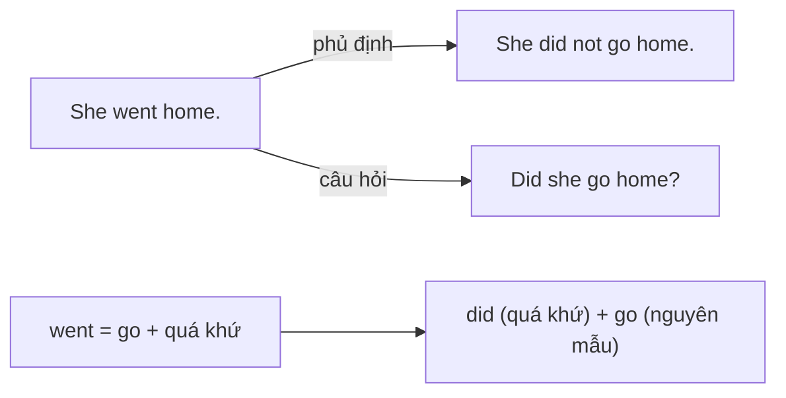

# A1-G018 · Past Simple: Negatives & Questions — Quá khứ đơn: phủ định và nghi vấn

## Mục lục

- [A. Lesson Information](#a-lesson-information)
- [B. Warm-up](#b-warm-up-tình-huống-thực-tế)
- [C. WHAT](#c-what-phủ-định-và-câu-hỏi-ở-quá-khứ)
- [D. WHY](#d-why-did-mang-dấu-hiệu-quá-khứ)
- [E. FORM](#e-form-công-thức)
- [F. HOW](#f-how-cách-dùng-trong-giao-tiếp)
- [G. VISUAL](#g-visual-explanation)
- [H. COMPARISON](#h-comparison)
- [I. COMMON MISTAKES](#i-common-mistakes)
- [J. MEMORY TRICKS](#j-memory-tricks)
- [K. REAL-LIFE APPLICATION](#k-real-life-application)
- [L. PRACTICE EXERCISES](#l-practice-exercises)
- [M. KNOWLEDGE CHECK](#m-knowledge-check)
- [N. ANSWER KEY](#n-answer-key)

---

## A. Lesson Information

| Mục | Nội dung |
|---|---|
| **Lesson ID** | A1-G018 |
| **Topic** | Past Simple — Negatives, Yes/No Questions, Wh- Questions |
| **Tên tiếng Việt** | Quá khứ đơn — phủ định và câu hỏi |
| **CEFR Level** | A1 |
| **Prerequisites** | [A1-G017](A1-G017-past-simple-affirmative.md), [A1-G002](A1-G002-present-simple-negatives-questions.md) |
| **Estimated Time** | 90 phút |

**Learning Objectives:**

1. Tạo phủ định: **didn't + V nguyên mẫu** cho mọi chủ ngữ.
2. Tạo câu hỏi: **Did + S + V?** và trả lời ngắn *Yes, S did / No, S didn't*.
3. Tạo câu hỏi Wh- về quá khứ: *Where did you go? What did you do?*
4. Phân biệt câu hỏi với *was/were* và với *did*.
5. Hỏi – đáp về cuối tuần, kỳ nghỉ, trải nghiệm vừa qua một cách tự nhiên.

---

## B. Warm-up: Tình huống thực tế

Đồng nghiệp hỏi bạn sau kỳ nghỉ:

> "Bạn **có đi** đâu không? Bạn **đi** đâu? **Có vui** không? Bạn **có ăn** hải sản không?"

Bạn đã biết: hiện tại dùng *Do/Does* để hỏi (*Do you go...?*). Quá khứ của *do* là *did*.

🤔 **Hãy suy nghĩ:** Nếu *did* đã cho biết "quá khứ", thì động từ chính (*go, eat*) còn cần ở dạng V2 (*went, ate*) không? Nhớ lại quy tắc "chỉ một dấu hiệu" ở [A1-G002](A1-G002-present-simple-negatives-questions.md)...

---

## C. WHAT: Phủ định và câu hỏi ở quá khứ

| Loại | Ví dụ | Nghĩa |
|---|---|---|
| Phủ định | *I **didn't go** out last night.* | Tối qua tôi không ra ngoài. |
| Câu hỏi Yes/No | ***Did** you **enjoy** the trip?* | Bạn có thích chuyến đi không? |
| Trả lời ngắn | *Yes, I **did**. / No, I **didn't**.* | |
| Câu hỏi Wh- | *Where **did** you **go**?* | Bạn đã đi đâu? |

**Did** là quá khứ của **do** — trợ động từ dùng cho **mọi chủ ngữ** (không có *does* ở quá khứ).

---

## D. WHY: *Did* mang dấu hiệu quá khứ

Giống *does* "lấy" chữ *-s* ở hiện tại, **did "lấy" dấu hiệu quá khứ** của động từ chính. Động từ chính trở về **nguyên mẫu**:

| Câu | Dấu hiệu quá khứ ở đâu? |
|---|---|
| *She **went** home.* | ở *went* |
| *She **did**n't go home.* | ở *did* |
| ***Did** she go home?* | ở *did* |

Vì vậy *She didn't went* và *Did she went?* đều sai — quá khứ bị đánh dấu **hai lần**.

---

## E. FORM: Công thức

**Ký hiệu:** **S** = chủ ngữ · **V** = động từ nguyên mẫu.

| | Công thức (mọi chủ ngữ) | Ví dụ |
|---|---|---|
| ➖ | S + **didn't** (did not) + V | *He **didn't call** me.* |
| ❓ | **Did** + S + V? | ***Did** he **call** you?* |
| 💬 | Yes, S **did**. / No, S **didn't**. | *Yes, he did. / No, he didn't.* |
| Wh- | Wh- + **did** + S + V? | *Why **did** he **call** you?* |

### So sánh với *was/were* (gia đình 1)

| | *be* (was/were) | Động từ thường (did) |
|---|---|---|
| ➖ | *I **wasn't** at home.* | *I **didn't stay** at home.* |
| ❓ | ***Were** you tired?* | ***Did** you **sleep** well?* |
| 💬 | *Yes, I **was**.* | *Yes, I **did**.* |
| Wh- | *Where **were** you?* | *Where **did** you **go**?* |

### Câu hỏi giao tiếp thông dụng về quá khứ

| Câu hỏi | Nghĩa |
|---|---|
| *What **did** you **do** at the weekend?* | Cuối tuần bạn làm gì? |
| *Where **did** you **go** on holiday?* | Bạn đi nghỉ ở đâu? |
| ***Did** you **have** a good time?* | Bạn có vui không? |
| *How **did** you **get** there?* | Bạn đến đó bằng gì? |
| *Who **did** you **go** with?* | Bạn đi với ai? |
| *How long **did** you **stay**?* | Bạn ở đó bao lâu? |
| *What **did** you **think** of it?* | Bạn thấy nó thế nào? |
| *When **did** you **arrive**?* | Bạn đến khi nào? |

---

## F. HOW: Cách dùng trong giao tiếp

| # | English | Tiếng Việt | Phân tích |
|---|---|---|---|
| 1 | *I **didn't sleep** well last night.* | Tối qua tôi ngủ không ngon. | *didn't* + V |
| 2 | *She **didn't come** to the meeting.* | Cô ấy không đến buổi họp. | *came* → *didn't come* |
| 3 | ***Did** you **see** the news? — Yes, I **did**.* | Bạn xem tin tức chưa? — Rồi. | |
| 4 | ***Did** they **win** the match? — No, they **didn't**.* | Họ có thắng không? — Không. | |
| 5 | *Where **did** you **go** on holiday?* | Bạn đi nghỉ ở đâu? | |
| 6 | *What time **did** the train **leave**?* | Tàu rời đi lúc mấy giờ? | |
| 7 | *How **did** you **find** this restaurant?* | Sao bạn biết nhà hàng này? | *find* = tìm ra, biết đến |
| 8 | *Why **didn't** you **tell** me?* | Sao bạn không nói với tôi? | Wh- + phủ định |
| 9 | *What **did** she **say**?* | Cô ấy đã nói gì? | *said* → *did ... say* |
| 10 | *We **didn't have** enough money, so we **didn't buy** the tickets.* | Chúng tôi không đủ tiền nên không mua vé. | Hai phủ định |
| 11 | ***Were** you at home? — No. **Did** you **call** me?* | | Trộn hai gia đình |
| 12 | *How long **did** you **live** in Japan?* | Bạn đã sống ở Nhật bao lâu? | Thời gian đã kết thúc |

---

## G. VISUAL EXPLANATION

### Bảng tổng hợp thì quá khứ đơn (động từ thường)

| | Mọi chủ ngữ |
|---|---|
| ➕ | I/She/They **went**. |
| ➖ | I/She/They **didn't go**. |
| ❓ | **Did** I/she/they **go**? |
| 💬 | Yes, ... **did**. / No, ... **didn't**. |
| Wh- | Where **did** you **go**? |

### QUASI ở quá khứ

| Question word | Auxiliary | Subject | Infinitive | Rest |
|---|---|---|---|---|
| Where | did | you | go | last summer? |
| What | did | your boss | say | ? |
| How | did | they | get | to the airport? |

---

## H. COMPARISON

### *didn't* và *wasn't/weren't*

| Sai | Đúng | Lý do |
|---|---|---|
| ~~I didn't tired.~~ | *I **wasn't** tired.* | *tired* là tính từ → *be* |
| ~~I wasn't go.~~ | *I **didn't go**.* | *go* là động từ thường → *did* |
| ~~Did you happy?~~ | ***Were** you happy?* | |
| ~~Were you enjoy it?~~ | ***Did** you **enjoy** it?* | |

**Quy tắc ra quyết định:** Nhìn **từ chính** sau chủ ngữ. Tính từ/danh từ/nơi chốn → *was/were*. Động từ hành động → *did*.

### Hiện tại và quá khứ

| Hiện tại | Quá khứ |
|---|---|
| *Do/Does* | ***Did*** (một dạng cho mọi chủ ngữ) |
| *don't/doesn't* | ***didn't*** |

---

## I. COMMON MISTAKES

| # | ❌ Sai | ✅ Đúng | Nguyên nhân | Cách tránh |
|---|---|---|---|---|
| 1 | I **didn't went** to work. | I **didn't go** to work. | Đánh dấu quá khứ hai lần | Sau *didn't* → V nguyên mẫu |
| 2 | **Did** you **saw** him? | **Did** you **see** him? | | Sau *Did* → V nguyên mẫu |
| 3 | Where you went? | Where **did** you **go**? | Thiếu *did*, giữ trật tự câu kể | QUASI |
| 4 | **Did** you tired? | **Were** you tired? | Dùng *did* với tính từ | Tính từ → *be* |
| 5 | I **wasn't** like the film. | I **didn't like** the film. | Dùng *be* với động từ thường | |
| 6 | **Does** she call you yesterday? | **Did** she call you yesterday? | Quên chuyển trợ động từ sang quá khứ | Quá khứ → *Did* |
| 7 | I **not saw** her. | I **didn't see** her. | Dịch "không" thành *not* | |
| 8 | "Did you finish?" — "Yes, I **finished**." | "Yes, I **did**." | Trả lời ngắn bằng động từ chính | |

---

## J. MEMORY TRICKS

1. **"Did là tem quá khứ — chỉ dán một lần"**: Khi đã có *did/didn't*, động từ chính không được "dán tem" quá khứ nữa.
2. **"Một Did cho tất cả"**: Không có *dids*, không có *does* ở quá khứ — *Did* dùng cho mọi người.
3. **Phép thử "tính từ hay hành động"** (mục H) để chọn *was/were* hay *did*.

---

## K. REAL-LIFE APPLICATION

### Hội thoại: Hỏi thăm sau kỳ nghỉ Tết

> **Mark:** Hi, Lan! **Did** you **have** a good Tet holiday?
> **Lan:** Yes, I **did**, thanks! I **went** back to my hometown in Nam Dinh.
> **Mark:** Nice! How **did** you **get** there?
> **Lan:** By bus. It **took** about two hours.
> **Mark:** What **did** you **do** there?
> **Lan:** I **visited** my relatives and **ate** a lot of banh chung. I **didn't do** any work!
> **Mark:** Ha ha, perfect. **Did** you **get** any lucky money?
> **Lan:** Yes, but I **didn't get** much — I'm an adult now, so I **gave** more than I **received**!
> **Mark:** And **was** the weather nice?
> **Lan:** No, it **wasn't**. It **was** cold and rainy. What about you? **Did** you **travel**?
> **Mark:** No, I **didn't**. I **stayed** in Hanoi and **watched** the fireworks.

**Vietnamese explanation:** Mark hỏi Lan về kỳ nghỉ Tết: Lan về quê Nam Định bằng xe buýt (khoảng 2 tiếng), thăm họ hàng, ăn nhiều bánh chưng, không làm việc gì. Lan nhận ít lì xì vì giờ đã lớn — cho nhiều hơn nhận. Thời tiết lạnh và mưa. Mark không đi đâu, ở Hà Nội xem pháo hoa.

**Useful expressions:** *Did you have a good...?* · *It took about two hours.* (Mất khoảng hai tiếng.) · *lucky money* (tiền lì xì) · *What about you?*

---

## L. PRACTICE EXERCISES

> ✍️ Đáp án: [A1-G018-ANSWERS](../../12-ANSWERS-AND-EXPLANATIONS/A1/A1-G018-ANSWERS.md)

### Level 1 — Recognition

**L1.1.** I ___ my homework last night.  A. didn't do  B. didn't did  C. don't did
**L1.2.** ___ you enjoy the concert?  A. Were  B. Did  C. Do
**L1.3.** ___ you at the party on Saturday?  A. Did  B. Were  C. Was
**L1.4.** Where ___ you buy that jacket?  A. did  B. were  C. do
**L1.5.** "Did she pass the exam?" — "Yes, she ___."  A. passed  B. did  C. was
**L1.6.** Which is correct?  A. He didn't came.  B. He didn't come.  C. He not came.

### Level 2 — Controlled Practice

Viết câu phủ định.

**L2.1.** We watched TV last night. → ______
**L2.2.** She bought a new car. → ______
**L2.3.** They were at home. → ______

Viết câu hỏi Yes/No và trả lời ngắn theo gợi ý.

**L2.4.** (you / sleep well?) — Yes, ...
**L2.5.** (Nam / call / you?) — No, ...
**L2.6.** (the film / be / good?) — Yes, ...

Viết câu hỏi Wh- cho phần **in đậm**.

**L2.7.** I went to **Phu Quoc** last summer.
**L2.8.** She left **at 6 a.m.**
**L2.9.** They stayed there **for two weeks**.
**L2.10.** He bought **a guitar**.

### Level 3 — Error Correction

**L3.1.** Did you went to the cinema yesterday?
**L3.2.** I didn't saw anything.
**L3.3.** Where you were last night?
**L3.4.** Did you tired after the trip?
**L3.5.** She wasn't call me back.
**L3.6.** What did he said?

### Level 4 — Production

Dịch sang tiếng Anh:

**L4.1.** Hôm qua tôi không đi làm vì tôi bị ốm.
**L4.2.** Bạn có xem trận bóng tối qua không? (*the match*)
**L4.3.** Bạn đã gặp vợ bạn ở đâu?
**L4.4.** Sao bạn không gọi cho tôi?
**L4.5.** Kỳ nghỉ có đắt không? (*Was...*)

### Level 5 — Real Communication

**L5.1.** Viết 10 câu hỏi (5 Yes/No, 5 Wh-) để phỏng vấn một người bạn về chuyến du lịch gần nhất của họ. Sau đó viết đoạn văn 60–80 từ kể lại chuyến đi của họ (dùng ngôi 3, có ít nhất 3 câu phủ định).
**L5.2.** **Speaking — Talk about your last holiday:** Tự trả lời to (ghi âm) 8 câu hỏi: *Where did you go? Who did you go with? How did you get there? How long did you stay? Where did you stay? What did you do? Was the food good? Did you have a good time?*

---

## M. KNOWLEDGE CHECK

### 5 câu hỏi tự kiểm tra

1. Sau *did/didn't*, động từ chính ở dạng nào? Vì sao?
2. Khi nào hỏi bằng *Were you...?*, khi nào bằng *Did you...?*
3. Viết câu hỏi: "Bạn đã làm gì cuối tuần?"
4. Phủ định của *She went to bed early*.
5. Có *does* ở quá khứ không?

### Checklist

- [ ] Tôi không còn viết *didn't went / Did you saw*.
- [ ] Tôi chọn đúng *was/were* hay *did*.
- [ ] Tôi hỏi – đáp được về cuối tuần và kỳ nghỉ.

### 3 lỗi quan trọng cần nhớ

1. ~~didn't went~~ → **didn't go**.
2. ~~Where you went?~~ → Where **did** you **go**?
3. ~~Did you tired?~~ → **Were** you tired?

### Lịch ôn tập

| Ngày | Việc cần làm |
|---|---|
| Ngày 1 | Làm lại L2 |
| Ngày 3 | Viết 5 câu về những việc bạn **không** làm tuần trước |
| Ngày 7 | Làm lại L5.2 với một chuyến đi khác |

### Liên kết

- ➡️ Bài tiếp theo: [A1-G019 — Future with Will](A1-G019-future-will.md)
- 🎯 **Mini Challenge khối A1-4:** *Talk about your last weekend and next weekend* — xem [A1 README](../README.md#5-mini-challenges)
- 🔜 [A2-G001 — Past Continuous](../../03-A2-ELEMENTARY/grammar/A2-G001-past-continuous.md)

---

## N. ANSWER KEY

👉 [A1-G018-ANSWERS.md](../../12-ANSWERS-AND-EXPLANATIONS/A1/A1-G018-ANSWERS.md)
