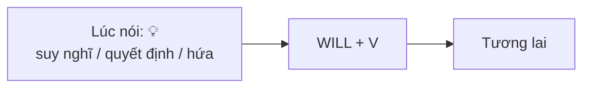
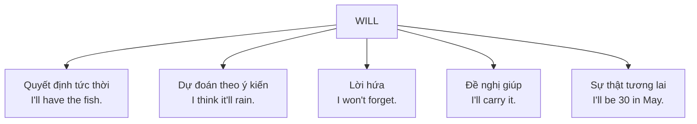

# A1-G019 · Future with *Will* — Tương lai với Will

## Mục lục

- [A. Lesson Information](#a-lesson-information)
- [B. Warm-up](#b-warm-up-tình-huống-thực-tế)
- [C. WHAT](#c-what-will-là-gì)
- [D. WHY](#d-why-will-là-quyết-định-trong-đầu-người-nói)
- [E. FORM](#e-form-công-thức)
- [F. HOW](#f-how-các-cách-dùng)
- [G. VISUAL](#g-visual-explanation)
- [H. COMPARISON](#h-comparison)
- [I. COMMON MISTAKES](#i-common-mistakes)
- [J. MEMORY TRICKS](#j-memory-tricks)
- [K. REAL-LIFE APPLICATION](#k-real-life-application)
- [L. PRACTICE EXERCISES](#l-practice-exercises)
- [M. KNOWLEDGE CHECK](#m-knowledge-check)
- [N. ANSWER KEY](#n-answer-key)

---

## A. Lesson Information

| Mục | Nội dung |
|---|---|
| **Lesson ID** | A1-G019 |
| **Topic** | Future with *Will* |
| **Tên tiếng Việt** | Thì tương lai đơn với *will* |
| **CEFR Level** | A1 |
| **Prerequisites** | [A1-G012 — Can](A1-G012-can-cant.md) (modal verbs), [A1-G002](A1-G002-present-simple-negatives-questions.md) |
| **Estimated Time** | 75 phút |

**Learning Objectives:**

1. Tạo câu với **will / won't + V** cho mọi chủ ngữ.
2. Dùng *will* cho: **quyết định tức thời**, **dự đoán** (ý kiến), **lời hứa**, **lời đề nghị giúp đỡ**, **sự thật tương lai**.
3. Dùng ***I think / I don't think + will***, ***probably / definitely***.
4. Dùng ***Shall I...? / Shall we...?*** để đề nghị.
5. Phát âm đúng *I'll* /aɪl/, *won't* /wəʊnt/ (khác *want* /wɒnt/).

---

## B. Warm-up: Tình huống thực tế

Ở nhà hàng, người phục vụ hỏi:

> **Waiter:** Are you ready to order?
> **You:** Hmm... chicken or fish? OK — "Tôi **sẽ** lấy món cá."

Trên đường về, trời bắt đầu tối. Bạn nói với bạn mình: "Đừng lo, tôi **sẽ** đưa bạn về nhà."

🤔 **Hãy suy nghĩ:** Trong cả hai trường hợp, bạn **quyết định ngay lúc nói** — không có kế hoạch từ trước. Tiếng Việt dùng "sẽ". Tiếng Anh có một từ ngắn tương đương — và nó cũng là một modal verb như *can*.

---

## C. WHAT: *Will* là gì?

**Will** là modal verb dùng để nói về **tương lai** — nhưng không phải mọi tương lai. *Will* đặc biệt phù hợp khi tương lai đó xuất phát từ **suy nghĩ, ý kiến, quyết định hoặc lời hứa của người nói tại thời điểm nói**.

| Cách dùng | Ví dụ | Nghĩa |
|---|---|---|
| Quyết định tức thời | *I'**ll** have the fish.* | Tôi sẽ gọi món cá. (quyết định ngay) |
| Dự đoán (ý kiến) | *I think it **will** rain tomorrow.* | Tôi nghĩ mai sẽ mưa. |
| Lời hứa | *I **won't** tell anyone.* | Tôi sẽ không nói với ai. |
| Đề nghị giúp | *I'**ll** carry your bag.* | Để tôi xách túi cho. |
| Sự thật tương lai | *I'**ll** be 30 next year.* | Năm sau tôi 30 tuổi. |

---

## D. WHY: *Will* là "quyết định trong đầu người nói"

Hãy hình dung *will* như một **bóng đèn bật sáng trong đầu** ngay lúc nói 💡. Không có kế hoạch, không có bằng chứng bên ngoài — chỉ có suy nghĩ, ý chí hoặc niềm tin của người nói.



So sánh với *be going to* (bài sau [A1-G020](A1-G020-be-going-to.md)): *going to* nói về **kế hoạch đã có trước** hoặc **dự đoán dựa trên bằng chứng nhìn thấy**.

Vì *will* là modal verb, nó tuân theo **ba quy tắc vàng** ([A1-G012](A1-G012-can-cant.md)): không chia, không *to*, không *do*.

---

## E. FORM: Công thức

**Ký hiệu:** **S** = chủ ngữ · **V** = động từ nguyên mẫu (không *to*).

| | Công thức | Rút gọn | Ví dụ |
|---|---|---|---|
| ➕ | S + **will** + V | I'll, you'll, he'll, she'll, it'll, we'll, they'll | *She'**ll** help you.* |
| ➖ | S + **will not** + V | **won't** /wəʊnt/ | *It **won't** take long.* |
| ❓ | **Will** + S + V? | | ***Will** you be home tonight?* |
| 💬 | Yes, S **will**. / No, S **won't**. | | *Yes, I will.* (không rút gọn *Yes, I'll*) |
| Wh- | Wh- + will + S + V? | | *What time **will** you arrive?* |

### Đề nghị với *Shall* (dùng với *I/we*)

| Mẫu | Ví dụ | Chức năng |
|---|---|---|
| ***Shall I*** + V? | *Shall I open the window?* | Đề nghị giúp |
| ***Shall we*** + V? | *Shall we go out tonight?* | Gợi ý cùng làm |

### *Will* với các từ chỉ mức độ chắc chắn

| Mẫu | Ví dụ |
|---|---|
| *I think* + S + *will* | *I think she'**ll** like it.* |
| *I don't think* + S + *will* | *I **don't think** he'**ll** come.* (*I think he won't come* vẫn đúng nhưng ít tự nhiên hơn) |
| *will* + *probably / definitely* | *We'**ll probably** be late.* / *It'**ll definitely** be fun.* |
| *probably / definitely* + *won't* | *She **probably won't** call.* |

> ⚠️ Vị trí trạng từ: khẳng định *will probably*; phủ định *probably won't*.

### Phát âm

- *I'll* /aɪl/ — nghe gần như *aisle*.
- *won't* /wəʊnt/ (âm "âu") ≠ *want* /wɒnt/ (âm "o"). Nhầm lẫn sẽ đổi nghĩa: *I won't go* (tôi sẽ không đi) vs *I want to go* (tôi muốn đi).

---

## F. HOW: Các cách dùng

| # | Cách dùng | English | Tiếng Việt | Phân tích |
|---|---|---|---|---|
| 1 | Quyết định tức thời | *"The phone's ringing." — "I'**ll** get it."* | "Điện thoại kêu." — "Để tôi nghe." | Quyết định ngay lúc đó |
| 2 | Quyết định tức thời | *It's cold. I'**ll** close the window.* | Lạnh quá. Tôi đóng cửa sổ đây. | |
| 3 | Dự đoán (ý kiến) | *I think Vietnam **will** win the match.* | Tôi nghĩ Việt Nam sẽ thắng. | Ý kiến, không có bằng chứng |
| 4 | Dự đoán | *In 2050, people **will** live longer.* | Năm 2050, con người sẽ sống thọ hơn. | |
| 5 | Lời hứa | *I **will** always love you.* | Anh sẽ luôn yêu em. | |
| 6 | Lời hứa | *Don't worry, I **won't** be late.* | Đừng lo, tôi sẽ không muộn đâu. | |
| 7 | Đề nghị giúp | *That bag looks heavy. I'**ll** help you.* | Túi trông nặng đấy. Để tôi giúp. | |
| 8 | Đề nghị với *Shall* | ***Shall** I call a taxi for you?* | Tôi gọi taxi cho bạn nhé? | |
| 9 | Sự thật tương lai | *The meeting **will** be in Room 5.* | Cuộc họp sẽ ở phòng 5. | Thông báo |
| 10 | Yêu cầu | ***Will** you marry me?* / ***Will** you help me?* | Em sẽ lấy anh chứ? / Bạn sẽ giúp tôi chứ? | *Will you...?* có thể là lời đề nghị/yêu cầu |
| 11 | Từ chối | *The car **won't** start.* | Xe không chịu nổ máy. | *won't* = không chịu (vật/người) |
| 12 | Gợi ý | ***Shall** we meet at 7?* | Mình gặp nhau lúc 7 giờ nhé? | |

---

## G. VISUAL EXPLANATION

### Timeline

```text
  ──────────────── NOW 💡 ─────────────── ✕ ──────►
                  (quyết định / dự đoán    (sự việc
                   / hứa ngay lúc nói)      tương lai)
                  "I'll call you tomorrow."
```

### Bản đồ cách dùng



---

## H. COMPARISON

### *Will* và *be going to* (giới thiệu — so sánh đầy đủ ở [A1-G020](A1-G020-be-going-to.md))

| *will* | *be going to* |
|---|---|
| Quyết định **lúc nói** | Kế hoạch **đã quyết định trước** |
| *"We need milk." — "OK, I'**ll** buy some."* | *I'**m going to** buy milk after work.* (đã định từ trước) |
| Dự đoán theo **ý kiến** | Dự đoán theo **bằng chứng** |
| *I think it'**ll** rain tomorrow.* | *Look at those clouds! It'**s going to** rain.* |

### *Will* và hiện tại đơn sau *when/if* (lưu ý sớm)

Sau *when, if, before, after, as soon as*... nói về tương lai, dùng **hiện tại đơn**, không dùng *will*:

- ✅ *I'll call you **when** I **arrive**.* — ❌ *when I will arrive*
- ✅ ***If** it **rains**, we'll stay home.* — học kỹ ở [A2-G017](../../03-A2-ELEMENTARY/grammar/A2-G017-first-conditional.md).

---

## I. COMMON MISTAKES

| # | ❌ Sai | ✅ Đúng | Nguyên nhân | Cách tránh |
|---|---|---|---|---|
| 1 | I will **to** call you. | I will call you. | Thêm *to* | Modal + V không *to* |
| 2 | She will **calls** you. | She will **call** you. | Chia động từ | Sau *will* → nguyên mẫu |
| 3 | **Do** you will come? | **Will** you come? | Dùng *do* | *will* tự đảo |
| 4 | I **don't will** go. / I **will not to** go. | I **won't** go. | | *will not* → *won't* |
| 5 | I'll call you when I **will arrive**. | ...when I **arrive**. | Dùng *will* sau *when* | Sau *when/if* → hiện tại |
| 6 | "Will you come?" — "Yes, **I'll**." | "Yes, **I will**." | Rút gọn ở cuối | |
| 7 | I think he **won't** come. (không sai nhưng kém tự nhiên) | I **don't think** he'll come. | | Phủ định ở *think* |
| 8 | Phát âm *won't* như *want* | /wəʊnt/ | | Âm "âu" như trong *go* |
| 9 | (Waiter: What would you like?) — *I **have** the fish.* | *I'**ll have** the fish.* | Dùng hiện tại đơn cho quyết định | Quyết định ngay → *'ll* |

---

## J. MEMORY TRICKS

1. **"Will = bóng đèn 💡"**: ý tưởng/quyết định bật ra ngay lúc nói.
2. **"Won't = will + not"** — viết khác hẳn (không phải *willn't*), đọc /wəʊnt/ như "wâunt".
3. **"Shall chỉ đi với I và We"** trong câu hỏi đề nghị: *Shall I...? Shall we...?*

---

## K. REAL-LIFE APPLICATION

### Hội thoại: Lên kế hoạch bất ngờ

> **Hoa:** Oh no! I forgot it's Mum's birthday tomorrow!
> **Phong:** Don't worry. I'**ll** buy a cake after work.
> **Hoa:** Thanks! And I'**ll** make her favourite soup. Do you think she'**ll** like a party?
> **Phong:** Hmm, I **don't think** she'**ll** want a big party. She's tired these days.
> **Hoa:** You're right. **Shall we** just have a small dinner at home?
> **Phong:** Good idea. **Shall I** call Uncle Tam and Aunt Lan?
> **Hoa:** Yes, please. But **will** you promise me something?
> **Phong:** What?
> **Hoa:** You **won't** tell Mum! It's a surprise.
> **Phong:** I promise. I **won't** say a word.

**Vietnamese explanation:** Hoa quên mai là sinh nhật mẹ. Phong sẽ mua bánh sau giờ làm, Hoa sẽ nấu món súp mẹ thích. Họ nghĩ mẹ không muốn tiệc lớn vì dạo này mệt, nên quyết định ăn tối nhỏ ở nhà, mời chú Tâm và cô Lan. Phong hứa không nói với mẹ vì đây là bất ngờ.

**Grammar highlights:** quyết định tức thời (*I'll buy, I'll make*), dự đoán (*she'll like, I don't think she'll want*), *Shall we/I...?*, lời hứa (*won't tell, won't say*).

**Useful expressions:** *Don't worry.* · *Good idea.* · *I promise.* · *I won't say a word.* (Tôi sẽ không hé răng.)

---

## L. PRACTICE EXERCISES

> ✍️ Đáp án: [A1-G019-ANSWERS](../../12-ANSWERS-AND-EXPLANATIONS/A1/A1-G019-ANSWERS.md)

### Level 1 — Recognition

**L1.1.** "I'm thirsty." — "I ___ get you some water."  A. will  B. 'll to  C. am
**L1.2.** I think she ___ the job.  A. gets  B. will get  C. will gets
**L1.3.** ___ you help me with this box?  A. Do  B. Will  C. Are
**L1.4.** I ___ tell anyone. I promise.  A. won't  B. don't will  C. will not to
**L1.5.** ___ I open the door for you?  A. Will  B. Shall  C. Do
**L1.6.** I'll call you when I ___ home.  A. will get  B. get  C. got

### Level 2 — Controlled Practice

Hoàn thành câu với *will/'ll* hoặc *won't* + động từ trong ngoặc.

**L2.1.** "It's very hot in here." — "I (turn on) ___ the air conditioner."
**L2.2.** Don't worry. I (forget) ___ your birthday this year.
**L2.3.** I'm sure you (pass) ___ the exam. You studied hard.
**L2.4.** The shop is closed now. It (open) ___ again at 8 a.m.
**L2.5.** "I don't have any money." — "No problem. I (pay) ___."
**L2.6.** This medicine is safe. It (hurt) ___ you.

Viết câu với *I think* / *I don't think*:

**L2.7.** (it / rain / tomorrow) — bạn nghĩ có
**L2.8.** (he / come / to the party) — bạn nghĩ không
**L2.9.** Viết câu đề nghị bằng *Shall I*: (bạn thấy đồng nghiệp mang nhiều đồ)
**L2.10.** Viết câu gợi ý bằng *Shall we*: (đi ăn phở tối nay)

### Level 3 — Error Correction

**L3.1.** I will to visit you next week.
**L3.2.** She will travels to Japan in June.
**L3.3.** Do you will be at home tonight?
**L3.4.** I think he won't pass the test. (viết lại cho tự nhiên hơn)
**L3.5.** I'll send you the file when I will finish it.
**L3.6.** "Will you be there?" — "Yes, I'll."

### Level 4 — Production

Dịch sang tiếng Anh:

**L4.1.** Để tôi giúp bạn. (đề nghị)
**L4.2.** Tôi nghĩ năm nay giá nhà sẽ tăng. (*house prices, go up*)
**L4.3.** Tôi hứa tôi sẽ không đến muộn nữa. (*again*)
**L4.4.** Chúng ta xem phim nhé? (*Shall*)
**L4.5.** Có lẽ tôi sẽ ở nhà cuối tuần này. (*probably*)

### Level 5 — Real Communication

**L5.1.** Viết đoạn văn 70–90 từ: *My predictions for 2040* — dự đoán về công nghệ, công việc, giao thông, cuộc sống của bạn. Dùng *will, won't, I think, I don't think, probably, definitely*.
**L5.2.** **Speaking — Quick reactions:** Phản ứng ngay bằng một câu *I'll...* cho mỗi tình huống (nói to, không chuẩn bị):
1. *It's raining and your friend has no umbrella.*
2. *The waiter asks: "Tea or coffee?"*
3. *Your colleague can't open a file.*
4. *Your mum is cooking and needs some eggs.*
5. *Your friend is sad.*
6. *Someone knocks at the door.*

---

## M. KNOWLEDGE CHECK

### 5 câu hỏi tự kiểm tra

1. Kể 5 cách dùng của *will*.
2. *won't* là dạng rút gọn của gì? Phát âm thế nào?
3. *Shall* dùng với chủ ngữ nào? Để làm gì?
4. Sau *when* nói về tương lai, dùng thì gì?
5. Viết câu tự nhiên: "Tôi không nghĩ là anh ấy sẽ đến."

### Checklist

- [ ] Tôi dùng *will + V* đúng cho mọi chủ ngữ.
- [ ] Tôi nói được lời hứa, lời đề nghị, quyết định tức thời.
- [ ] Tôi phân biệt *won't* và *want* khi nói và nghe.

### 3 lỗi quan trọng cần nhớ

1. ~~will to call / will calls~~ → **will call**.
2. ~~when I will arrive~~ → **when I arrive**.
3. ~~Do you will~~ → **Will you**.

### Lịch ôn tập

| Ngày | Việc cần làm |
|---|---|
| Ngày 1 | Làm lại L2 |
| Ngày 3 | Viết 5 lời hứa cho bản thân năm nay |
| Ngày 7 | Làm lại L5.2 với 6 tình huống mới |

### Liên kết

- ➡️ Bài tiếp theo: [A1-G020 — Be Going To](A1-G020-be-going-to.md)
- 🔁 Tra cứu: [MODAL-VERBS-COMPARISON](../../06-GRAMMAR-REFERENCE/MODAL-VERBS-COMPARISON.md)

---

## N. ANSWER KEY

👉 [A1-G019-ANSWERS.md](../../12-ANSWERS-AND-EXPLANATIONS/A1/A1-G019-ANSWERS.md)
