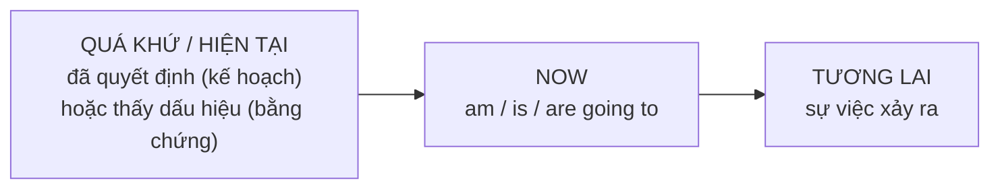

# A1-G020 · Be Going To — Tương lai với Be going to

## Mục lục

- [A. Lesson Information](#a-lesson-information)
- [B. Warm-up](#b-warm-up-tình-huống-thực-tế)
- [C. WHAT](#c-what-be-going-to-là-gì)
- [D. WHY](#d-why-going-to--tương-lai-đã-bắt-đầu-từ-hiện-tại)
- [E. FORM](#e-form-công-thức)
- [F. HOW](#f-how-hai-cách-dùng-chính)
- [G. VISUAL](#g-visual-explanation)
- [H. COMPARISON](#h-comparison-will-và-be-going-to)
- [I. COMMON MISTAKES](#i-common-mistakes)
- [J. MEMORY TRICKS](#j-memory-tricks)
- [K. REAL-LIFE APPLICATION](#k-real-life-application)
- [L. PRACTICE EXERCISES](#l-practice-exercises)
- [M. KNOWLEDGE CHECK](#m-knowledge-check)
- [N. ANSWER KEY](#n-answer-key)

---

## A. Lesson Information

| Mục | Nội dung |
|---|---|
| **Lesson ID** | A1-G020 |
| **Topic** | Be Going To (plans & evidence-based predictions) |
| **Tên tiếng Việt** | Tương lai với *be going to* — dự định và dự đoán có căn cứ |
| **CEFR Level** | A1 |
| **Prerequisites** | [A1-G019 — Will](A1-G019-future-will.md), [A1-G004 — Present Continuous](A1-G004-present-continuous.md) |
| **Estimated Time** | 90 phút |

**Learning Objectives:**

1. Tạo câu với **am/is/are + going to + V**.
2. Dùng *be going to* cho **dự định/kế hoạch đã có trước** thời điểm nói.
3. Dùng *be going to* cho **dự đoán dựa trên bằng chứng hiện tại**.
4. Chọn đúng giữa *will* và *be going to* trong ngữ cảnh.
5. Nhận ra dạng nói nhanh *gonna* (chỉ trong văn nói thân mật).

---

## B. Warm-up: Tình huống thực tế

**Tình huống 1:** Tháng trước bạn đã đặt vé máy bay đi Nhật. Hôm nay đồng nghiệp hỏi "Hè này bạn làm gì?" Bạn trả lời: "Tôi **sẽ** đi Nhật."

**Tình huống 2:** Bạn nhìn ra cửa sổ, trời đầy mây đen. Bạn nói: "Trời **sắp** mưa rồi."

🤔 **Hãy suy nghĩ:** Ở bài trước, *will* dùng cho quyết định **ngay lúc nói** và dự đoán theo **ý kiến**. Nhưng ở tình huống 1, quyết định đã có **từ tháng trước**. Ở tình huống 2, bạn có **bằng chứng nhìn thấy** (mây đen). Tiếng Anh có một cách nói khác cho những trường hợp này không?

---

## C. WHAT: *Be going to* là gì?

**Be going to + V** diễn tả tương lai **đã có "mầm mống" từ hiện tại**:

| Cách dùng | Ví dụ | Nghĩa |
|---|---|---|
| **Dự định, kế hoạch** đã quyết định từ trước | *I'**m going to** visit Japan this summer.* | Hè này tôi sẽ đi Nhật (đã lên kế hoạch). |
| **Dự đoán có bằng chứng** ở hiện tại | *Look at those clouds! It'**s going to** rain.* | Nhìn mây kìa! Trời sắp mưa. |

Lưu ý: *going to* ở đây **không** mang nghĩa "đang đi đến". Cả cụm *be going to* là một cấu trúc chỉ tương lai.

---

## D. WHY: *Going to* — tương lai đã bắt đầu từ hiện tại

Cấu trúc này dùng **thì hiện tại tiếp diễn** (*am/is/are + going*) — như thể bạn **đang "trên đường" tiến tới** sự việc đó. Ý định đã có trong đầu bạn, hoặc dấu hiệu đã xuất hiện trước mắt bạn — tương lai đã "khởi động" từ hiện tại.



So sánh với *will*: *will* = quyết định/ý kiến **bật ra tại thời điểm nói** 💡. *Going to* = ý định/dấu hiệu **đã có sẵn** 📅👀.

---

## E. FORM: Công thức

**Ký hiệu:** **S** = chủ ngữ · **V** = động từ nguyên mẫu.

| | Công thức | Ví dụ |
|---|---|---|
| ➕ | S + **am/is/are + going to** + V | *She'**s going to** study abroad.* |
| ➖ | S + **am/is/are + not going to** + V | *We **aren't going to** buy a car.* |
| ❓ | **Am/Is/Are** + S + **going to** + V? | ***Are** you **going to** watch the match?* |
| 💬 | Yes, S + am/is/are. / No, S + am/is/are + not. | *Yes, I am. / No, I'm not.* |
| Wh- | Wh- + am/is/are + S + going to + V? | *What **are** you **going to** do after graduation?* |

Cấu trúc này thuộc **gia đình *be*** — câu hỏi và phủ định do *am/is/are* đảm nhiệm, không dùng *do*.

### *Going to go* và *going to the...*

- *I'm going to **go** to the beach.* — đúng, nhưng thường rút gọn thành:
- *I'm going **to the beach**.* — thì hiện tại tiếp diễn chỉ kế hoạch (học kỹ ở [A2-G008](../../03-A2-ELEMENTARY/grammar/A2-G008-present-continuous-future.md)). Cả hai đều đúng.

### *Gonna* — văn nói

Trong văn nói nhanh, *going to* + V thường nghe như **gonna** /ˈɡənə/: *I'm gonna call you.* Bạn cần **nhận ra** khi nghe, nhưng **không viết** *gonna* trong email, bài luận hay bài thi.

---

## F. HOW: Hai cách dùng chính

### Cách dùng 1 — Dự định, kế hoạch (intentions & plans)

| # | English | Tiếng Việt | Phân tích |
|---|---|---|---|
| 1 | *I'**m going to** learn Korean next year.* | Năm sau tôi sẽ học tiếng Hàn. | Ý định đã có |
| 2 | *We'**re going to** move to Da Nang in June.* | Tháng 6 chúng tôi sẽ chuyển vào Đà Nẵng. | Kế hoạch |
| 3 | *She **isn't going to** go to the party. She's too tired.* | Cô ấy sẽ không đi dự tiệc. Cô ấy mệt quá. | Phủ định |
| 4 | *What **are** you **going to** do this weekend?* | Cuối tuần này bạn định làm gì? | Hỏi kế hoạch |
| 5 | ***Are** they **going to** get married? — Yes, they **are**!* | Họ định cưới à? — Đúng vậy! | |
| 6 | *I'**m going to** be a doctor when I grow up.* | Lớn lên con sẽ làm bác sĩ. | Ý định dài hạn |

### Cách dùng 2 — Dự đoán có bằng chứng (predictions with present evidence)

| # | English | Tiếng Việt | Bằng chứng |
|---|---|---|---|
| 7 | *Look at the sky! It'**s going to** rain.* | Nhìn trời kìa! Sắp mưa rồi. | Mây đen |
| 8 | *Be careful! You'**re going to** fall!* | Cẩn thận! Bạn sắp ngã đấy! | Người đang mất thăng bằng |
| 9 | *She'**s going to** have a baby in May.* | Cô ấy sẽ sinh em bé vào tháng 5. | Đang mang thai |
| 10 | *We'**re going to** be late. Look at the traffic!* | Chúng ta sẽ muộn mất. Nhìn xe cộ kìa! | Tắc đường |
| 11 | *Vietnam **is going to** win! They're 3–0 up with five minutes left.* | Việt Nam sắp thắng rồi! Dẫn 3–0, còn 5 phút. | Tỉ số hiện tại |
| 12 | *I feel sick. I think I'**m going to** throw up.* | Tôi thấy buồn nôn. Chắc tôi sắp nôn mất. | Cảm giác cơ thể |

---

## G. VISUAL EXPLANATION

### Timeline

```text
KẾ HOẠCH:
  ── 📅 (đã quyết định) ────────── NOW ─────────── ✕ (sự việc) ──►
       last month                  "I'm going to visit Japan."

BẰNG CHỨNG:
  ──────────────────────── NOW 👀 ☁️☁️ ──── ✕ 🌧️ ──►
                         "It's going to rain."
```

### Sentence breakdown

`My brother | is | going to | buy | a new motorbike | next month.`

| Phần | Vai trò |
|---|---|
| My brother | S (ngôi 3) → *is* |
| is going to | Cấu trúc tương lai (*be* chia theo S) |
| buy | V nguyên mẫu |
| a new motorbike | O |
| next month | Thời gian tương lai |

---

## H. COMPARISON: *will* và *be going to*

| Tình huống | *will* | *be going to* |
|---|---|---|
| Quyết định | **Ngay lúc nói** 💡: *"We're out of milk." — "I'll buy some."* | **Đã quyết định trước** 📅: *I'm going to buy milk after work.* |
| Dự đoán | Dựa trên **ý kiến, niềm tin**: *I think it'll be a great film.* | Dựa trên **bằng chứng hiện tại** 👀: *Look — it's going to rain.* |
| Lời hứa, đề nghị | ✅ *I'll help you. I won't tell anyone.* | ❌ |
| Câu hỏi về kế hoạch của người khác | Ít dùng | ✅ *What are you going to do?* |

### Cặp câu đối chiếu

| *will* | *be going to* |
|---|---|
| *"The phone's ringing." — "I'**ll** answer it."* | *I'**m going to** call the bank tomorrow morning.* |
| *I think Real Madrid **will** win the league.* | *Real Madrid **are going to** win — it's 2–0 in the 90th minute!* |
| *"I'm hungry." — "I'**ll** make you a sandwich."* | *I'**m going to** make pizza tonight. I bought everything yesterday.* |

> 💡 Trong nhiều dự đoán, cả hai đều có thể đúng và khác biệt rất nhỏ. Ở cấp A1, hãy nhớ quy tắc chính: **💡 lúc nói → will; 📅 đã định / 👀 có bằng chứng → going to**.

---

## I. COMMON MISTAKES

| # | ❌ Sai | ✅ Đúng | Nguyên nhân | Cách tránh |
|---|---|---|---|---|
| 1 | I **going to** visit my aunt. | I'**m going to** visit my aunt. | Thiếu *be* | *am/is/are* + going to |
| 2 | She is going to **visits** Hue. | She is going to **visit** Hue. | Chia động từ | Sau *to* → nguyên mẫu |
| 3 | She is going **visit** Hue. | She is going **to** visit Hue. | Thiếu *to* | |
| 4 | **Do** you going to come? | **Are** you going to come? | Dùng *do* | Gia đình *be* |
| 5 | (Waiter: "What would you like?") — *I'm going to have the steak.* (quyết định ngay lúc đó) | *I'**ll** have the steak.* | Dùng *going to* cho quyết định tức thời | 💡 → *will* |
| 6 | "My bag is heavy." — "*I'm going to help you.*" | "*I'**ll** help you.*" | | Đề nghị tức thời → *will* |
| 7 | (Viết email) *I'm **gonna** send the report.* | *I'm **going to** send the report.* | Dùng văn nói trong văn viết | Không viết *gonna* |
| 8 | I **will** visit Japan this summer. I booked the tickets last month. (không sai hẳn) | I'**m going to** visit Japan... | | Kế hoạch đã có → *going to* tự nhiên hơn |

---

## J. MEMORY TRICKS

1. **Ba biểu tượng**: 💡 *will* (bật ra lúc nói) · 📅 *going to* (kế hoạch có sẵn) · 👀 *going to* (thấy bằng chứng).
2. **"Going to = đang trên đường tới"**: Bạn đã "lên đường" (đã định / đã có dấu hiệu) → *going to*.
3. **Câu kiểm tra**: Hỏi "Quyết định này có **trước** khi tôi mở miệng không?" Có → *going to*. Không → *will*.

---

## K. REAL-LIFE APPLICATION

### Hội thoại: Kế hoạch sau khi tốt nghiệp

> **Teacher:** So, what **are** you **going to** do after graduation, Linh?
> **Linh:** I'**m going to** work for a travel company in Hoi An. I signed the contract last week!
> **Teacher:** Congratulations! **Are** you **going to** live there?
> **Linh:** Yes, I am. I'**m going to** rent a small flat near the old town.
> **Teacher:** Wonderful. And you, Duc?
> **Duc:** I'm not sure yet. Maybe I'**ll** do a master's degree. Or maybe I'**ll** take a gap year.
> **Teacher:** Well, I'm sure you'**ll** make the right decision.
> *(Linh looks out of the window)*
> **Linh:** Oh no, look at those black clouds! It'**s going to** rain, and I don't have an umbrella.
> **Duc:** Don't worry, I'**ll** lend you mine.

**Vietnamese explanation:** Linh đã ký hợp đồng làm cho công ty du lịch ở Hội An (kế hoạch → *going to*), sẽ thuê căn hộ gần phố cổ. Đức chưa chắc — có thể học thạc sĩ hoặc nghỉ một năm (chưa quyết định → *will/maybe*). Thấy mây đen, Linh nói trời sắp mưa (bằng chứng → *going to*); Đức đề nghị cho mượn ô (đề nghị tức thời → *will*).

**Useful expressions:** *Congratulations!* · *I'm not sure yet.* · *Maybe I'll...* · *a gap year* (năm nghỉ giữa hai giai đoạn học/làm) · *make the right decision*.

---

## L. PRACTICE EXERCISES

> ✍️ Đáp án: [A1-G020-ANSWERS](../../12-ANSWERS-AND-EXPLANATIONS/A1/A1-G020-ANSWERS.md)

### Level 1 — Recognition

**L1.1.** We ___ visit our grandparents next Sunday. We told them already.  A. will  B. are going to  C. going to
**L1.2.** Look at that man! He ___ fall off his bike!  A. will  B. is going to  C. goes to
**L1.3.** "I can't open this jar." — "Give it to me. I ___ do it."  A. 'll  B. 'm going to  C. go to
**L1.4.** What ___ you going to cook tonight?  A. do  B. are  C. will
**L1.5.** She is going to ___ a new job.  A. starts  B. start  C. starting
**L1.6.** Câu nào **không nên** dùng trong email công việc?  A. I'm going to call you.  B. I'm gonna call you.  C. I'll call you.

### Level 2 — Controlled Practice

Viết câu với *be going to* theo gợi ý.

**L2.1.** I / clean / my room / this afternoon (+)
**L2.2.** They / not / buy / a new house (–)
**L2.3.** you / watch / the football match? (?)
**L2.4.** It's 8:55 and the class starts at 9. You're still at home. → You (be late) ___.
**L2.5.** The sky is clear and blue. → It (be) ___ a beautiful day.

Chọn *will* hoặc *be going to* và chia đúng.

**L2.6.** "Did you buy the train tickets?" — "No, I forgot! I (buy) ___ them now."
**L2.7.** My sister (have) ___ a baby in October.
**L2.8.** "Why are you wearing your gym clothes?" — "I (play) ___ badminton with Nam."
**L2.9.** I think robots (do) ___ most jobs in the future.
**L2.10.** "This box is really heavy." — "Wait, I (help) ___ you."

### Level 3 — Error Correction

**L3.1.** I going to visit Hue next month.
**L3.2.** He is going to buys a new phone.
**L3.3.** Do you going to come to my party?
**L3.4.** "The phone is ringing." — "I'm going to answer it."
**L3.5.** We are going travel to Sapa.
**L3.6.** Look out! The glass will fall! (có bằng chứng — sắp rơi)

### Level 4 — Production

Dịch sang tiếng Anh:

**L4.1.** Tối nay bạn định làm gì?
**L4.2.** Chúng tôi sẽ không đi nghỉ năm nay. (đã quyết định)
**L4.3.** Cẩn thận! Bạn sắp làm đổ cà phê! (*spill*)
**L4.4.** Năm sau anh trai tôi sẽ học thạc sĩ ở Úc. (*do a master's degree*)
**L4.5.** "Hết sữa rồi." — "Để tôi đi mua." (*We're out of milk.*)

### Level 5 — Real Communication

**L5.1.** Viết đoạn văn 80–100 từ: *My plans for next year*. Dùng *be going to* cho ít nhất 5 kế hoạch (công việc, học tập, du lịch, sức khỏe...) và *will/probably/maybe* cho 2 điều bạn chưa chắc chắn.
**L5.2.** **Speaking — Talk about your next weekend:** Nói 1 phút về kế hoạch cuối tuần tới (*going to*), thêm 2 dự đoán (*I think... will...*) và 1 điều bạn chưa quyết định (*Maybe I'll...*). Ghép với bài A1-G018 để hoàn thành Mini Challenge *"Talk about your last weekend and next weekend"*.

---

## M. KNOWLEDGE CHECK

### 5 câu hỏi tự kiểm tra

1. Hai cách dùng chính của *be going to* là gì?
2. Khi nào dùng *will* thay vì *going to* để nói về quyết định?
3. Câu hỏi với *going to* dùng *do* hay *be*?
4. *Gonna* có dùng trong văn viết không?
5. Chọn *will/going to*: "Mây đen kìa! Trời ___ mưa."

### Checklist

- [ ] Tôi tạo câu *be going to* với đủ ba phần: *be* + *going to* + V.
- [ ] Tôi chọn đúng *will / going to* trong ≥ 80% bài tập trộn.
- [ ] Tôi nói được kế hoạch cuối tuần, năm tới.

### 3 lỗi quan trọng cần nhớ

1. ~~I going to~~ → I**'m** going to.
2. ~~going to buys / going buy~~ → going **to buy**.
3. Quyết định/đề nghị ngay lúc nói → **will**, không phải *going to*.

### Lịch ôn tập

| Ngày | Việc cần làm |
|---|---|
| Ngày 1 | Làm lại L2.6–L2.10 và giải thích lý do |
| Ngày 3 | Viết 5 kế hoạch của gia đình bạn cho tháng sau |
| Ngày 7 | Làm bài trộn *will / going to / present continuous* trong [LAB-02](../../10-PRACTICE-LAB/LAB-02-mixed-grammar-exercises.md) |

### Liên kết

- ➡️ Bài tiếp theo: [A1-G021 — Basic Conjunctions](A1-G021-basic-conjunctions.md)
- 🔜 [A2-G008 — Present Continuous for Future](../../03-A2-ELEMENTARY/grammar/A2-G008-present-continuous-future.md)
- 🔁 Tra cứu: [ALL-TENSES-COMPARISON](../../06-GRAMMAR-REFERENCE/ALL-TENSES-COMPARISON.md)

---

## N. ANSWER KEY

👉 [A1-G020-ANSWERS.md](../../12-ANSWERS-AND-EXPLANATIONS/A1/A1-G020-ANSWERS.md)
