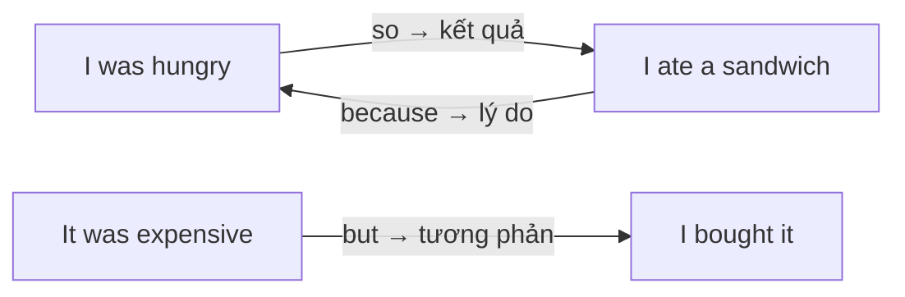

# A1-G021 · Basic Conjunctions — Liên từ cơ bản: and, but, or, so, because

## Mục lục

- [A. Lesson Information](#a-lesson-information)
- [B. Warm-up](#b-warm-up-tình-huống-thực-tế)
- [C. WHAT](#c-what-liên-từ-là-gì)
- [D. WHY](#d-why-liên-từ-cho-biết-quan-hệ-giữa-các-ý)
- [E. FORM](#e-form-năm-liên-từ-và-dấu-câu)
- [F. HOW](#f-how-ví-dụ-phân-tích)
- [G. VISUAL](#g-visual-explanation)
- [H. COMPARISON](#h-comparison-so-và-because)
- [I. COMMON MISTAKES](#i-common-mistakes)
- [J. MEMORY TRICKS](#j-memory-tricks)
- [K. REAL-LIFE APPLICATION](#k-real-life-application)
- [L. PRACTICE EXERCISES](#l-practice-exercises)
- [M. KNOWLEDGE CHECK](#m-knowledge-check)
- [N. ANSWER KEY](#n-answer-key)

---

## A. Lesson Information

| Mục | Nội dung |
|---|---|
| **Lesson ID** | A1-G021 |
| **Topic** | Basic Conjunctions: and, but, or, so, because |
| **Tên tiếng Việt** | Liên từ cơ bản |
| **CEFR Level** | A1 |
| **Prerequisites** | [A0-G008 — Sentence Patterns](../../01-A0-FOUNDATION/grammar/A0-G008-sentence-patterns.md) |
| **Estimated Time** | 60 phút |

**Learning Objectives:**

1. Dùng *and* (thêm ý), *but* (tương phản), *or* (lựa chọn), *so* (kết quả), *because* (lý do).
2. Nối hai câu đơn thành một câu ghép tự nhiên.
3. Đặt dấu phẩy đúng chỗ với *and, but, so*.
4. Phân biệt rõ *so* (kết quả) và *because* (nguyên nhân).
5. Tránh lỗi *Because..., so...* và *Although..., but...* (lỗi kinh điển của người Việt).

---

## B. Warm-up: Tình huống thực tế

Đọc đoạn văn của một người học:

> *I live in Hue. I work in a hotel. I like my job. It is tiring. I want to change my job. I want to earn more money.*

Mọi câu đều đúng, nhưng đoạn văn nghe như **robot** — các ý rời rạc, không thấy mối quan hệ.

🤔 **Hãy suy nghĩ:** Trong tiếng Việt, bạn sẽ nối các câu này bằng những từ nào? ("và", "nhưng", "vì", "nên"...) Tiếng Anh có những từ tương đương không?

---

## C. WHAT: Liên từ là gì?

**Conjunctions** (liên từ) là những từ **nối** từ, cụm từ hoặc câu, đồng thời cho biết **mối quan hệ logic** giữa chúng.

| Liên từ | Quan hệ | Nghĩa | Ví dụ |
|---|---|---|---|
| **and** | Thêm ý, cùng chiều | và | *I like tea **and** coffee.* |
| **but** | Tương phản | nhưng | *It's cheap **but** good.* |
| **or** | Lựa chọn | hoặc, hay | *Tea **or** coffee?* |
| **so** | Kết quả | nên, vì vậy | *I was tired, **so** I went to bed.* |
| **because** | Nguyên nhân, lý do | vì, bởi vì | *I went to bed **because** I was tired.* |

---

## D. WHY: Liên từ cho biết quan hệ giữa các ý

Người đọc/người nghe không chỉ cần **thông tin**, mà còn cần biết **thông tin này liên quan thế nào với thông tin kia**. Liên từ là "biển chỉ đường" của câu:



Một đoạn văn có liên từ phù hợp giúp bạn đạt điểm **Cohesion** (mạch lạc) trong bài viết và bài nói — tiêu chí quan trọng ở mọi kỳ thi, kể cả VSTEP.

---

## E. FORM: Năm liên từ và dấu câu

| Liên từ | Nối được | Dấu phẩy | Ví dụ |
|---|---|---|---|
| **and** | từ, cụm từ, câu | Thường có dấu phẩy khi nối **hai câu dài** có chủ ngữ riêng | *I cooked dinner, **and** my husband washed the dishes.* |
| **but** | từ, cụm từ, câu | Thường có dấu phẩy **trước** *but* khi nối hai câu | *She's rich, **but** she isn't happy.* |
| **or** | từ, cụm từ, câu | Thường không cần với từ/cụm ngắn | *Do you want rice **or** noodles?* |
| **so** | **câu** (mệnh đề) | **Có** dấu phẩy trước *so* | *It was raining, **so** we stayed home.* |
| **because** | **câu** (mệnh đề) | **Không** dấu phẩy khi đứng giữa câu; **có** dấu phẩy khi *Because...* đứng đầu | *We stayed home **because** it was raining.* / ***Because** it was raining, we stayed home.* |

**Ký hiệu:** **Mệnh đề** (clause) = một nhóm từ có **chủ ngữ + động từ** (*it was raining*).

### Lược chủ ngữ với *and/but/or*

Khi hai vế có **cùng chủ ngữ**, có thể bỏ chủ ngữ thứ hai:

- *I got up **and** (I) had breakfast.* → *I got up and had breakfast.*
- *She's tired **but** (she's) happy.* → *She's tired but happy.*

### Liệt kê nhiều thứ

*I bought eggs, milk, bread **and** cheese.* — dấu phẩy giữa các mục, *and* trước mục cuối. (Một số người viết thêm dấu phẩy trước *and* — gọi là *Oxford comma*; cả hai cách đều được chấp nhận.)

---

## F. HOW: Ví dụ phân tích

| # | English | Tiếng Việt | Phân tích |
|---|---|---|---|
| 1 | *My sister is a doctor **and** my brother is a teacher.* | Chị tôi là bác sĩ và anh tôi là giáo viên. | Hai ý cùng loại |
| 2 | *I got up early **and** went jogging.* | Tôi dậy sớm và đi chạy bộ. | Cùng chủ ngữ → lược *I* |
| 3 | *The hotel was old **but** very clean.* | Khách sạn cũ nhưng rất sạch. | Tương phản giữa hai tính từ |
| 4 | *I called him, **but** he didn't answer.* | Tôi gọi anh ấy nhưng anh ấy không nghe máy. | Kết quả trái mong đợi |
| 5 | *Would you like tea **or** coffee?* | Bạn uống trà hay cà phê? | Lựa chọn |
| 6 | *We can take a taxi **or** walk.* | Chúng ta có thể đi taxi hoặc đi bộ. | |
| 7 | *It was late, **so** we took a taxi.* | Trời đã muộn nên chúng tôi đi taxi. | Nguyên nhân → **so** → kết quả |
| 8 | *We took a taxi **because** it was late.* | Chúng tôi đi taxi vì trời đã muộn. | Kết quả → **because** → nguyên nhân |
| 9 | *I don't eat meat **or** fish.* | Tôi không ăn thịt và cá. | ⚠️ Trong câu **phủ định**, "và" thường dịch là *or* |
| 10 | *I'm learning English **because** I want to work abroad.* | Tôi học tiếng Anh vì muốn làm việc ở nước ngoài. | |
| 11 | *She didn't study, **so** she failed the test.* | Cô ấy không học nên trượt bài kiểm tra. | |
| 12 | *"Why are you late?" — "**Because** the bus was late."* | "Sao bạn đến muộn?" — "Vì xe buýt đến muộn." | Văn nói: câu trả lời ngắn bắt đầu bằng *Because* được chấp nhận |

---

## G. VISUAL EXPLANATION

### Cặp *so – because*: hai chiều của một mối quan hệ

```text
  NGUYÊN NHÂN                          KẾT QUẢ
  It was raining.   ───── so ─────►   We stayed home.
  It was raining.   ◄── because ───   We stayed home.

  It was raining, so we stayed home.
  We stayed home because it was raining.
```

### Sentence breakdown

`I love my job, | but | it's very tiring, | so | I want to change it.`

| Phần | Vai trò |
|---|---|
| I love my job | Ý 1 |
| **but** | Tương phản với ý 1 |
| it's very tiring | Ý 2 (trái với kỳ vọng từ ý 1) |
| **so** | Dẫn tới kết quả |
| I want to change it | Kết quả của ý 2 |

---

## H. COMPARISON: *so* và *because*

| | *so* | *because* |
|---|---|---|
| Đứng trước | **Kết quả** | **Nguyên nhân** |
| Thứ tự | Nguyên nhân, **so** kết quả | Kết quả **because** nguyên nhân |
| Ví dụ | *I was sick, **so** I stayed home.* | *I stayed home **because** I was sick.* |

### ⚠️ Lỗi "đôi" kinh điển của người Việt

Tiếng Việt thích dùng cặp "**Vì**... **nên**...", "**Tuy**... **nhưng**...". Tiếng Anh **chỉ dùng MỘT** liên từ:

| ❌ Sai | ✅ Đúng (chọn một) |
|---|---|
| *Because I was sick, **so** I stayed home.* | *Because I was sick, I stayed home.* / *I was sick, so I stayed home.* |
| *Although it was cheap, **but** I didn't buy it.* | *Although it was cheap, I didn't buy it.* / *It was cheap, but I didn't buy it.* |

(*Although* sẽ học ở [B1-G018](../../04-B1-INTERMEDIATE/grammar/B1-G018-linking-words.md).)

### *because* và *because of*

| *because* + **mệnh đề** (S + V) | *because of* + **danh từ** |
|---|---|
| *We stayed home **because** it rained.* | *We stayed home **because of** the rain.* |

---

## I. COMMON MISTAKES

| # | ❌ Sai | ✅ Đúng | Nguyên nhân | Cách tránh |
|---|---|---|---|---|
| 1 | **Because** I was tired, **so** I slept early. | Because I was tired, I slept early. | Dịch "Vì... nên..." | Một liên từ thôi |
| 2 | I don't like tea **and** coffee. | I don't like tea **or** coffee. | Dịch "và" trong câu phủ định | Phủ định → *or* |
| 3 | I stayed home **because of** it was raining. | ...**because** it was raining. | Nhầm *because of* | Có S + V → *because* |
| 4 | I was hungry **because** I ate a pizza. (ý: đói nên ăn) | I was hungry, **so** I ate a pizza. | Nhầm chiều nguyên nhân – kết quả | *so* trước kết quả |
| 5 | **Because** it was cold. (đứng một mình trong bài viết) | We stayed inside **because** it was cold. | Câu không hoàn chỉnh (fragment) | Trong văn viết, *because*-clause cần mệnh đề chính |
| 6 | It was raining **so** we stayed home. (văn viết trang trọng) | It was raining**,** so we stayed home. | Thiếu dấu phẩy | Dấu phẩy trước *so* |
| 7 | I like football, **and** I like basketball, **and** I like tennis. | I like football, basketball and tennis. | Lặp *and* | Liệt kê với dấu phẩy |
| 8 | **But** I like it. (mở đầu đoạn viết trang trọng) | **However,** I like it. | *But* đầu câu không hợp văn trang trọng | Văn trang trọng dùng *However* ([B1-G018](../../04-B1-INTERMEDIATE/grammar/B1-G018-linking-words.md)) |

---

## J. MEMORY TRICKS

1. **"FANBOYS"** (mẹo tiếng Anh): **F**or, **A**nd, **N**or, **B**ut, **O**r, **Y**et, **S**o — 7 liên từ đẳng lập. Ở A1, bạn cần **and, but, or, so**.
2. **"So → mũi tên tới kết quả; Because → mũi tên ngược về nguyên nhân"** (hình ở mục G).
3. **"Tiếng Anh độc thân"**: Không ghép đôi *because...so* hay *although...but* — tiếng Anh chỉ cần **một** liên từ cho một mối quan hệ.

---

## K. REAL-LIFE APPLICATION

### Bài đọc: My job (phiên bản đã nối câu)

> *I live in Hue **and** I work in a hotel near the Perfume River. I like my job **because** I meet people from all over the world. I usually work in the morning **or** in the evening. The work is interesting, **but** it is very tiring, **because** I'm on my feet all day. I also want to earn more money, **so** I'm learning English **and** Japanese in my free time. In the future, I'd like to be a hotel manager **or** open my own guesthouse.*

So sánh với đoạn ở mục B: cùng thông tin nhưng giờ người đọc thấy rõ **lý do**, **tương phản**, **kết quả** và **lựa chọn**.

**Grammar highlights:** *and* (thêm ý), *because* ×2 (lý do), *or* ×2 (lựa chọn), *but* (tương phản), *so* (kết quả).

---

## L. PRACTICE EXERCISES

> ✍️ Đáp án: [A1-G021-ANSWERS](../../12-ANSWERS-AND-EXPLANATIONS/A1/A1-G021-ANSWERS.md)

### Level 1 — Recognition

**L1.1.** I wanted to go out, ___ it was raining.  A. and  B. but  C. so
**L1.2.** Do you want to eat now ___ later?  A. or  B. but  C. so
**L1.3.** He missed the bus, ___ he was late for work.  A. because  B. so  C. or
**L1.4.** She's happy ___ she passed the exam.  A. so  B. but  C. because
**L1.5.** I don't drink coffee ___ tea.  A. and  B. or  C. but
**L1.6.** Which sentence is correct?  A. Because it was hot, so we went swimming.  B. Because it was hot, we went swimming.  C. Because of it was hot, we went swimming.

### Level 2 — Controlled Practice

Nối hai câu bằng liên từ phù hợp (*and, but, or, so, because*).

**L2.1.** I was thirsty. I drank a glass of water.
**L2.2.** The restaurant was expensive. The food wasn't very good.
**L2.3.** We can go by bus. We can go by train.
**L2.4.** She stayed at home. She had a headache.
**L2.5.** My father is a farmer. My mother is a nurse.
**L2.6.** The shop was closed. We went to another one.

Hoàn thành câu theo ý của bạn:

**L2.7.** I'm learning English because ______.
**L2.8.** It was my birthday, so ______.
**L2.9.** I like my city, but ______.
**L2.10.** At the weekend, I usually ______ or ______.

### Level 3 — Error Correction

**L3.1.** Because I didn't have money, so I didn't buy it.
**L3.2.** I don't like cats and dogs.
**L3.3.** We cancelled the trip because of it was raining.
**L3.4.** I was sleepy because I drank three cups of coffee. (ý: buồn ngủ nên uống cà phê)
**L3.5.** She is beautiful but she is kind. (hai ý cùng chiều tích cực)
**L3.6.** I bought apples and oranges and bananas and grapes.

### Level 4 — Production

Dịch sang tiếng Anh:

**L4.1.** Tôi muốn mua chiếc điện thoại đó nhưng nó quá đắt.
**L4.2.** Trời lạnh nên tôi mặc áo khoác.
**L4.3.** Tôi thích sống ở Đà Lạt vì không khí trong lành. (*the air is fresh*)
**L4.4.** Bạn muốn đi xem phim hay ở nhà?
**L4.5.** Anh ấy không hút thuốc và không uống rượu. (*smoke, drink alcohol*)

### Level 5 — Real Communication

**L5.1.** Viết lại đoạn văn rời rạc sau thành đoạn mạch lạc bằng *and, but, or, so, because* (có thể thêm/bớt từ):
> *I live in a small town. It is quiet. It is boring. There are not many jobs. Young people move to big cities. I want to stay. I love my family. Maybe I will open a café. Maybe I will teach English.*

**L5.2.** **Speaking — Why?:** Trả lời 5 câu hỏi, mỗi câu dùng ít nhất **hai** liên từ: *Why do you learn English? Do you prefer the city or the countryside? What did you do last weekend? Do you like your job/school? What are you going to do next summer?*

---

## M. KNOWLEDGE CHECK

### 5 câu hỏi tự kiểm tra

1. Năm liên từ cơ bản và quan hệ chúng diễn tả?
2. *so* và *because* khác nhau thế nào?
3. Vì sao *Because..., so...* là sai?
4. "Tôi không ăn thịt và cá" dịch thế nào?
5. *because* và *because of* khác nhau ra sao?

### Checklist

- [ ] Tôi nối câu đúng với 5 liên từ.
- [ ] Tôi không dùng cặp *because...so*.
- [ ] Tôi đặt dấu phẩy trước *so* và *but* khi nối hai câu.

### 3 lỗi quan trọng cần nhớ

1. ~~Because..., so...~~ → chỉ dùng **một** liên từ.
2. Phủ định: ~~don't like tea and coffee~~ → **or**.
3. ~~because of it was~~ → **because** it was.

### Lịch ôn tập

| Ngày | Việc cần làm |
|---|---|
| Ngày 1 | Làm lại L2 |
| Ngày 3 | Viết lại một đoạn văn cũ của bạn (bài A1 trước) với liên từ |
| Ngày 7 | Làm lại L5.1, so sánh với lần đầu |

### Liên kết

- ➡️ Bài tiếp theo: [A1-G022 — Comparatives](A1-G022-comparatives.md)
- 🔜 [B1-G018 — Linking Words](../../04-B1-INTERMEDIATE/grammar/B1-G018-linking-words.md)
- 🔁 Viết: [W01 — Sentence Construction](../../09-FOUR-SKILLS/Writing/W01-sentence-construction.md)

---

## N. ANSWER KEY

👉 [A1-G021-ANSWERS.md](../../12-ANSWERS-AND-EXPLANATIONS/A1/A1-G021-ANSWERS.md)
