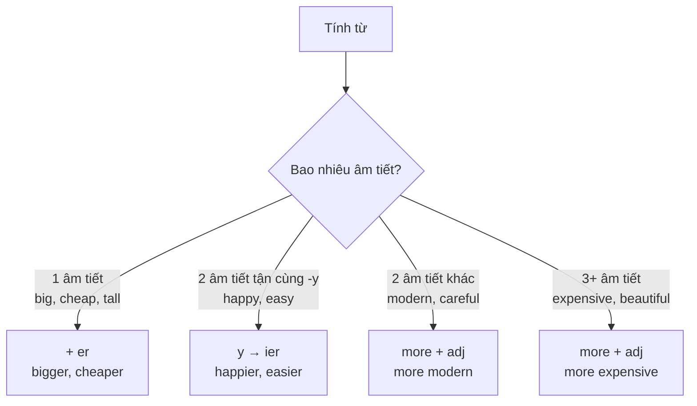

# A1-G022 · Comparative Adjectives — So sánh hơn

## Mục lục

- [A. Lesson Information](#a-lesson-information)
- [B. Warm-up](#b-warm-up-tình-huống-thực-tế)
- [C. WHAT](#c-what-so-sánh-hơn-là-gì)
- [D. WHY](#d-why-vì-sao-có--er-và-more)
- [E. FORM](#e-form-quy-tắc-tạo-so-sánh-hơn)
- [F. HOW](#f-how-ví-dụ-phân-tích)
- [G. VISUAL](#g-visual-explanation)
- [H. COMPARISON](#h-comparison)
- [I. COMMON MISTAKES](#i-common-mistakes)
- [J. MEMORY TRICKS](#j-memory-tricks)
- [K. REAL-LIFE APPLICATION](#k-real-life-application)
- [L. PRACTICE EXERCISES](#l-practice-exercises)
- [M. KNOWLEDGE CHECK](#m-knowledge-check)
- [N. ANSWER KEY](#n-answer-key)

---

## A. Lesson Information

| Mục | Nội dung |
|---|---|
| **Lesson ID** | A1-G022 |
| **Topic** | Comparative Adjectives (+ than) |
| **Tên tiếng Việt** | So sánh hơn của tính từ |
| **CEFR Level** | A1 |
| **Prerequisites** | [A0-G005 — Adjectives](../../01-A0-FOUNDATION/grammar/A0-G005-nouns-verbs-adjectives-adverbs.md), [A0-G009 — To Be](../../01-A0-FOUNDATION/grammar/A0-G009-verb-to-be.md) |
| **Estimated Time** | 75 phút |

**Learning Objectives:**

1. Tạo so sánh hơn với tính từ **ngắn** (*-er*) và tính từ **dài** (*more*).
2. Áp dụng quy tắc chính tả: *-r, -ier*, gấp đôi phụ âm.
3. Thuộc dạng bất quy tắc: *good → better, bad → worse, far → further/farther*.
4. Dùng **than** + danh từ/đại từ/mệnh đề.
5. Nhấn mạnh mức độ với *much, a lot, a bit, a little*.

---

## B. Warm-up: Tình huống thực tế

Bạn đang phân vân giữa hai căn hộ:

> - Căn A: 50 m², 6 triệu/tháng, gần công ty, ồn ào.
> - Căn B: 70 m², 8 triệu/tháng, xa công ty, yên tĩnh.

Bạn muốn nói: "Căn B **rộng hơn** và **yên tĩnh hơn**, nhưng **đắt hơn** và **xa hơn**."

🤔 **Hãy suy nghĩ:** Tiếng Việt chỉ cần thêm "**hơn**" sau mọi tính từ. Trong tiếng Anh, *bigger* và *more expensive* — vì sao một từ thêm *-er*, một từ dùng *more*?

---

## C. WHAT: So sánh hơn là gì?

**Comparative** (so sánh hơn) dùng để **so sánh hai** người, vật, nơi chốn — cho biết bên nào có đặc điểm **ở mức cao hơn**.

| Tính từ | So sánh hơn | Ví dụ |
|---|---|---|
| big | **bigger** | *Flat B is **bigger than** flat A.* |
| expensive | **more expensive** | *Flat B is **more expensive than** flat A.* |
| good | **better** | *This plan is **better**.* |

**Than** /ðən/ (yếu) = "hơn" — đứng trước đối tượng được so sánh.

---

## D. WHY: Vì sao có *-er* và *more*?

Tiếng Anh thích **sự cân bằng âm tiết**. Thêm *-er* vào một từ ngắn (*big → bigger*) thì dễ đọc. Nhưng thêm *-er* vào một từ dài (*expensive → expensiver*) sẽ tạo ra từ quá dài, khó phát âm. Vì vậy, với tính từ dài, tiếng Anh dùng một từ riêng — **more** — đặt phía trước.

---

## E. FORM: Quy tắc tạo so sánh hơn

### E1. Bảng quy tắc

| Loại tính từ | Quy tắc | Ví dụ |
|---|---|---|
| 1 âm tiết | + **-er** | tall → tall**er**, cheap → cheap**er**, old → old**er** |
| 1 âm tiết tận cùng *-e* | + **-r** | nice → nice**r**, large → large**r**, safe → safe**r** |
| 1 âm tiết, CVC | gấp đôi phụ âm + **-er** | big → bi**gg**er, hot → ho**tt**er, thin → thi**nn**er |
| 2 âm tiết tận cùng *-y* | *y* → **-ier** | happy → happ**ier**, busy → bus**ier**, easy → eas**ier** |
| 2 âm tiết khác | **more** + adj | modern → **more** modern, boring → **more** boring |
| 3 âm tiết trở lên | **more** + adj | expensive → **more** expensive, beautiful → **more** beautiful |
| Bất quy tắc | học thuộc | **good → better**, **bad → worse**, **far → further / farther** |

> 💡 Một số tính từ 2 âm tiết dùng được cả hai cách: *quiet → quieter / more quiet*, *clever → cleverer / more clever*, *simple → simpler*, *narrow → narrower*. Khi không chắc, *more* thường an toàn với tính từ 2 âm tiết **không** tận cùng *-y*.

### E2. Cấu trúc câu

| Mẫu | Ví dụ |
|---|---|
| A + be + **adj-er / more adj + than** + B | *Hanoi is **colder than** Saigon in winter.* |
| A + V + ... + **than** + B | *My brother earns **more** money **than** me.* |
| Không cần *than* khi đối tượng đã rõ | *This one is cheaper.* |

### E3. *Than* + đại từ

| Văn nói, thân mật | Văn trang trọng |
|---|---|
| *She's taller **than me**.* | *She's taller **than I am**.* |
| *He's older **than her**.* | *He's older **than she is**.* |

> ❌ *She's taller than I.* — đúng ngữ pháp cổ, nhưng nghe rất cứng; tránh dùng.

### E4. Nhấn mạnh mức độ khác biệt

| Mức độ | Từ | Ví dụ |
|---|---|---|
| Khác nhiều | **much / a lot / far** + comparative | *Flat B is **much bigger**.* |
| Khác ít | **a bit / a little / slightly** + comparative | *It's **a bit cheaper**.* |

> ❌ *very bigger* — *very* **không** đi với so sánh hơn.

---

## F. HOW: Ví dụ phân tích

| # | English | Tiếng Việt | Phân tích |
|---|---|---|---|
| 1 | *My brother is **taller than** me.* | Anh tôi cao hơn tôi. | 1 âm tiết + *-er*; *than me* (văn nói) |
| 2 | *Today is **hotter than** yesterday.* | Hôm nay nóng hơn hôm qua. | CVC → gấp đôi *t* |
| 3 | *This exercise is **easier than** the last one.* | Bài này dễ hơn bài trước. | *-y* → *-ier*; *one* thay *exercise* |
| 4 | *Taxis are **more expensive than** buses.* | Taxi đắt hơn xe buýt. | 3 âm tiết → *more* |
| 5 | *Her English is **better than** mine.* | Tiếng Anh của cô ấy giỏi hơn của tôi. | *good → better*; *mine* = my English |
| 6 | *The traffic is **worse** today.* | Hôm nay giao thông tệ hơn. | *bad → worse*; không cần *than* |
| 7 | *Flat B is **much bigger** but **a bit further** from my office.* | Căn B rộng hơn nhiều nhưng xa công ty hơn một chút. | *much / a bit* nhấn mạnh |
| 8 | *Life in the countryside is **more relaxing**.* | Cuộc sống ở nông thôn thư thái hơn. | 3 âm tiết |
| 9 | *My new phone is **lighter and faster**.* | Điện thoại mới nhẹ hơn và nhanh hơn. | Hai so sánh nối bằng *and* |
| 10 | *Is Da Nang **bigger than** Hue?* | Đà Nẵng có lớn hơn Huế không? | Câu hỏi |
| 11 | *Which is **healthier**, rice or bread?* | Cơm hay bánh mì tốt cho sức khỏe hơn? | *Which...?* + so sánh |
| 12 | *I'm **happier** now **than** I was last year.* | Bây giờ tôi vui hơn năm ngoái. | *than* + mệnh đề |

---

## G. VISUAL EXPLANATION

### So sánh hai căn hộ

| | Flat A | Flat B | Câu so sánh |
|---|---|---|---|
| Size | 50 m² | 70 m² | *Flat B is **bigger** than flat A.* |
| Rent | 6 million | 8 million | *Flat B is **more expensive** than flat A.* |
| Distance to work | 1 km | 5 km | *Flat B is **further** from work.* |
| Noise | noisy | quiet | *Flat B is **quieter** / **more peaceful**.* |
| Overall | — | — | *I think flat B is **better** for my family.* |

### Breakdown

`Flat B | is | much | more spacious | than | flat A.`

- *much* — mức độ khác biệt (nhiều)
- *more spacious* — so sánh hơn (3 âm tiết: *spa-cious*... thực ra 2 âm tiết nhưng không tận cùng -y → *more*)
- *than* — "hơn"
- *flat A* — đối tượng so sánh

---

## H. COMPARISON

### *more* và *-er* — không dùng cả hai

| ❌ | ✅ |
|---|---|
| more bigger | bigger |
| more better | better |
| more easier | easier |

### So sánh với trạng từ (giới thiệu)

So sánh hơn cũng dùng với **trạng từ**: *She drives **more carefully** than her husband.* / *He runs **faster** than me.* / *Please speak **more slowly**.* — Học kỹ ở [A2-G027](../../03-A2-ELEMENTARY/grammar/A2-G027-comparisons.md).

### *than* và *then*

| *than* /ðən/ | *then* /ðen/ |
|---|---|
| hơn (so sánh) | sau đó, khi đó |
| *bigger **than** me* | *First I ate, **then** I slept.* |

---

## I. COMMON MISTAKES

| # | ❌ Sai | ✅ Đúng | Nguyên nhân | Cách tránh |
|---|---|---|---|---|
| 1 | He is **more tall** than me. | He is **taller** than me. | Dùng *more* cho từ ngắn | 1 âm tiết → *-er* |
| 2 | It's **more cheaper**. | It's **cheaper**. | Dùng cả hai | Chọn một |
| 3 | This film is **gooder**. | This film is **better**. | | Bất quy tắc |
| 4 | She is taller **that** me. / taller **then** me | taller **than** me | Nhầm chính tả | *than* |
| 5 | This is **very** bigger. | This is **much** bigger. | *very* không đi với so sánh | *much/a lot/a bit* |
| 6 | **biger**, **hoter**, **happyer** | **bigger**, **hotter**, **happier** | Sai chính tả | Ôn E1 |
| 7 | My phone is **more modern than you**. | My phone is more modern than **yours**. | So sánh sai đối tượng (điện thoại ↔ người) | So sánh cùng loại: *mine/yours/his* |
| 8 | Hanoi is **colder** Saigon. | Hanoi is colder **than** Saigon. | Thiếu *than* | |

---

## J. MEMORY TRICKS

1. **"Ngắn thêm đuôi, dài đội mũ"**: Tính từ ngắn **thêm đuôi** *-er*; tính từ dài **đội mũ** *more*.
2. **"Good–Better–Best, Bad–Worse–Worst"**: Đọc theo nhịp như bài hát — bạn sẽ dùng chúng nhiều nhất.
3. **"Very không thích so sánh"**: Muốn nói "hơn nhiều" → *much*; "hơn chút" → *a bit*.
4. **So sánh táo với táo**: *My car is bigger than **yours*** (xe với xe), không phải *than you* (xe với người).

---

## K. REAL-LIFE APPLICATION

### Hội thoại: Chọn căn hộ

> **Hanh:** So, which flat do you prefer, A or B?
> **Khoa:** Well, flat B is **bigger** and **much quieter**. But it's **more expensive** — two million dong **more** a month.
> **Hanh:** And it's **further** from your office, right?
> **Khoa:** Yes, about four kilometres **further**. The journey will be **longer**, especially in the rainy season when the traffic is **worse**.
> **Hanh:** Hmm. But flat B has a balcony. It's **brighter** and the kitchen is **more modern**.
> **Khoa:** True. I think flat B is **better** for us. We work from home a lot, so a **quieter** place is **more important** than a **shorter** journey.
> **Hanh:** I agree. Let's call the landlord!

**Vietnamese explanation:** Hạnh và Khoa chọn giữa hai căn hộ: căn B rộng hơn, yên tĩnh hơn nhiều, sáng hơn, bếp hiện đại hơn, có ban công; nhưng đắt hơn 2 triệu/tháng và xa công ty hơn 4 km. Họ quyết định chọn căn B vì làm việc ở nhà nhiều — yên tĩnh quan trọng hơn quãng đường ngắn.

**Useful expressions:** *Which ... do you prefer, A or B?* · *Well,...* · *True.* (Đúng vậy.) · *I agree.* · *Let's call the landlord!*

---

## L. PRACTICE EXERCISES

> ✍️ Đáp án: [A1-G022-ANSWERS](../../12-ANSWERS-AND-EXPLANATIONS/A1/A1-G022-ANSWERS.md)

### Level 1 — Recognition

**L1.1.** An elephant is ___ than a horse.  A. big  B. biger  C. bigger
**L1.2.** Gold is ___ than silver.  A. expensiver  B. more expensive  C. most expensive
**L1.3.** My cooking is ___ than my husband's.  A. gooder  B. more good  C. better
**L1.4.** This test is ___ easier than the last one.  A. very  B. much  C. more
**L1.5.** She is taller ___ her mother.  A. that  B. then  C. than
**L1.6.** Which is correct?  A. It's more cheaper.  B. It's cheaper.  C. It's more cheap.

### Level 2 — Controlled Practice

Viết dạng so sánh hơn:

**L2.1.** old / nice / hot / dry
**L2.2.** busy / noisy / modern / careful
**L2.3.** bad / good / far / interesting

Hoàn thành câu với dạng so sánh hơn + *than*:

**L2.4.** A motorbike is (fast) ___ a bicycle.
**L2.5.** Ho Chi Minh City is (crowded) ___ Can Tho.
**L2.6.** My new job is (good) ___ my old one.
**L2.7.** Winter in Sapa is (cold) ___ winter in Hanoi.
**L2.8.** I think maths is (difficult) ___ English.
**L2.9.** The weather today is (bad) ___ yesterday.
**L2.10.** Her flat is (small) ___ mine, but it's (comfortable) ___.

### Level 3 — Error Correction

**L3.1.** My sister is more young than me.
**L3.2.** This book is more better than that one.
**L3.3.** Today is very hotter than yesterday.
**L3.4.** He is richer then his brother.
**L3.5.** My bag is heavyer than yours.
**L3.6.** Her hair is longer than me.

### Level 4 — Production

Dịch sang tiếng Anh:

**L4.1.** Đà Lạt mát hơn Sài Gòn nhiều. (*cool*)
**L4.2.** Điện thoại của tôi cũ hơn của bạn.
**L4.3.** Đi tàu thoải mái hơn đi xe khách. (*Travelling by train..., bus*)
**L4.4.** Bài kiểm tra hôm nay khó hơn tôi nghĩ. (*than I thought*)
**L4.5.** Bạn thấy cái nào tốt hơn, iPhone hay Samsung? (*Which do you think...*)

### Level 5 — Real Communication

**L5.1.** Viết đoạn văn 80–100 từ so sánh **hai thành phố** bạn biết (khí hậu, giá cả, giao thông, con người, đồ ăn). Dùng ít nhất 8 cấu trúc so sánh hơn, có *much / a bit* và ít nhất một dạng bất quy tắc.
**L5.2.** **Speaking — Then and now:** So sánh bản thân bạn bây giờ với 5 năm trước trong 1 phút: *I'm older... I'm more confident... My English is better...*

---

## M. KNOWLEDGE CHECK

### 5 câu hỏi tự kiểm tra

1. Khi nào dùng *-er*, khi nào dùng *more*?
2. Viết so sánh hơn của *big, happy, good, bad, beautiful*.
3. Từ nào nhấn mạnh "hơn nhiều"? Vì sao không dùng *very*?
4. *than* và *then* khác nhau thế nào?
5. Sửa: *My car is faster than you.*

### Checklist

- [ ] Tôi tạo đúng so sánh hơn cho tính từ ngắn, dài, bất quy tắc.
- [ ] Tôi viết đúng chính tả (*bigger, happier*).
- [ ] Tôi so sánh được hai lựa chọn trong đời sống.

### 3 lỗi quan trọng cần nhớ

1. ~~more taller / more cheaper~~ → **taller / cheaper**.
2. ~~very bigger~~ → **much** bigger.
3. ~~than you~~ (so sánh vật) → **than yours**.

### Lịch ôn tập

| Ngày | Việc cần làm |
|---|---|
| Ngày 1 | Làm lại L2 |
| Ngày 3 | So sánh 5 cặp đồ vật trong nhà bằng 10 câu |
| Ngày 7 | Làm lại L5.2 |

### Liên kết

- ➡️ Bài tiếp theo: [A1-G023 — Superlatives](A1-G023-superlatives.md)
- 🔜 [A2-G027 — Comparisons: as...as](../../03-A2-ELEMENTARY/grammar/A2-G027-comparisons.md)

---

## N. ANSWER KEY

👉 [A1-G022-ANSWERS.md](../../12-ANSWERS-AND-EXPLANATIONS/A1/A1-G022-ANSWERS.md)
