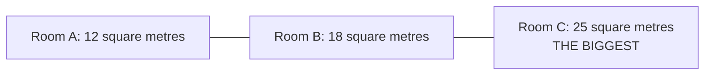

# A1-G023 · Superlative Adjectives — So sánh nhất

## Mục lục

- [A. Lesson Information](#a-lesson-information)
- [B. Warm-up](#b-warm-up-tình-huống-thực-tế)
- [C. WHAT](#c-what-so-sánh-nhất-là-gì)
- [D. WHY](#d-why-vì-sao-cần-the)
- [E. FORM](#e-form-quy-tắc-tạo-so-sánh-nhất)
- [F. HOW](#f-how-ví-dụ-phân-tích)
- [G. VISUAL](#g-visual-explanation)
- [H. COMPARISON](#h-comparison-so-sánh-hơn-và-so-sánh-nhất)
- [I. COMMON MISTAKES](#i-common-mistakes)
- [J. MEMORY TRICKS](#j-memory-tricks)
- [K. REAL-LIFE APPLICATION](#k-real-life-application)
- [L. PRACTICE EXERCISES](#l-practice-exercises)
- [M. KNOWLEDGE CHECK](#m-knowledge-check)
- [N. ANSWER KEY](#n-answer-key)

---

## A. Lesson Information

| Mục | Nội dung |
|---|---|
| **Lesson ID** | A1-G023 |
| **Topic** | Superlative Adjectives |
| **Tên tiếng Việt** | So sánh nhất |
| **CEFR Level** | A1 |
| **Prerequisites** | [A1-G022 — Comparatives](A1-G022-comparatives.md) |
| **Estimated Time** | 75 phút |

**Learning Objectives:**

1. Tạo so sánh nhất: **the + adj-est** và **the most + adj**.
2. Dùng đúng dạng bất quy tắc: *the best, the worst, the furthest*.
3. Dùng **in** + nơi chốn/nhóm và **of** + số lượng/khoảng thời gian sau so sánh nhất.
4. Dùng cấu trúc ***one of the + superlative + plural noun***.
5. Dùng ***the ... I've ever ...*** như một cụm cố định để nói về trải nghiệm.

---

## B. Warm-up: Tình huống thực tế

Một du khách hỏi bạn về Việt Nam:

> *"What's the **most exciting** city in Vietnam, in your opinion? What's the **most beautiful** place? And what's the **best** food?"*

🤔 **Hãy suy nghĩ:** Ở bài trước bạn so sánh **hai** thứ (*bigger than*). Giờ bạn so sánh **một** thứ với **tất cả** những thứ còn lại trong nhóm. Bạn có để ý mỗi câu đều có từ ***the*** không? Vì sao?

---

## C. WHAT: So sánh nhất là gì?

**Superlative** (so sánh nhất) dùng khi so sánh **một** người/vật với **cả nhóm** (thường từ ba trở lên trong bài tập cơ bản), để nói nó ở **mức cao nhất (hoặc thấp nhất)** trong nhóm.

| Tính từ | So sánh hơn | So sánh nhất |
|---|---|---|
| big | bigger | **the biggest** |
| expensive | more expensive | **the most expensive** |
| good | better | **the best** |

---

## D. WHY: Vì sao cần *the*?

Khi bạn nói "**lớn nhất**", bạn xác định vị trí cao nhất trong một nhóm đã biết. Có thể có hai đối tượng cùng đứng đầu; so sánh nhất không bảo đảm chỉ có một người/vật. Ở [A0-G012](../../01-A0-FOUNDATION/grammar/A0-G012-articles-basic.md), bạn học rằng vật **duy nhất** trong ngữ cảnh đi với ***the*** (*the sun, the moon*). So sánh nhất trước danh từ thường dùng *the* để xác định người/vật theo tiêu chí so sánh: *the biggest room in this house*. Nếu dùng *my* hoặc sở hữu cách thì không thêm *the*.



Logic tạo từ giống hệt so sánh hơn: **ngắn → -est**, **dài → the most**.

---

## E. FORM: Quy tắc tạo so sánh nhất

### E1. Bảng quy tắc

| Loại tính từ | Quy tắc | Ví dụ |
|---|---|---|
| 1 âm tiết | **the** + adj + **-est** | tall → the tall**est**, cheap → the cheap**est** |
| 1 âm tiết tận cùng *-e* | **the** + adj + **-st** | nice → the nice**st**, large → the large**st** |
| 1 âm tiết, CVC | gấp đôi + **-est** | big → the bi**gg**est, hot → the ho**tt**est |
| 2 âm tiết tận cùng *-y* | *y* → **-iest** | happy → the happ**iest**, busy → the bus**iest** |
| Nhiều tính từ 2 âm tiết và đa số tính từ 3+ âm tiết | **the most** + adj | the **most** modern, the **most** beautiful |
| Bất quy tắc | học thuộc | good → **the best**, bad → **the worst**, far → **the furthest/farthest** |

Một số tính từ hai âm tiết có dạng -est hoặc hai cách dùng: *simple → simplest*, *clever → cleverest / most clever*. Với CVC (phụ âm–nguyên âm–phụ âm), quy tắc gấp đôi áp dụng cho các từ như *big/hot*; không gấp đôi w, x, y (*newest*, không phải *newwest*). Tra từ điển khi chưa chắc, không chỉ đếm số chữ.

### E2. Cấu trúc câu

| Mẫu | Ví dụ |
|---|---|
| S + be + **the** + superlative (+ N) + **in** + nơi chốn/nhóm | *Fansipan is **the highest** mountain **in** Vietnam.* |
| ... **of** + số lượng / khoảng thời gian | *She's **the youngest of** the three sisters.* / *It was **the best day of** my life.* |
| ***one of the*** + superlative + **N số nhiều** | *Hoi An is **one of the most beautiful towns** in Asia.* |
| ***the*** + superlative + N + ***I've ever*** + V3 | *This is **the best pho I've ever eaten**.* |

> 💡 *I've ever eaten* là thì hiện tại hoàn thành (học ở [A2-G004](../../03-A2-ELEMENTARY/grammar/A2-G004-present-perfect-experience.md)). Ở A1, hãy học nguyên cụm như một mẫu cố định: *the best ... I've ever seen / eaten / had / been to*.

### E3. *in* hay *of*?

| *in* + nơi chốn, tổ chức, nhóm (danh từ số ít) | *of* + số lượng, nhóm (số nhiều), thời gian |
|---|---|
| *in the world, in my class, in the company, in the family* | *of all, of the three, of my friends, of the year, of my life* |

### E4. Có thể bỏ *the* khi...

- Sau tính từ sở hữu: *my **best** friend* (không phải *my the best friend*).
- Sau sở hữu cách: *Lan's **oldest** brother*.
- Khi tính từ sau *be* không đi kèm danh từ, đôi khi không có *the*: *Which room is biggest?* Trong mẫu *the biggest room*, vẫn cần *the* hoặc một từ xác định phù hợp.

**Ký hiệu:** S = chủ ngữ; N = danh từ; *adj* = tính từ. Với *be*: *This is the cheapest room / This isn't the cheapest room / Is this the cheapest room? — Yes, it is / No, it isn't.* Đảo/phủ định *be*, không đổi dạng *cheapest*.

---

## F. HOW: Ví dụ phân tích

Các nhận xét về “đẹp/ngon/tốt” là đánh giá của người nói trong ngữ cảnh minh họa, không phải bảng xếp hạng khách quan.

| # | English | Tiếng Việt | Phân tích |
|---|---|---|---|
| 1 | *Room C is **the biggest room in** this house.* | Phòng C lớn nhất nhà này. | Room C là S; is là V; the biggest room xác định căn phòng theo diện tích; *big* gấp đôi g; in giới thiệu phạm vi ngôi nhà. Dựa vào sơ đồ D. |
| 2 | *This is **the highest shelf in** the kitchen.* | Đây là kệ cao nhất bếp. | This + is + the highest shelf. *High* một âm tiết thêm -est; in the kitchen xác định nhóm kệ đang so sánh. |
| 3 | *This is **the most expensive restaurant in** town.* | Đây là nhà hàng đắt nhất thị trấn. | This + is + the most expensive restaurant. Tính từ dài dùng most, không thêm -est; nói về mức giá trong nhóm nhà hàng. |
| 4 | *Who is **the best student in** your class?* | Ai là học sinh giỏi nhất lớp bạn? | Who hỏi người; is + the best student xác định vị trí trong lớp. *Good → best* bất quy tắc, không dùng *goodest*. |
| 5 | *That was **the worst film of** the year for me.* | Với tôi, đó là phim dở nhất năm. | That + was nói đánh giá quá khứ; bad → worst; of the year nêu khoảng thời gian. For me làm rõ đây là ý kiến. |
| 6 | *Monday is **the busiest day of** the week at our shop.* | Ở cửa hàng chúng tôi, thứ Hai bận nhất tuần. | Monday + is + the busiest day. Busy đổi y thành i rồi thêm -est; of the week xác định nhóm ngày. |
| 7 | *Hoi An is **one of the most beautiful towns** I know.* | Hội An là một trong những nơi đô thị đẹp nhất tôi biết. | One of + the most beautiful + towns số nhiều: chọn một thành viên của nhóm; *I know* giới hạn trong trải nghiệm người nói. |
| 8 | *She's **my best friend**.* | Cô ấy là bạn thân nhất của tôi. | She + is + my best friend. *My* đã xác định danh từ nên không viết *my the best*. |
| 9 | *This is **the best coffee I've ever had**.* | Đây là cà phê ngon nhất tôi từng uống. | This + is + the best coffee. Cụm cố định *I've ever had* giới hạn so sánh trong trải nghiệm của tôi, chưa yêu cầu phân tích thì ở A1. |
| 10 | *What's **the most important thing** in life for you?* | Với bạn, điều quan trọng nhất trong cuộc sống là gì? | What + is tạo câu hỏi; important dùng most. For you cho biết tiêu chí mang tính cá nhân. |
| 11 | *He's **the oldest of my three brothers**.* | Anh ấy lớn tuổi nhất trong ba anh em trai của tôi. | He + is + the oldest; of + nhóm ba người được nêu cụ thể. Old thêm -est, không dùng *most oldest*. |
| 12 | *This is **the longest river on this map**.* | Đây là sông dài nhất trên bản đồ này. | This + is + the longest river; long thêm -est. On this map xác định phạm vi bản đồ, không khẳng định dài nhất thế giới. |

---

## G. VISUAL EXPLANATION

### Ba mức độ

| Tính từ (positive) | So sánh hơn (comparative) | So sánh nhất (superlative) |
|---|---|---|
| cheap | cheaper (than) | the cheapest |
| hot | hotter | the hottest |
| happy | happier | the happiest |
| modern | more modern | the most modern |
| good | better | the best |
| bad | worse | the worst |
| far | further / farther | the furthest / farthest |

### Thang so sánh

```text
     Car A             Car B              Car C
   200 million      500 million        2 billion
     cheap      →   more expensive  →  THE MOST EXPENSIVE
  THE CHEAPEST
```

---

## H. COMPARISON: So sánh hơn và so sánh nhất

| | So sánh hơn | So sánh nhất |
|---|---|---|
| Góc nhìn | So hai người/vật hoặc hai nhóm | Đặt một thành viên ở mức cao/thấp nhất trong cả nhóm |
| Từ đi kèm | *than* | *the* ... *in/of* |
| Ví dụ | *Room B is **bigger than** Room A.* | *Room C is **the biggest** room **in** this house.* |

**Quy tắc ra quyết định:** Xem ý định so hai đối tượng hay chọn mức cao nhất trong nhóm. *Than* thường đi với so sánh hơn; *in/of* giúp nêu phạm vi nhưng không tự quyết định dạng tính từ. Với hai đối tượng, bài tập cơ bản ưu tiên *the taller of the two*; trong lời nói vẫn có thể gặp so sánh nhất cho nhóm hai.

### *the most* và *most* (không có *the*)

| | |
|---|---|
| ***the most** beautiful* | đẹp nhất (so sánh nhất) |
| ***most** people* | hầu hết mọi người (lượng từ) |

---

## I. COMMON MISTAKES

| # | ❌ Sai | ✅ Đúng | Nguyên nhân | Cách tránh |
|---|---|---|---|---|
| 1 | She is **tallest** girl in the class. | She is **the tallest** girl... | Quên *the* | Trước danh từ dùng *the* hoặc từ xác định phù hợp như *my* |
| 2 | **the most tallest** | **the tallest** | Dùng cả hai | Chọn một |
| 3 | the **goodest** | **the best** | | Bất quy tắc |
| 4 | the biggest city **of** Vietnam | the biggest city **in** Vietnam | | Nơi chốn → *in* |
| 5 | one of the most beautiful **city** | one of the most beautiful **cities** | | *one of* + **số nhiều** |
| 6 | **my the best** friend | **my best** friend | | Có *my* → bỏ *the* |
| 7 | the **hotest**, the **happyest** | the **hottest**, the **happiest** | Chính tả | |
| 8 | He is the best **than** all students. | He is the best **of** all the students. | Trộn *than* | So sánh nhất không dùng *than* |

---

## J. MEMORY TRICKS

1. **"The — vương miện của người chiến thắng"** 👑: Trước danh từ, thường dùng *the*; *my/Lan's* có thể thay vị trí đó. Đây là mẹo hỗ trợ, không phải quy tắc mọi so sánh nhất đều có *the*.
2. **"-er/-est, more/most"**: Hai cặp song song — *-er* đi với *-est*, *more* đi với *most*.
3. **"In chỗ, Of nhóm"**: *in* + nơi chốn (*in the world*), *of* + nhóm/thời gian (*of the three, of the year*).
4. **"One of — luôn số nhiều"**: "Một trong **những**..." → danh từ số nhiều.

---

## K. REAL-LIFE APPLICATION

### Hội thoại: Giới thiệu Việt Nam cho du khách

> **Tourist:** What's **the biggest** city in Vietnam?
> **Mai:** For me, Ho Chi Minh City. It's **the most exciting** city I've visited.
> **Tourist:** And what's **the most beautiful** place, in your opinion?
> **Mai:** That's difficult! Ha Long Bay is **one of the most famous** places. But for me, Ha Giang is **the most beautiful** — the mountains are amazing.
> **Tourist:** What's **the best** time to visit?
> **Mai:** Autumn is probably **the best** season in the north. Summer is **the hottest**, and the rainy season can be **the worst** time for travel in the south.
> **Tourist:** And **the best** food?
> **Mai:** Oh, easy — bun cha! It's **the most delicious** dish I've ever eaten. Well... after my mum's spring rolls!

**Vietnamese explanation:** Mai giới thiệu: với Mai, TP.HCM là thành phố thú vị nhất cô từng thăm; Vịnh Hạ Long là một trong những nơi nổi tiếng nhất, nhưng với Mai, Hà Giang đẹp nhất. Mùa thu là thời điểm tốt nhất để thăm miền Bắc. Món ngon nhất: bún chả — sau món nem của mẹ Mai!

**Useful expressions:** *in your opinion* (theo ý bạn) · *That's difficult!* · *for me* (với tôi) · *probably* · *Oh, easy!*

---

## L. PRACTICE EXERCISES

> ✍️ Đáp án: [A1-G023-ANSWERS](../../12-ANSWERS-AND-EXPLANATIONS/A1/A1-G023-ANSWERS.md)

### Level 1 — Recognition

**L1.1.** Mount Everest is ___ mountain in the world.  A. the higher  B. the highest  C. highest
**L1.2.** This is ___ book I've ever read.  A. the most interesting  B. the more interesting  C. most interesting
**L1.3.** Who is the oldest ___ your family?  A. of  B. in  C. than
**L1.4.** It was the best day ___ my life.  A. in  B. of  C. than
**L1.5.** In my opinion, these are some of the most beautiful ___ in Asia.  A. city  B. cities  C. a city
**L1.6.** She's ___ friend.  A. my the best  B. the my best  C. my best

### Level 2 — Controlled Practice

Viết dạng so sánh nhất (có *the*):

**L2.1.** cheap / large / thin / easy
**L2.2.** bad / good / far / dangerous

Hoàn thành câu với dạng so sánh nhất và *in/of* khi cần:

**L2.3.** August is (hot) ___ month ___ the year here.
**L2.4.** This is (comfortable) ___ chair ___ the house.
**L2.5.** Nam is (funny) ___ person ___ our team.
**L2.6.** That was (bad) ___ meal I've ever had.
**L2.7.** The cheetah is (fast) ___ land animal ___ the world.
**L2.8.** Which is (popular) ___ sport ___ Vietnam?

Chọn so sánh hơn hoặc so sánh nhất:

**L2.9.** My sister is (young) ___ than me, but my brother is (young) ___ of the three of us.
**L2.10.** This hotel is (good) ___ than the one we stayed in last year. Actually, it's (good) ___ hotel in the city.

### Level 3 — Error Correction

**L3.1.** He is tallest boy in my class.
**L3.2.** This is the most cheapest phone in the shop.
**L3.3.** She is one of the best student in the school.
**L3.4.** It's the bigger city of the country.
**L3.5.** Mai is my the best friend.
**L3.6.** That was the worse film I've ever seen.

### Level 4 — Production

Dịch sang tiếng Anh:

**L4.1.** Đây là con sông dài nhất trên bản đồ này.
**L4.2.** Thứ Sáu là ngày tuyệt nhất trong tuần.
**L4.3.** Đà Lạt là một trong những thành phố lãng mạn nhất Việt Nam. (*romantic*)
**L4.4.** Đây là ly cà phê ngon nhất tôi từng uống. (*I've ever had*)
**L4.5.** Ai là người hài hước nhất trong gia đình bạn? (*funny*)

### Level 5 — Real Communication

**L5.1.** Viết đoạn văn 80–100 từ: *My country/my city — the best and the worst*. Dùng ít nhất 6 cấu trúc so sánh nhất (có *one of the..., the best... I've ever...*) và 2 cấu trúc so sánh hơn.
**L5.2.** **Speaking — Superlative quiz about you:** Trả lời to (1–2 câu mỗi câu): *What's the best film you've ever seen? Who's the funniest person you know? What's the most difficult thing about learning English? What's the most beautiful place you've ever been to? What's the worst food you've ever eaten?*

---

## M. KNOWLEDGE CHECK

### 5 câu hỏi tự kiểm tra

1. So sánh hơn và so sánh nhất khác nhau về số đối tượng thế nào?
2. Viết so sánh nhất của *hot, happy, good, bad, expensive*.
3. Khi nào dùng *in*, khi nào dùng *of* sau so sánh nhất?
4. Vì sao *one of the best student* sai?
5. Khi nào bỏ được *the* trong so sánh nhất?

### Checklist

- [ ] Tôi chọn được *the* hoặc từ sở hữu khi so sánh nhất đứng trước danh từ.
- [ ] Tôi dùng *one of the + số nhiều* đúng.
- [ ] Tôi giới thiệu được "nhất" của thành phố/đất nước mình.

### 3 lỗi quan trọng cần nhớ

1. ~~tallest boy~~ → **the** tallest boy.
2. ~~the most cheapest~~ → **the cheapest**.
3. ~~one of the best student~~ → one of the best **students**.

### Lịch ôn tập

| Ngày | Việc cần làm |
|---|---|
| Ngày 1 | Làm lại L2 |
| Ngày 3 | Viết 5 câu "nhất" về gia đình bạn |
| Ngày 7 | Trộn A1-G022 và A1-G023: so sánh 3 điện thoại/3 quán ăn bạn biết |

### Liên kết

- 🎉 **Đây là bài ngữ pháp cuối cùng của A1!** Tiếp theo: [A1 Communication](../A1-COMMUNICATION.md) → [A1 Skills Practice](../A1-SKILLS-PRACTICE.md) → [A1 Exit Test](../../11-EXAMS-AND-ASSESSMENTS/A1-EXIT-TEST.md)
- 🎯 **Mini Challenge khối A1-5:** so sánh hai thành phố bạn biết — xem [A1 README](../README.md#5-mini-challenges)
- 🔜 [A2-G027 — Comparisons](../../03-A2-ELEMENTARY/grammar/A2-G027-comparisons.md)

---

## N. ANSWER KEY

👉 [A1-G023-ANSWERS.md](../../12-ANSWERS-AND-EXPLANATIONS/A1/A1-G023-ANSWERS.md)


Đối chiếu cách tạo dạng và sử dụng: [Cambridge — Comparison: adjectives](https://dictionary.cambridge.org/grammar/british-grammar/comparison-adjectives-bigger-biggest-more-interesting-most-interesting). Ví dụ và bài luyện trong bài được biên soạn riêng.
